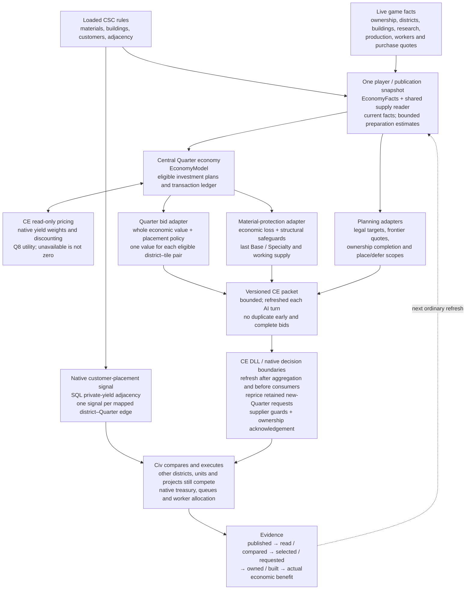

# CSC AI architecture

The target is one shared account of a Quarter economy, with adapters that offer
its value at the decisions Civ actually makes. Civ retains legality, competition,
production, purchases and execution. We do not order a city to build a chain.

This implements the architecture agreed on 6 November (commit `057d4c55`). The
13 November revision covers **Problems 1.1–1.8 and 2.1–2.2**. It replaces the
Quarter's forecast at the late district-value boundary, rather than trying to
reconstruct and subtract each of Civ's modifier-interpreter mistakes.

**Revision status, 13 November:** corrected source passes 243 native checks and
25 economy tests, with Astra review and controlled delivery qualification.
The normal Online game to turn 250 run completes: 57 exact new-site comparisons; all seven
AI-founded Quarters have Base and actual +3 or better at turn 250. Held Quarters drop
26 to 9 (two weak captures), with two operating Bakers Stage 2 chains and no
Tailors Stage 2 chain. This verifies placement selectivity in one world, not
all follow-through, building, Builder or Service capabilities.
[Full outcome and limitations](../research/mods/csc-ai-quality-placement-250-20261113.md),
[implementation and corrected assumptions](../research/mods/csc-ai-managed-placement-20261113.md).

## From the world to a decision

Read the central box as an economic ledger, not another controller. It records
who supplies whom, which buildings must exist, when a transaction could start,
who receives the yield, and whether it is tile income or city income. A decision
adapter asks a particular question of that ledger. A native system is preferable
where the game already exposes a suitable input, as with customer adjacency.

## Where the code lives

The active economic families are Bakers and Tailors. The shared pipeline is
reusable; the other six Quarters still need their gameplay/economic definitions
and acceptance data. All reusable CSC policy is in `Civ Supply Chains/Lua_UI/AI/`:

| Layer | Files and responsibility |
|---|---|
| UI read boundary | `Lua_UI/Adjacencies/CSC_AdjacencyUI.lua`: raw invoices and UI-only cost/yield/research reads return scalars/plain records; the older exclusive-buyer screen stays separate. |
| Live facts | `CSC_AI_EconomyFacts.lua`: loaded definitions, completed customer footprints, actual buildings, research paths, construction estimates, supplier observations and per-publication caches. |
| Central rules | `CSC_AI_EconomyModel.lua`: transaction recipients, population rounding, exclusive producers, prerequisite and queue timing, bounded optional investment plans, recurring yields and marginal loss. No game writes. |
| Economic decisions | `CSC_AI_EconomyAdapters.lua`: native pricing, complete Quarter bids, weak-site policy and material-loss quotes. Managed types defer unquoted/unknown sites; unavailable economic capability retains the older policy explicitly. |
| Placement preparation | `CSC_AI_AdjacencyScan.lua`: adjacency, viable present/future footprints, quoted frontier options and poor-site/deferral facts. Future customer space can establish feasibility; it earns no speculative customer yield. |
| Existing chain decisions | `CSC_AI_QuarterPlacement.lua`: shared suppliers/chains, material deductions, exclusions, supplier acquisition, Builder and building/repair offers. Economic loss enriches protection; structural safeguards remain. |
| Publication | `CSC_AI_BakersGameplay.lua`: despite its historical name, coordinates Bakers and Tailors; refreshes and publishes one bounded packet, then reads receipts. |
| Transport | `CSC_AI_DistrictBridge.lua`: validates and publishes typed CE entries atomically. Complete Quarter bids are exclusive with the old early score adjustment for the same pair. |
| Native database input | `Data/CSC_AI_Connectors.sql`: moderate private-yield adjacency for mapped customer districts, with replacement expansion and edge deduplication; also retains the existing modest Builder controls. |
| CE mechanism | Isolated CE feature branch `codex/quarter-value-delivery`: managed-type defaults, consumer refresh, retained-request repricing and native economic quotes. CSC rules do not belong in CE. No upstream PR is submitted. |

The adjacent Builder, building, research and recovery problems remain distinct
roadmap capabilities. Keeping their working adapters does not mean the new
economic bid has solved those capabilities or priced every Service.

## Coverage of all ten sub-problems

| Problem | Model or shared fact | Decision path |
|---|---|---|
| **1.1 Materials** | Actual mapped Base/Specialty, viable improvements, working supply and tile staffing. | Quarter economic bid plus existing material-aware planning. |
| **1.2 Neighbors** | Completed mapped customer footprints and eligible future buildings; feasible future footprints remain preparation facts. | Quarter transaction ledger; no yield credited to an unbuilt customer district. City Lights mappings follow loaded rules; unsupported contracts fall back. |
| **1.3 Rivers** | Loaded river adjacency and one eligible local Mill; Wind terrain and Water river edges are alternatives. | Direct adjacency now and producer-terrain income only after its Mill. |
| **1.4 Adjacency** | Current materials, terrain and completed customers; alternative Mill geometry. | Same economic bid across sites, with a +3 minimum and bounded +3/+4/+5/+6+ preference bands for profitable alternatives. +4 is a preference, not a compulsory order. |
| **1.5 Tile purchase** | Native quoted footprint cost and credible supply; separate supplier-acquisition facts. | Frontier bid, native savings/payment, intended-city ownership acknowledgement and supplier purchase route. No subsidy or direct purchase is introduced. |
| **1.6 Follow-through** | Unlock estimates, native legal targets and population-limited capacity. | Native district comparison → request/tree → foundation → completion. Retained new-Quarter request values are repriced through the native tracked setter; reservations, queues and existing foundations/repairs remain native. |
| **1.7 Place or defer** | Whether a credible Base/customer path exists, with unknown distinguished from absent. | Negative managed default plus sparse positive offers. Nonpositive new investments are withheld during native placement selection; fresh facts can promote them next turn. |
| **1.8 Poor placement** | Missing Base, covering mapped materials, absent customer path and low realised adjacency. | Complete Quarter valuation, +3/no-Base gate and bounded profitable-site preferences; actual native choice and foundation quality qualify suppression. |
| **2.1 Customer placement** | Shared customer registry and district replacement families. | Native SQL private-yield adjacency for ordinary mapped districts; bounded future-footprint guidance stays in its existing adapter. City Center settlement and Wonder placement are separate consumers. |
| **2.2 Material protection** | Shared retained chains, last viable/working Base or Specialty, marginal lost transactions. | Existing district deductions and qualified native exclusion, Wonder and destructive-Builder guards. Economic quotes enrich rather than replace structural protection. |

This table is a code/ownership map, **not ten new completion claims**. For the
evidence and remaining native acceptance checks, read [current status](STATUS.md)
and the [numbered roadmap](roadmap.md).

## Timing, units and boundaries

The ordinary turn refresh creates one player snapshot. Static rules persist;
ownership, research, staffing, construction and quotes expire with the snapshot.
Raw invoices price all known frontier alternatives. Positive purchase guidance
still requires an unambiguous intended buyer; otherwise the complete bid is at
most zero. The CE ownership hook recognises an already-correct purchase and does
not choose Economic's buyer. Civ retains plans, reservations and execution; the managed request adapter refreshes the value of new-Quarter requests.

CE publishes a new version atomically and consumes entries when its native
decision runs. A packet is neither a reservation nor a construction command.

Recurring amounts are ordinary yield per turn. CE prices them in native **Q8
utility** (256 integer units per utility unit), using native yield weighting and
discounting. The initial model uses a 50-turn window and a 4.0 discount parameter;
these are explicit calibration assumptions. Purchase Gold is a fixed invoice,
not recurring upkeep. Production costs delay serial construction; they are not
also subtracted using an invented universal conversion.

Optional later construction must not reduce the best feasible Quarter plan.
Only one Mill is counted. Population payouts follow the gameplay registry and
receiving-city rounding. Improved but unworked material tiles feed a producer
without earning assumed citizen-worked tile payouts. The bid includes observed
worked-footprint income displaced by the new Quarter.

The ledger is deliberately incomplete: future specialists, trade-route changes,
Service-specific premiums and perfect empire-wide construction scheduling are
not priced. It supports the current unit-transfer contract and checks the loaded
leaf amounts; a changed unsupported contract is reported rather than guessed.
City Lights and other optional integrations require their own acceptance data.

For a managed Quarter type, unknown or omitted sites receive a negative default,
not an untouched native building premium. The adapter quotes revealed owned
and frontier radius-three potential without requiring a current BUILD menu
entry. Native eligibility, invalid sentinels and legality remain authoritative.
Sparse positive offers can be trimmed at capacity while retaining the defaults;
material protection keeps precedence. Missing economic capability is separately
logged and keeps the established non-economic path rather than claiming whole
valuation. Existing district foundations/repairs are outside new-investment
ownership, determined from the actual city district collection. Row+50 is
improvement presence; row+51 omits incomplete/pillaged districts. Neither
cached flag is an adequate exemption.

CE refreshes the matrix after aggregation and immediately before joint selection,
type-specific location selection and present-value reads. A reserved tile can be
priced: Civ still applies its reservation thresholds. GetBest can choose negative
scores, so nonpositive managed new investments are temporarily masked and every
byte restored afterwards. Location also respects critical supplier exclusions.

Native UnitRequestContract.Update keeps max(previous,current). An additional
post-update adapter rebases only managed new-Quarter requests through the native
tracked-value setter. Building/unit branches, invalid updates and existing
footprints remain native. Locationless requests use the native zero-floored
column maximum, with an existing-Quarter guard. This changes the offer, never
creates a request or cancels a reservation.

The initial preference estimates are96/192/288/384 native utility for profitable
+3/+4/+5/+6+ alternatives, plus16 for both material classes. They cannot make a
loss-making investment positive. Mill alternatives are ranked on the final
placement bid, so a profitable Wind+3 option can beat an earlier Water+2 option.
These bands need outcome calibration; they are not inferred exact vanilla prices.

Each native pass is bounded to37 rows and at most16 managed types per player.
No hook calls Lua. Counters distinguish delivery, masks, reserved-cell writes and
retained-request changes and report native processing time. Managed samples are
lossy/bounded (2048 per packet), separate from legacy write budgets and reserve
half the core journal for other evidence. Dropped samples are explicit; missing
samples must not be called absence of delivery. Performance and actual native
consumption remain live qualification requirements for this candidate.

## How we judge a change

Separate the layers of evidence: a ledger can be correct while an offer is never
consumed; a consumed offer can lose; a winning request can wait; a completed
building can still lack supplies or customers. Diagnostics and controlled tests
must identify the layer reached. Outcome games use only main CSC tuning, the
shared controller and pinned packages. Their results determine calibration and
remaining weaknesses; the diagram alone proves none of those outcomes.

### Initial runtime qualification

The fresh three-turn smoke (`csc-ai-economy-20261113/smoke03`) qualified native
pricing for all five AI cities and restored preferences/packages with exit0.
Both pricing and final interfaces reported ready. **No complete economic bid
was demonstrated:** Quarter readiness was unavailable, so established guidance
remained active. That result exposed the fact-binding gap; the next revision
adds explicit UI-only numeric reads and separates raw invoices from the
exclusive-buyer screen. The corrected 30-turn window demonstrates repeated
complete bids and native consumption; the final review revision repeats the
native acceptance in a fresh 3-turn smoke with 16 exact write/cache/comparison
receipts. [Full audit](../research/mods/csc-ai-central-economy-20261113.md).
Neither window establishes improved placement or Services.

### First long outcome test

The completed normal Online250 run confirms continued publication and native
consumption, but not the intended placement quality: 26 completed Quarters,
8 currently at +3 or better, 4 at +4 or better, one active Bakers Stage 2 chain
and no Tailors chain. Readiness and architecture coverage are not outcome
closure. The next diagnostic records foundation/completion geometry and the
actual native winning score, separating retained-plan timing from valuation
and later material loss. [Measurements and limitations](../research/mods/csc-ai-economy-250-20261113.md).
