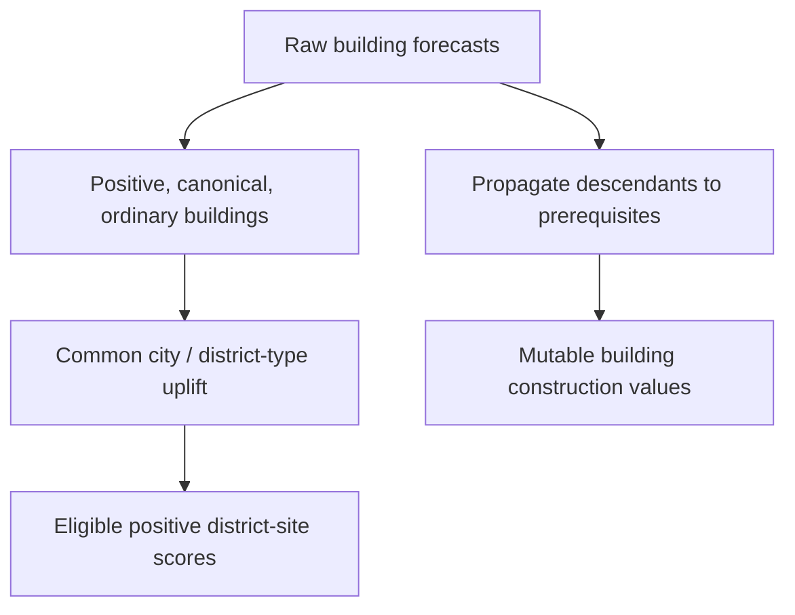
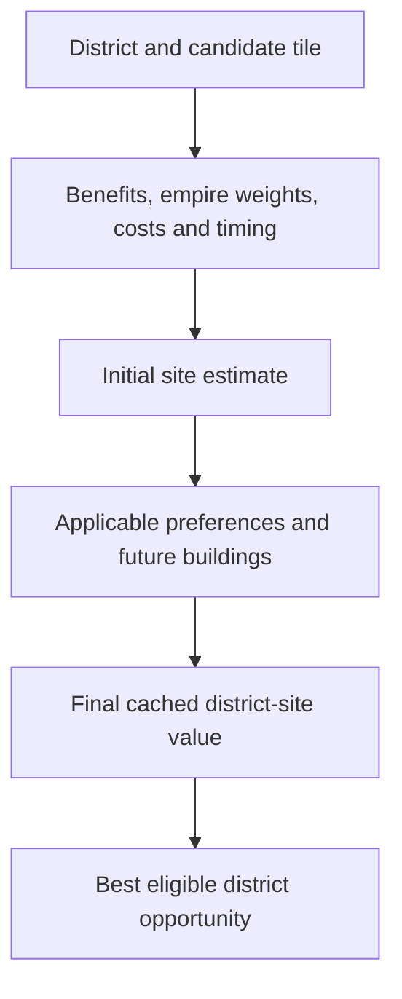
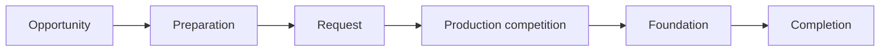

# How the AI decides

A district is both a place on the map and an investment in future capabilities. Civ VI considers those together, then passes its preferred opportunity through preparation and production systems. A high site score is an early step, not a construction order.

## Find possibilities

Each city has score storage for its center and tiles within three rings, across district types. A storage slot does not make an option legal. The evaluator checks the player’s available district types, terrain, revealed land, city assignment and other restrictions.

It can consider some districts before their technology or civic is ready, allowing for the expected delay. It can also consider revealed unowned land; an eligible frontier site may lead to a tile-purchase request. Our simple CSC scanner currently covers a narrower set of owned, city-assigned sites.

Buying land for a resource can happen separately. Each city's analysis
picks one frontier resource tile for the routine purchase pass. The
treasury and buying city still decide whether that purchase can go through.

## Value the investment

Adjacency enters a broader estimate containing supported yields and effects, empire-dependent yield weights, construction and research delays, maintenance, land costs and competing uses of the plot. The same yield can matter differently to different empires or at different times.

If the tile has an intact improvement, Civ deducts its estimated remaining value
from the turn the district is expected to be ready. For a farm that can include
its Food, its own adjacency and Housing. A pillaged improvement skips that debit.
[How the improvement is valued](../topics/native/district-score-anatomy.md#what-does-it-cost-to-replace-an-improvement).

The selector also has a reserved score for an invalid option. A
finite penalty can still leave a site in contention. The two
placement searches and any existing request each have their own
checks, so excluding a new option depends on where the rule enters.

Future buildings contribute too. The inspected path adds a city-wide estimate for that district type to eligible positive site scores. It does not independently simulate a complete, site-specific building chain on every tile.

The new CSC capture makes another distinction concrete: **raw building values
help value a district; descendant-propagated building values help value its
construction chain**. A Textile Workshop can have a negative own forecast yet a
strongly positive construction value after Tailor and Fashion House are included.
Its negative own value is omitted from the district sum, while those positive
later buildings still contribute.

Hidden `MustPurchase` buildings are excluded from the direct district sum.
That does not exclude every prerequisite relationship: a zero-own-value River
Access flag receives Water Mill value in the mutable vector.
[Measured building ledger](../../research/mods/csc-ai-mill-building-study-20261105.md).

The numbers are **utility**, not raw yields or Gold. Internally, 256 stored units represent one utility unit. A million stored units does not mean a million Production—and precision does not guarantee an accurate forecast.

A city can forecast a building each turn and compare it as an ordinary
candidate only when its planning slot opens. The production queue is
separate. In Kőszeg, the Lighthouse kept getting forecasts between
comparisons, and the city eventually bought it while producing a unit.
[Lighthouse replay](../../research/mods/csc-ai-shared-stage-two-fractal-20261108.md#lighthouse-follow-through).

## Turn an opportunity into work

The district winner can start a preparation tree: obtain research or land, reserve the location and offer a construction request. That request has its own state and value.

This matters when we change a score. The inspected update can retain the **higher of the request’s old value and the current estimate**. Lowering today’s site score does not necessarily retract yesterday’s commitment. An existing preparation tree can also delay admission of a new district proposal.

## Compete for production

When a city’s queue is empty, the selector considers offered contracts alongside applicable unit and project alternatives. Buildings enter its ordinary fallback choice. A new district winner does not automatically interrupt a busy queue. In our controlled Tailors example, the city finished its Bomber before selecting the Quarter request.

## Several clocks, rather than one planning stack

Fresh city analysis ordinarily runs on a per-turn, readiness-gated cycle and can involve worker jobs. Proposal creation, request updates, production selection and purchases have their own gates. A global turn-start event is not a guarantee that every city’s new analysis has finished.

We trace those stages separately. A score change, selected request, completed Quarter and working supply chain answer different questions.

**Continue:** [Steering the AI](steering-the-ai.md).

Technical evidence: [score anatomy](../topics/native/district-score-anatomy.md), [district choice](../topics/native/district-choice.md), [requests and production](../topics/native/production-and-prerequisites.md), and [timing and purchases](../../research/mods/civ6-district-cache-timing-and-purchases-20261104.md).
