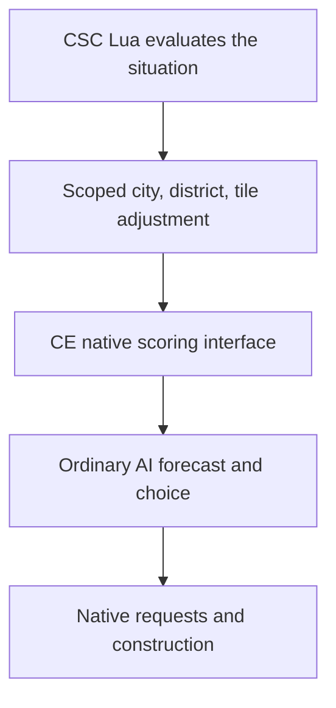
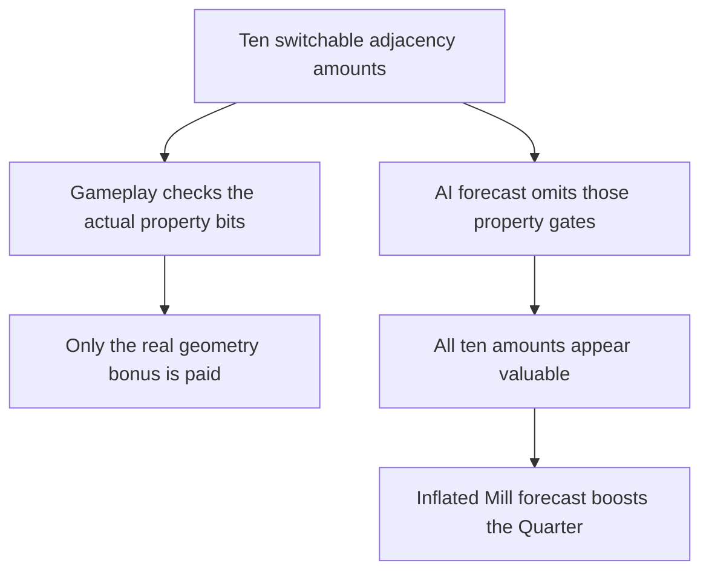

# Steering the AI

Our new interface lets a mod change how valuable the AI thinks a specific district-site opportunity is. The AI then chooses and executes work through its own systems. The policy can be sophisticated Lua; the native hook applies a checked numerical adjustment at the identified scoring boundary.

## Why this is useful

An ordinary preference can encourage a district type broadly. A per-site adjustment can express a local relationship:

- This Bakers site has useful materials and customers nearby.
- This alternative destroys material the producer would need.
- This investment could serve an empire need, but needs development first.
- A native forecast credits a benefit whose CSC conditions are missing.

These are possible inputs, not all implemented behaviours. Our current rule is much simpler: promote one good adjacency option per city and softly penalise weak ones.

The interface changes valuation. It does not directly place a district, clear a production queue, grant Gold or guarantee that a lower-scored option cannot win.

## What we have demonstrated

| Demonstration | What it establishes | What it leaves open |
| --- | --- | --- |
| A small adjustment reached the cache, winner and new request | Delivery through several decision stages | A better choice or construction |
| Sydney switched from Neighborhood to Tailors at the same tile, then naturally completed it | A caused district-type choice change and follow-through in that case | A better site, profitable chain or general improvement |
| Packaged Lua + CE fork completed Online100 with 101 matching policy plans and all four diagnostic families | A bounded development carrier without a Python/Frida policy worker | Release compatibility, economic benefit and historical outcome parity |

The Online100 journal recorded 73 increases and 14,584 deductions with zero reported native API faults. These are implementation counts, not a measure of intelligence. The [parity report](../../research/mods/csc-ce-policy-parity-20261104.md) preserves the conditions and limitations.

## Why Community Extension needs a change

### A concrete reason to inspect the forecast

Our latest observation found that a Mill supplies over 99.8% of two weak Bakers sites’ future-building uplift. The main term is an adjacency encoding artifact: the hypothetical evaluator credits all ten switchable modifier magnitudes without their gameplay property gates. Those yields are not actually paid in the game.

This is the kind of relationship-aware steering we want: identify the specific false forecast, preserve real building benefits, and let the AI reconsider the investment. We have measured the error; a corrected-choice demonstration remains future work. [Read the component breakdown](../../research/mods/csc-ai-bakers-forecast-components-20261104.md).

### The release arrangement

The released CE we tested has memory tools, but lacks this typed scoring interface. Our fork adds the native hook, numeric batch publication, scope and version checks, context reset and diagnostics. Keeping those responsibilities native avoids calling arbitrary Lua from the scoring worker.

The preferred release arrangement is **CSC supplies Lua policy → released CE supplies the native capability**. The earlier master-based draft PR is closed. We are preparing a focused `develop`-based API contribution using CE’s existing build, with clearer code comments and a fresh qualification step. Its final scope will be reviewed with Henno before another PR. Until acceptance and release, we need the development fork; stock CE lacks the tested implementation. [Current port and remaining checks](../../research/mods/csc-ce-develop-port-20261105.md).

## Keep steering meaningful

The native forecast already includes useful benefits and costs. Adding our entire economic estimate on top would count some things twice. We need a ledger of what is represented, what is approximated poorly and what is missing. Then we can apply a justified correction and test the decision.

**Continue:** [Teaching it CSC](teaching-it-csc.md).

Technical references: [native extension](../topics/native/native-placement-extension.md), [Workshop and CE delivery](../topics/native/workshop-delivery.md), and [controlled choice and completion](../../research/mods/civ6-district-placement-choice-20261103.md).
