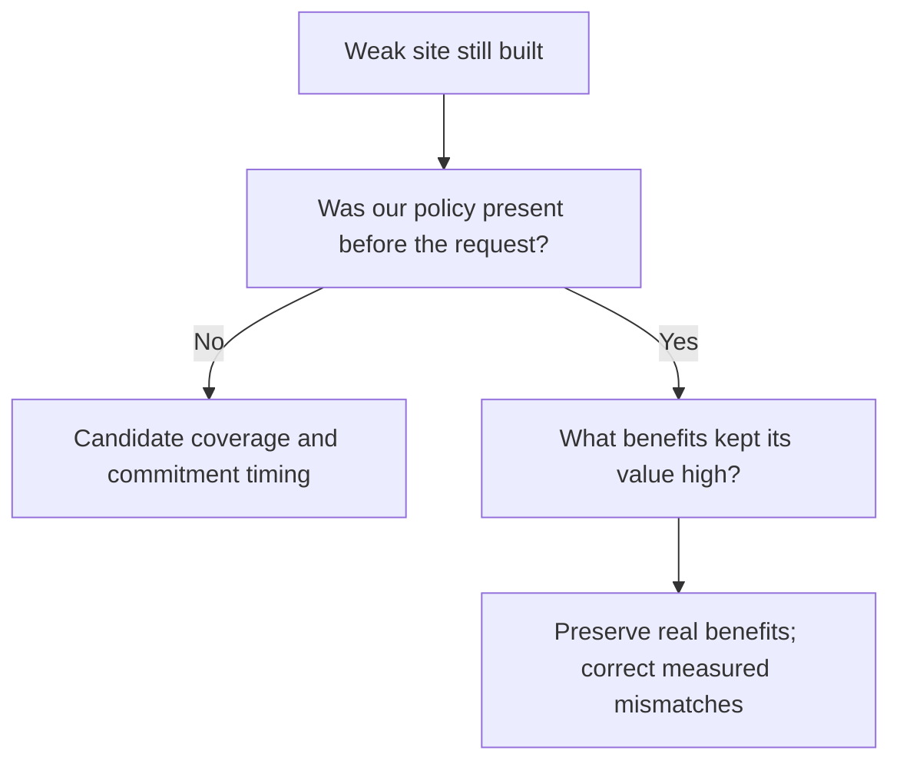

# Teaching the AI Civ Supply Chains

The objective is **worthwhile, durable supply chains that serve the empire**. More Quarters are not enough. A Quarter can be well placed but never developed, or fully built but poorly matched to materials and customers.

## Explain a good opportunity

| Question | What we need to distinguish |
| --- | --- |
| Materials | Working supply, a credible improvement plan, and a resource that merely happens to be nearby |
| Customers | Useful current recipients, missing customer buildings, and specific legal future district spaces |
| River and other adjacency | The exact designed rule, including the appropriate conditional first Mill |
| Development | Producers, customers, Builder work, unlocks, delays and maintenance |
| Alternatives | Lost tile use, competing districts, current commitments, and developing an existing chain |
| Empire needs | Whether the outputs and eventual Services help this empire now or later |

Ordinary sales and Service supply gates differ. Missing a full chain does not make every partial benefit zero. A conditional future benefit is not current income.

## The current experimental rule

For Bakers and Tailors, the policy scans eligible sites and calculates designed Production plus Gold adjacency, including rivers and the planned appropriate first Bakers Mill. It promotes the highest qualifying pair in each city at **+4 combined adjacency or better**. Sites that would destroy an on-site material are not positively promoted.

The second version also applies a graded deduction to observed sub-4 pairs. It is a soft preference, not a ban. Combining Production and Gold was an explicitly chosen first test, not an established universal exchange rate.

In the earlier soft-penalty game, four below-4 Quarters still founded. Two exposed a timing/coverage gap; two received large later native value. Those are specific questions, rather than a reason to keep increasing a blanket penalty.

## Why both Mills were overvalued

CSC inherited MAB’s general approach of encoding a number with conditional amounts 1, 2, 4, …, 512. The AI omits the property gates and forecasts every amount. **Water has the same problem as Wind.** Their large values differ because the forecast discounts different development delays; a separate mutual-exclusion rule makes Wind the Mill added to the district total in our captured cases.

Our actual rules need far less range:

| Bonus | Real range |
| --- | --- |
| Wind, on the Quarter’s own hills tile | 0 or 1 Production |
| Water, one Production per two river edges | 0–3 Production |
| Each current neighboring-resource/district rule | 0–6 yield |

The source now keeps the matcher and UI while using **one conditional +1 switch for Wind and three +1 steps for Water**. The generic encoding for other rules is unchanged. Each Mill enables only its own functioning Quarter; the previous remote activation came from CSC omitting MAB’s explicit city-scope setting. Focused offline SQL/Lua checks cover the repair. It has not been installed or tested in-game.

This removes the huge encoding capacity but does not make the AI understand a condition it currently skips. Our scanner still deliberately evaluates the appropriate planned first Mill as a future benefit, separately from actual current income. Native yield, forecast and save checks remain pending. [Read the implementation](../../research/mods/csc-ai-local-mill-unit-steps-20261104.md).

## Hidden eligibility markers are not economic development

The hidden River Access markers are another implementation detail the AI can
misread. They automatically gate Water Mill availability and have no economic
output or direct district-score contribution in our capture. Their prerequisite
and exclusion links nevertheless affect native forecasting. Current gameplay
also permits Wind on river sites; it only forbids Water off-river and owning
both Mills. We should preserve real availability while separating free markers
from investment value. [Read the logic audit](../../research/mods/csc-ai-river-access-flags-20261104.md).

## The richer planner is a separate review tool

An offline Tailors evaluator compares 44 copied cases using explicit yield, cost, timing and development assumptions. It explains when developing an existing Quarter becomes attractive and how that changes with the horizon or construction costs.

It is **not** the active native policy, and its partial review utility is not native utility. Services, empire priorities and competing land uses need fuller treatment. Try the [interactive comparison](https://hennogous.github.io/Henno-Mods/ai/static/site-planner-review.html) to explore its assumptions.

## Placement is the first decision

After a good foundation, the AI still needs to improve and preserve materials, construct producers and customers, repair damage and choose useful Services. We will address those paths where evidence shows a failure. Retired tuning, subsidies and scripted foundations are not defaults for this approach.

The Bakers investigation found a dominant mismatch: the native Mill forecast credited all ten generated adjacency encoding bits without their gameplay gates. The new source representation addresses that capacity while preserving real amenities, exchanges and investment constraints. The policy’s +4 promotion and soft deduction are unchanged; the resulting native forecast and choices still need measurement.

**Continue:** [What we’re investigating](what-next.md).

Evidence and design: [site-planner reference](../topics/csc/site-planner.md), [confirmed objectives](../../integrations/csc-ai-objectives.md), [soft-penalty cases](../../research/mods/csc-ai-placement-penalties-20261103.md), and [modifier forecast limitations](../topics/native/modifier-forecasts.md).
