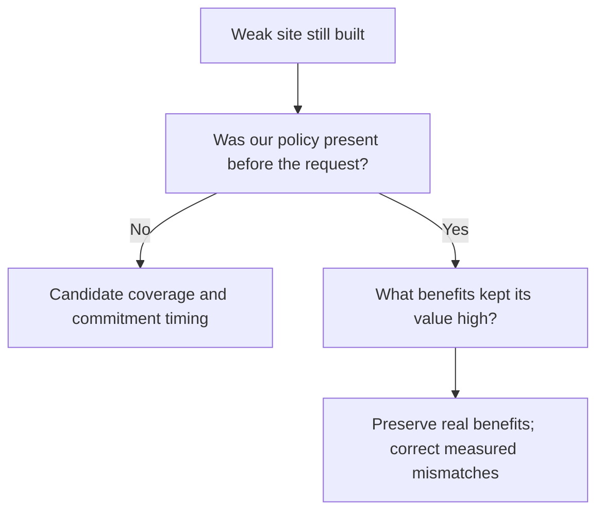

# Teaching the AI Civ Supply Chains

The objective is **worthwhile, durable supply chains that serve the empire**. More Quarters are not enough. A Quarter can be well placed but never developed, or fully built but poorly matched to materials and customers.

## Explain a good opportunity

| Question | What we need to distinguish |
| --- | --- |
| Materials | Working supply, a credible improvement plan, and a resource that merely happens to be nearby |
| Customers | Useful current recipients, missing customer buildings, and specific legal future district spaces |
| River and other adjacency | The exact designed rule, including the appropriate conditional first Mill |
| Development | Producers, customers, Builder work, unlocks, delays and maintenance |
| Alternatives | Lost tile use, competing districts, current commitments, and developing an existing chain |
| Empire needs | Whether the outputs and eventual Services help this empire now or later |

Ordinary sales and Service supply gates differ. Missing a full chain does not make every partial benefit zero. A conditional future benefit is not current income.

## The current experimental rule

For Bakers and Tailors, the policy scans eligible sites and calculates designed Production plus Gold adjacency, including rivers and the planned appropriate first Bakers Mill. It promotes the highest qualifying pair in each city at **+4 combined adjacency or better**. Sites that would destroy an on-site material are not positively promoted.

The second version also applies a graded deduction to observed sub-4 pairs. It is a soft preference, not a ban. Combining Production and Gold was an explicitly chosen first test, not an established universal exchange rate.

In the earlier soft-penalty game, four below-4 Quarters still founded. Two exposed a timing/coverage gap; two received large later native value. Those are specific questions, rather than a reason to keep increasing a blanket penalty.

## Why both Mills were overvalued

CSC inherited MAB’s general approach of encoding a number with conditional amounts 1, 2, 4, …, 512. The AI omits the property gates and forecasts every amount. **Water has the same problem as Wind.** Their large values differ because the forecast discounts different development delays; a separate mutual-exclusion rule makes Wind the Mill added to the district total in our captured cases.

Our actual rules need far less range:

| Bonus | Real range |
| --- | --- |
| Wind, on the Quarter’s own hills tile | 0 or 1 Production |
| Water, one Production per two river edges | 0–3 Production |
| Each current neighboring-resource/district rule | 0–6 yield |

The source now keeps the matcher and UI while using **one conditional +1 switch for Wind and three +1 steps for Water**. The generic encoding for other rules is unchanged. Twenty native cases verify the intended payouts, own-Quarter scope, remote exclusion, removal and building pillage/repair. The previous remote activation came from CSC omitting MAB’s explicit city-scope setting.

The native forecast also uses the four small steps. It still skips the property
conditions and uses no particular candidate tile, so smaller numbers alone do
not make it river/hill aware. Our scanner deliberately evaluates the appropriate
planned first Mill as a separate future benefit.

One extra case remains failed: directly clearing Quarter pillage leaves the
healthy Mill's native Production at zero despite STEP1=1, through a turn and a
reload. A normal queued repair also completes without restoring the affected
save’s bonus. This does not yet prove reproduction from ordinary pillage on a
pristine Quarter. The study reports both the failure and this limit.
[Native checks and forecast ledger](../../research/mods/csc-ai-mill-building-study-20261105.md).

## Preserve useful forecasts and correct specific gaps

| What the new capture shows | Consequence for our model |
| --- | --- |
| Later-building amenities dominate in the two test cities | Preserve real native benefits; replacing the whole building sum would discard useful reasoning. |
| Bakery/Café credit both alternative Mill recipients | Correct the measured alternative-recipient forecast rather than treating both as real simultaneous income. |
| Fashion House receives Wonder-linked GPP without those Wonders | Source eligibility is not faithfully represented. |
| Some material, tourism and Service paths have no native consumer here | Add only the missing relationship after checking its real gates and recipients. |
| Specialists, several cost/income terms and City Center population/export channels remain unitemised | Keep them explicitly unresolved rather than assuming zero or adding them twice. |

The test cities deliberately receive population and research/customer grants.
Their score proportions are examples, not universal weights or evidence of a
better empire. A negative raw Workshop value also becomes positive when native
prerequisite propagation includes its valuable descendants.

## Our current coverage map

We have now matched the source effects to their forecast channels, rather than
assuming that observing every Quarter building covers the whole economy.

| Treatment | Current examples |
| --- | --- |
| Preserve useful native value | Amenities and ordinary local producer exchanges |
| Correct false credit | Mill geography, both Mill alternatives, absent-Wonder GPP |
| Account for established missing paths | Producer returns to improvements; reached Tourism and Service grants |
| Measure before adding a bonus | Population sales, incoming material yields, routes, specialist staffing and regional reach |
| Find an eligible positive case first | Zero-valued growth, Housing, Faith, naval Production and related GPP |

The [full map](../topics/csc/forecast-coverage.md) covers both implemented Quarters,
including the directions and conditions of each relationship. A state flag or
hidden marker is not another economic benefit. The Mill repair discrepancy is
being left for observation in longer games, without blocking this model work.

## Hidden eligibility markers are not economic development

The hidden River Access markers are another implementation detail the AI can
misread. They automatically gate Water Mill availability and have no economic
output or direct district-score contribution in our capture. Their prerequisite
and exclusion links nevertheless affect native forecasting. Current gameplay
also permits Wind on river sites; it only forbids Water off-river and owning
both Mills. We should preserve real availability while separating free markers
from investment value. In the new capture, raw River Access remains zero but
receives Water value through prerequisite propagation. Some other hidden Service
definitions have positive, unattributed structural forecasts; `MustPurchase`
still excludes all of them from the direct district sum.
[Read the logic audit](../../research/mods/csc-ai-river-access-flags-20261104.md).

Why keep two markers? A missing prerequisite can leave Water visible but grey;
the complementary exclusion hides it. Vanilla Water Mill's native river flag
instead checks the City Center, so it cannot simply replace the Quarter-local
test. Henno confirmed the intended rule: Water only on river sites, Wind anywhere,
with only one Mill per Quarter. [Native gate and UI evidence](../../research/mods/csc-ai-watermill-native-river-check-20261104.md).

## The richer planner is a separate review tool

An offline Tailors evaluator compares 44 copied cases using explicit yield, cost, timing and development assumptions. It explains when developing an existing Quarter becomes attractive and how that changes with the horizon or construction costs.

It is **not** the active native policy, and its partial review utility is not native utility. Services, empire priorities and competing land uses need fuller treatment. Try the [interactive comparison](https://hennogous.github.io/Henno-Mods/ai/static/site-planner-review.html) to explore its assumptions.

## Placement is the first decision

After a good foundation, the AI still needs to improve and preserve materials, construct producers and customers, repair damage and choose useful Services. We will address those paths where evidence shows a failure. Retired tuning, subsidies and scripted foundations are not defaults for this approach.

The old dominant Mill mismatch is now bounded in the native forecast. The new
ledger identifies more specific represented, false and missing relationships.
The policy’s +4 promotion and soft deduction are unchanged; this observation
does not test a new correction or prove better choices.

**Continue:** [What we’re investigating](what-next.md).

Evidence and design: [site-planner reference](../topics/csc/site-planner.md), [confirmed objectives](../../integrations/csc-ai-objectives.md), [soft-penalty cases](../../research/mods/csc-ai-placement-penalties-20261103.md), and [modifier forecast limitations](../topics/native/modifier-forecasts.md).
