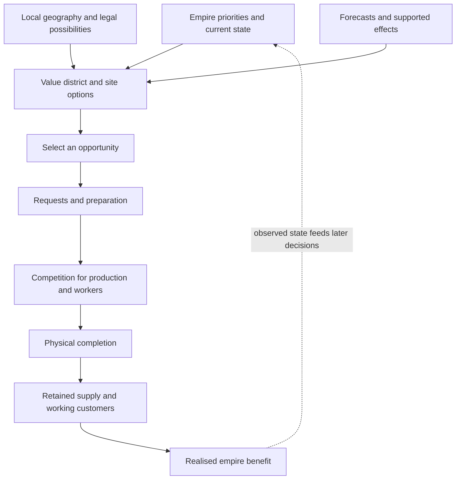

# Civilization VI AI handbook

Our current understanding of how Civilization VI's AI evaluates opportunities,
chooses work and follows it through. The handbook brings together native code
analysis, shipped data, actual game observations and the CSC AI experiments.

[CSC public documentation](https://hennogous.github.io/Henno-Mods/) ·
[Handbook source](https://github.com/hennogous/Henno-Mods/tree/main/project/docs/civ6-ai)

**Start with the explanation, then follow the evidence.** Topic pages describe
the reconciled model. The original reports retain their exact experimental
conditions, corrections and limitations. The [finding register](findings.md)
provides stable references for individual conclusions.

> [!info] Current research boundary — 3 November 2026
> District choice, prerequisite valuation and several modding controls are now
> understood at specific consumers. Reliable, worthwhile supply-chain competence
> across Basic CSC and RomanHoliday has **not** been established. Native per-site
> extension work has reached a bounded prototype with measured score-to-request delivery;
> arbitrary policy and release integration remain open. This handbook starts no game or experiment.

## Understand the engine

1. [Architecture: how priorities become work](topics/native/architecture.md)
2. [District types and placement](topics/native/district-choice.md)
3. [Empire needs and strategic priorities](topics/native/empire-needs.md)
4. [Prerequisites, requests and production](topics/native/production-and-prerequisites.md)
5. [What hypothetical effect evaluation can understand](topics/native/modifier-forecasts.md)
6. [Modding controls and possible native extensions](topics/native/modding-controls.md)
7. [How we know: evidence and instrumentation](topics/native/evidence-and-instrumentation.md)
8. [Native placement-score extension](topics/native/native-placement-extension.md): the identified integration point, persistence and proposed bridge

## Understand the CSC experiments

The CSC topic pages connect placement, research, material development, building
follow-through and assistance to the actual objective: useful economic chains
that justify their cost and support the empire's priorities.

Browse [CSC research topics](topics/csc/index.md), then the
[research journey](topics/history/research-journey.md) for the progression of
experiments and the decisions that changed direction.

## See the whole decision

This is a conceptual map. Each arrow has its own conditions and failure modes.
Evidence of a score change establishes one step; it does not establish successful
completion or net benefit. The architecture page links the verified native paths.

## Find an answer or an uncertainty

- [Corrections and cautions](topics/history/corrections-and-cautions.md)
- [Open questions and useful next investigations](topics/history/open-questions.md)
- [Diagram atlas](diagrams.md): browse the decision and evidence maps together
- [Finding register](findings.md): assertions, scope, evidence and dependencies
- [Evidence library](evidence.md): original reports, implementation records and agent notes
- [Coverage and provenance](coverage.md): what was consolidated and how
- [Maintaining the handbook](maintenance.md): updating, correcting and publishing
- [Terms and evidence levels](glossary.md)

The left-hand search covers both the handbook and its evidence library. The
local graph and backlinks show connections between the current page and its
references. Diagrams explain the decision mechanisms; the link graph helps
navigate them.
