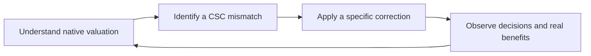

# Understanding and steering Civilization VI’s AI

We are learning how Civ VI turns the map and its empire’s needs into decisions—and how to help it understand Civ Supply Chains. This guide explains our **current understanding**. You do not need to read the experiment history first.

## Where to start

1. **[How the AI decides](guide/how-the-ai-decides.md)** — district sites, future buildings, empire priorities and production commitments.
2. **[Steering the AI](guide/steering-the-ai.md)** — what our native interface lets a mod change, what we have demonstrated, and why Community Extension matters.
3. **[Teaching it CSC](guide/teaching-it-csc.md)** — materials, customers and credible future development.
4. **[What we’re investigating](guide/what-next.md)** — the next questions and what would count as progress.

## What works today

We can adjust how valuable the AI thinks a particular **district at a particular tile in a particular city** would be, then let its ordinary decision and construction systems act on that value. In one controlled example, this changed its choice from a Neighborhood to a Tailors’ Quarter at the same tile; the AI subsequently built and completed the Quarter itself.

Packaged Lua and our **Community Extension development fork** complete an Online-speed game through turn100, with matching Lua/Python plans and no reported native API faults. The focused port onto CE’s `develop` branch now also passes with the supported Microsoft toolchain, including fresh context/save/reload checks. The earlier master-based PR is closed; we will review capability scope before another PR. Released CE still lacks this API. [Current contribution and qualification](../research/mods/csc-ce-develop-port-20261105.md).

These results establish control over an input and some natural follow-through. They do **not** yet establish better empire performance or reliable, profitable supply chains. [See the demonstrations and limits](guide/steering-the-ai.md).

## The central idea

The native AI already forecasts many benefits, costs and delays. We want to preserve that useful reasoning and supply the CSC relationships it misses or approximates poorly. Simply awarding a large bonus to every Quarter would not teach it those relationships.

We traced the large Bakers building forecast to the Mills’ adjacency encoding and replaced its ten-bit capacity with one Wind step and three Water steps. Twenty native payout/locality cases now pass; a direct Quarter-repair reactivation check remains failed. The new building ledger shows that amenities, some false forecasts and some missing CSC benefits all matter. [Current results and next questions](guide/what-next.md).

## Reading the evidence

The guide is maintained as our understanding changes. Detailed technical explanations, stable finding IDs, original reports and superseded explorations live in the **[Research library](library.md)**. They support the guide rather than define its reading order. The search menu lets you explicitly include that full corpus.

[CSC player documentation](https://hennogous.github.io/Henno-Mods/) · [Maintaining this guide](maintenance.md)
