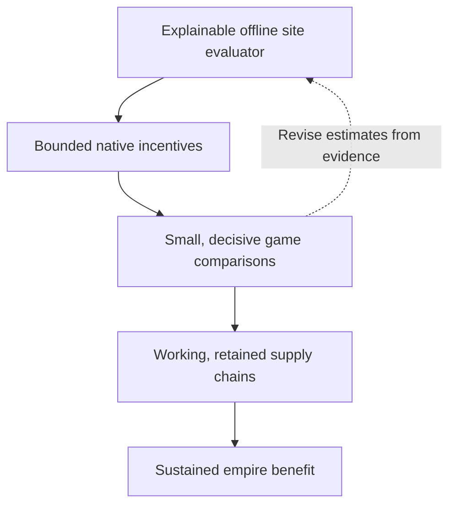

# CSC AI roadmap

Fresh plan, 3 November 2026. Henno requested removal of the old roadmap and a
new approach using the native decision tools now available. This is the sole
current roadmap. Dated experiments remain evidence; their proposed sequences,
weights and assistance policies are not defaults for this work.

## Goal

Develop worthwhile, durable supply chains that serve the empire's current needs,
strategic priorities and victory direction. The [confirmed objectives](../integrations/csc-ai-objectives.md)
remain the design reference: matching materials, river opportunities, useful
customers, balanced district placement, producer/customer construction,
material development and care, repair, and eventual strategic Service selection.
Both standalone CSC and RomanHoliday integration should meet that objective.

Success means realised benefit after investment and displaced opportunities.
More Quarters, higher scores or a single completed chain are intermediate results.

## Starting point

- Legacy CSC AI tuning is [archived and retired](../integrations/csc-ai-reset-20261103.md).
  The new implementation imports no old site heuristic, subsidy or scripted
  foundation policy. Real CSC gameplay remains the baseline.
- The ordinary native AI compares district/site pairs. A bounded extension can
  add an incentive to a fresh, scoped value and let native choice, requests and
  production follow through.
- The [Sydney trial](../research/mods/civ6-district-placement-choice-20261103.md)
  changed Neighborhood to Tailors at the same tile. The AI selected its request
  after a Bomber finished and completed the preferred-site Quarter at turn255.
  This establishes the mechanism, not a useful placement formula or net benefit.
- REA and Ghidra support focused offline investigation. Captured game facts and
  current SQL/Lua contracts ground the economic model. The maintained shared
  controller handles bounded live checks and normal restoration; discovery and
  project-completion popup recovery is now standard.

## 1. Build an explainable site evaluator offline — next

For each city, Quarter and candidate tile, describe the investment it enables:

- **Materials:** exact enabled Base/Specialty mappings, working supply versus
  credible future improvements, access, unlocks and preservation conflicts.
- **Customers:** actual adjacent districts/buildings, their beneficiary cities
  and population where relevant, and specific legal future customer footprints.
- **Returns:** real river/material/customer yields, ordinary transactions,
  Service effects and other applicable benefits. Respect each effect's own
  gates and stacking; missing full supply does not make every ordinary sale zero.
- **Development:** missing producer/customer buildings, likely timing, Builder
  work, purchases, maintenance and the city's capacity to finish the investment.
- **Alternatives:** lost tile use, other district sites, current commitments,
  finishing or repairing existing chains, and useful shared customers.
- **Empire needs:** what the resulting outputs and Services would contribute
  now and later. Keep that contribution separate from generic adjacency size.

Keep current benefits, conditional future benefits, costs and uncertainties
visible. Production and Gold remain separate components before strategic
conversion. Use explicit estimates; collect only missing facts that could change
the decision. Essential action legality remains a prerequisite.

Reuse captured cases and current mechanics, rather than copying the retired
planner. Compare contrasting cases: working Base/customer; Both without useful
customers; a missing customer building; credible future customers; blocked or
contested footprints; strong competing native sites; and repair versus expansion.
Do not turn the former Both-or-+4 trial threshold into a new rule by default.

**Deliverable:** ranked examples with explanations and sensitivity to the main
assumptions. The model should explain why one investment is preferable and what
would change that judgment, before another long game is needed.

## 2. Translate that value into a native incentive

Extend the fixed experimental preference into a bounded policy for actual
candidate pairs. Establish which benefits the native score already includes,
then supply the additional CSC value justified by the evaluator. Avoid counting
ordinary adjacency, costs or future-building value twice.

Specify native utility units, scope, immutable publication, refresh boundaries,
budgets and diagnostics. Handle caches, saves and retained requests explicitly:
removing a bonus is not guaranteed to withdraw an old commitment. Keep numerical
policy and the native carrier separate so each can be reviewed independently.

**Deliverable:** a transparent mapping from evaluator components to a bounded
candidate adjustment, with offline scope/arithmetic/lifecycle checks. Full engine
reconstruction and perfect coefficient calibration are not prerequisites for a
first useful comparison.

## 3. Test decisions with small, decisive game comparisons

Use existing saves and the shared controller where they can answer the question.
Choose the unresolved comparison deliberately: two sites for the same Quarter,
competition with another district type, or a production follow-through issue.
The Sydney type-switch result need not be re-proved as a substitute for those.

Trace fresh values, winner, reservation, native request, queue, foundation and
completion separately. Preserve actual initial-state comparability and declare
any difference in instrumentation or presentation recovery. Use native orders
and production; keep grants, forced foundations and queue clearing outside this
approach. Stop at the declared outcome or bounded observation limit.

**Deliverable:** an explanation of whether the intended decision changed and
what happened physically, including competing work and unresolved constraints.

## 4. Close the measured gaps in chain development

Follow promising placements through material improvements, producer/customer
buildings, retention and repair. At a failure, identify the responsible decision:
legality, admission, worker access/assignment, production competition, destructive
land use or execution. Use REA/Ghidra for a specific missing consumer and a
bounded live check for actual behaviour. Repair the measured gap through the
appropriate native decision path; a placement incentive alone cannot ensure
every later action.

Strategic Service selection remains part of the goal. Develop it alongside an
explicit account of which Services can become useful, rather than rewarding
infeasible promises or requiring the AI to pursue every chain.

**Deliverable:** useful chains that operate over time, with costs, delays,
losses, repairs and changed plans visible.

## 5. Validate benefit and choose release integration

Once the smaller comparisons support a useful policy, compare it with clean
standalone CSC and appropriate RH references across multiple situations/maps.
Measure realised outputs, strategic usefulness, opportunity costs, development
delays and durability. Fewer strong investments can outperform more Quarters.

The current native bridge is a pinned research prototype. Choose a distributable
carrier and qualify versions, lifecycle, persistence and compatibility before
calling it a player-ready release. Release packaging need not block offline
model development or the next decision-relevant comparison.

## Working rules

- Keep this roadmap short and current. Put results in dated reports and
  reconciled conclusions in handbook topics/findings.
- Prefer offline work; start a game to resolve a named uncertainty. Reuse the
  shared controller and existing observational infrastructure.
- Preserve the agreed goals while revising mechanisms and estimates. Old
  tuning amounts, auxiliary signals and assistance routines require fresh reasons.
- Commit and push documentation updates without additional website/link/deployment
  testing. This plan itself starts no game, automation or deployment.
