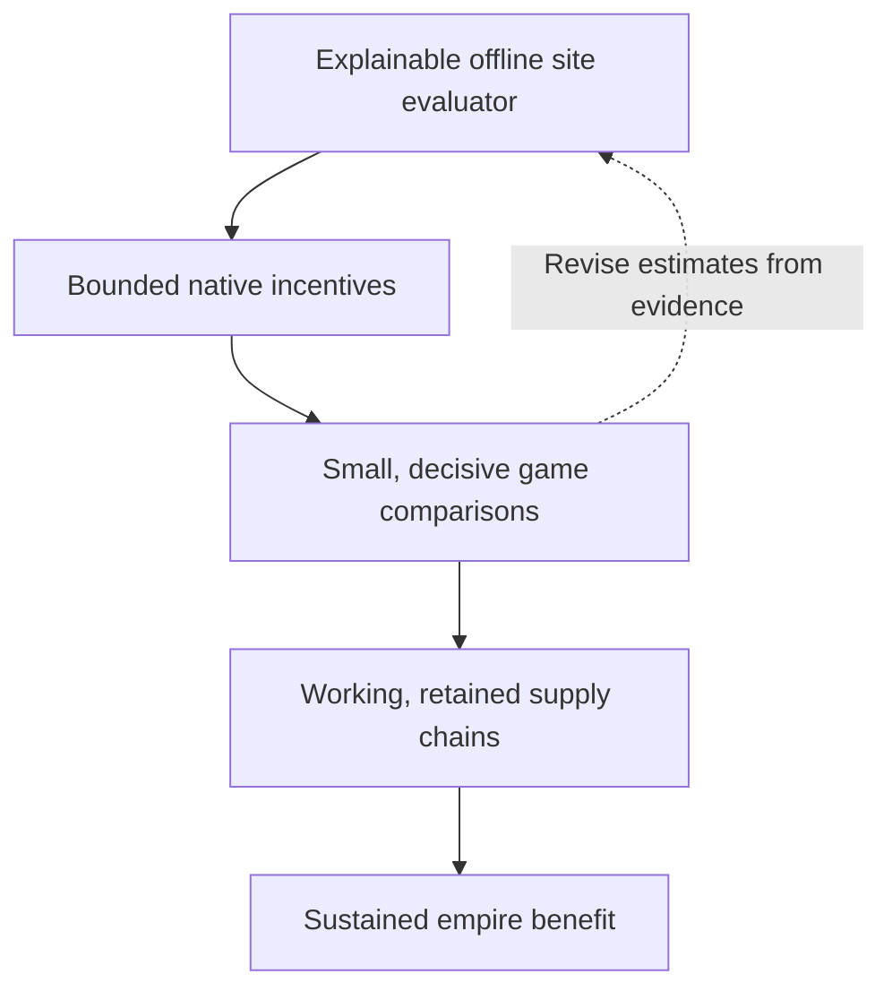

# CSC AI roadmap

> Current priority, 5 November: use the [effect coverage map](topics/csc/forecast-coverage.md)
> to measure missing or misvalued CSC relationships and correct the demonstrated
> differences at the completed district score.
> Henno deferred dedicated Mill repair work; monitor it in longer ordinary games.
> Earlier repair follow-up proposals below are historical, not the next task.

Fresh plan, 3 November 2026. Henno requested removal of the old roadmap and a
new approach using the native decision tools now available. This is the sole
current roadmap. Dated experiments remain evidence; their proposed sequences,
weights and assistance policies are not defaults for this work.

## Goal

Develop worthwhile, durable supply chains that serve the empire's current needs,
strategic priorities and victory direction. The [confirmed objectives](../integrations/csc-ai-objectives.md)
remain the design reference: matching materials, river opportunities, useful
customers, balanced district placement, producer/customer construction,
material development and care, repair, and eventual strategic Service selection.
Both standalone CSC and RomanHoliday integration should meet that objective.

Success means realised benefit after investment and displaced opportunities.
More Quarters, higher scores or a single completed chain are intermediate results.

## Carrier checkpoint: CE development parity restored

On4 November Henno put further AI tuning on hold until we investigate and
prototype a Workshop-distributable carrier. His preferred architecture is CSC
Lua/SQL with a Community Extension dependency, rather than our own shipped DLL.
The [delivery investigation](topics/native/workshop-delivery.md) demonstrates
local package-native loading and packaged Lua score delivery, and prepares a
CE-owned API contribution. Existing CE1.3 does not yet supply that proposed API.
Henno subsequently authorized a development fork to restore parity with the
Python/Frida setup before an upstream PR. The complete fork and packaged Lua now
pass the bounded [parity port](../research/mods/csc-ce-policy-parity-20261104.md):
Online100,101 exact plan comparisons,73 positive/14,584 negative changes,
all four diagnostic families, context reset, save/load and normal restoration.
This clears the development-carrier gate. The policy was unchanged throughout.
Upstream adoption, actual Workshop subscription and broader compatibility remain
release work; stock CE1.3 does not supply this API.
The tested feature was submitted as
[draft PR9](https://github.com/Wild-W/CivilizationVI_CommunityExtension/pull/9),
which is now closed by Henno's instruction.

**5 November update:** Henno approved closing that premature master-based draft
and preparing an API-only branch on upstream develop, preserving the old tested
fork. The source port and maintainability review are separate from qualification:
MSVC/SDK installation, both existing-project builds, 36 MSVC isolated checks and
the fresh Online100/context/save/reload regression now pass. Use CE's existing build;
broader build-system proposals are outside the
API contribution unless an actual need arises. Final capability scope and any
new upstream PR require Henno's review. [Current handoff](../research/mods/csc-ce-develop-port-20261105.md).

## Current bounded policy — now carried by CE/Lua

Henno authorized the [full-adjacency +4 pilot](../research/mods/csc-ai-adjacency-policy-20261103.md):
Bakers/Tailors, all designed adjacency including the planned first Mill, cached
city geography and per-turn scoring. Promote the highest qualifying pair per
city through native values, leave other sites selectable, and observe an
Online-speed game no later than turn100. First-Mill construction incentives
follow separately. This explicit new rule does not restore the old tuning,
subsidies or scripted foundations. The richer investment model is a later
refinement rather than a prerequisite for this deliberately simple test.

The recovered Online100 run is now closed:52 native score additions, zero native
errors,7 promoted Bakers foundations/completions, and23 other foundations below4
in their preceding scans. No Tailors site qualified. This confirms treated
follow-through and the absence of a weak-site ban, not a caused choice change
or empire benefit. Henno next authorized discouraging weak placements:
the [v2 soft-penalty extension](../research/mods/csc-ai-placement-penalties-20261103.md)
retains the promotion and subtracts a graded priority from every observed sub-4
pair. Its recovered Online100 test closed on4 November: ten promoted foundations,
four below-4 foundations and zero native errors. This compares descriptively with
23 below-4 foundations in the positive-only run, without a matched causal arm.
Two exceptions were admitted before scanner coverage and retained old request
values; two stayed positive and won after downstream native uplift. Next,
cover proposal candidates before admission and understand the
[native score components](topics/native/district-score-anatomy.md). On4 November,
Henno emphasized supplementing the native estimate to represent CSC gameplay:
preserve understood benefits, identify approximate/missing relationships, and
avoid double-counting. Decompose future-building contributions before deciding
whether a final-aggregate adjustment is warranted. The identified prerequisite-
depth heuristic and hidden CSC prerequisites need that component accounting too.
Retained-request refreshing would be a separate native contract.
First-Mill construction remains a later distinct decision, not part of this penalty.

The later4 November [component observation](../research/mods/csc-ai-bakers-forecast-components-20261104.md)
now supplies that accounting for the dominant term. Wind Mill forecasts provide
over99.8% of the two measured district-building sums; generated adjacency bits
are valued without their gameplay property gates. The current model task is to
exclude or replace this specific forecast artifact while preserving genuine
benefits, then test the isolated value and decision change. The current district
hook precedes the offending aggregation, so choose the correction boundary
explicitly rather than merely raising a counter-penalty. Smaller components,
candidate coverage, retained requests and physical chain development remain
separate. No correction was implemented in the read-only study. [AI-C053]

The subsequent [range and representation review](../research/mods/csc-ai-adjacency-simplification-20261104.md)
recommends trying a smaller Mill-specific source representation before extending
the native API: Wind needs one conditional +1; Water three unit steps. All317
current count cases preserve numeric encoding offline. At that proposal stage
it was uninstalled and not a live-gameplay result. Both Mills share the leak; different
forecast readiness and separate mutual canonicalization explain the apparent
Wind/Water difference. Actual scope, stacking and save migration remain explicit
qualification work. [AI-C054] [AI-C055]

Later4 November Henno authorized the local scope and smaller representation.
The [source repair](../research/mods/csc-ai-local-mill-unit-steps-20261104.md)
now implements CITY scope, functioning local-Mill eligibility and one Wind/three
Water unit steps. Generic encodings and current policy weights remain unchanged.
Focused SQL/Lua checks qualify the source graph and stale-property handling;
they do not establish native save migration or a corrected forecast/decision.
Henno initially chose to keep FireTuner open and finish offline only; native
validation was deferred at that checkpoint.
[AI-C056]

On5 November, the [combined native study](../research/mods/csc-ai-mill-building-study-20261105.md)
passes20 Mill payout/locality cases and retains one direct Quarter-repair failure
through a turn and exact reload. The new small roots execute; old weighted roots
do not. All19 loaded building forecasts and88 roots are accounted for in two
controlled AI cities. Amenities explain much of the later-building value, while
alternative Mill recipients, Wonder-linked GPP and missing material/Service/tourism
channels expose specific mismatches. District raw sums and propagated construction
values are distinct. A later normal queued repair completes at4 without
recovering the affected checkpoint. Investigate activation/invalidation and a
pristine lifecycle separately from correcting a measured forecast relationship. No new
policy or CE API was added by this study. [AI-C058] [AI-C059] [AI-N074]

The [late placement replay](../research/mods/csc-ai-late-placement-20261105.md)
establishes a write after the building pass that reaches the native district
winner, plot present value and prerequisite preparation. A separate arm applied
the first CSC rule using measured Wind and Water recipient credits for a flat
inland Bakers site. The 4,398 Q8 deduction left the control winner unchanged.
Both the scanner and the calibration library now live in `Lua_UI/AI`. Keep
the measured correction separate from the early experimental site priority.
The development fork now includes a [guarded late entry](../research/mods/csc-ce-late-score-api-20261105.md).
A recurring CSC policy still needs current component evidence.
[AI-N075] [AI-N076] [AI-C060]

## Starting point

- Legacy CSC AI tuning is [archived and retired](../integrations/csc-ai-reset-20261103.md).
  The new implementation imports no old site heuristic, subsidy or scripted
  foundation policy. Real CSC gameplay remains the baseline.
- The ordinary native AI compares district/site pairs. A bounded extension can
  add an incentive to a fresh, scoped value and let native choice, requests and
  production follow through.
- The [Sydney trial](../research/mods/civ6-district-placement-choice-20261103.md)
  changed Neighborhood to Tailors at the same tile. The AI selected its request
  after a Bomber finished and completed the preferred-site Quarter at turn255.
  This establishes the mechanism, not a useful placement formula or net benefit.
- REA and Ghidra support focused offline investigation. Captured game facts and
  current SQL/Lua contracts ground the economic model. The maintained shared
  controller handles bounded live checks and normal restoration; discovery and
  project-completion popup recovery is now standard.

## 1. Build an explainable site evaluator offline — first Tailors review ready

For each city, Quarter and candidate tile, describe the investment it enables:

- **Materials:** exact enabled Base/Specialty mappings, working supply versus
  credible future improvements, access, unlocks and preservation conflicts.
- **Customers:** actual adjacent districts/buildings, their beneficiary cities
  and population where relevant, and specific legal future customer footprints.
- **Returns:** real river/material/customer yields, ordinary transactions,
  Service effects and other applicable benefits. Respect each effect's own
  gates and stacking; missing full supply does not make every ordinary sale zero.
- **Development:** missing producer/customer buildings, likely timing, Builder
  work, purchases, maintenance and the city's capacity to finish the investment.
- **Alternatives:** lost tile use, other district sites, current commitments,
  finishing or repairing existing chains, and useful shared customers.
- **Empire needs:** what the resulting outputs and Services would contribute
  now and later. Keep that contribution separate from generic adjacency size.

Keep current benefits, conditional future benefits, costs and uncertainties
visible. Production and Gold remain separate components before strategic
conversion. Use explicit estimates; collect only missing facts that could change
the decision. Essential action legality remains a prerequisite.

Reuse captured cases and current mechanics, rather than copying the retired
planner. Compare contrasting cases: working Base/customer; Both without useful
customers; a missing customer building; credible future customers; blocked or
contested footprints; strong competing native sites; and repair versus expansion.
The earlier Both-or-+4 experiment is not a default; the new adjacency-only +4
pilot above is separately authorized and has its own implementation/evidence.

**Deliverable:** ranked examples with explanations and sensitivity to the main
assumptions. The model should explain why one investment is preferable and what
would change that judgment, before another long game is needed.

The [first Tailors review](topics/csc/site-planner.md) now covers44 copied cases,
including conditional rankings and explicit missing terms. Next, review those
assumptions, extend mechanics coverage and obtain the specific facts that can
change a decision. This first profile does not complete the broader evaluator.

## 2. Translate that value into a native incentive

Extend the fixed experimental preference into a bounded policy for actual
candidate pairs. Establish which benefits the native score already includes,
then supply the additional CSC value justified by the evaluator. Avoid counting
ordinary adjacency, costs or future-building value twice.

Specify native utility units, scope, immutable publication, refresh boundaries,
budgets and diagnostics. Handle caches, saves and retained requests explicitly:
removing a bonus is not guaranteed to withdraw an old commitment. Keep numerical
policy and the native carrier separate so each can be reviewed independently.

**Deliverable:** a transparent mapping from evaluator components to a bounded
candidate adjustment, with offline scope/arithmetic/lifecycle checks. Full engine
reconstruction and perfect coefficient calibration are not prerequisites for a
first useful comparison.

## 3. Test decisions with small, decisive game comparisons

Use existing saves and the shared controller where they can answer the question.
Choose the unresolved comparison deliberately: two sites for the same Quarter,
competition with another district type, or a production follow-through issue.
The Sydney type-switch result need not be re-proved as a substitute for those.

Trace fresh values, winner, reservation, native request, queue, foundation and
completion separately. Preserve actual initial-state comparability and declare
any difference in instrumentation or presentation recovery. Use native orders
and production; keep grants, forced foundations and queue clearing outside this
approach. Stop at the declared outcome or bounded observation limit.

**Deliverable:** an explanation of whether the intended decision changed and
what happened physically, including competing work and unresolved constraints.

## 4. Close the measured gaps in chain development

Follow promising placements through material improvements, producer/customer
buildings, retention and repair. At a failure, identify the responsible decision:
legality, admission, worker access/assignment, production competition, destructive
land use or execution. Use REA/Ghidra for a specific missing consumer and a
bounded live check for actual behaviour. Repair the measured gap through the
appropriate native decision path; a placement incentive alone cannot ensure
every later action.

Strategic Service selection remains part of the goal. Develop it alongside an
explicit account of which Services can become useful, rather than rewarding
infeasible promises or requiring the AI to pursue every chain.

**Deliverable:** useful chains that operate over time, with costs, delays,
losses, repairs and changed plans visible.

## 5. Validate benefit and choose release integration

Once the smaller comparisons support a useful policy, compare it with clean
standalone CSC and appropriate RH references across multiple situations/maps.
Measure realised outputs, strategic usefulness, opportunity costs, development
delays and durability. Fewer strong investments can outperform more Quarters.

The current native bridge is a pinned development capability. The4 November
CE/Lua parity qualification clears the development-carrier gate; upstream release
and player-facing delivery remain separate from further economic-model research.
Versions, lifecycle, persistence, platform and compatibility still need review
before calling it a player-ready release.

## Working rules

- Keep this roadmap short and current. Put results in dated reports and
  reconciled conclusions in handbook topics/findings.
- Prefer offline work; start a game to resolve a named uncertainty. Reuse the
  shared controller and existing observational infrastructure.
- Preserve the agreed goals while revising mechanisms and estimates. Old
  tuning amounts, auxiliary signals and assistance routines require fresh reasons.
- Build and verify handbook updates before committing/pushing, and confirm the
  Pages workflow after a publishing correction. This restores documentation
  checks at Henno's request after the roadmap-removal failure. This plan itself
  starts no game, automation or deployment.
