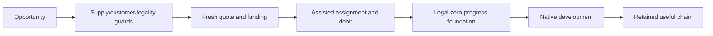

# Acquisition, foundations and planner evolution

Assistance moved from securing material potential toward a worthwhile investment with an actual customer path. Its backend is explicitly assisted; subsequent native production and most Quarter placements remain separate.

## AI-C031 — Foundations can be handed to native construction

The initial four-foundation diagnostic observed all four selected and completed without scripted completion or extra production orders. Later aged cohorts also completed most foundations; construction was often stronger than material siting/preservation.

Scope: Guarded native/UI-legal incomplete district route.

Limits: Foundation insertion consumes land and district capacity and changes the AI’s remaining choices. It proves a construction route in cases, not optimal investment or chain success.

Sources: [Four-foundation diagnostic](../../../research/mods/csc-ai-district-foundations-20261021.md), [original-placement breakdown](../../../research/mods/csc-ai-foundation-handholding-breakdown-20261025.md).

## AI-C032 — Paid acquisition is an assisted backend

A donated Both diagnostic verified 65 Gold in source/Sheep acquisitions, exact gift/debit, same-turn city ownership and a legal 0%Tailors foundation. Later own-first policies donate only the next step’s shortfall with receipts, caps, reserves and cooldowns.

Scope: Gameplay WorldBuilder city assignment plus native-quoted treasury debit.

Limits: This is not proved native AI PURCHASE behavior. A full-route gift or same-state affordability shadow is a mechanism diagnostic, not an untreated counterfactual or free-chain outcome.

Sources: [First donated proof](../../../research/mods/csc-ai-donated-both-diagnostic-20261023.md), [own-first fresh game](../../../research/mods/csc-ai-own-first-fresh-game-20261023.md), [profile contract](../../../integrations/csc-ai-profiles.md).

## AI-C033 — Guaranteed Both placement did not retain most inputs

In the partial 175 cohort all 11 assisted foundations completed, while 64/65 native placements completed. Only two assisted working Base/Both chains remained after nine initial Base losses. Captured sites and paid-land overlaps were tracked separately.

Scope: Original-placement cohorts; later uncontrolled 192 excluded.

Limits: Unassisted does not mean stock AI. Assistance preempted some Both choices, and cohort ages/opportunities differ; native-versus-assisted fractions are not causal treatment effects.

Sources: [Handholding breakdown](../../../research/mods/csc-ai-foundation-handholding-breakdown-20261025.md).

## AI-C034 — A partial200 package improved some milestones

All 11 assisted foundations completed with mean observed delay 21/median 20 versus 28.125/27 for eight prior completions. Non-City-Center customer adjacency 31 versus 18 and building links 19 versus 8 rose, while working Base producer sites fell 15 versus 21.

Scope: Historical combined foundation/customer treatment; controlled progress ended 175.

Limits: The requested 200 endpoint was not completed. Observer defeat, unobserved later finance and changed cohorts prevent a full benchmark or isolated queue-priority efficacy claim.

Sources: [Audited partial result](../../../research/mods/csc-ai-foundation-priority200-20261025-results.md).

## AI-C035 — Spending195 versus795 was not selective-chain success

The selective candidate spent 195 Gold=81 own+114 subsidy versus 795=300+495, but ended with three full-supply contexts versus four. Both had 53 Quarters,19 workingBase and 38 Stage 2 producers; candidate Both was four versus ten and zero assisted sites operated.

Scope: One matched 150 RH joint-package screen.

Limits: Savings 75.5% is not benefit, parity or proof of lower waste. Full-chain milestone spending is not total return accounting; materials/producers may already help. Construction cost was not monetized.

Sources: [Selective results](../../../research/mods/csc-ai-paired-selective-chain-screen-results-20261101.md).

## AI-C036 — Customer-aware v2 proved execution, not overall improvement

V 2 admits credible Base through Both or trial realProduction+Gold>=4 and requires an exact Stage 2/3 customer path. Its 150 pilot had two full contexts versus three selective,15 Base versus 19, and one assisted chain operating from 119 through later observations. Five foundations were assisted, fifty sites clearly native and one had cross-city acquired-land overlap.

Scope: Canonical implementation and same-map RH joint-package pilot.

Limits: 200 Gold included 85 on a turn-149 commitment censored at 150. Sixteen errors and missing planner observations 11–14 kept the dense-observation pass false. An individual functioning chain did not establish overall improvement or Basic qualification.

Sources: [Implementation](../../../research/mods/csc-ai-customer-aware-planner-v2-20261101.md), [native result](../../../research/mods/csc-ai-customer-aware-planner-v2-native-20261101.md).

## AI-C037 — Future customer credit needs a named conditional contract

V 2 binds material/customer identities across purchases and protects essential footprints. Working customers, existing districts missing buildings and specific future plots are different confidence tiers. Present real P/G, projected conditional value and private cues stay separate.

Scope: Customer-aware planner contract and Lua legality-binding investigation.

Limits: CanHaveDistrict does not prove future unlock/capacity legality. Unknown essential facts defer action; unknown secondary costs remain explicit rather than making every useful investment impossible. Future promises are not native site preferences or realized yields.

Sources: [V2 contract](../../../research/mods/csc-ai-customer-aware-planner-v2-20261101.md), [future legality](../../../research/mods/csc-native-future-customer-legality-20261101.md), [selective offline model](../../../research/mods/csc-ai-selective-planner-20261031.md).

[Complete source map](source-map.md).
