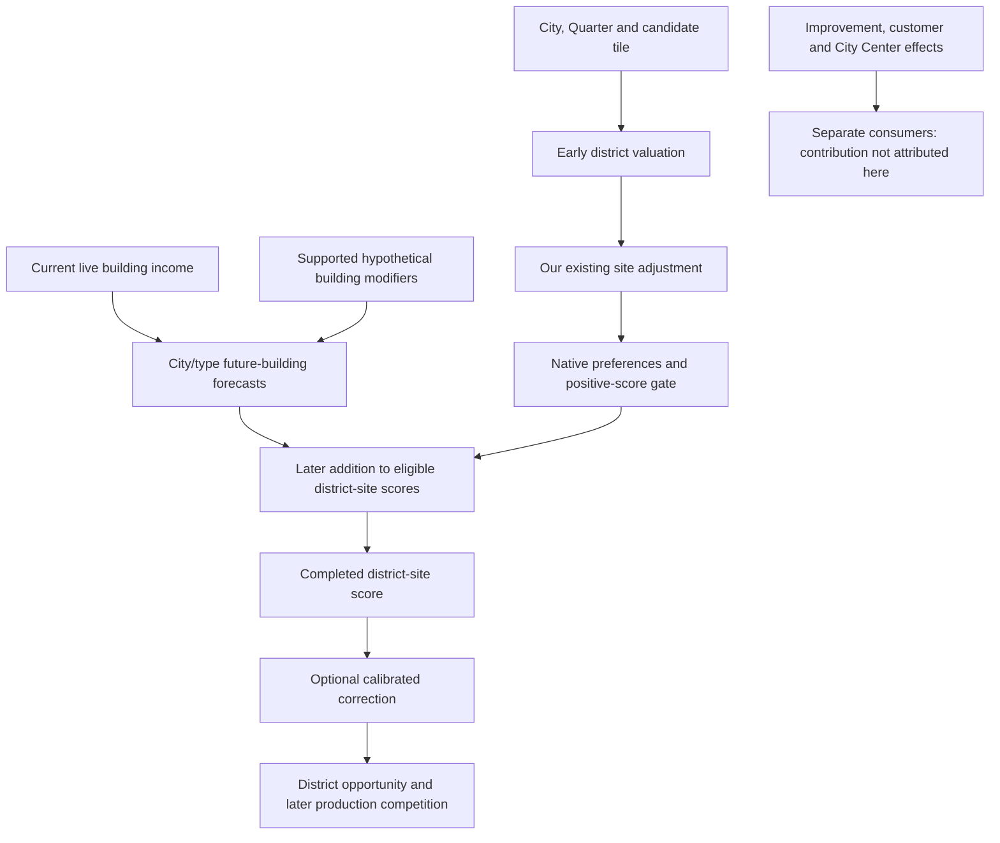

# Which CSC benefits does the AI forecast?

The AI roughly values **amenities and ordinary exchanges between buildings in
the same Quarter**. It does not reliably forecast the whole CSC supply chain.
Some effects get credit under the wrong conditions; some have no consumer in
the inspected forecast; others live outside the building pass we measured.

This map covers the implemented **Bakers and Tailors** families. The six other
Quarter actions are inactive. It reconciles22 gameplay groups and4 common
building components with the closed native capture: all88 building-root
attachments have one classification and were observed in both cities. These
counts measure inventory coverage, **not the percentage of gameplay value the
AI understands**. [AI-C059] [AI-N074]

## Where this fits into district placement

The later addition is common to eligible sites of the same Quarter type in a
city. The captured building calls have no particular candidate coordinates.
They do not rerun CSC's Lua supply, customer, population and route calculations
for each proposed site. Native building values also undergo eligibility,
positivity and mutual-exclusion filters before reaching the district sum.

Our scanner already projects designed Production/Gold adjacency, including an
appropriate planned Mill. That is an early experimental preference, not a priced
replacement for every later benefit. Quarter adjacency, material-improvement
returns, producer income and customer sales are distinct flows; adding the full
CSC economy on top would risk counting some benefits twice.

The early score also deducts the native value of a functioning improvement that
would be removed. That helper has plot and city context and calls modifier
analysis. The building-root ledger does not isolate what this different path
assigns to losing a CSC supplier or switching off a Service.
[Native displacement trace](../../../research/mods/civ6-district-improvement-loss-20261106.md).

## Read the classifications

| Label | Meaning for a correction |
| --- | --- |
| **Represented** | A useful kind of value is observed. Preserve it unless a specific mismatch is demonstrated. |
| **Misvalued** | A nonzero contribution has a demonstrated condition or alternative-recipient error. |
| **Missing here** | An observed collection/effect handler is absent in this forecast path. Other AI paths are not ruled out. |
| **Zero here** | The root was accepted but returned zero in these cities. This does not establish unsupported behavior. |
| **Unmeasured** | Outside the attributed window or not separately priced. Unknown is not zero. |
| **Mixed** | Directions or subeffects need different treatment. |
| **Structural / state** | Eligibility, investment bookkeeping or a signal; not an independent economic reward. |

## Bakers' Quarter

| Gameplay relationship | Coverage | What this means |
| --- | --- | --- |
| Wind hill Production / Water river-edge Production | **Misvalued** | Small1/3 capacity is respected, but all steps are credited without real candidate geometry/property conditions. Correct eligibility; do not add another unconditional Mill bonus. |
| Improved Base → Mill Food; Specialty → Café Food | **Unmeasured** | Improvement-owned effects are outside the building-root vector. Native live building income is an established input, but these specific future supplies were not attributed. Existing improvements and future Builder work need separate treatment. |
| Mill/Café → material-improvement Production and Gold | **Missing here** | Producer wrappers return false with a null improvement iterator. This is genuine output to eligible improvements, not another Quarter adjacency bonus. |
| Mill ↔ adjacent Granary | **Mixed** | In Trebizond, the unbuilt Granary's reciprocal roots returned zero with a working Mill. In Melbourne, an existing Granary's +1 Production and +1 Gold were already credited to the unbuilt Wind Mill as city yield changes. The Mill's prospective +1 Food to the Granary returned zero. Price each direction in the valuation path that actually consumes it. [AI-C099] [AI-C100] [AI-C102] [AI-C112] |
| Mill ↔ local Bakery/Café | **Mixed** | Food and Production/Gold exchanges receive value. Bakery/Café also credit both mutually exclusive Mill variants. Preserve the exchange while correcting the alternatives. |
| Storekeeper: growth, Engineer GPP, marker | **Zero here** | Roots return zero without reaching the child effects. Melbourne's live Food surplus and same-player Engineer reference put the two benefits near 21 utility points if enabled over the Mill forecast window. The proxy still needs an admitted positive case. [AI-C114] |
| Innkeeper: Housing, Merchant GPP, slot | **Zero here** | Roots return zero without children. Housing, GPP, the marker grant and staffing are separate questions. |
| Groundskeeper/Ride Technician: Tourism, Engineer GPP, slot | **Mixed** | Reached Tourism and grant children lack analyzers. One Zoo GPP branch receives value; others return zero. Nonzero GPP does not certify the full material/civic/customer gates. |
| Bakery ↔ Market ordinary population sales | **Unmeasured** | City Center consumers, not Bakery roots. Current implementation uses0.105 per customer citizen for customer Food and seller Production/Gold; ordinary sales do not require Service materials/civics. |
| Café ↔ Zoo/Ferris ordinary sales | **Unmeasured** | City Center consumers. Each customer site contributes floor(its city population/5), with Culture to customer and Production/Gold to seller. These are separate from Tourism and Services. |
| River Access / No River Access and Mill alternatives | **Structural** | Own raw flags are zero and excluded from direct district addition. River Access nevertheless receives Water value through prerequisite propagation; timing and mutual exclusion matter. |

## Tailors' Quarter

| Gameplay relationship | Coverage | What this means |
| --- | --- | --- |
| Improved Base → Workshop Culture; Specialty → Fashion House Culture | **Unmeasured** | Improvement-owned income was not separately attributed. A future supply plan is not proved by a live getter's general support. |
| Workshop/Fashion House → material-improvement Production and Gold | **Missing here** | Producer roots return false with null improvement iterators. Price eligible improvements and their real use, not all nearby resource icons. |
| Workshop ↔ local Tailor/Fashion House | **Represented** | Both directions receive nonzero native values. This is useful rough reasoning, with ordinary hypothetical timing/recipient approximations. |
| Workshop ↔ adjacent Lighthouse | **Zero here / unmeasured reverse** | Outgoing root zero; no eligible Harbor in these test cities. Lighthouse-owned reciprocal effects lie outside the capture. |
| Dockmaster: naval Production, Admiral GPP, slot | **Zero here** | Twelve naval era/class roots and other Service roots return zero. No eligible Lighthouse/naval case was measured; do not call all these effects unsupported or turn20%naval Production into general Production. |
| Sacristan: Faith, Prophet GPP, slot | **Zero here** | Roots return zero without children. A real positive recipient case is needed before changing their price. |
| Stage Manager / Wonder Services: Tourism, Artist GPP, markers | **Mixed** | Reached Tourism effects lack analyzers. Three Wonder-linked GPP roots each receive768Q8 even with no corresponding Wonders. Ordinary Theater roots return zero here; not every Service grant was reached. |
| Tailor ↔ Market/Temple ordinary population sales | **Unmeasured** | City Center consumers. Customer Culture and seller Production/Gold depend on actual customer population and functioning adjacency; no Service material/civic gate. |
| Fashion House ↔ Amphitheater/named Wonder ordinary sales | **Unmeasured** | City Center consumers. Floor population per actual customer before summing; exact Wonder plot and functioning state matter. This is distinct from Wonder-Service GPP. |

## Shared benefits and implementation details

| Component | Coverage | What this means |
| --- | --- | --- |
| Bakery/Tailor local amenities; Café/Fashion House regional amenities | **Represented, regional geography incomplete** | Direct amenities are large in the controlled population15 cities. Each captured forecast has one recipient; candidate-specific range, overlap and multiple-city marginal benefit were not demonstrated. |
| Producer and Service specialist slots/yields | **Unmeasured** | No separate staffing valuation. Slots require citizens and displace other work; do not price specialist rows as passive building yields. Some Service slots have no own declared yield rows. |
| Hidden Service grants and markers | **Mixed** | `MustPurchase` excludes direct district additions. Some absent Service buildings have unexplained20,595Q8 raw values; these are not demonstrated Service benefits. Reached Café grant children are unsupported; other grant paths remain unexpanded. |
| Unlocks, costs, maintenance and prerequisites | **Structural, partly attributed** | Native readiness and raw district sums reconcile. Descendants raise mutable construction values: a negative own Workshop can still be worth building. Some residual cost/income and hidden-depth terms remain unitemised. |
| Trade imports/exports | **Unmeasured** | Route-dependent City Center consumers. Origin Food/Culture/Amenity and supplied-producer Production/Gold returns require actual routes; zero supply-flag writer value does not mean exports were forecast. Future route choice is unproved. |
| Supply/Service properties and expanded art | **State; no standalone value** | A property amount of1 is a flag, not1 yield. Art deserves no economic incentive; supply flags matter only through their economic consumers. |

No direct `Building_YieldChanges` rows exist across the19 baseline buildings.
Their real income can still come from modifiers and staffed citizens. Do not
equate an empty flat-yield table with an empty economy.

## Boundaries and optional content

Ordinary Quarter resource/customer adjacency belongs to the earlier site model;
this study does not certify the native valuation of every CSC district-owned
adjacency rule. Quarter container costs/maintenance, copy-scaled cost progression,
appeal, defensive strength and pillage/capture behavior also belong to earlier
valuation or other gameplay systems. Their exact CSC-specific utility is not
separately measured here; do not assign them a second future-building reward. Existing building forecasts also do not prove a plan to improve
resources, construct customers, assign specialists or establish routes.

M&C Industry/Corporation additions and Leugi Garden/Horticulturist were absent
from the native capture. Source review identifies their analogous channels, but
their contributions need explicit profile qualification. Extra resource/customer
mods and replacements change eligibility; they do not automatically establish a
new native consumer. The six inactive Quarter designs have no runtime forecast
to certify yet.

## What to pursue next

The late placement trial has a measured correction for a flat inland Bakers
site. It removes Wind's inapplicable hills credit and Bakery and Café's credit
for a Water Mill recipient. The difference is calculated from the three raw
building forecasts that actually entered the district sum, with Civ's positive
building gate reapplied. The main CSC Lua policy returned a deduction of
4,398 Q8. The native replay applied it, leaving the Bakers site at 100,223 Q8
and preserving Delhi's Neighborhood choice. [AI-C060]
[Calibrated Bakers trial](../../../research/mods/csc-ai-late-placement-20261105.md)

1. **Attribute ordinary population sales and material inputs.** They are central
   CSC benefits outside the producer-root window. Separate existing delivered
   income from a forecast of an unbuilt chain, on both seller and customer sides.
2. **Extend measured corrections by site.** The inland Mill case has an exact
   calculation. River sites need a choice between eligible Mill alternatives,
   and Wonder GPP needs a distinction between unavailable and future recipients.
   Preserve the amenity and other building value that Civ already credited.
3. **Add only established missing relationships.** Improvement returns and
   reached Tourism/grant paths have specific absent consumers. Grants still
   require valuing actual staffing rather than awarding a flat Service bonus.
4. **Use an eligible case for the zero-valued Services.** Growth, Housing, Faith,
   naval Production and their GPP cannot be classified as missing from zeros alone.

This is an investigation order, not a claim about economic magnitudes. No tuning
or new CE API is proposed as necessary until a specific correction needs it.

Henno deferred the Mill repair discrepancy on5 November: watch for comparable
states in ordinary longer test games, retaining before/after pillage/repair,
building health/location, properties and actual payout. It is not a blocker for
the forecast map and does not justify another dedicated game now.

Evidence: [coverage reconciliation](../../../research/mods/csc-ai-effect-coverage-map-20261105.md),
[measured components](../../../research/mods/csc-ai-mill-building-study-20261105.md),
[source inventory](https://github.com/hennogous/Henno-Mods/blob/main/project/tools/native_ai/mill_building_study/ledger/README.md)
and [machine-readable map](https://github.com/hennogous/Henno-Mods/blob/main/project/tools/native_ai/mill_building_study/ledger/forecast_coverage.json).
The [modifier interpreter reference](../native/modifier-forecasts.md) explains
why missing handlers, skipped requirements and absent context differ.
