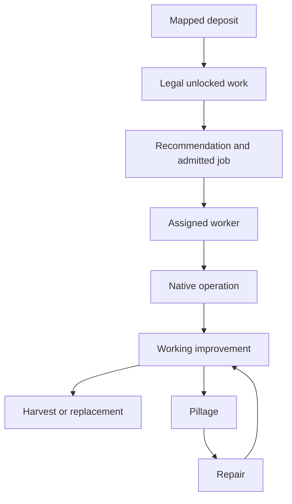

# Materials, Builders, preservation and repair

A valid material can be locked, unowned, unsafe, unassigned, reserved for a destructive alternative, pillaged after repair or covered by a district. Builder counts alone cannot distinguish these failures.

## AI-C011 — Broad Builder tuning had mixed confounded outcomes

The historical 90/900 package reached improvement density 7.76/city versus 5.22 at the common 200 checkpoint, but did not finish 250. A later resource-layout variant with the same settings gave 6.70/city at 200. Training, purchases, unit additions and remaining charges measure different things. Later native tracing established that the Units-list Value adds to request priority rather than acting like a percentage; Basic's Builder 50 is not a promise of 50 workers. Required City=-1 removes one city-ID restriction while retaining ordinary eligibility checks; it does not assign a worker or guarantee recruitment.

Scope: One-seed historical Builder/density trials and current-build static Units/request consumer tracing.

Limits: Interrupted runs do not enter completed 250 comparisons. Combined settings and changed worlds do not identify a useful individual coefficient or prove sufficient workers for a particular job.

Sources: [Builder partial result](../../../research/mods/csc-ai-rh-builders-20261017-turn200.md), [interruption](../../../research/mods/csc-ai-rh-builders-20261017.md), [density result](../../../research/mods/csc-ai-density-v4-20261017-turn250.md), [Builder consumers](../../../research/mods/csc-ai-native-builder-consumers-20261028.md), [request priority](../../../research/mods/csc-ai-native-builder-priority-20261028.md).

## AI-C012 — Private yields are not human-economically inert

Zero-turn readbacks showed one worker move to Flax with private+40, changing ordinary worked Production/Culture despite unchanged real plot inputs. The later Plantation extension changed allocations/output without additional material development. Empty icons and UI filters do not prevent this.

Scope: All-owner raw-resource/improvement mechanism arms.

Limits: No direct conversion into money does not imply no economic effect. Older inert-output wording is superseded; all-owner diagnostic packages were not AI-only release candidates.

Sources: [Citizen effects](../../../research/mods/csc-ai-private-resource-citizen-effects-20261024.md), [extended forecast](../../../research/mods/csc-ai-resource-improvement-forecast75-results-20261024.md).

## AI-C013 — Soft care landed without reliable preservation

Material-care v 1 stopped 170; v 2 ended after observer defeat 192 rather than 225. V 2 recorded eleven repair-to-working episodes and thirteen supporting-link losses, including four confirmed native harvests for Farm jobs. A working improvement was sometimes actively removed before harvesting.

Scope: Historical 160/80/20 care and urgency experiments.

Limits: Occupancy alone is not a confirmed harvest. Repairs do not prove incentive causality, and nodeSUCCESS is not operation/completion. Neither endpoint achieved the declared 225 test.

Sources: [v1](../../../research/mods/csc-ai-material-care-v1-20261023.md), [decision paths](../../../research/mods/csc-ai-material-care-decision-paths-20261023.md), [v2 terminal result](../../../research/mods/csc-ai-material-care-v2-terminal192-20261023.md).

## AI-C014 — A harvest ban was an unsuitable preservation control

The no-harvest rule prevented the raw control’s three losses through 75 and yielded six versus five working Base producers. It also removed Quarter options and caused repeated rejected harvest/build routes, some later adapting to Pastures.

Scope: Identical source 16→75 counterfactual pair.

Limits: One world, shared private signals and subsidies; zero working Both producers. A player-wide legality restriction is not targeted care and was not promoted.

Sources: [Native harvest-rule result](../../../research/mods/csc-ai-native-harvest-rule75-20261024.md).

## AI-C015 — Direct Pasture and conditional Farm routes had positive controls

Cattle 2533 changed from a Farm reservation/harvest in the raw control to a Pasture reservation 20, working 21 and retained 75 under direct Pasture 80. The 150 resource-Farm pilot verified seven isolated resource-Farm positives and 81 terrain-only negatives, with logged job/reservation and physical development evidence.

Scope: Separate historical direct and conditional forecasting treatments.

Limits: All-owner scope, whole-bundle/timing differences and divergent spending prevent isolated empire-benefit claims. The Farm poweroff left 45 research rows and other interval observations missing; its dense-observation pass stayed false. Preservation and repeated pillage remained problems.

Sources: [Pasture result](../../../research/mods/csc-ai-pasture-forecast75-results-20261024.md), [Farm150](../../../research/mods/csc-ai-resource-farm150-test-20261024.md).

## AI-C016 — District-free supply is necessary but insufficient

A planner falsely counted Silk retained under a City Center as future Plantation supply. The corrected same-source 75 guard omitted that site: four valid foundations versus five, unchanged seven working Base producers and zero Both producers.

Scope: Exact precommit audit and external planner/commit correction.

Limits: A globally valid improvement mapping plus owned/revealed/district-free resource does not prove current unlock, terrain legality, reachable Builder or eventual work. Fewer false starts is a quality fix, not a causal whole-mod victory.

Sources: [False-Both discovery](../../../research/mods/csc-ai-resource-improvement-forecast75-results-20261024.md), [corrected result](../../../research/mods/csc-ai-material-viability75-results-20261024.md).

## AI-C017 — Recommendations, assignments and getter domains differ

Honey became its city’s highest returned recommendation at 112/113 and stayed unimproved; different Builders received identical city lists. Flax’s absence did not prove illegality or zero hidden value. Separate probes also found existing serialized Farm values and newly assigned Sugar responding differently despite correct loaded definitions.

Scope: Bounded follow-through, recommendation/admission and zero-turn delivery studies.

Limits: No same-path positive control means a getter’s zero is inconclusive. UI, Gameplay, initialization phase and reload cannot be interchanged; recommendation is not admitted work or allocated capacity.

Sources: [Follow-through](../../../research/mods/csc-ai-material-followthrough-20261031.md), [recommendations](../../../research/mods/csc-ai-material-recommendations-20261031.md), [admission](../../../research/mods/csc-ai-work-admission-20261031.md), [delivery](../../../research/mods/csc-ai-acquisition-signal-delivery-20261024.md).

[Complete source map](source-map.md).
