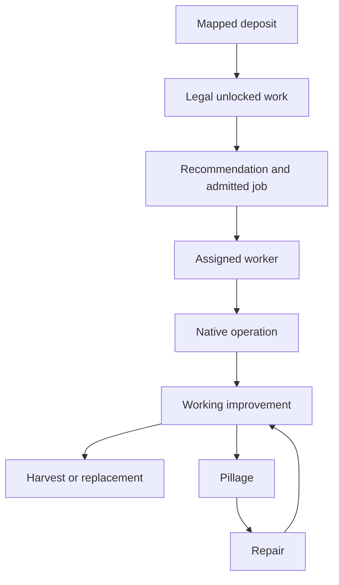

# Materials, Builders, preservation and repair

A valid material can be locked, unowned, unsafe, unassigned, reserved for a destructive alternative, pillaged after repair or covered by a district. Builder counts alone cannot distinguish these failures.

Boston's only Cattle survived a matched Campus placement test and became a
working Pasture. A later Farm job for the Feudalism boost removed the Pasture
and harvested the deposit. The same Builder, exact plot and distinct native
operations identify work clearance as the cause. [AI-N087]
[Boston's exchange and Builder-loss evidence](../../../research/mods/csc-ai-bakers-natural-research-20261106.md#the-ordinary-exchange-worked-then-a-feudalism-boost-consumed-the-base).

The main CSC publisher also preserved that supplier in a matched CE replay.
The AI put Campus on plot 720 and worked the Cattle on plot 796 by turn 37.
This verifies automatic district protection for the fixture. Builder
clearance is a separate decision. [AI-C065]
[Automatic publisher evidence](../../../research/mods/csc-ai-bakers-natural-research-20261106.md#automatic-district-protection-replay).

The follow-up traced two callers of the same improvement site selector.
Boost planning can skip a city whose location result is empty. Ordinary
planning can defer creating an improvement tree. A guarded replay used
both paths to keep Boston's exact Pasture through Storekeeper activation.
[AI-N088] [Native paths and retained replay](../../../research/mods/csc-ai-bakers-natural-research-20261106.md#guarding-the-boost-decision-before-reservation).

A stock GameCore probe filtered the protected row before native ranking.
The boost route initially deferred Boston's Farm, and later calls retained
eligible same-city alternatives. The supplier survived through Storekeeper.
[AI-N091] [Candidate filtering replay](../../../research/mods/csc-ai-bakers-natural-research-20261106.md#builder-candidate-filtering-before-native-ranking).

The earlier improvement forecast supplies that ranking cache directly.
CE can scope a score change to one improvement on a protected supplier
site without replacing the selector. An already assigned job can reach
execution without another score calculation. [AI-N092]
[CE score producer and execution limits](../../../research/mods/csc-ai-bakers-natural-research-20261106.md#ce-score-producer-and-execution-limits).

CSC's live supplier scan now feeds that CE capability. In the matched
Boston replay the treatment retained the Cattle Pasture and verified
Storekeeper while the control lost the deposit. [AI-C066]
[Automatic Builder protection evidence](../../../research/mods/csc-ai-bakers-natural-research-20261106.md#automatic-builder-protection-in-the-matched-ce-replay).

After a blizzard, a stock continuation kept the damaged Cattle deposit but
did not rebuild the Pasture or repair the Mill by turn 234. A Wonder claim
on the Cattle plot and a Spaceport in production give two separate recovery
dependencies to trace. [AI-C067]
[Stock recovery baseline](../../../research/mods/csc-ai-bakers-natural-research-20261106.md#natural-recovery-after-the-boston-blizzard).

The main CSC Wonder policy redirected the native claim to another site.
Boston's Cattle remained physically developable, and both links remained
down by turn 222. Selection and execution of a Pasture job remain
separate checks. [AI-C068]
[Matched Wonder protection](../../../research/mods/csc-ai-bakers-natural-research-20261106.md#matched-wonder-protection-changed-the-reservation).

When the Spaceport and Research Lab finished, Boston's eligible Water Mill
repair won the building comparison. The city queued an admitted Theater
Square contract. A later Mill contract lost to Encampment, then executed
after that district completed. The Mill's building yields returned while
the missing Pasture kept Storekeeper inactive.
[AI-C069] [Mill repair choice](../../../research/mods/csc-ai-bakers-natural-research-20261106.md#the-mill-won-the-building-comparison-and-missed-the-queue).

Removing only the Pasture in the early Boston fixture exposed separate
job and plot gates. The old plot reservation no longer resolved. The
ordinary improvement slot was occupied, then a different job won.
An Irrigation boost made a new claim and its Builder harvested the
Cattle. [AI-N096] [AI-C070]
[Supplier replay](../../../research/mods/csc-ai-bakers-natural-research-20261106.md#isolating-the-missing-pasture).

Both turn-72 CE arms lost the Cattle. The treatment logged the expected
ineligible Farm values, while the same Irrigation job reached execution.
The forecast receipts alone cannot distinguish a fresh selection from
a job carrying a prior location. [AI-C071]
[Matched supplier failure](../../../research/mods/csc-ai-bakers-natural-research-20261106.md#the-turn-72-protection-arms-both-lost-the-cattle).

The turn-69 comparison caught the actual Farm selection before the
Irrigation reservation. The treatment redirected the job and kept the
Cattle through turn 81. Boston's first two open ordinary job slots
went to a Camp elsewhere. A Pasture remained legal and Storekeeper
stayed inactive. [AI-C072]
[Earlier matched protection](../../../research/mods/csc-ai-bakers-natural-research-20261106.md#earlier-protection-redirected-the-boost-and-preserved-the-deposit).

Holding protection constant, a bounded Pasture bid won the next
ordinary job in treatment. The AI assigned a Builder and restored
the original Pasture. Storekeeper and the Mill's supplier output
returned at both subsequent samples. The control kept its Cattle
with the Pasture missing. [AI-C073]
[Matched Pasture recovery](../../../research/mods/csc-ai-bakers-natural-research-20261106.md#a-bounded-pasture-bid-restored-storekeeper-in-the-matched-replay).

The main CSC publisher and the CE bid API reproduced that recovery.
The treatment restored the Pasture and activated the native growth
modifier on Boston's exact City Center recipient. The control kept
protection and still lacked the Pasture. [AI-C075]
[Integrated publisher and exact recipient evidence](../../../research/mods/csc-ai-bakers-natural-research-20261106.md#the-main-csc-supplier-publisher-uses-the-existing-ce-score-hook).

The naturally damaged chain had a different dependency. The Cattle
survived, but the Mill stayed pillaged and Boston never submitted
its repair through turn 264. The supplier preference needed the
Mill. [AI-C076]
[Simultaneous damage and the production queue](../../../research/mods/csc-ai-bakers-natural-research-20261106.md#preserving-the-natural-supplier-did-not-resolve-simultaneous-damage).

On the turn-258 replay the Mill was eligible in all six building
comparisons. Military Academy won the building ranking, and the
queue eventually trained Modern Armor through its generic offense
fallback. [AI-C078]
[The Mill's nomination and queue competition](../../../research/mods/csc-ai-bakers-natural-research-20261106.md#military-academy-beat-the-eligible-mill-in-building-selection).

The turn-261 repeat separated two barriers. Academy beat the Mill
by 60,619 Q8 at the building comparison. A 1,428,800 Q8 project
beat Academy, then failed execution. Boston went straight to generic
offense. A larger Mill bid would also have to beat the failed project
if the existing queue order stays in place. [AI-C079]
[Exact queue operands](../../../research/mods/csc-ai-bakers-natural-research-20261106.md#the-rejected-project-sent-the-queue-straight-to-generic-offense).

A matched preference lifted the eligible Mill to 783,717 Q8 and
won the building ranking. The same unadvanceable project won the
category comparison, so the city still reached generic offense.
The other observed building winner came from threat review. [AI-C080]

In a separate matched replay, the native eligibility check excluded
the unavailable project before ranking. Boston then chose a valid
Terrestrial Laser at the same score. Neither arm restored Storekeeper.
[AI-C082] [Matched project eligibility replay](../../../research/mods/csc-ai-bakers-natural-research-20261106.md#project-eligibility-preserved-a-valid-terrestrial-laser).

A later Mill-only baseline kept the Pasture and Granary working.
Boston took a Theater Square contract, offered the Mill repair the
following turn, and executed it after Theater Square completed.
The exchange and Storekeeper were working at turn 126. [AI-C083]
[Mill-only contract and payouts](../../../research/mods/csc-ai-bakers-natural-research-20261106.md#boston-repaired-the-mill-after-theater-square).

In the turn-100 normal-start run, Alexandria Troas had the Mill,
Granary and Feudalism. Its only mapped Base was unimproved Cattle.
The exact Pasture bid reached the native scorer, but the city kept
reserving another site and had no Pasture at the endpoint. Trace
proposal admission and worker assignment on this save. [AI-C084]
[Normal-start follow-through](../../../research/mods/csc-ai-bakers-natural-research-20261106.md#normal-start-follow-through-to-turn-100).

The turn-112 replay found that Alexandria's ordinary improvement
tree was occupied on nine checks. When the slot opened, the
selected improvement was Pasture but another tile led by 5,888 Q8
in all three comparisons. The Bakers supplier was selectable.
[AI-C085] [Competing Pasture trace](../../../research/mods/csc-ai-bakers-natural-research-20261106.md#alexandria-selected-a-different-pasture).

Adding 6,144 Q8 in the matched diagnostic changed all three
locations and reached native Builder assignment. The Pasture was
still absent at 112 while the assigned work was in its movement
step. A continuation without the extra bid reselected and built
the competing Pasture. [AI-C086]
[Matched choice and assignment](../../../research/mods/csc-ai-bakers-natural-research-20261106.md#the-extra-pasture-bid-changed-location-and-assignment).

Keeping the extra bid on the same turn-112 save redirected the new
job to the Bakers supplier. The AI completed the Pasture at 118
and the exact City Center received Storekeeper Growth on turns
119–121. [AI-C087]
[Matched execution and Service](../../../research/mods/csc-ai-bakers-natural-research-20261106.md#keeping-the-bid-active-completed-the-bakers-pasture-and-storekeeper).

The integrated publisher and widened CE cap then reproduced the
same work and three Storekeeper turns without a diagnostic hook.
[AI-C088] [Integrated calibration replay](../../../research/mods/csc-ai-bakers-natural-research-20261106.md#the-integrated-supplier-bid-reproduced-storekeeper-without-a-diagnostic-hook).

The later ordinary-start game delivered the same bid to Aigai's
Pasture scorer. The Cattle remained unimproved at 150 while other
jobs held reservations. A second start with the same setup diverged
and called the city at that site Alexandria Troas. It reserved and
improved the Cattle, and Storekeeper operated from 119. Trace the
open admission and assignment to explain the difference. [AI-C110]

The 105–120 follow-up captured the successful branch. The exact
Pasture won the first three open ordinary comparisons. On turn
109 the city failed to find an available Builder despite owning
two with charges. One reached the tile later, built the Pasture
on 118, and Storekeeper operated on 119. The original Aigai
branch remains unresolved. [AI-C111]

In Heidelberg, the ordinary
improvement tree repaired the Maize Farm during a three-turn
Storekeeper lapse. The native effect resumed on 187 for the same
Quarter and customer. [AI-C106]

Heidelberg then placed a Dam on that same Maize tile. CE had
deducted 24,576 Q8 from the exact district-site pair while the
Farm and Service still worked. The Dam entered the queue on 206
and Storekeeper stayed down from 207 through the endpoint.
This leaves permanent last-supplier protection open even where
the score deduction reaches the district. [AI-C107]

Melbourne had a reversible supplier loss in the same game. Its
Rice deposit survived but the Farm was gone. The exact Builder
bid reached the scorer, the city rebuilt the Farm on 241, and
Storekeeper resumed on 242. [AI-C108]

The same packages then ran from normal setup. Alexandria's
Storekeeper operated for six measured turns after the native
Pasture completed. Other cities still had production or
placement gaps. [AI-C089]
[Fresh calibrated game](../../../research/mods/csc-ai-bakers-natural-research-20261106.md#the-fresh-calibrated-game-activated-one-storekeeper).

The same game's Melbourne Wind Mill passed requirements but
lost its ordinary building comparison to Amphitheater. Two
earlier queue openings accepted existing contracts. A nomination
bid needs separate checks for production and payout. [AI-C090]
[Melbourne building trace](../../../research/mods/csc-ai-bakers-natural-research-20261106.md#melbournes-available-wind-mill-lost-the-ordinary-building-nomination).

The matched nomination bid changed the valid offer to Wind
Mill. Its score came from the ordinary building cache, below
the boosted nomination score. The Commercial Hub was still
in production at the endpoint. [AI-C091]
[Nomination and offer pricing](../../../research/mods/csc-ai-bakers-natural-research-20261106.md#the-wind-mill-nomination-changed-without-carrying-its-premium-into-the-offer).

At the next production opening the native queue raised the
same offer's value and accepted it without another adjustment.
Melbourne completed the Mill on turn 137 and operated Storekeeper
on 138–143. The replay establishes follow-through from one
diagnostic nomination. [AI-C092]
[Production and payout trace](../../../research/mods/csc-ai-bakers-natural-research-20261106.md#melbourne-executed-the-wind-mill-offer-at-its-native-refreshed-value).

Charleston later received the same bounded supplier preference
for a Maize Farm. The Farm worked at the endpoint and Charleston
operated Storekeeper on 176–177, while Alexandria and Melbourne
remained active. This is a second supplier resource and a third
working chain in the development game. [AI-C098]
[Charleston follow-through](../../../research/mods/csc-ai-bakers-natural-research-20261106.md#charleston-activated-a-third-storekeeper-after-a-farm-bid).

A committed Clear Plot job still has to select a worker with charges
before submitting a removal or harvest. In the matched turn-72
replay a one-shot failure stopped the old harvest, and an ordinary
job later claimed the same tile and rebuilt the Pasture. Storekeeper
resumed. The main CSC and CE guard reproduced that result without
Frida. Other destructive routes remain open.
[AI-N097] [AI-C074] [AI-C077]
[Committed-harvest replay](../../../research/mods/csc-ai-bakers-natural-research-20261106.md#a-committed-harvest-failed-safely-and-boston-used-the-plot-again).

## AI-C011 — Broad Builder tuning had mixed confounded outcomes

The historical 90/900 package reached improvement density 7.76/city versus 5.22 at the common 200 checkpoint, but did not finish 250. A later resource-layout variant with the same settings gave 6.70/city at 200. Training, purchases, unit additions and remaining charges measure different things. Later native tracing established that the Units-list Value adds to request priority rather than acting like a percentage; Basic's Builder 50 is not a promise of 50 workers. Required City=-1 removes one city-ID restriction while retaining ordinary eligibility checks; it does not assign a worker or guarantee recruitment.

Scope: One-seed historical Builder/density trials and current-build static Units/request consumer tracing.

Limits: Interrupted runs do not enter completed 250 comparisons. Combined settings and changed worlds do not identify a useful individual coefficient or prove sufficient workers for a particular job.

Sources: [Builder partial result](../../../research/mods/csc-ai-rh-builders-20261017-turn200.md), [interruption](../../../research/mods/csc-ai-rh-builders-20261017.md), [density result](../../../research/mods/csc-ai-density-v4-20261017-turn250.md), [Builder consumers](../../../research/mods/csc-ai-native-builder-consumers-20261028.md), [request priority](../../../research/mods/csc-ai-native-builder-priority-20261028.md).

## AI-C012 — Private yields are not human-economically inert

Zero-turn readbacks showed one worker move to Flax with private+40, changing ordinary worked Production/Culture despite unchanged real plot inputs. The later Plantation extension changed allocations/output without additional material development. Empty icons and UI filters do not prevent this.

Scope: All-owner raw-resource/improvement mechanism arms.

Limits: No direct conversion into money does not imply no economic effect. Older inert-output wording is superseded; all-owner diagnostic packages were not AI-only release candidates.

Sources: [Citizen effects](../../../research/mods/csc-ai-private-resource-citizen-effects-20261024.md), [extended forecast](../../../research/mods/csc-ai-resource-improvement-forecast75-results-20261024.md).

## AI-C013 — Soft care landed without reliable preservation

Material-care v 1 stopped 170; v 2 ended after observer defeat 192 rather than 225. V 2 recorded eleven repair-to-working episodes and thirteen supporting-link losses, including four confirmed native harvests for Farm jobs. A working improvement was sometimes actively removed before harvesting.

Scope: Historical 160/80/20 care and urgency experiments.

Limits: Occupancy alone is not a confirmed harvest. Repairs do not prove incentive causality, and nodeSUCCESS is not operation/completion. Neither endpoint achieved the declared 225 test.

Sources: [v1](../../../research/mods/csc-ai-material-care-v1-20261023.md), [decision paths](../../../research/mods/csc-ai-material-care-decision-paths-20261023.md), [v2 terminal result](../../../research/mods/csc-ai-material-care-v2-terminal192-20261023.md).

## AI-C014 — A harvest ban was an unsuitable preservation control

The no-harvest rule prevented the raw control’s three losses through 75 and yielded six versus five working Base producers. It also removed Quarter options and caused repeated rejected harvest/build routes, some later adapting to Pastures.

Scope: Identical source 16→75 counterfactual pair.

Limits: One world, shared private signals and subsidies; zero working Both producers. A player-wide legality restriction is not targeted care and was not promoted.

Sources: [Native harvest-rule result](../../../research/mods/csc-ai-native-harvest-rule75-20261024.md).

## AI-C015 — Direct Pasture and conditional Farm routes had positive controls

Cattle 2533 changed from a Farm reservation/harvest in the raw control to a Pasture reservation 20, working 21 and retained 75 under direct Pasture 80. The 150 resource-Farm pilot verified seven isolated resource-Farm positives and 81 terrain-only negatives, with logged job/reservation and physical development evidence.

Scope: Separate historical direct and conditional forecasting treatments.

Limits: All-owner scope, whole-bundle/timing differences and divergent spending prevent isolated empire-benefit claims. The Farm poweroff left 45 research rows and other interval observations missing; its dense-observation pass stayed false. Preservation and repeated pillage remained problems.

Sources: [Pasture result](../../../research/mods/csc-ai-pasture-forecast75-results-20261024.md), [Farm150](../../../research/mods/csc-ai-resource-farm150-test-20261024.md).

## AI-C016 — District-free supply is necessary but insufficient

A planner falsely counted Silk retained under a City Center as future Plantation supply. The corrected same-source 75 guard omitted that site: four valid foundations versus five, unchanged seven working Base producers and zero Both producers.

Scope: Exact precommit audit and external planner/commit correction.

Limits: A globally valid improvement mapping plus owned/revealed/district-free resource does not prove current unlock, terrain legality, reachable Builder or eventual work. Fewer false starts is a quality fix, not a causal whole-mod victory.

Sources: [False-Both discovery](../../../research/mods/csc-ai-resource-improvement-forecast75-results-20261024.md), [corrected result](../../../research/mods/csc-ai-material-viability75-results-20261024.md).

## AI-C017 — Recommendations, assignments and getter domains differ

Honey became its city’s highest returned recommendation at 112/113 and stayed unimproved; different Builders received identical city lists. Flax’s absence did not prove illegality or zero hidden value. Separate probes also found existing serialized Farm values and newly assigned Sugar responding differently despite correct loaded definitions.

Scope: Bounded follow-through, recommendation/admission and zero-turn delivery studies.

Limits: No same-path positive control means a getter’s zero is inconclusive. UI, Gameplay, initialization phase and reload cannot be interchanged; recommendation is not admitted work or allocated capacity.

Sources: [Follow-through](../../../research/mods/csc-ai-material-followthrough-20261031.md), [recommendations](../../../research/mods/csc-ai-material-recommendations-20261031.md), [admission](../../../research/mods/csc-ai-work-admission-20261031.md), [delivery](../../../research/mods/csc-ai-acquisition-signal-delivery-20261024.md).

[Complete source map](source-map.md).
