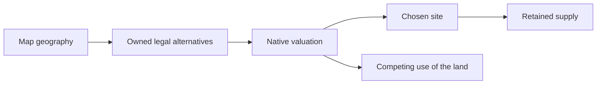

# Material opportunities and placement incentives

For the engine side of these experiments, read [joint district/site choice](../native/district-choice.md)
and [empire priorities](../native/empire-needs.md). Those explain where a placement
signal enters and why raw adjacency does not determine the final choice.

Geography, city access, native valuation and later preservation are separate problems. A map can lack an entire material class; a city can lack a legal owned site; an AI can choose another site for genuine economic reasons.

## AI-C006 — More resources do not ensure useful city opportunities

Fifteen paired native maps showed TAR Abundant mostly redistributing sites, while Truly Abundant increased Both-site counts. Some paired maps lacked Tailor specialty resources entirely. Offline studies and native helper follow-ups developed a resource-generation pass; production scope narrowed to Bakers/Tailors and temporary Tailor density assistance increased opportunities.

Scope: Five paired landscapes, historical 80-layout emulator study and separate native helper/density samples.

Limits: Geographic counts precede ownership, city reach, visibility, research and complete legality. Fixed-landscape emulation does not reproduce all native RNG/start adjustment. Shared clusters are not independent investments, and map assistance is not AI competence.

Sources: [Map opportunities](../../../research/mods/csc-map-material-opportunities-20261016.md), [offline abundance](../../../research/mods/csc-offline-abundance-study-20261016.md), [generation calibration](../../../research/mods/csc-offline-generation-calibration-20261016.md), [production materials](../../../research/mods/csc-implemented-materials-native-20261016.md), [Tailor native density](../../../research/mods/csc-tailor-density-native-20261017.md).

## AI-C007 — Early co-location gains did not solve material choice

Placement v 1 increased Quarter/customer co-location without convincing mapped-material improvement and with more supporting deposits covered later. The subsequent native bonus/river package chose Bakers Base in 24/27 opportunities versus 14/25 baseline and 16/28 v 1 on one seed.

Scope: Historical combined treatments, including one completed Online 250 bonus/river game.

Limits: One seed and multiple changed inputs cannot isolate each cue or establish general superiority. Better placement still needs retained supply and development.

Sources: [Placement v1](../../../research/mods/csc-ai-tuning-v1-20261017.md), [bonus/river trial](../../../research/mods/csc-ai-native-bonus-river-20261017.md).

## AI-C008 — The broad BONUS cue was effective but poorly targeted

The generic bonus-resource proxy changed native values and siting, but rewarded resources unmapped to the relevant Quarter. In density-v 4, nine of eleven Tailors beside bonus resources had only wrong-industry bonus types. Later mechanism contrasts confirmed responsiveness without a demonstrated chain-quality improvement; current source removes BONUS 12.

Scope: Historical proxy experiments and current November source.

Limits: Removing it is not itself proved to improve the economy. Broader guidance can incidentally help, so removal and exact-material replacement require their own outcome evidence.

Sources: [Density result](../../../research/mods/csc-ai-density-v4-20261017-turn250.md), [mechanism results](../../../research/mods/csc-ai-mechanism-tests-20261025-results.md), [current source boundary](../../../research/mods/csc-future-economy-forecast-20261103.md).

## AI-C009 — Markers and resource-class sets were rejected representations

Synthetic feature markers reached prospective native previews but accumulated clearing, placement and presentation side effects. A separate custom resource-class probe worked, while tested list encodings behaved as single distinct class identifiers. Resource reclassification would change gameplay and cannot cleanly represent overlapping CSC TypeTags.

Scope: October 17 marker trial and October 28 native resource-class probes.

Limits: Preview recognition does not establish safe metadata or better natural choices. The tested class encodings failed multiple membership; do not infer arbitrary parser capabilities from a TEXT column.

Sources: [Rejected markers](../../../research/mods/csc-ai-markers-rejected-20261017.md), [custom class](../../../research/mods/native-custom-resourceclass-probe-20261028.md), [multivalue test](../../../research/mods/native-resourceclass-multivalue-probe-20261028.md).

## AI-C010 — Spatial amounts and preferences have different units

Ordinary native adjacency with dynamic private yields reaches district valuation. Yield bias 25 is a percentage-style contribution; the traced positive Districts preference uses aggregate sign and a 1.5 multiplier. Raw private yield is not that many final score points.

Scope: Current-build static consumers and bounded runtime mechanism contrasts.

Limits: Costs, time discount, competing land value and caches intervene. The two final observer diagnostics captured no target Quarter decision and closed after excessive callback fan-out; no calibrated placement benefit follows.

Sources: [Placement consumer/weights](../../../research/mods/csc-native-quarter-placement-weights-20261101.md), [controls](../../../research/mods/csc-native-quarter-placement-control-evidence-20261101.md).

[Complete source map](source-map.md).
