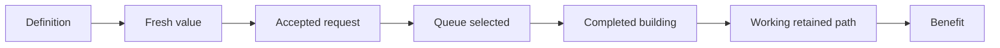

# Producer and customer follow-through

The corresponding engine model is [prerequisite value and production](../native/production-and-prerequisites.md)
and [prospective modifier evaluation](../native/modifier-forecasts.md). These
separate missing-prerequisite foresight from an actual customer-building gate.

The AI can value a missing building and complete useful work in individual cases. The question is how that work passes caches, contracts and competing production, then keeps functioning supply.

## A retained Bakers Stage 2 chain in Boston

The matched tests kept Boston's exact Cattle Pasture next to a working Water
Mill and Granary. Engineering and Feudalism advanced through normal research.
At turns 63 and 66, the Granary produced 2 Food against a base of 1, the Water
Mill produced 1 Production and 1 Gold, and the Storekeeper marker and Growth
property were active. The earlier replay also showed the ordinary exchange
still producing after the supplier was lost, while Storekeeper stayed absent.
[AI-C061] [AI-C062]
[Boston evidence and turn-66 checkpoint](../../../research/mods/csc-ai-bakers-natural-research-20261106.md#retained-stage-2-chain-verified-at-turns-63-and-66).

## AI-C024 — Private producer value reached an unbuilt Workshop decision

A bounded trace captured a legal unbuilt Textile Workshop’s fresh NetValue and nested private getter 80, later best-building selection and queue entry. This is stronger than a UI preview or loaded row.

Scope: Historical Kobdo 110/111 RH package and current-build native consumer investigation.

Limits: The OFF arm never ran. Delivery, consumption and one choice do not prove 80 caused that choice, completion or economic benefit. Today’s population/property-consumer source is not the historical package.

Sources: [Producer decision](../../../research/mods/csc-ai-producer-decision-20261030.md), [live effect](../../../research/mods/csc-ai-producer-live-effect-20261029.md), [current source distinction](../../../research/mods/csc-future-economy-forecast-20261103.md).

## AI-C025 — Accepted work can wait behind another queue

The exact target district request was accepted 103/105 while Builder production continued, selected/Execute at 109 when the queue emptied, and completion-censored at 110. Native construction can use a prepared foundation without an immediate queue replacement.

Scope: Single-target existing-city observation and static contract trace.

Limits: Priority, PresentValue, retained contract value, best-building fallback and final queue arbitration differ. No general finish-first override was proved.

Sources: [Foundation observation](../../../research/mods/csc-ai-foundation-observation-20261029.md), [decision path](../../../research/mods/csc-ai-foundation-decision-path-20261029.md).

## AI-C026 — Strategy building inputs loaded without the hoped response

Twenty-seven CSC counterparts added to RH strategy Buildings lists had verified definitions/adoption but V 7’s physical state, finance and scoped construction/strategy/tree logs matched V 6 through 150. A conditional Granary strategy later reported true/Following while the observed ordinary building path still received preference 0.

Scope: Fixed-A RH package comparison and separate bounded Granary delivery probe.

Limits: These are route/context non-responses, not unsupported Buildings everywhere or proof that another Value increase would help. Specialization probes also lacked a responsive positive control.

Sources: [RH campaign](../../../research/mods/csc-ai-rh5-parity-campaign-20261024.md), [conditional Granary](../../../research/mods/csc-ai-granary-priority-20261031.md), [mechanism controls](../../../research/mods/csc-ai-mechanism-tests-20261025-results.md).

## AI-C027 — Direct Granary preference worked without controlling the target

Direct trait binding delivered preference 1 in 20/20 captured evaluations and two exact 2× Granary winners. The prescribed city still lacked Granary/Bakery after 21 intervals; Choir elsewhere completed Granary and began Bakery. Its Food 2 versus database base 1 is compatible with an additional CSC effect.

Scope: Genghis trait-wide experimental 110→131 control.

Limits: Instrumentation/recovery differences prevent isolated causality; Walls and military allocation changed. The wider gain was not free, and Choir lacked a full retained-chain material/effect census.

Sources: [Direct preference](../../../research/mods/csc-ai-granary-direct-priority-20261101.md), [earlier measured decision](../../../research/mods/csc-ai-granary-decision-20261031.md).

## AI-C028 — Customer geometry was a concrete repeated failure

All four selective-assisted sites had working Both and upstream producers at 150 but no operating customer path. Three lacked Stage 2 geography; Choir had an adjacent City Center without Granary. All four also lacked registered Stage 3 customer geometry.

Scope: Four precisely identified assisted investments in the selective RH screen.

Limits: More Both starts alone would not address the diagnosed customer-path gap. Partial extraction/producer benefits do not require the full operating milestone, so these cases are not automatically zero-income.

Sources: [Selective result](../../../research/mods/csc-ai-paired-selective-chain-screen-results-20261101.md), [customer reconstruction](../../../research/mods/csc-ai-customer-comparison-20261023.md).

## AI-C029 — Current future inputs are explicitly authored

An existing Tailors Quarter supplies Workshop private 80 for BASE plus 40 with SPEC. The RH role bridge does not itself check Quarter completion/pillage. An existing functioning Bakers Mill can target Granary private 40 before Granary exists; the real Mill→Granary exchange instead requires actual recipient Granary.

Scope: Pinned November 3 source and native analysis.

Limits: Fact flags use mapped-resource presence, ownership, reveal and district-free checks, not full improvement buildability or Builder availability. Do not describe historical getter 80 as a run of the whole current source tree or evidence of complete native network simulation.

Sources: [Current forecast investigation](../../../research/mods/csc-future-economy-forecast-20261103.md).

## AI-C030 — Current population returns are realized-state calculations

Stage 3 per-population seller/customer consumers attach to City Centers; Lua computes actual functioning same-owner adjacent relationships and writes bits. Stage 4/export consumers can instead adjust named building yields. Legacy producer-owned definitions can remain present but unattached.

Scope: November 3 source, after consumer changes.

Limits: Native unsupported collections, omitted property gates and missing plot context prevent assuming faithful arbitrary future-chain forecasting. Missing material is not equivalent to no ordinary Stage 3 sales.

Sources: [Forecast/source audit](../../../research/mods/csc-future-economy-forecast-20261103.md).

[Complete source map](source-map.md).
