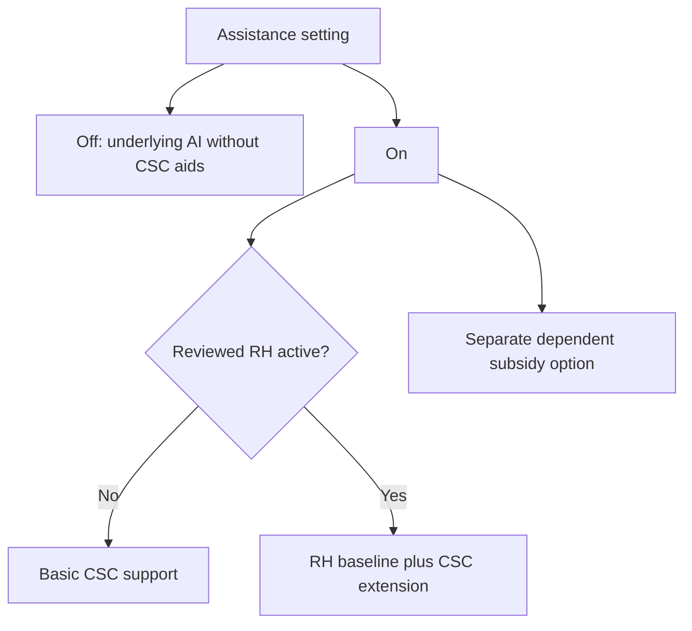

# Profiles and reference-mod lessons

Basic and RH share a CSC-specific objective without requiring identical knobs. Reference mods supply techniques to inspect, not proof that every row works on the current build or permission to copy their whole policy.

## AI-C038 — Profile separation is architecture, not qualification

Off means native CSC without CSC AI interventions, or RH alone when RH is active. On selects Basic or RH-specific support, with a separate subsidy option. Basic owns general Builder/improvement/movement/contract inputs; RH is intended to own its baseline while CSC addresses evidenced supply-chain gaps.

Scope: Current objectives/source architecture and dated native pilots.

Limits: A historical profile status or manifest is not current installed-state proof. No sustained multi-map Basic/RH competence or parity was established, and old global Builder weights must not be silently shared into RH.

Sources: [Profiles](../../../integrations/csc-ai-profiles.md), [objectives](../../../integrations/csc-ai-objectives.md), [source audit](../../../research/mods/csc-ai-profile-source-audit-20261028.md).

## AI-C039 — RH version changes invalidate copied assumptions

The old 4.34 reference used improvement 90/globalBuilder 900. Reviewed 5.097 uses improvement 30, no equivalent globalBuilder 900 row, +1 friendly movement and substantial Lua Builder purchasing. Selecting a needy spawn city is not dispatching an existing Builder to an exact resource job.

Scope: Read-only, version-pinned RH source review.

Limits: Leader overrides, load order and activation gates matter. RH’s separate resource-improvement fallback is a stronger intervention, not proof of a native job dispatcher. Reference source is read-only; source declarations are not performance validation.

Sources: [RH5.097 review](../../../research/mods/csc-rh-v5097-ai-review-20261018.md), [fallback distinction](../../../research/mods/csc-ai-acquisition-signal-delivery-20261024.md).

## AI-C040 — AI+ and Real Strategy supplied bounded leads

AI+ led to RequiredCity=-1 and AddGoalTech civic payload wiring. Real Strategy supplied trait/list and Lua-strategy precedents, while its historical system comments helped distinguish subsystem semantics. Their successful packages do not prove every named preference or current-build consumer works.

Scope: Read-only AI+v 13, RealStrategy 2.3.1 and RH dynamic-research reviews.

Limits: No arbitrary per-Quarter resource matcher or safe CSC Service-goal adapter emerged. Author-reported behavior remains separate from locally reproduced runtime results; civic preferences and ordinary yield percentages are not interchangeable units.

Sources: [AI+ review](../../../research/mods/csc-aiplus-research-review-20261020.md), [Real Strategy review](../../../research/mods/csc-real-strategy-research-review-20261020.md), [RH dynamic examples](../../../research/mods/csc-rh-dynamic-research-followup-20261019.md).

## AI-C041 — The RH parity campaign did not qualify a winner

V 6 reached 150 with 57 cities,55 completedQuarters,39 producers,21 Base,5 Both,8 customer links and 4 flags, but failed its per-city and customer/Service gates against Basic-A. V 7’s 27 strategy additions matched V 6’s physical signature, scoped logs and finance through 150.

Scope: Historical fixed-A RH development series, not three independent parity successes.

Limits: Startup retries, same-world reloads and source candidates are not independent worlds. Later closures and the paused broad campaign override diary statements that say ACTIVE. Current source is not automatically the executed candidate.

Sources: [Parity ledger](../../../research/mods/csc-ai-rh5-parity-campaign-20261024.md), [latest consolidated progress](../../../integrations/csc-ai-progress-and-learnings-20261101.md).

## AI-C051 — RH steers placement through custom adjacency incentives

The installed5.097 source uses `RH_YIELD_LAST_RESORT` for positive and negative
district-site incentives, including reciprocal Industrial Zone/infrastructure
relationships and natural-wonder/volcano penalties. This demonstrates the general
score-steering principle. Its visible implementation uses SQL yield/adjacency
definitions; no direct native district-score hook was found in the reviewed
package. Our native extension can instead supply arbitrary signed per-pair
adjustments from independently calculated CSC facts.

Scope: Read-only installed5.097 source and package inventory,4 November2026.

Limits: Source intent is not runtime efficacy, and absence from this package
cannot establish what RH privately knows or does with external tools. Older
public-source yield identifiers must not be substituted for the installed ones.

Source: [RH5 placement-method comparison](../../../research/mods/csc-rh-native-placement-method-review-20261104.md).

[Complete source map](source-map.md).
