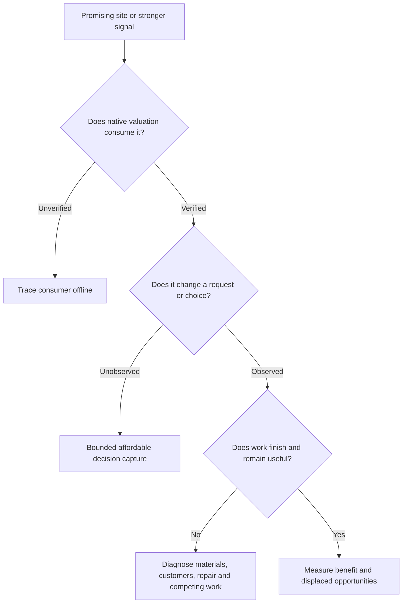

# How our understanding developed

The research has moved from broad tuning to tracing the decisions that tuning must reach. We have working inputs and useful assistance mechanisms, but have not established reliable, worthwhile supply-chain development throughout games under both supported AI profiles. More Quarters, stronger displayed values or cheaper purchases have each proved insufficient as a definition of success. **[AI-H001]**

This page reconciles the [AI optimisation chat](codex://threads/01a12a24-6714-7540-8d23-154b092106fe), its dated reports and the later November architecture investigations. The full chat pagination reached its beginning: **50 pages, 492 distinct turns, 11 October–1 November 2026**. The [review record](../../data/thread-review.json) records every retrieved turn ID and the limits of that review. Command outputs were not re-audited from the chat; linked reports and their underlying evidence support technical conclusions.

## The objective stayed broader than the experiments

Henno's initial question on 11 October was whether the AI could understand custom adjacency, place Quarters beside their materials and customers, improve those materials, and pursue useful Services. The objective was made explicit on 28 October: develop the opportunities in the AI's lands into supply chains that increase total empire benefit and support its priorities. The [durable objective](../../../integrations/csc-ai-objectives.md) governs interpretation of the trials.

That objective includes material-aware sites, rivers, balanced customer placement, producer/customer construction, material retention and repair. Strategic Service matching remains an intended later capability. A mountain Campus can be a better investment than a weak Campus beside a Quarter; customer encouragement must preserve that comparison. Fewer strong chains can be preferable to Quarter proliferation. **[AI-H001]**

Map randomness is part of the intended design. The chat explicitly accepts unequal industry opportunities between games and players. Base-only sites can support valuable earlier stages, while Both-material sites offer additional later potential. Map assistance was investigated to supply opportunities, not to guarantee identical industrial portfolios.

## The main phases

| Period | Question and evidence | What we carried forward |
|---|---|---|
| 11–16 October | Establish untreated behaviour before optimising it; inspect map opportunities and material scarcity. Five Standard-speed games were followed by more carefully specified Online comparisons. | Keep speed, settings, resource passes, map opportunities and observation windows attached to every comparison. [Initial baseline](../../../research/mods/csc-ai-baseline-20261015.md), [paired Standard-resource baseline](../../../research/mods/csc-ai-paired-standard-20261016.md). |
| 16–18 October | Can ordinary adjacency, material modifiers, synthetic map markers and Builder preferences improve play? | Co-location guidance was promising; synthetic features interfered with clearing and placement. General bonus-resource guidance could reward the wrong industry. [First tuning](../../../research/mods/csc-ai-tuning-v1-20261017.md), [rejected markers](../../../research/mods/csc-ai-markers-rejected-20261017.md), [bonus/river trial](../../../research/mods/csc-ai-native-bonus-river-20261017.md). |
| 19–21 October | How do dynamic research preferences reach the AI? What can RH, AI+ and Real Strategy teach us? | Loaded rows and callback truth are intermediate evidence. Actual research goals and choice transitions must be measured in their proper consumer. [Native civic goals](../../../research/mods/csc-native-civic-goals-findings-20261020.md), [dynamic foundations](../../../research/mods/csc-ai-dynamic-foundations-20261021.md). |
| 21–23 October | Can a legal, zero-progress district foundation secure a good site while leaving production to the AI? Can the host acquire a route one tile at a time? | Placement and purchase assistance work as interventions, with real land commitment and economic costs. The AI can complete foundations, but completion and chain operation are separate. [Three-game foundation study](../../../research/mods/csc-ai-dynamic-foundations-three-games-20261021.md), [material-access study](../../../research/mods/csc-ai-material-access-overnight-20261023.md). |
| 23–25 October | Do improvement forecasts, preservation cues and compatibility additions develop and retain supply? | Some values reach the native engine; repairs and new improvements occur. Harvests, district coverage, absent customers and pillage still break chains. Equal nominal forecast amounts do not prove equivalent consumers. [Mapped improvements](../../../research/mods/csc-ai-mapped-improvements-test-20261024.md), [mechanism tests](../../../research/mods/csc-ai-mechanism-tests-20261025-results.md). |
| 28–30 October | Which native functions turn values into proposals, contracts, queues and completed work? Can symbolic references and REA reduce guesswork? | Read-only native analysis and bounded observation made several consumers visible. Names and old-platform layouts remain leads requiring current-build checks. A producer forecast was observed entering a fresh unbuilt-building valuation and Workshop queue entry, without an off-arm causal contrast. [Native production](../../../research/mods/csc-ai-native-production-analysis-20261028.md), [producer decision](../../../research/mods/csc-ai-producer-decision-20261030.md), [REA trial](../../../research/mods/csc-ai-rea-trial-20261030.md). |
| 31 October–1 November | Can a selective, customer-aware planner do better than broader acquisition? Do ordinary building preferences reach their consumer? | A direct Granary trait route was delivered; a conditional strategy route did not deliver that ordinary preference in the bounded test. Selectivity restrained spending, but did not improve combined chain counts. [Granary delivery](../../../research/mods/csc-ai-granary-direct-priority-20261101.md), [selective comparison](../../../research/mods/csc-ai-paired-selective-chain-screen-results-20261101.md), [customer-aware v2](../../../research/mods/csc-ai-customer-aware-planner-v2-native-20261101.md). |
| 1 November | Can we capture effective Quarter placement weights and a natural decision? | Two observers stopped at turn 2 because callback volume exceeded the cost gate. No useful target choice was captured and no weights changed. [Placement evidence](../../../research/mods/csc-native-quarter-placement-control-evidence-20261101.md). |
| 1–3 November | Starting from Industrial Zone, how do prerequisites, future effects, district types, sites and empire needs connect? | Static and bounded runtime work distinguishes useful foresight channels from a full future-chain model. District/site pairs are jointly compared; current strategy and performance can change value. [IZ architecture](../../../research/mods/civ6-industrial-zone-planning-architecture-20261101.md), [IZ runtime boundary](../../../research/mods/civ6-industrial-zone-decision-boundary-20261101.md), [future economy](../../../research/mods/csc-future-economy-forecast-20261103.md), [district choice](../../../research/mods/civ6-district-choice-placement-and-incentives-20261103.md). |

## Where the earlier approach became stuck

Several separate bottlenecks had accumulated. We were sometimes adjusting signals before confirming their consumer, measuring recommendations without observing job admission, or treating an attractive site as if its future customers were secured. Instrumentation and controller overhead then made the decisive observations expensive. This explains why continuing to increase weights was unlikely to resolve the whole problem.

The later studies identify concrete boundaries rather than a universal failure of AI planning:

- A city's exposed improvement recommendation is not its admitted native job value or assignment. Honey became the highest exposed recommendation without being improved; it never entered the captured job payloads. A Builder-allocation failure therefore remains unproved. [Recommendation study](../../../research/mods/csc-ai-material-recommendations-20261031.md), [admission study](../../../research/mods/csc-ai-work-admission-20261031.md).
- A best-building return can belong to threat review or another caller, while the actual production queue chooses a unit or a district contract. [Granary decision](../../../research/mods/csc-ai-granary-decision-20261031.md), [IZ runtime boundary](../../../research/mods/civ6-industrial-zone-decision-boundary-20261101.md).
- A future-customer promise in CSC bookkeeping does not reserve that plot in the native planner. One promised Holy Site became a Theater Square. Customer-aware geometry cannot ensure the named building will be completed. **[AI-H009]** [Customer-aware native study](../../../research/mods/csc-ai-customer-aware-planner-v2-native-20261101.md).
- Reading a private yield during scoring establishes delivery; it does not establish native discovery of the entire economic dependency or the marginal benefit of that signal. [Future-economy study](../../../research/mods/csc-future-economy-forecast-20261103.md).

## The latest optimisation results in context

The selective RH screen spent **195 Gold versus 795**, but ended with **three full-supply S2-or-S3 contexts versus four**. All four assisted sites had working Both supply and upstream producers; none reached a qualifying customer path. Reduced spending was cost restraint, not improved total chain operation.

The following customer-aware v2 run produced **one working assisted chain**, retained at every sampled checkpoint from 119 through 150. Overall it ended with **two full-supply contexts versus three** in the previous selective arm, and **15 working Base sites versus 19**. Of its 200 Gold, 85 belonged to a turn-149 investment with no foundation by 150. That late episode remains right-censored. These are descriptive same-map, joint-package comparisons; none isolates every component or establishes net empire gain. **[AI-H002]**

Working material improvements and producers can yield benefits before a full-chain milestone. An unfinished or nonoperating commitment is not automatically zero return, and structural links or Service flags are not recorded payments. **[AI-H003]** [Selective results](../../../research/mods/csc-ai-paired-selective-chain-screen-results-20261101.md), [progress synthesis](../../../integrations/csc-ai-progress-and-learnings-20261101.md).

## Current research state

The broad optimisation campaign remains **paused**. Both November placement observers are closed; their earlier live and next-step sections are historical provenance. Later authorised IZ and district investigations were separate scopes. This handbook does not start a game, resume an automation, change weights or implement a native extension. **[AI-H004]**

A separately authorized native prototype first demonstrated a scoped district
score adjustment reaching a new request's logged value, with the winner unchanged.
The subsequent clean-rules Sydney trial changed Neighborhood to Tailors at the
same tile and produced a native Quarter request. When its existing Bomber
finished, that request was selected and the Quarter's physical foundation
appeared on the declared preferred tile at turn254 and completed at255. This crosses the earlier
score-only boundary; it does not yet establish economic quality or chain benefit.
See the [delivery prototype](../../../research/mods/civ6-district-score-prototype-20261103.md)
and [choice/construction trial](../../../research/mods/civ6-district-placement-choice-20261103.md).

The earlier CSC tuning is archived and its runtime actions retired. The new
trial imports no old site heuristic, subsidy or scripted foundation policy.
Discovery/project cinematic stalls exposed during follow-through were fixed
in the shared controller, whose default handlers then passed the blocked turn.

The useful next questions are now about specific missing capabilities and their consumers. Read [corrections and cautions](corrections-and-cautions.md) before interpreting an older report, then [open questions](open-questions.md) for the remaining evidence boundaries.
