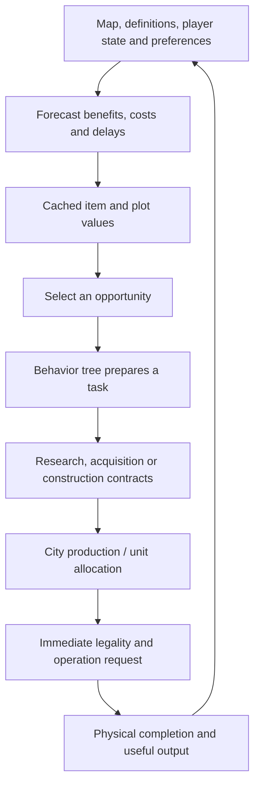

# How the native AI turns value into work

The inspected Civ VI city AI separates evaluating an opportunity, requesting work, choosing production and completing an action. A strong score at one stage does not guarantee success at the next. This is a reconstruction of specific economic paths, not the complete military, diplomatic or victory AI. [AI-N001]

The core economic chain is visible in CityBuild: off-turn analysis submits a city-evaluation job; per-plot evaluation writes caches; activation processes related building values and checks opportunities. QueueNextBuild later arbitrates production. The selector therefore reads a prepared valuation rather than performing a fresh complete simulation at its return. See the [production reconstruction](../../../research/mods/csc-ai-native-production-analysis-20261028.md) and [district study](../../../research/mods/civ6-district-choice-placement-and-incentives-20261103.md).

## Refresh, proposal and execution are different clocks

CityManager StartTurn clears per-city off-turn/job flags. Once five subsystem
readiness conditions hold, CityBuild schedules a City Analysis job that evaluates
all stored plot rows for that cycle. Full matching-priority activation then
aggregates building forecasts and checks opportunities. A live district event
tree can block a new district winner request even with fresh scores; ordinary
production selection waits for an empty queue. This is a per-turn analysis cycle
with separate gates, not a universal exact count of selector calls per turn.
[AI-N067]

The [score anatomy](district-score-anatomy.md) separates each value component;
[district choice](district-choice.md) explains current versus future land, and
[production](production-and-prerequisites.md) explains contracts and queue gates.

## Three meanings of planning

**Forecasting dependencies:** a Factory can have value before Workshop exists, and some of that value can flow backward to Workshop and Industrial Zone.

**Preparing one task:** the shipped district tree coordinates research, plot purchase/reservation, Builder clearance and district construction. This is real multi-step coordination. [AI-N002]

**Maintaining an economic objective across tasks:** the inspected ordinary building route commits to its selected item. No enduring Factory-rooted construction graph was found there. That scoped result does not establish that every native subsystem lacks higher-level plans. [AI-N003]

The [IZ architecture study](../../../research/mods/civ6-industrial-zone-planning-architecture-20261101.md) supplies the data, tree and code evidence for these distinctions.

## Requests have more than one kind of importance

A UnitRequestContract has a request priority and a separate extra present-value field. Unit preferences can add to the first; city queue comparisons read the second. “Priority,” a log's “Value,” a preference row's “Value” and an item's yield are not interchangeable units. [AI-N004]

The [Builder consumer trace](../../../research/mods/csc-ai-native-builder-priority-20261028.md) connects Units.Value to request priority. The [runtime request observation](../../../research/mods/csc-ai-native-contract-observation-20261028.md) separately observed same-priority requests with different evolving values.

## Native work exists; an arbitrary submission interface remains a gap

The Build Improvement node can reach native improvement, repair and adjacent-improvement requests after checking workers, reachability and legality. That establishes an action consumer. [AI-N005]

A reusable interface carrying an external planner's player, city, material plot and improvement into that consumer was not established. Operation coordinates alone do not prove the economic tree's typed working data is populated. This remains a [bounded integration gap](../../../research/mods/csc-ai-native-material-job-feasibility-20261030.md), discussed under [modding controls](modding-controls.md).

Ordinary improvement admission is another boundary: CheckForImprovement can exit while its stored tree slot is occupied, before submitting a new candidate. A cached recommendation is therefore not an admitted job or an available Builder. The October 31 trace linked fresh Farm/Mine payloads, while Honey never entered the observed payloads; it did not show a Honey job failing worker assignment. [AI-N052] See [work admission](../../../research/mods/csc-ai-work-admission-20261031.md).

## Read next

- [District choice](district-choice.md): which type/site wins.
- [Empire needs](empire-needs.md): where strategic state enters values.
- [Production and prerequisites](production-and-prerequisites.md): why a winner may wait.
- [Modifier forecasts](modifier-forecasts.md): what hypothetical effects can actually express.
- [Evidence and instrumentation](evidence-and-instrumentation.md): how these conclusions were established.
