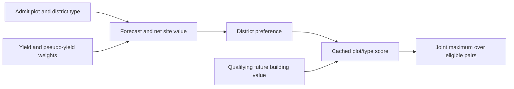

# District type and site are chosen together

In the inspected ordinary city route, the AI compares district/plot pairs. A better Campus site can help Campus beat another district type; this route does not first fix a type independently of its available locations. [AI-N006]

GetBestDistrict (RVA 3e4a50) loops cached plot records and DistrictDefinition indices. It takes the highest admitted score and randomizes equal-score ties. A live reservation supplies a threshold the new candidate must exceed. Its initial stored baseline is the invalid sentinel **−2,559,744 Q8**, representing−9,999 utility units, **not zero**: the selector itself has no score-greater-than-zero test.

The selector consults the contract manager before using a stored plot
threshold. A cached reservation whose contract is gone uses the default
threshold. Alexandria's Quarter repair reproduced this case in the
turn-201 district comparison. [AI-C119]

For a Dam alternative, compare legal sites in the same native floodplain.
The flood handler scans the affected river's floodplain for a complete,
unpillaged flood-prevention district. This establishes coverage for
flood damage. Other location benefits still need their own comparison.
[AI-N106]

This is a local comparison over this city's cache, not proof of exhaustive optimization of all future district layouts. The [district choice report](../../../research/mods/civ6-district-choice-placement-and-incentives-20261103.md) is the detailed evidence source.

## Which plots enter?

InitializePlotAnalyzers (3e7350) initializes up to 37 city-index plots: three rings including the center, skipping off-map positions. Evaluation checks revelation, ownership/city assignment, purchasable adjacent unowned land, district restrictions and placement potential. [AI-N007]

InternalOnly districts are excluded. OnePerCity prevents another site when that type already exists elsewhere in the city. Forecast admission permits estimating missing research and construction delays; immediate permission to start construction is checked later.

The allocated matrix spans the complete district-definition collection, including
locked and unusable types; rejected pairs receive invalid entries. Missing tech
and civic ETA plus construction time can admit future districts within the
valuation horizon. Native planning is broader than the CSC pilot's owned-only
scanner: revealed unowned rows can be evaluated, while the ordinary winner gate
admits owned or adjacent-frontier land. Land assigned to another city or owned by
another player is rejected in this route. Plot-purchase cost enters NetValue.
[AI-N066]

GetBestLocationFor (3e5550) serves a different purpose: it finds a site for an already specified district type. Do not use that overload to describe the joint type/site choice.

District NetValue doubles its accumulated value for a candidate that
matches the existing pillaged district on its plot. The City Center
gets an extra addition before doubling. Later cache aggregation can
change the final amount available to the selector. [AI-N108]

## What the cached score means

Per-plot evaluation reaches district NetValue (52a440) and DistrictValue (52d500). Inputs include timing, adjacency and other benefits, strategic conversion weights, maintenance, acquisition/clearance economics and lost existing value. Later CalculateDistrictValues (3dfee0) can propagate qualifying future building values into positive district entries. These are different stages and units, not a list of raw yields to add together. [AI-N008]

The [score anatomy](district-score-anatomy.md) gives a component ledger and the
measured Quarter examples. Q8 means256 stored units per utility unit; a large
integer is not a large raw adjacency yield or evidence of forecast accuracy.

## Preferences and competing use of land

The inspected district preference uses accumulated **sign**: negative excludes the type, zero is neutral, positive multiplies the net site value by **1.5**, before later building-value aggregation. A larger numeric Districts.Value is not a proportional increase in this multiplier. Multiplying a negative score can make it more negative. [AI-N009]

DistrictValue also compares static adjacency for feasible alternative types on the same land. When the chosen type's static value is below the maximum, it can subtract the **full maximum**, rather than just the difference. This deduction is guarded by DistrictDef+e0 mask 0x04 being clear; that flag is **Aqueduct**, proved through the current SQL loader. This is narrower than comparing alternatives' complete net economic values. [AI-N010]

A custom adjacency cue can therefore affect its recipient and competing uses of the same tile. There is no verified universal “raw cue equals final score” or doubling formula.

## Winning is the start of a workflow

The selected pair seeds a behavior tree. Purchase, reservation, clearance, contract competition and immediate CanZone still follow; a forecast winner is not a construction receipt. [AI-N011] See [production and prerequisites](production-and-prerequisites.md).

Routine off-turn city analysis refreshes values on a per-turn, readiness-gated
cycle. Activation aggregates future-building forecasts; CheckForDistrict only
asks for a new winner when its district event-tree slot is free. A busy tree
therefore does not imply stale scores. [AI-N067]

In the turn-8 London control, the game refreshed a positive Bakers score
while the Holy Site tree held the district slot. London was producing the
Great Bath at the same time. The district planning slot and the production
queue can have different commitments. [AI-N082]
[Natural checkpoint and native log evidence](../../../research/mods/csc-ai-bakers-natural-research-20261106.md).

Boston's later Campus plan reserved a tracked Bakers Base deposit even
though an improvement tree had already reserved it. The selector requires
a score strictly above the effective reservation value. A positive
reservation therefore gives the competing improvement a threshold, and a
strong district can clear it. The placement decision preceded the build
queue's acceptance by two turns. [AI-N084]
[Campus and supplier timeline](../../../research/mods/csc-ai-bakers-natural-research-20261106.md#boston-lost-the-tracked-base-before-its-mill-was-available).

A matched test lowered that exact Campus pair by 8,784 Q8. Boston chose a
different site, built its Campus there, and finished the planned Pasture on
the retained Cattle. This demonstrates a finite preference for the inspected
auction. Later choices still need protection if they threaten the supplier.
[AI-N086] [Matched protection test](../../../research/mods/csc-ai-bakers-natural-research-20261106.md#a-matched-deduction-protected-the-only-base).

## Buying a future site

The district tree can request a particular unowned location through a
PurchasePlotContract. Economic's targeted route checks the lowest positive quote
across the player's cities, plot/slush savings and native purchase legality.
Already-owned locations succeed without buying. Independently, an opportunistic
Economic pass considers each city's cached frontier-resource acquisition target,
using improvement forecasts and a feature heuristic. This is not a universal
highest-yield-tile auction. Requested targets have a more permissive savings
hurdle than routine purchases. [AI-N069]

Founding first annexes eligible plots immediately around the new
City Center. A proposed Bakers site beside that center is therefore
usually already owned. An adjacent supplier farther out can still
require acquisition of its own. A targeted purchase for the district
does not cover the supplier. [AI-N101]

See [cache timing and purchase details](../../../research/mods/civ6-district-cache-timing-and-purchases-20261104.md)
for exact funds/thresholds, phase conditions and the important distinction
between the two pilot misses and a proven native purchase.

## Observed score and selection timing

Fresh valuation can also happen before the city asks for its next district.
In the clean Sydney trial, eleven Tailors outputs reached the cache while an
existing Aerodrome tree finished; no new ordinary GetBestDistrict return was
captured that interval. A site score alone therefore does not prove that a
new district proposal was compared. [AI-N063] See the
[placement-choice test](../../../research/mods/civ6-district-placement-choice-20261103.md).

The later matched decision provides direct causal evidence for joint type/site
comparison: a scoped Tailors incentive changed Sydney's winner from Neighborhood
to Tailors **at the same tile** and generated a native Quarter request. This is
not proof of Quarter site relocation. [AI-N064] A later replay observed the
waiting request selected when the Bomber finished, a physical Quarter
foundation at the preferred tile at254, and completion at255. [AI-N065]

The Lua query plot:CanHaveDistrict(districtIndex, playerID, cityID) reads three numeric arguments after self in this build. No fourth future/ignore flag was found. Its result expresses bounded plot potential, not complete city permission, an economic quote or material preservation: an auto-harvest path can admit resource-bearing land. [AI-N012] See the [legality investigation](../../../research/mods/csc-native-future-customer-legality-20261101.md).
