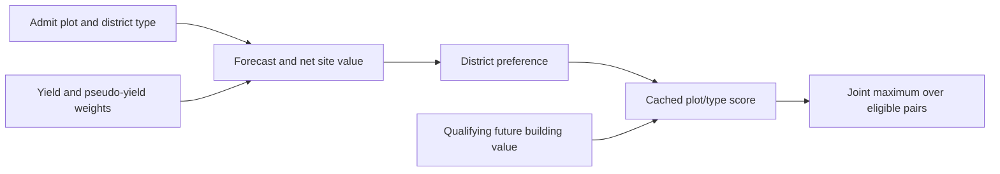

# District type and site are chosen together

In the inspected ordinary city route, the AI compares district/plot pairs. A better Campus site can help Campus beat another district type; this route does not first fix a type independently of its available locations. [AI-N006]

GetBestDistrict (RVA 3e4a50) loops cached plot records and DistrictDefinition indices. It takes the highest admitted score and randomizes equal-score ties. A live reservation supplies a threshold the new candidate must exceed. Its initial baseline is the invalid Q8 sentinel −9999, **not zero**: the selector itself has no score-greater-than-zero test.

This is a local comparison over this city's cache, not proof of exhaustive optimization of all future district layouts. The [district choice report](../../../research/mods/civ6-district-choice-placement-and-incentives-20261103.md) is the detailed evidence source.

## Which plots enter?

InitializePlotAnalyzers (3e7350) initializes up to 37 city-index plots: three rings including the center, skipping off-map positions. Evaluation checks revelation, ownership/city assignment, purchasable adjacent unowned land, district restrictions and placement potential. [AI-N007]

InternalOnly districts are excluded. OnePerCity prevents another site when that type already exists elsewhere in the city. Forecast admission permits estimating missing research and construction delays; immediate permission to start construction is checked later.

GetBestLocationFor (3e5550) serves a different purpose: it finds a site for an already specified district type. Do not use that overload to describe the joint type/site choice.

## What the cached score means

Per-plot evaluation reaches district NetValue (52a440) and DistrictValue (52d500). Inputs include timing, adjacency and other benefits, strategic conversion weights, maintenance, acquisition/clearance economics and lost existing value. Later CalculateDistrictValues (3dfee0) can propagate qualifying future building values into positive district entries. These are different stages and units, not a list of raw yields to add together. [AI-N008]

## Preferences and competing use of land

The inspected district preference uses accumulated **sign**: negative excludes the type, zero is neutral, positive multiplies the net site value by **1.5**, before later building-value aggregation. A larger numeric Districts.Value is not a proportional increase in this multiplier. Multiplying a negative score can make it more negative. [AI-N009]

DistrictValue also compares static adjacency for feasible alternative types on the same land. When the chosen type's static value is below the maximum, it can subtract the **full maximum**, rather than just the difference. This deduction is guarded by DistrictDef+e0 mask 0x04 being clear; that flag is **Aqueduct**, proved through the current SQL loader. This is narrower than comparing alternatives' complete net economic values. [AI-N010]

A custom adjacency cue can therefore affect its recipient and competing uses of the same tile. There is no verified universal “raw cue equals final score” or doubling formula.

## Winning is the start of a workflow

The selected pair seeds a behavior tree. Purchase, reservation, clearance, contract competition and immediate CanZone still follow; a forecast winner is not a construction receipt. [AI-N011] See [production and prerequisites](production-and-prerequisites.md).

The Lua query plot:CanHaveDistrict(districtIndex, playerID, cityID) reads three numeric arguments after self in this build. No fourth future/ignore flag was found. Its result expresses bounded plot potential, not complete city permission, an economic quote or material preservation: an auto-harvest path can admit resource-bearing land. [AI-N012] See the [legality investigation](../../../research/mods/csc-native-future-customer-legality-20261101.md).
