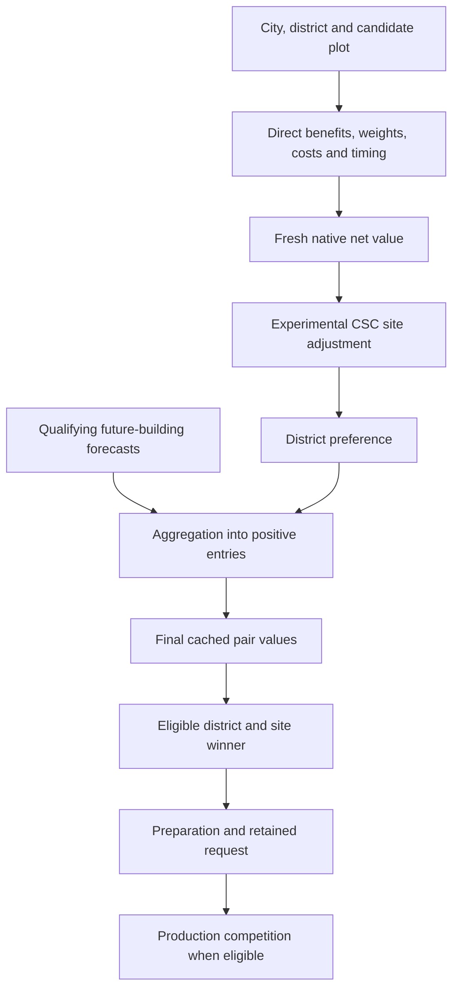

# What goes into a district-site score?

Adjacency is an early input to a broader, state-sensitive forecast. The AI
estimates what a district and qualifying future buildings can contribute, when
that contribution can start, and what the site displaces. Understanding those
components is more useful than treating the final number as adjacency in larger
units. The [component and timing investigation](../../../research/mods/civ6-district-cache-timing-and-purchases-20261104.md)
connects this map to native code and captured CSC cases.

## Units and precision

The inspected scores are signed **Q8 fixed point**:256 stored units represent
one utility unit. Nominal fractional resolution is1/256. Utility is not raw
Production, Gold, profit or a universal exchange rate. Larger integers also
reflect income streams over time and later aggregation. Fine numerical
resolution does not establish accurate economic forecasts. [AI-N013] [AI-N055]

## A component ledger

| Stage | What enters | Important boundary |
| --- | --- | --- |
| Admission | Player's buildable district mapping, type/geography restrictions, revelation, ownership/assignment and frontier access | Allocated matrix slots are not necessarily valid or selectable. Future research can be forecast; readiness beyond the horizon is invalid. [AI-N066] |
| Direct district benefits | Native adjacency and supported district/player yields; applicable pseudo-yields, special effects, housing and other branches | These are weighted inputs, not an unweighted sum of adjacency numbers. [AI-N008] [AI-N016] |
| Empire conversion | Yield DefaultValue, player's aggregate yield bonuses, strategy/personality and catch-up responses | The same yield can matter differently to different empires or at different times. [AI-N013] [AI-N014] |
| Timing | Research/civic ETA, construction delay and evaluation horizon; fixed amounts and income streams use their own discount routes | Production cost is reflected through native construction timing here; do not invent a universal one-time subtraction formula. [AI-N008] [AI-N018] |
| Site economics | Maintenance; plot purchase; supported clearance/harvest; lost improvement/resource value | A future unowned site is not treated as free land. [AI-N008] [AI-N066] |
| Competing land use | Feasible alternatives' static adjacency on the same plot | The inspected branch can deduct the full maximum alternative, rather than just the difference. This is narrower than comparing complete future plans. [AI-N010] |
| District preference | Negative excludes; neutral leaves the ordinary branch alone; positive multiplies by1.5 | Larger SQL Districts.Value is not a proportionally larger multiplier. [AI-N009] |
| Future buildings | Positive qualifying building forecasts for a missing/pillaged prerequisite district | A city/type sum is added to positive candidate entries; it is not a fresh site-specific building-chain search at each plot. First-row and ordering exceptions matter. [AI-N018] [AI-N055] |
| Retained requests | A selected site enters its preparation tree and construction request | A lower fresh site score need not lower a request that retains its earlier higher value. [AI-N023] |
| Production choice | Contracts compete with applicable units/projects; fallback compares buildings/units/projects | A district category winner is not automatically the next city production item. [AI-N025] [AI-N067] |

This is an explanatory ordering for the inspected route, not a complete closed
formula for all districts. The CSC adjustment is a research intervention and is
absent in an untreated game.

## What makes the building forecast larger?

Ordinary buildings receive their own native value even before their district
or direct prerequisites exist, with research and production delays. Their
valuation has dynamic yield, pseudo-yield, supported modifier, amenity/regional,
housing, power and other applicable branches. Only qualifying positive values
propagate into the district. [AI-N018] [AI-N026]

There is also a specific heuristic in BuildingValue: it follows a first-
prerequisite chain of depth d and multiplies an early benefit subtotal by
**1+2d** before subtracting normalized maintenance and discounting that income.
Later additions remain separate. This is neither a multiplier on every building
effect nor a complete traversal of the dependency graph. [AI-N068]

For CSC, a hidden prerequisite is therefore not necessarily invisible to native
valuation. The River Access→Water Mill relationship and the Mills listed before
Bakery/Café deserve inspection. Their exact component impact in the latest
test was not measured.

## What the latest Quarter test actually measured

| Bakers case | Fresh native value | Site penalty | Remaining value | Final cache |
| --- | ---: | ---: | ---: | ---: |
| Delhi |66,743|65,536|1,207|1,358,358|
| Majapahit |228,808|196,608|32,200|1,623,830|

The penalties applied. Both values stayed positive, so later building aggregation
remained enabled. The capture shows a large subsequent gain, but it did not
record every building/helper contribution. It cannot tell us how much was Mill,
Bakery, Café, regional amenities or an approximated modifier. The result warrants
decomposition, rather than assuming the final value is either all correct or all
unwanted. [AI-C050]

The identified building pass applies a shared city/type contribution to positive
site entries. That explains why a weak adjacency site can receive substantial
future-development value; it does not prove the native model faithfully prices
CSC's actual material/customer dependencies.

Native ordinary adjacency and CSC's bundled Lua adjacency are also distinct.
The pilot reads CSC's loaded rules itself; its+4 criterion becomes an explicit
priority adjustment, not a calibrated conversion of the Quarter's entire future
yield stream. We cannot assume the native hypothetical evaluator runs the Lua
adjacency writer for an unbuilt Quarter. [AI-N030] [AI-N032] [AI-C049]

## Grow the CSC model without counting benefits twice

Use a component ledger with four states:

1. **Native and understood:** preserve verified ordinary yield, cost, timing and
   strategic contributions.
2. **Native approximation needing review:** prerequisites, hypothetical effects,
   geographic context and regional benefits may not match CSC economics.
3. **CSC relationship missing from the forecast:** identify a specific material,
   customer, construction or Service dependency and its responsible consumer.
4. **Unmeasured:** retain uncertainty and capture the component before assigning
   it a correction.

The [modifier-forecast limits](modifier-forecasts.md) distinguish supported effects
from skipped requirements, unsupported collections, absent plot context and
current-state Lua returns. A working gameplay modifier does not guarantee an
accurate hypothetical forecast. Equally, a large positive native result is not
evidence that its whole contribution should be removed.

The [CSC roadmap](../../roadmap.md) therefore calls for native-versus-CSC component
accounting before another broad final-score adjustment. Earlier candidate coverage
and existing-request persistence remain separate placement issues.
