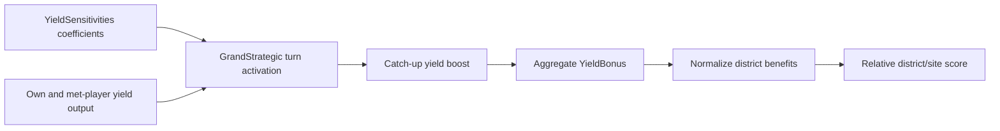

# How empire and city needs enter district value

Native district choice is not driven only by adjacency. The max selector reads cached scores; strategic preferences, current performance and local needs enter those scores upstream. This establishes concrete responsiveness, not a guarantee that the most urgent missing district always wins.

## Convert benefits using the player's weights

NormalizeYields (52b110) consumes the yield's DefaultValue and the player's aggregate YieldBonus. The ordinary Yields-list Value is percentage-style: 25 contributes +25%, not a 25-times multiplier. Q8 rounding and an upper aggregate cap apply. DefaultValue, adjacency amount, preference and final score remain separate controls. [AI-N013]

The [district/incentive report](../../../research/mods/civ6-district-choice-placement-and-incentives-20261103.md) traces the native conversion and units. Other list systems require their own consumer traces; the same SQL column name does not imply the same units.

## A current-performance catch-up mechanism

The verified path connects a configurable sensitivity to current player performance:

Global initialization (49c7c0) registers YieldSensitivities. Its callback (4a2580) returns the GrandStrategic coefficient vector at +0x468. DoTurnActivate (4b1540) uses positively configured yields, own/met-player output, the leader gap and dispersion to update a boost. YieldBonus (4b6d70) includes that boost, and NormalizeYields consumes the aggregate. [AI-N014]

Thus falling behind can change relative valuations of districts that produce the configured yield. The reconstructed code does not supply a new measured boost or causal district-choice result for today's CSC configuration.

## Personality and active strategies

Leader queries populate district preferences. Shipped strategy priorities link conditions and strategies to Districts, Yields and PseudoYields lists. Native strategy start/end paths attach or remove those lists; victory strategy activation is one traced source. [AI-N015]

A descriptive condition name is not its verified formula. Strategy declarations, a callback firing, actual activation and a downstream consumer are separate evidence. For example, [older civic experiments](../../../research/mods/csc-native-civic-goals-findings-20261020.md) found strategy-owned Civics favorites with no score response despite verified callbacks and Following. Do not generalize one working list system to every other system.

## Local state and coverage

HousingModifierValue (5298e0) reads housing and food surplus and uses growth penalties and projected boundaries. Relevant district branches also inspect regional coverage and existing same-type districts; applicable unit/resource-enabling benefits are additional inputs. These are state-sensitive mechanisms beyond a fixed personality label. [AI-N016]

The evidence does not reconstruct a complete empire portfolio optimizer or prove a rule such as “count Campuses, then build exactly enough.” How those weights and competing tasks combine in a particular live choice remains a numerical/runtime question. [AI-N017]

## What this means for mod design

Separate a type-level motive from a site-specific benefit. A Boolean Lua strategy can gate a broad preference; native adjacency can discriminate between sites. A custom supply-chain opportunity model needs a verified bridge into the relevant consumer rather than assuming a “need” property is automatically read. See [modding controls](modding-controls.md) and [modifier forecasts](modifier-forecasts.md).
