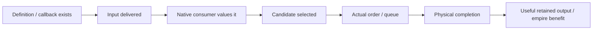

# Reading native evidence without overstating it

The canonical native conclusions here apply to the inspected Windows XP2 GameCore DLL SHA256:

```text
324c51e9ea3531758842e16c69e6cddbefbb226c5b675c3d6e60111646c2e98c
```

Addresses in these topics are RVAs from image base 0x180000000. Reconstructed C is not recovered Firaxis source.

## Names help discovery; bytes establish the target

The supplied historical linker map has rich C++ names, aliases and vtable information. It belongs to a different historical binary. Community transfers provide candidate current names, but there is no single global address delta, and a matching name does not establish the current ABI or layout. Current callers, loaders, vtables, assembly and PE bytes supply those checks. [AI-N039]

See the [symbol-resource provenance](../../../research/mods/csc-ai-gamecore-symbol-resource-20261029.md). Linux layouts and overloaded signatures are discovery aids, not permission to dereference current Windows memory using an assumed structure.

## What a runtime control establishes

The first native probe compared fresh play with a reload and had differing AI values plus an incomplete control endpoint. Its limitations remain historical facts.

A later loaded-save versus loaded-save count-only control matched exported endpoints and all 17 closed AI CSVs for that short vanilla 1→6 scenario. This resolves that particular fresh/load confound; it does not prove general neutrality for richer hooks or longer/modded scenarios. [AI-N040] Sources: [first probe](../../../research/mods/csc-ai-native-instrumentation-probe-20261028.md), [loaded control](../../../research/mods/csc-ai-native-loaded-control-20261028.md).

Hook entry counts and retained records measure different things. The historical producer observer intercepted over 2.5 million yield-getter calls, while the failed placement diagnostics retained no target choice despite heavy fan-out. A small retained-record cap does not bound callback overhead, and zero target records do not mean rejection by the native scorer. [AI-N041] See the [producer report](../../../research/mods/csc-ai-producer-decision-20261030.md) and [placement control summary](../../../research/mods/csc-native-quarter-placement-control-evidence-20261101.md).

## A useful bounded consumer observation

The October 30 producer trace linked a live private +80 adjustment to a fresh unbuilt Workshop valuation, then a favored building selection and actual queue entry. Its off arm never ran and the transition between fresh NetValue and later cache was not captured. This proves delivery and consumption in that package, not a causal+80 choice effect, completion or empire benefit. [AI-N042]

The November 1 IZ trace separately verified exact backward-value arithmetic and a Lighthouse category result followed by Neighborhood production. Neither observation is a broad tuning benchmark.

## Keep lifecycle evidence separate from AI evidence

The shared NativeSession/controller owns load intent, readiness, process identity, finite advances and verified restoration. Load acknowledgement is not readiness. A zero-turn integration can validate lifecycle handling without proving any AI behavior. [AI-N043] See the [shared-session report](../../../research/mods/csc-shared-native-session-20261030.md).

Future runs remain subject to the user's active authorization and maintained controller workflow. These knowledge pages authorize no launch, hook, score change, new world or old-campaign restart.

## Use an evidence ladder

A claim should name which boundary it reached:



Each arrow needs evidence; later stages do not follow from a promising name or score. State unknowns, dropped exposure, original-human versus actual-AI roles, profile/package dates and alternative consumers explicitly. Fixture success is not native gameplay evidence, and successful restoration is not AI efficacy. [AI-N044]

Current static engine facts, observed historical CSC packages and proposed future extensions are deliberately separated across these topics. The linked dated reports remain the provenance record; their older “next step,” live status and proposed amounts do not become current instructions.
