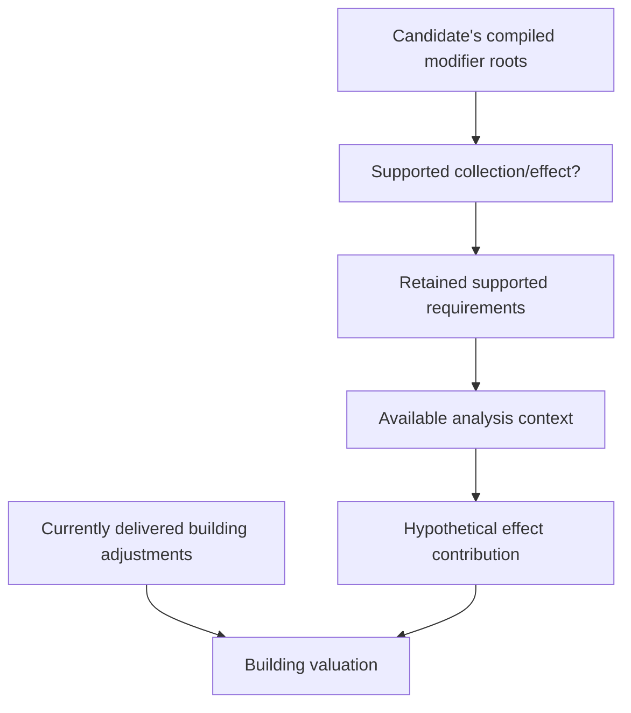

# What prospective modifier analysis can and cannot forecast

Gameplay modifier activation and hypothetical AI valuation are different systems. A working gameplay effect, tooltip or Lua preview does not prove that native candidate scoring simulates the same effect before its source and recipients exist.

## Two building-value inputs

BuildingValue (52b900) reads dynamic YieldDefinitions through the city's live per-building GetYieldChange. Positive adjustments enter normalization. Separately, it evaluates a precompiled modifier vector through ModifierValue (529ed0) and GameEffectAnalyzer. A live adjustment need not depend on the hypothetical interpreter's capabilities. [AI-N026]

The [future-economy study](../../../research/mods/csc-future-economy-forecast-20261103.md) is the current synthesis; the historical [producer observation](../../../research/mods/csc-ai-producer-decision-20261030.md) captured private +80 entering fresh valuation for an unbuilt Textile Workshop. Its off arm did not run, so delivery/consumption and selection were observed, not the marginal benefit of 80.

Another native heuristic follows the first prerequisite-building chain and
multiplies an early benefit subtotal by1+2×depth before maintenance/discounting.
Later modifier, amenity and other additions remain separate. Hidden prerequisites
can therefore matter to the approximation; this does not establish their numeric
effect in a particular live city. [AI-N068] The [score anatomy](district-score-anatomy.md)
keeps this distinct from supported hypothetical modifier interpretation.

## Unsupported collections and requirements fail differently

A missing collection or effect handler leaves a null pointer and compilation/evaluation refuses that modifier. The inspected 27-collection registry lacks COLLECTION_PLAYER_IMPROVEMENTS. Current producer-to-material wrappers using it are therefore unsupported through that traversal, without implying zero material value everywhere. [AI-N027]

Unrecognized **requirements are skipped** when compiling the AI requirement list. An ALL set with no retained requirements succeeds. The registry lacks REQUIREMENT_PLOT_PROPERTY_MATCHES; its nested-set string REQUIREMENTSET_IS_MET differs from CSC's REQUIREMENT_REQUIREMENTSET_IS_MET, with no alias established. [AI-N028]

It is consequently wrong to assume that every gameplay requirement rejects a hypothetical effect when currently unmet. Omitted gates may admit an approximation; unsupported collections may omit it entirely.

The modifier compiler reads definition virtual slot +0x60, independently identified as **SubjectRequirementSetId**. OwnerRequirementSetId is slot +0x58 and is not compiled by that body. This is a scoped interpreter observation, not a claim that owner activation is globally ignored in gameplay or every other native path. [AI-N029]

## Plot context must actually exist

PLAYER_PLOT_YIELDS and SINGLE_PLOT_YIELDS share a handler that consumes an already supplied analysis +0x88 plot once. It neither enumerates plots nor fills that field. OWNER also does not fill it. Direct DistrictValue and the ordinary non-placement building context leave +0x88 empty; the plot effect's no-subject callback returns without adding value. These specific direct forecast paths therefore gain no plot contribution through that handler. Placement-specific, nested and live routes remain separate. [AI-N030]

An older note mislabeled the 4634d0/4634f0 city iterator as PLAYER_PLOT_YIELDS. That mapping and its city-enumeration explanation are **superseded**, not an alternative current interpretation. [AI-N045]

## Missing recipient capability is not a missing-chain simulation

AdjustBuildingYieldEffect (475a50) can discount an absent target building's stream by 0.5 after admission. But the supported ordinary CityHasBuilding requirement (490c90) tests actual presence and does not substitute the hypothetical candidate index. Its exception is for IsWonder, not ordinary Granary, Workshop or Lighthouse. A compiled customer gate can therefore block the effect before its 0.5 capability matters. [AI-N031]

Likewise, AI PlotAdjacentToOwner performs no plot-distance calculation in the ordinary no-unit context; it accepts player presence. An admitted hypothetical effect does not certify faithful geography.

Current CSC population-return Lua uses actual functioning sellers, customer objects, ownership, adjacency and population, then writes properties. The inspected native candidate route is not shown to re-run that writer for a proposed chain. Existing delivered returns and a forecast of future missing partners remain different claims. [AI-N032]
