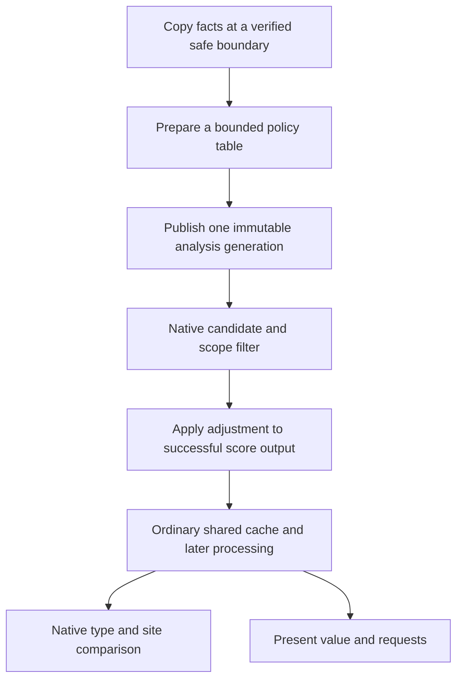

# A native bridge for custom district incentives

A native extension is a credible route to a formula such as
`F(player, city, district, plot, copied state)`. We have identified a concrete
score/cache boundary and its downstream readers. **The bridge remains a design;
no hook, extension build or Civ mutation test has been performed.** [AI-N036]

The [offline feasibility report](../../../research/mods/civ6-district-score-extension-20261103.md)
contains the current-build code, ABI, source and verification details.

## Change the value the AI actually uses

The ordinary evaluator calls district NetValue and copies the pointed signed
score into its plot/district cache. The candidate integration point is immediately
before that store. Its result uses output storage and returns a pointer; a
generic replacement of RAX with an integer would not implement the required
contract. These are static observations requiring real adapter validation. [AI-N053]

Changing only the winning coordinates would leave those cached values unchanged.
That would not provide coherent value guidance to later consumers.

## The incentive can be more expressive than adjacency

A copied numeric table or pure function could express Base/Both combinations,
future customer paths, scarcity, development delay, supply preservation and
competing uses of land. Rules could be authored in data or calculated beforehand
in Lua at a verified context boundary. The proposed native callback would perform
a fast lookup rather than call Lua or Python for every candidate. [AI-N060]

This route can influence AI decisions without adding an ordinary gameplay yield
or a synthetic map feature. Original human identities, including autoplay role
changes, still need explicit exclusion and verification. No AI-only implementation
has been tested.

## Guardrails that change the implementation

**A zero score is ambiguous.** Some native early-outs return zero; other rejected
cases return the invalid sentinel. “Not invalid” does not establish a successful
candidate. A first limited adapter could preserve all zero results, but it would
then omit legal zero-score opportunities too. Valid negative values are not
automatically rejected by the native selector. [AI-N054]

**The stage defines the units.** At the proposed pre-store point the addition is
Q8 AI utility. Positive district preference processing and the later
positive-score future-building gate follow it. A batch addition after preferences
or after future-building aggregation would have different semantics. [AI-N055]
That aggregation can also reset a qualifying positive first-row entry before
adding building value; the adjustment is not guaranteed to survive every row
unchanged.

**The cache has other readers.** Six observed direct present-value call sites
include request updates, triggers, production interruption review and a district
production-effect analyser. Some convert Q8 to integers; the no-plot overload
has a zero floor. Coherence means respecting those transformations. [AI-N056]

**Influence can persist.** District cache values are serialized and restored.
Existing requests can retain higher earlier extra present value. Removing a
bonus therefore need not immediately reverse an old commitment, and repeated
addition to a restored cache could compound it. Load identity, fresh analysis,
policy version and disabling need their own contract. [AI-N057] [AI-N058]

## Existing CE APIs do not already supply it

Pinned Community Extension source shows an entry callback that requests no Lua
return values, and a processor registry whose native callers must be implemented.
Its `DistrictTargetChooser` handles Congress choices. Ordinary district scoring
would require new native integration; naming a processor or property is insufficient.
Installed CE/source correspondence and compatibility were not established. [AI-N059]

A Frida/CModule host is a useful proposed experiment route. A later CE extension
or independent GameCore carrier would need separate packaging, loader, version,
save/lifecycle and compatibility qualification. It is a larger deployment choice
than ordinary SQL/Lua content.

## The next useful proof

First use a separate native test host to prove output-pointer identity, exact
no-op behaviour, scope and arithmetic, immutable publication and native filtering
before JavaScript. The older observers showed why retaining few records does not
make interception cheap. These tests were specified, not executed here.

An eventual bounded existing-save test should then link one declared incentive
to a fresh cached score, the natural winner and downstream request value. It
should use the shared controller, preserve legality and competing decisions,
and issue no forced construction. Chain outcomes and empire benefit remain later
questions. [Open questions](../history/open-questions.md)
