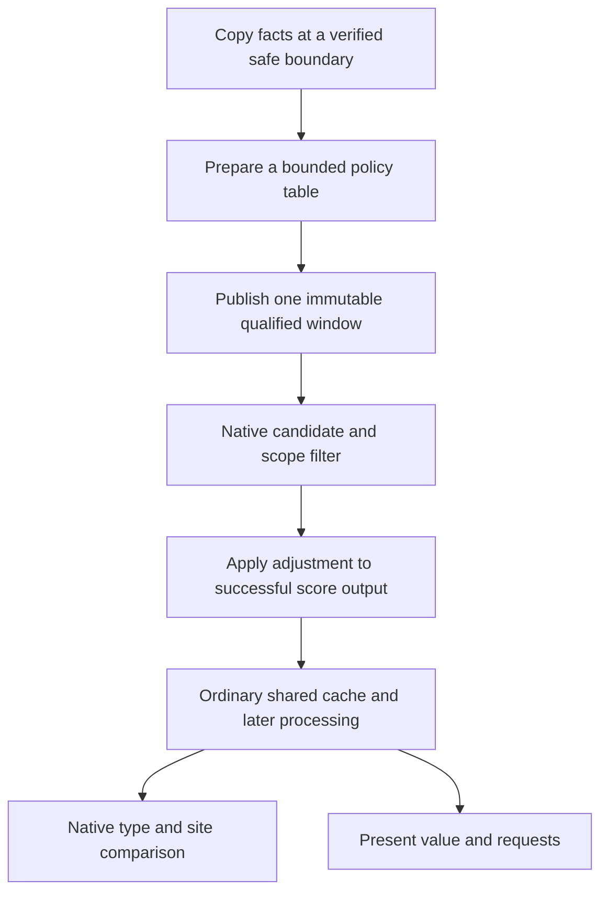

# A native bridge for custom district incentives

> **4 November carrier checkpoint:** The CE fork now carries the existing policy
> and diagnostics through a bounded Online100 test; upstream release remains open.
> Native DLLs can load from mod packages. Henno prefers a CE dependency with CSC Lua/SQL.
> See [Workshop delivery](workshop-delivery.md) for the demonstrated independent
> carrier and the development-fork score API, which is not in released CE.

> 5 November: the master-based PR is closed. The API-only develop source port is
> reviewed, builds with supported MSVC and passes 36 isolated checks and a fresh
> bounded Online100/context/save/reload regression. [Current qualification](../../../research/mods/csc-ce-develop-port-20261105.md).

## Late write reaches district selection and preparation

The Delhi replay changes one completed district-site cell on return from
`CalculateDistrictValues`. The same checkpoint selected Neighborhood at
248,223 Q8 in the control. The pulse raised Bakers at plot 1210 from 104,621 to
248,479 Q8 after aggregation. The native winner and plot-specific present value
both read that exact value. Delhi reserved the site and submitted its missing
Craftsmanship goal through the native district tree. [AI-N075]

This boundary supports corrections measured in the final score's units. The
trial uses Frida and a pinned original DLL. The main CSC Lua library owns the
Bakers policy. A recurring CE implementation needs a late transport and
current component evidence. [Late placement trial](../../../research/mods/csc-ai-late-placement-20261105.md)

## Earlier bridge tests

A native extension now has a working experimental bridge at the ordinary
district score/cache boundary. In a matched one-save trial, a single+1 utility
adjustment reached the completed cache, native winner's score, present value
and new district request. The isolated Win64 host also passed167 checks.
General arbitrary-policy authoring and a shipping extension remain future work.
[AI-N036] [AI-N061] [AI-N062]

The [next controlled trial](../../../research/mods/civ6-district-placement-choice-20261103.md)
tests a distinct preferred Tailors site and natural construction, with the old
CSC tuning [retired](../../../integrations/csc-ai-reset-20261103.md). Its first
interval captured fresh values while Sydney finished an existing Aerodrome;
a new selection needs its own observed opportunity. [AI-N063]

The [offline feasibility report](../../../research/mods/civ6-district-score-extension-20261103.md)
contains the current-build code, ABI and source details. The
[prototype report](../../../research/mods/civ6-district-score-prototype-20261103.md)
records the implementation, isolated checks and bounded game trial.

## Change the value the AI actually uses

The ordinary evaluator calls district NetValue and copies the pointed signed
score into its plot/district cache. The candidate integration point is immediately
before that store. Its result uses output storage and returns a pointer; a
generic replacement of RAX with an integer would not implement the required
contract. The experimental adapter preserves that pointer and adjusts only its
pointed signed32 score; isolated ABI checks and the untouched native trace now
validate this limited integration. [AI-N053] [AI-N061]

Changing only the winning coordinates would leave those cached values unchanged.
That would not provide coherent value guidance to later consumers.

## The incentive can be more expressive than adjacency

A copied numeric table or pure function could express Base/Both combinations,
future customer paths, scarcity, development delay, supply preservation and
competing uses of land. Rules could be authored in data or calculated beforehand
in Lua at a verified context boundary. The proposed native callback would perform
a fast lookup rather than call Lua or Python for every candidate. [AI-N060]

This route can influence AI decisions without adding an ordinary gameplay yield
or a synthetic map feature. Original human identities, including autoplay role
changes, need explicit exclusion and verification. The prototype implements a
single exact original-AI tuple; it does not yet provide the general authoring layer.

## Guardrails that change the implementation

**A zero score is ambiguous.** Some native early-outs return zero; other rejected
cases return the invalid sentinel. “Not invalid” does not establish a successful
candidate. A first limited adapter could preserve all zero results, but it would
then omit legal zero-score opportunities too. Valid negative values are not
automatically rejected by the native selector. [AI-N054]

**The stage defines the units.** At the proposed pre-store point the addition is
Q8 AI utility. Positive district preference processing and the later
positive-score future-building gate follow it. A batch addition after preferences
or after future-building aggregation would have different semantics. [AI-N055]
That aggregation can also reset a qualifying positive first-row entry before
adding building value; the adjustment is not guaranteed to survive every row
unchanged.

**The cache has other readers.** Six observed direct present-value call sites
include request updates, triggers, production interruption review and a district
production-effect analyser. Some convert Q8 to integers; the no-plot overload
has a zero floor. Coherence means respecting those transformations. [AI-N056]

**Influence can persist.** District cache values are serialized and restored.
Existing requests can retain higher earlier extra present value. Removing a
bonus therefore need not immediately reverse an old commitment, and repeated
addition to a restored cache could compound it. Load identity, fresh analysis,
policy version and disabling need their own contract. [AI-N057] [AI-N058]

## Released CE1.3 APIs do not supply it

Pinned Community Extension source shows an entry callback that requests no Lua
return values, and a processor registry whose native callers must be implemented.
Its `DistrictTargetChooser` handles Congress choices. Ordinary district scoring
would require new native integration; naming a processor or property is insufficient.
Installed CE/source correspondence and compatibility were not established. [AI-N059]

A Frida/CModule host first implemented the experimental route. The
[CE fork parity port](../../../research/mods/csc-ce-policy-parity-20261104.md)
now carries the existing policy and four diagnostic families through packaged
Lua and a bounded native consumer, with an audited Online100 result. Broader
compatibility still needs separate packaging, loader, version,
save/lifecycle and compatibility qualification. It is a larger deployment choice
than ordinary SQL/Lua content.

## What the live prototypes establish

The first nonzero trial now establishes delivery through the ordinary path:

| Value | No-write baseline | One+256 Q8 adjustment |
|---|---:|---:|
| Original NetValue output |119,170|119,170|
| Score returned to the ordinary caller |119,170|119,426|
| Completed cache / winner score / present value |339,677|339,933|
| New native request's logged value |1,326|1,327|

Both arms selected Bakers at the same Avignon site. Only the corresponding
request-value fields changed in the city-build and behavior-tree logs; the
production-queue logs were identical. The Quarter remained unbuilt. This proves
delivery into request valuation, not a caused choice switch or economic benefit.
Both sessions normally closed with settings, original save and installed package
verified. [AI-N062]

The separate native test host now verifies pointer identity, no-op behaviour,
scope, arithmetic, immutable publication and native filtering before JavaScript.
It also exercises the three downstream monitor signatures. The no-write Civ
baseline then recorded the exact fresh candidate through cache, winner and PV,
with no errors and verified normal closure. [AI-N061]

This first implementation uses one immutable **single-load window**. Its host
generation labels are not native analysis epochs. VirtualQuery checks readable
and writable regions but does not pin game-object lifetime. Neither mechanism
constitutes a general shipping lifecycle solution.

After retiring the old CSC tuning, the Sydney test established a changed
**district type at the same tile**. Without an adjustment, Neighborhood won
plot2272 at585,676 Q8; Tailors scored243,277. Adding the measured gap plus256
made Tailors win at585,932, and the AI submitted its ordinary Quarter request
with logged value2288.0. Pre-decision physical, production and research facts
matched. Only one definitely unreserved Tailors site qualified, so this was
not a move between two Quarter sites. [AI-N064]

The first follow-through observed no Quarter foundation through253, then
stalled while attempting254 and closed normally. After fixing the missing
discovery/project presentation handlers in the shared controller, the replay
passed254 and an actual Tailors foundation appeared at the preferred tile.
The AI selected its waiting Quarter request after the existing Bomber finished;
no order or foundation was scripted. The same contract and physical Quarter
completed at255, after which the city moved to Artillery.
[AI-N065] See the [placement-choice report](../../../research/mods/civ6-district-placement-choice-20261103.md).

Policy refresh, native generations, saved influence and a useful material/customer
formula remain separate work. Chain outcomes and empire benefit come later.
[Open questions](../history/open-questions.md)
