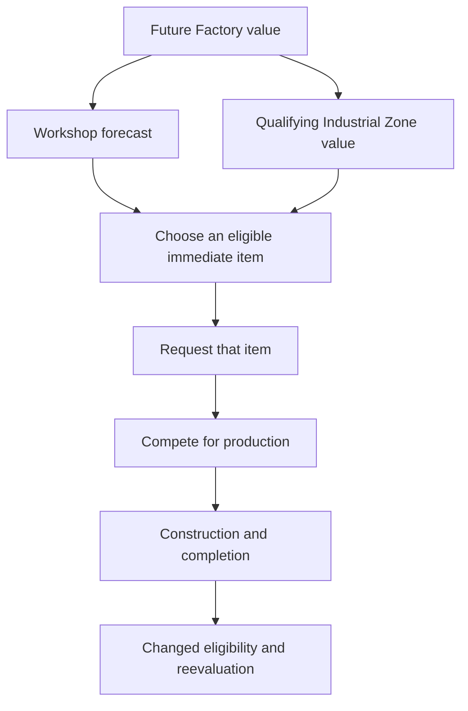

# Prerequisite value, item requests and actual production

A missing prerequisite can block immediate construction while the dependent building still has forecast value. Native city development combines that foresight with commitments to individual items; it does not follow that every useful chain becomes a persistent plan.

## Factory can help justify Workshop and Industrial Zone

The inspected building forecast includes research/civic delay, missing prerequisite district and direct prerequisite-building production delays, and the desired building's production time. CalculateDistrictValues (3dfee0) adds positive direct-dependent values backward and can add qualifying building values to positive missing/pillaged prerequisite district entries. [AI-N018]

For the shipped IZ case, Factory depends on Workshop, and both require Industrial Zone. Workshop's reverse dependency collection includes Factory. The pass mutates values in definition order; it is not a verified recursive fixed-point solver or general topological scheduler. District aggregation has separate gates and timing. See the [architecture investigation](../../../research/mods/civ6-industrial-zone-planning-architecture-20261101.md).

The November 1 existing-save observation recorded six calls across two cities. Every call satisfied:

```text
Workshop_return - Workshop_entry = max(0, Factory_entry)
```

Three Toulouse calls added Factory value while Workshop was missing. The value used was Factory's **entry**, not its larger return, supporting the order-sensitive pass. This verifies that channel in the observed package, not an entire Factory plan or economic benefit. [AI-N019] See the [runtime report](../../../research/mods/civ6-industrial-zone-decision-boundary-20261101.md).

## Eligibility and request scope remain separate

The ordinary CheckForUnitOrBuilding route calls GetBestBuilding with flags 0/0 and requires the missing-building and missing-district results to be clear. Factory therefore does not become its immediate item while Workshop or a legal prerequisite IZ is missing. The selected building receives its own request; the inspected build/request bodies do not replace it with a missing prerequisite or recursively create prerequisite jobs. [AI-N020]



This is different from a customer building in another district merely being useful: a supported ordinary HasBuilding requirement tests actual presence. See [modifier forecasts](modifier-forecasts.md).

## A civic in progress has its own time estimate

Gameplay estimates turns left on the active civic from its cost, accumulated
progress, carried culture and current culture yield. The UI's per-civic query
reads a cache. AI research planning keeps its own estimate for the requested
civic and can add time remaining on the current one. Track current selection,
turns remaining and the actual unlock separately when following a district
prerequisite. [AI-N081] [Native paths and the natural Bakers pilot](../../../research/mods/csc-ai-bakers-natural-research-20261106.md).

The technology queue can hold a goal and start a different technology as its
immediately researchable step. A technology research contract increases a
score in the analysis row. The queue still selects and validates the actual
step independently. [AI-N085]
[Technology queue and contract paths](../../../research/mods/csc-ai-bakers-natural-research-20261106.md#native-technology-decision-boundary).

The civic queue also separates the goal from the next step. It compares
the full Q8 value after owned and exclusion checks, then validates the
winning row's immediate step with `CanProgress`. A civic research
contract adds to the full value. It does not directly queue a civic.
[AI-N100] [Civic row and queue trace](../../../research/mods/csc-ai-bakers-natural-research-20261106.md#native-civic-decision-boundary).

## Visible, disabled and constructible are different queries

Stock ProductionPanel first queries `CanProduce(hash,true)` for list admission,
then `CanProduce(hash,false,true)` for immediate legality and failure reasons.
The inspected native building path treats a missing building prerequisite as a
start failure that the visible query can bypass. An actually present mutually
exclusive building is a hard exclusion and hides the option. Purchases also
separate exclusion from full validation. [AI-N073]

These calls are in the UI-cache binding. On patched XP2, Gameplay
registers `CanProduce` to a stub and expects a production discriminator
before the item value in `HasBeenPlaced`. A UI district-hash call can
therefore throw when copied into a Gameplay publisher. [AI-N099]

Vanilla Water Mill uses `RequiresAdjacentRiver`, whose ordinary precompute tests
the city's own plot rather than the prerequisite district's plot. Moving the
building to another district does not retarget that test. CSC's positive River
prerequisite plus complementary NoRiver exclusion therefore has a practical
purpose: enforce Quarter-local legality and hide an impossible Water option.
A UI-only filter would not establish AI/gameplay legality. [Native trace](../../../research/mods/csc-ai-watermill-native-river-check-20261104.md).

## Preference, priority and value use different controls

For Buildings, the traced favored preference is sign-based: negative applies 0.5, positive 2.0, zero no preference multiplier. Larger Buildings.Value does not proportionally strengthen that branch. [AI-N021]

For Units, the integer Value accumulator is different: the applicable sum adds to **request priority** at unit-request initialization. It does not directly add that integer to extra present value, nor establish a final queue result. [AI-N022] The [Builder priority report](../../../research/mods/csc-ai-native-builder-priority-20261028.md) closes the link left open in the earlier consumer review. Treat the old “Value-to-request is unresolved” statement as superseded, while keeping later allocation questions open. [AI-N046]

RequiredCity=-1 skips only the request's city-ID equality restriction. Ordinary eligibility remains. A vanilla runtime request started unrestricted and became city-bound on execution; one AI city does not prove cross-city recruitment or make every custom override redundant. [AI-N048] See the [request observation](../../../research/mods/csc-ai-native-contract-observation-20261028.md).

Another priority consumer, OddsOfBuilding (3e7c80), encodes 0.2×priority+0.5 for a specific forecast route after its gates. It has no 0–1 clamp, so its name does not establish a probability or the final city queue formula. [AI-N049] The [priority report](../../../research/mods/csc-ai-native-builder-priority-20261028.md) keeps this bounded consumer separate from unresolved allocation machinery.

## Persistence and expiry are bounded mechanisms

The inspected contract Update retains max(stored value, current cached item value). Lowering a fresh forecast therefore need not lower an existing request through that update path. Other writers, cancellation and replacement are not excluded. [AI-N023]

A building-tree Turn Limit 5 is an elapsed waiting-update rule, not a requirement to finish a building in five turns. The inspected timeout cancels/releases overdue waiting states 1/3; executing state 5 is exempt. Validation, threat and interruption use other paths. [AI-N024]

The traced threat-interruption path uses AI_CURRENT_TASK_BIAS, but final cancellation also requires threat/damage-or-attack gates. Its comparison is not a generic every-turn switching penalty applicable to all queues. [AI-N051] See the [production analysis](../../../research/mods/csc-ai-native-production-analysis-20261028.md).

## Category winner does not mean queue winner

QueueNextBuild validates/updates contracts and compares the selected contract with unit/project alternatives; the inspected contract gate has no best-building comparison. Its fallback compares buildings, units and projects. Districts arrive through contracts. [AI-N025]

An admitted building offer can also finish through the economic
purchase route. The native purchase check uses the current
building present value, normalized Gold cost and spending limits.
The city can buy the building and still use production for other
work. [AI-N103]

The ordinary CityBuild nomination pass has a separate unit-or-building
plan slot. When the slot is occupied, the pass returns before the
ordinary building comparison. Building forecasts still run, and a free
slot can lead to a comparison while another item is in the production
queue. [AI-N111] [Kőszeg replay](../../../research/mods/csc-ai-shared-stage-two-fractal-20261108.md#lighthouse-follow-through).

The fallback attempts the winning category. In the observed project branch,
a false return from `BuildProject` led directly to generic unit selection.
Neither the highest-ranked building nor the ordinary unit was retried.
[AI-N098] [Queue comparison and return trace](../../../research/mods/csc-ai-bakers-natural-research-20261106.md#the-rejected-project-sent-the-queue-straight-to-generic-offense).

Matching DoTurn/activation paths call that ordinary selector when the city queue
is empty. A new best district value does not automatically replace current
production each turn. The activation pass also updates a working contract, while
new district proposals wait for a free district event-tree slot. At the inspected
contract gate, the selected offered-contract value must beat the best unit value
minus256 Q8 and the best project value. Interruption remains a separate path.
[AI-N067] See [the detailed cadence and purchase investigation](../../../research/mods/civ6-district-cache-timing-and-purchases-20261104.md).

A concrete bounded example: after completing an existing Factory, Nicomedia's building selector returned Lighthouse, but a Neighborhood contract became production. The contract score was not captured, so no numerical Lighthouse-versus-Neighborhood inequality follows. Toulouse did not expose the ordinary 0/0 next-building choice or a new Workshop order. These absences are coverage limits, not measured failure rates.

The same branch ran on the patched XP2 build in Boston. Water Mill repair
won the building comparison on turn 245. The Theater Square contract
executed, and the function returned before fallback production selection.
Boston later submitted a Mill repair contract and queued an Encampment.
After that district completed, the same retained Mill contract executed
and its repair finished.
[AI-C069] [Native branch and live queue evidence](../../../research/mods/csc-ai-bakers-natural-research-20261106.md#the-mill-won-the-building-comparison-and-missed-the-queue).

If a pillaged building's host district is also pillaged, the native
building requirements can reject the repair before the queue compares
it. The specified district's own repair can reuse its existing
footprint, subject to the zone legality checks. Test district repair
eligibility and nomination separately from the building bid. [AI-N107]
