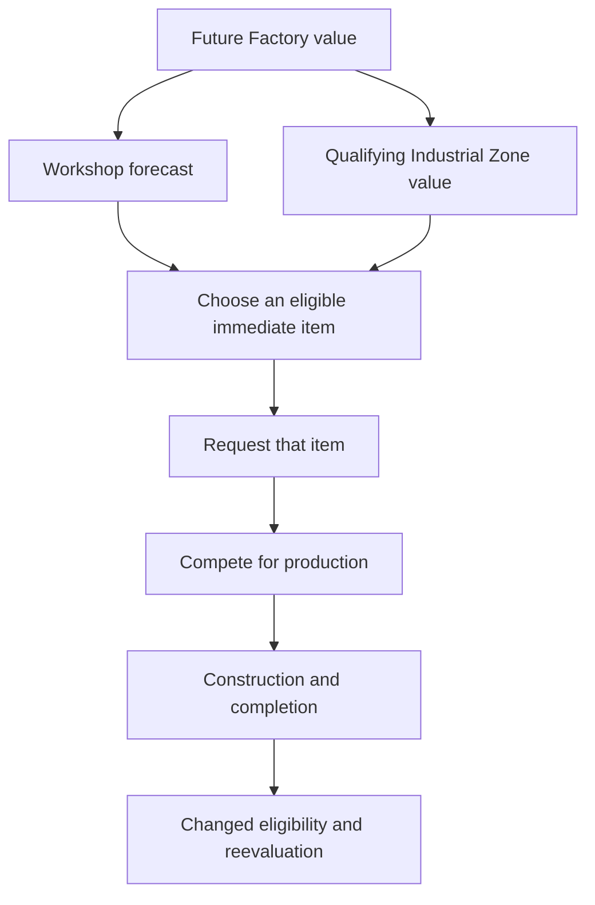

# Prerequisite value, item requests and actual production

A missing prerequisite can block immediate construction while the dependent building still has forecast value. Native city development combines that foresight with commitments to individual items; it does not follow that every useful chain becomes a persistent plan.

## Factory can help justify Workshop and Industrial Zone

The inspected building forecast includes research/civic delay, missing prerequisite district and direct prerequisite-building production delays, and the desired building's production time. CalculateDistrictValues (3dfee0) adds positive direct-dependent values backward and can add qualifying building values to positive missing/pillaged prerequisite district entries. [AI-N018]

For the shipped IZ case, Factory depends on Workshop, and both require Industrial Zone. Workshop's reverse dependency collection includes Factory. The pass mutates values in definition order; it is not a verified recursive fixed-point solver or general topological scheduler. District aggregation has separate gates and timing. See the [architecture investigation](../../../research/mods/civ6-industrial-zone-planning-architecture-20261101.md).

The November 1 existing-save observation recorded six calls across two cities. Every call satisfied:

```text
Workshop_return - Workshop_entry = max(0, Factory_entry)
```

Three Toulouse calls added Factory value while Workshop was missing. The value used was Factory's **entry**, not its larger return, supporting the order-sensitive pass. This verifies that channel in the observed package, not an entire Factory plan or economic benefit. [AI-N019] See the [runtime report](../../../research/mods/civ6-industrial-zone-decision-boundary-20261101.md).

## Eligibility and request scope remain separate

The ordinary CheckForUnitOrBuilding route calls GetBestBuilding with flags 0/0 and requires the missing-building and missing-district results to be clear. Factory therefore does not become its immediate item while Workshop or a legal prerequisite IZ is missing. The selected building receives its own request; the inspected build/request bodies do not replace it with a missing prerequisite or recursively create prerequisite jobs. [AI-N020]



This is different from a customer building in another district merely being useful: a supported ordinary HasBuilding requirement tests actual presence. See [modifier forecasts](modifier-forecasts.md).

## Preference, priority and value use different controls

For Buildings, the traced favored preference is sign-based: negative applies 0.5, positive 2.0, zero no preference multiplier. Larger Buildings.Value does not proportionally strengthen that branch. [AI-N021]

For Units, the integer Value accumulator is different: the applicable sum adds to **request priority** at unit-request initialization. It does not directly add that integer to extra present value, nor establish a final queue result. [AI-N022] The [Builder priority report](../../../research/mods/csc-ai-native-builder-priority-20261028.md) closes the link left open in the earlier consumer review. Treat the old “Value-to-request is unresolved” statement as superseded, while keeping later allocation questions open. [AI-N046]

RequiredCity=-1 skips only the request's city-ID equality restriction. Ordinary eligibility remains. A vanilla runtime request started unrestricted and became city-bound on execution; one AI city does not prove cross-city recruitment or make every custom override redundant. [AI-N048] See the [request observation](../../../research/mods/csc-ai-native-contract-observation-20261028.md).

Another priority consumer, OddsOfBuilding (3e7c80), encodes 0.2×priority+0.5 for a specific forecast route after its gates. It has no 0–1 clamp, so its name does not establish a probability or the final city queue formula. [AI-N049] The [priority report](../../../research/mods/csc-ai-native-builder-priority-20261028.md) keeps this bounded consumer separate from unresolved allocation machinery.

## Persistence and expiry are bounded mechanisms

The inspected contract Update retains max(stored value, current cached item value). Lowering a fresh forecast therefore need not lower an existing request through that update path. Other writers, cancellation and replacement are not excluded. [AI-N023]

A building-tree Turn Limit 5 is an elapsed waiting-update rule, not a requirement to finish a building in five turns. The inspected timeout cancels/releases overdue waiting states 1/3; executing state 5 is exempt. Validation, threat and interruption use other paths. [AI-N024]

The traced threat-interruption path uses AI_CURRENT_TASK_BIAS, but final cancellation also requires threat/damage-or-attack gates. Its comparison is not a generic every-turn switching penalty applicable to all queues. [AI-N051] See the [production analysis](../../../research/mods/csc-ai-native-production-analysis-20261028.md).

## Category winner does not mean queue winner

QueueNextBuild validates/updates contracts and compares the selected contract with unit/project alternatives; the inspected contract gate has no best-building comparison. Its fallback compares buildings, units and projects. Districts arrive through contracts. [AI-N025]

A concrete bounded example: after completing an existing Factory, Nicomedia's building selector returned Lighthouse, but a Neighborhood contract became production. The contract score was not captured, so no numerical Lighthouse-versus-Neighborhood inequality follows. Toulouse did not expose the ordinary 0/0 next-building choice or a new Workshop order. These absences are coverage limits, not measured failure rates.
