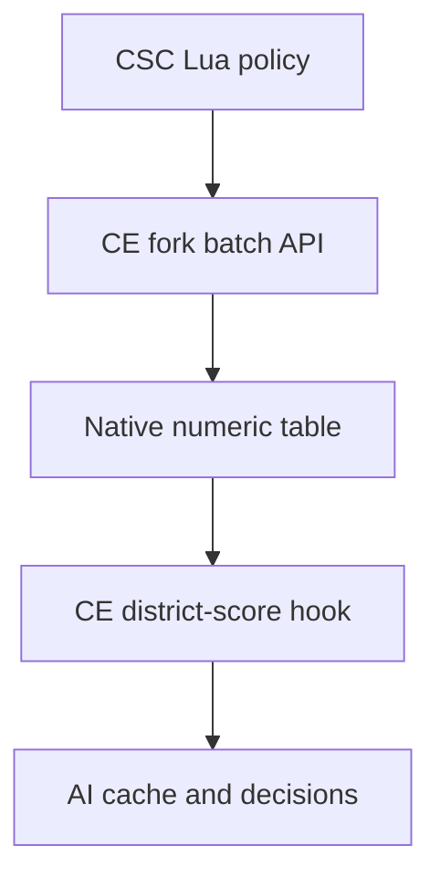

# Workshop delivery and Community Extension

**Current status: develop port passes supported MSVC build and fresh bounded native regression.**
Henno prefers CSC to ship Lua/SQL and depend on Community Extension, rather than
ship and maintain its own DLL.

## A Workshop package can carry native code

Civ VI's frontend `GameCores.PackageId/DllPrefix` selects a GameCore DLL from a
mod package. CE uses that path. An independent local prototype now also loads
this way, publishes tiny score adjustments from packaged Lua without Frida or
Python, and clears its policy on same-process game-context recreation.
This corrects the earlier implication that a launcher/manual DLL installation
is unavoidable. The native component can be supplied by a dependency. [AI-N070]

## Existing CE and the missing consumer

Current CE has memory access, but arbitrary cache writes need a verified safe
window, identity and analysis-generation handling. Its general RegisterCallEvent
is documented as unfinished and the inspected implementation has ABI/lifetime
concerns. Neither an entry callback nor a named processor establishes a safe
ordinary district-score writer. [AI-N059] [AI-N071]

A Lua-only package depending on stock CE now reads real shared scores:55 city
observations and174 score reads in Online1–3, with no CSC DLL, Frida or memory
writes. The sampled turn-start events preceded completion of fresh analysis;
later activation exposed scores. That still leaves mutation timing unqualified.

The preferred design puts native hook/synchronization/lifecycle ownership in CE.
CSC supplies numeric batches through Lua. Henno authorized a
[CE fork](https://github.com/hennogous/CivilizationVI_CommunityExtension/tree/feature/ai-district-scores)
to qualify that capability before preparing an upstream contribution. The full
fork now builds, and packaged Lua reproduces the existing Python placement
policy. The corrected native test has passed fresh1–6, a second observation-only
context1–2, and reload of the saved6 with identical captured scanner facts.
The Online100 run completed with101 exact Lua/Python plan comparisons,
73 positive and14,584 negative native changes, and zero native faults.
All29,479 records across score/cache/winner/PV tracing reconstructed. [AI-N072]

This restores the current bounded CSC policy and diagnostic capabilities without
a Python/Frida policy worker. It does not establish identical historical outcomes
or economic benefit; gameplay-event publication has different timing from the
old inactive-boundary controller. [AI-C052]

The [parity report](../../../research/mods/csc-ce-policy-parity-20261104.md)
preserves the first reporting failure and both transport corrections. The API
is absent from released CE1.3; maintainer acceptance and a released upstream
dependency remain separate. A private fork is not the same as stock CE.
On5 November Henno approved closing
[draft PR9](https://github.com/Wild-W/CivilizationVI_CommunityExtension/pull/9),
preserving the tested branch and preparing an API-only feature branch from
upstream `develop`. The new source integration preserves develop's lifecycle and
uses the existing Visual Studio/vcpkg approach, without the alternate Zig builder.
Readability, native contracts and failure behavior are documented beside the code.
The approved compiler/SDK installation is complete. Both unmodified develop and
the API branch build through the same supported MSVC/vcpkg setup, with identical
warning counts and no errors; 36 isolated checks also pass with MSVC. Static
DLL export, import, shim and unwind checks pass. The fresh shared-controller
Online100 regression also passes: 101 matching plans, all four trace families,
62 increases/13,746 deductions, zero native faults, context/save/reload and
verified closure/restoration. This independently qualifies the new artifact's
bounded method; it does not inherit or match the old world's outcomes.
[Port, offline checks and handoff](../../../research/mods/csc-ce-develop-port-20261105.md).

The subsequent refactor uses CE's shared Runtime hook layer, typed C++ and
HavokScript bindings. It adds a guarded late score entry while keeping CSC
policy on the mod side. [C++ refactor and late score API](../../../research/mods/csc-ce-late-score-api-20261105.md)

The independent CSC DLL remains a delivery experiment. It is not the selected
release architecture. Local native loading and tiny score delivery are proved;
an actual Workshop subscription roundtrip, broader save/lifecycle behavior and
compatibility remain separate gates. The new test covered a fresh Online100
world, same-process observation1–2 and reload of its exact saved6. It normally
closed and restored all152 mod entries/autostartfalse with content unchanged.

Source: [Delivery report and evidence](../../../research/mods/csc-native-workshop-delivery-20261104.md).
