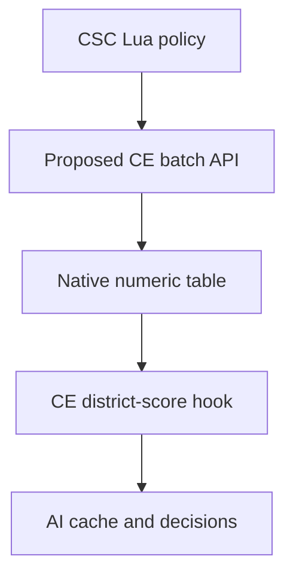

# Workshop delivery and Community Extension

**Current priority: establish the release carrier before improving AI tuning.**
Henno prefers CSC to ship Lua/SQL and depend on Community Extension, rather than
ship and maintain its own DLL.

## A Workshop package can carry native code

Civ VI's frontend `GameCores.PackageId/DllPrefix` selects a GameCore DLL from a
mod package. CE uses that path. An independent local prototype now also loads
this way, publishes tiny score adjustments from packaged Lua without Frida or
Python, and clears its policy on same-process game-context recreation.
This corrects the earlier implication that a launcher/manual DLL installation
is unavoidable. The native component can be supplied by a dependency. [AI-N070]

## Existing CE and the missing consumer

Current CE has memory access, but arbitrary cache writes need a verified safe
window, identity and analysis-generation handling. Its general RegisterCallEvent
is documented as unfinished and the inspected implementation has ABI/lifetime
concerns. Neither an entry callback nor a named processor establishes a safe
ordinary district-score writer. [AI-N059] [AI-N071]

A Lua-only package depending on stock CE now reads real shared scores:55 city
observations and174 score reads in Online1–3, with no CSC DLL, Frida or memory
writes. The sampled turn-start events preceded completion of fresh analysis;
later activation exposed scores. That still leaves mutation timing unqualified.

The preferred design puts native hook/synchronization/lifecycle ownership in CE.
CSC supplies numeric batches through Lua. A candidate CE module compiles to
objects and an unapplied integration patch validates against pinned source.
The proposed API is absent from released CE1.3; the combined CE build and
maintainer adoption are not established. A private CE fork is not the same as
depending on stock CE.

The independent CSC DLL remains a delivery experiment. It is not the selected
release architecture. Local native loading and tiny score delivery are proved;
an actual Workshop subscription roundtrip, full save/lifecycle behavior and
broader compatibility remain separate gates.

Source: [Delivery report and evidence](../../../research/mods/csc-native-workshop-delivery-20261104.md).
