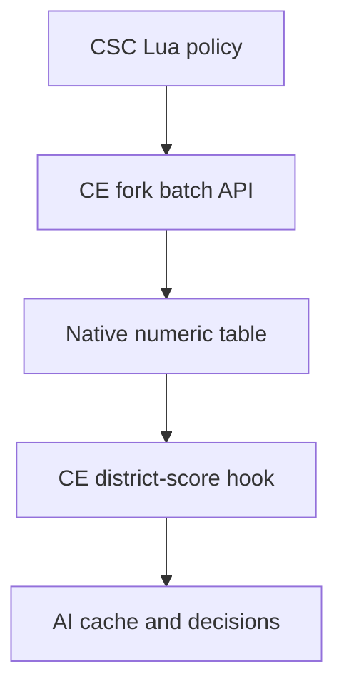

# Workshop delivery and Community Extension

## Current development setup

Build and test CSC with [Cru's Dev CE `dev` branch](https://github.com/cru121/civ6-dev-ce/tree/dev).
The [integration commit `6244570`](https://github.com/cru121/civ6-dev-ce/commit/62445704b5648a83ecedadf49ec14055a33a0ca4)
imported the CSC native API and adapted its registration and context lifecycle to
Dev CE. Shadow's working checkout is `Desktop/Codex/civ6-dev-ce`.
Base feature branches on the latest `origin/dev` in that repository. The old
`hennogous` fork and the release and save evidence below are historical.

[Build-DevCe.ps1](../../../../tools/ai_workshop_bridge/dev_ce/Build-DevCe.ps1)
builds the Dev CE checkout with Visual Studio 2022 and pinned vcpkg inputs. Its
CSC development package retains the qualified mod ID and DLL prefix used by
CSC's optional SQL and shared controller. This avoids enabling those SQL
connectors merely because an older general Dev CE release is installed. Build
to a fresh output directory. The wrapper emits `Dev CE CSC Development` and
`dev-ce-build.json`, which records the source commit and DLL hash. It links
MinHook and Capstone statically into the Dev CE DLL.

The installed package is called **Dev CE (CSC development build)** in Civ VI.
On Shadow its folder is `Documents/My Games/Sid Meier's Civilization VI/Mods/CSC Bakers Development CE`.
Use one GameCore provider in a game. Pass the staged output and DLL hash to the
shared controller. If the installed development package matches that output,
the controller can use it and restore the prior mod selections after the test.
For a replay pinned to the former fork or another build, park the installed
Dev CE package outside `Mods` while the old snapshot owns the same mod ID.
A public Workshop dependency still needs its own release qualification.

### Ordinary controller games use the installed CSC

The fresh-game driver uses the main installed `Civ Supply Chains` package
when `--csc` is omitted. It snapshots that input once, records the hashes of
the loaded package and optional mods, and leaves the main install in place
when it archives the save and restores preferences. An explicitly supplied
snapshot can reuse the main install when their bytes match. Frozen
development identities remain available for historical and dormant-control
comparisons.

The save refers to its original mod identities. Keep the matching Dev CE
and gameplay dependencies installed for later inspection. A rebuild can
change the mechanics of a reloaded save even when the identities still
match. The run's frozen package provides a reference for exact replay.

### Shadow cutover on 22 November 2026

Dev CE `6244570` contains all 47 native AI method names referenced by CSC.
Its Release x64 build loaded on Steam build `26595377`, with proxy SHA-256
`120fbea9c2ebc0a660999c20cb1e37dcf085ab5ac0b5687154ebd8f85230e9ac`.
The shared controller verified the loaded proxy and Firaxis GameCore paths and
hashes. A fresh small Continents game on Online speed reached turn 25 with
the combined CSC tuning package. Runtime telemetry captured 67 native
district-site score changes across 13 reporting turns, including 13 increases
and 54 decreases. The native status reported zero faults. The controller
verified preference restoration and game closure. Local evidence is under
`Desktop/Codex/dev-ce-csc-6244570/smoke-continents`.

Dev CE is the only installed local GameCore provider. The former `CE-fork`
checkout was moved intact to `Desktop/Codex/retired-ce/henno-ce-fork` at
`f6f0dd8` after the check. Its existing build and save evidence remains usable
for exact replays.

## Historical delivery investigation

## A Workshop package can carry native code

Civ VI's frontend `GameCores.PackageId/DllPrefix` selects a GameCore DLL from a
mod package. CE uses that path. An independent local prototype now also loads
this way, publishes tiny score adjustments from packaged Lua without Frida or
Python, and clears its policy on same-process game-context recreation.
This corrects the earlier implication that a launcher/manual DLL installation
is unavoidable. The native component can be supplied by a dependency. [AI-N070](https://github.com/hennogous/civ6-ai/blob/main/references/engine/findings.md#ai-n070)

## Existing CE and the missing consumer

Current CE has memory access, but arbitrary cache writes need a verified safe
window, identity and analysis-generation handling. Its general RegisterCallEvent
is documented as unfinished and the inspected implementation has ABI/lifetime
concerns. Neither an entry callback nor a named processor establishes a safe
ordinary district-score writer. [AI-N059](https://github.com/hennogous/civ6-ai/blob/main/references/engine/findings.md#ai-n059) [AI-N071](https://github.com/hennogous/civ6-ai/blob/main/references/engine/findings.md#ai-n071)

A Lua-only package depending on stock CE now reads real shared scores:55 city
observations and174 score reads in Online1–3, with no CSC DLL, Frida or memory
writes. The sampled turn-start events preceded completion of fresh analysis;
later activation exposed scores. That still leaves mutation timing unqualified.

The preferred design puts native hook/synchronization/lifecycle ownership in CE.
CSC supplies numeric batches through Lua. Henno authorized a
[CE fork](https://github.com/hennogous/CivilizationVI_CommunityExtension/tree/feature/ai-district-scores)
to qualify that capability before preparing an upstream contribution. The full
fork now builds, and packaged Lua reproduces the existing Python placement
policy. The corrected native test has passed fresh1–6, a second observation-only
context1–2, and reload of the saved6 with identical captured scanner facts.
The Online100 run completed with101 exact Lua/Python plan comparisons,
73 positive and14,584 negative native changes, and zero native faults.
All29,479 records across score/cache/winner/PV tracing reconstructed. [AI-N072](https://github.com/hennogous/civ6-ai/blob/main/references/engine/findings.md#ai-n072)

This restores the current bounded CSC policy and diagnostic capabilities without
a Python/Frida policy worker. It does not establish identical historical outcomes
or economic benefit; gameplay-event publication has different timing from the
old inactive-boundary controller. [AI-C052](https://github.com/hennogous/Henno-Mods/blob/main/project/docs/civ6-ai/findings.md#ai-c052)

The [parity report](../../../research/mods/csc-ce-policy-parity-20261104.md)
preserves the first reporting failure and both transport corrections. The API
is absent from released CE1.3; maintainer acceptance and a released upstream
dependency remain separate. A private fork is not the same as stock CE.
On5 November Henno approved closing
[draft PR9](https://github.com/Wild-W/CivilizationVI_CommunityExtension/pull/9),
preserving the tested branch and preparing an API-only feature branch from
upstream `develop`. The new source integration preserves develop's lifecycle and
uses the existing Visual Studio/vcpkg approach, without the alternate Zig builder.
Readability, native contracts and failure behavior are documented beside the code.
The approved compiler/SDK installation is complete. Both unmodified develop and
the API branch build through the same supported MSVC/vcpkg setup, with identical
warning counts and no errors; 36 isolated checks also pass with MSVC. Static
DLL export, import, shim and unwind checks pass. The fresh shared-controller
Online100 regression also passes: 101 matching plans, all four trace families,
62 increases/13,746 deductions, zero native faults, context/save/reload and
verified closure/restoration. This independently qualifies the new artifact's
bounded method; it does not inherit or match the old world's outcomes.
[Port, offline checks and handoff](../../../research/mods/csc-ce-develop-port-20261105.md).

The subsequent refactor uses CE's shared Runtime hook layer, typed C++ and
HavokScript bindings. It adds a guarded late score entry while keeping CSC
policy on the mod side. [C++ refactor and late score API](../../../research/mods/csc-ce-late-score-api-20261105.md)

The independent CSC DLL remains a delivery experiment. It is not the selected
release architecture. Local native loading and tiny score delivery are proved;
an actual Workshop subscription roundtrip, broader save/lifecycle behavior and
compatibility remain separate gates. The new test covered a fresh Online100
world, same-process observation1–2 and reload of its exact saved6. It normally
closed and restored all152 mod entries/autostartfalse with content unchanged.

Source: [Delivery report and evidence](../../../research/mods/csc-native-workshop-delivery-20261104.md).
