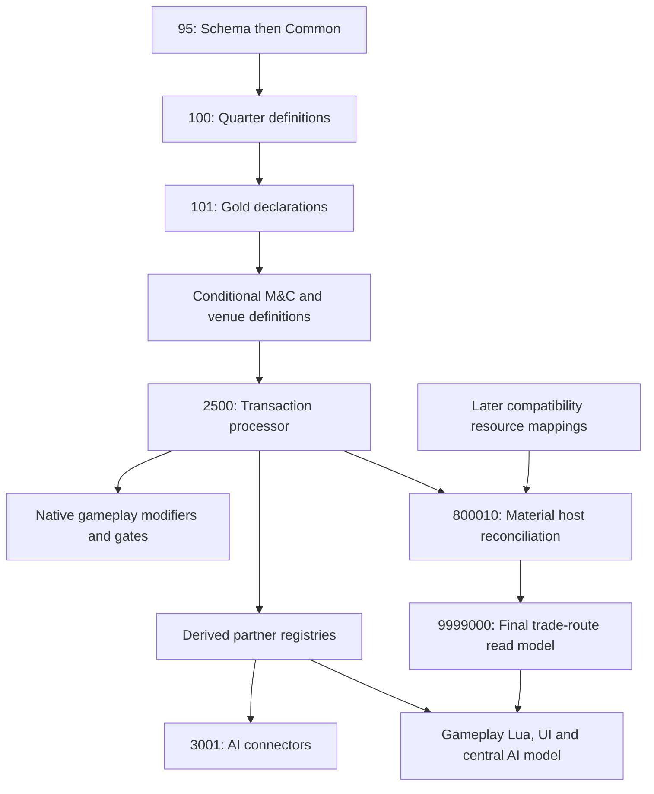

# CSC shared SQL structure

Updated 17 November 2026. This is a source organization change: the authored
economy, native identities, rounding, gates and Lua refresh behavior are preserved.

## Where to edit

| File under `Civ Supply Chains/Data/` | Responsibility |
| --- | --- |
| `CSC_Q_ALL_Schema.sql` | Shared economic tables, adjacency configuration and helper-table definitions. Creates no payouts. |
| `CSC_Q_ALL_Common.sql` | Modifier types, vocabulary and common population/bit helper data. |
| `CSC_Q_BAKERS.sql`, `CSC_Q_TAILORS.sql` | Quarter buildings, Services, adjacency and ordinary transaction declarations. |
| Corresponding `_GOLD.sql` files | Add Gold payout legs to the same transaction identities. |
| Corresponding `_MC_MODE*.sql` files | Add Industry/Corporation exchange legs under the existing mode criterion. |
| `CSC_Q_ALL_TransactionProcessor.sql` | Compile material, fixed-building and population declarations into native modifiers, requirements and derived partner registries, in that order. |
| `CSC_Q_ALL_AI_Connectors.sql` | Project gameplay-defined customer relationships into private AI adjacency; retain modest native Builder controls. Uses its existing CE criterion. |
| `CSC_Q_ALL_MaterialHosts.sql` | Reconcile input-host attachments after compatibility resource/improvement mappings have loaded. |
| `CSC_Q_ALL_TradeRouteReader.sql` | Publish the late read model of effective route payouts after final compatibility effects. |

In the main Quarter files, transaction terms are in section 5 alongside the
buildings, with native identity bindings in section 6. Gold adds legs rather than copying rates or
partner identities from core. Mode and compatibility files stay conditional.
An economic amount belongs in its declaration; generated native amounts are
outputs of the shared processor.

## Loading and consumers

These SQL passes run while Civ assembles the gameplay database. Consolidating
files adds no per-turn work or scans. Processors remain separated by actual load
dependencies; in particular late material hosts and final route projections must
not move into the early transaction pass.

## What was cleaned up

The former `CSC_Q_ALL.sql` was split into Schema and Common. Separate building
and route schemas moved into Schema, including the input-host table previously
created in the late material pass. The three transaction processors became one
file with ordered sections. Material hosts, route reader and AI connectors now
use the `CSC_Q_ALL_Purpose.sql` naming convention.

The four `_TRANSACTIONS*.sql` sidecars were folded back into their Quarter/Gold
files. Main files follow the seven-section outline below; Gold companions keep
their additional legs. Redundant fixed/material native rows were removed
from Quarter/Gold/M&C files: the shared processor generates their existing IDs.
Explicit Service gates, route/property consumers and early improvement-owner
registrations remain where their existing lifecycle requires them.

Two obsolete, unattached Bakery modifiers and their three arguments were
removed: `MOD_CSC_BAKERS_BAKERY_ATTACH_COMMERCIAL_HUB` and
`MOD_CSC_BAKERS_BAKERY_FOOD_TO_MARKET`. They delivered no gameplay effect.

The action list now groups matching declarative actions and uses explicit load
orders throughout. See [the action workflow](../workflows/modbuddy-actions-json.md).

## Regression record

The pre-cleanup working SQL was executed against the same offline fixtures as
the new source across all 16 Gold/Garden/M&C/unique-replacement combinations.
All 25 compared native graph and economic metadata tables match, allowing only
the two dead modifier roots and their arguments above. The checked-in reference
is `project/tools/transactions/consolidation_qa_reference.json`; its regression
test reads the current declarations and processors, rather than copying them.

Existing transaction tests also exercise payout rounding, ownership, pillage,
shared customers, unique replacements, materials and route behavior. Shared
model tests check that gameplay definitions still reach AI forecasts. No game
was launched for this maintenance change.

Checks passed: 83 transaction tests, 123 AI economy tests, 175 other Quarter
checks, nine action/packaging tests, two campaign-package tests and the lens
fixture suite. An activation-contract audit also matched all 136 file
registrations, with only the four documented implicit-to-explicit orders.

The Fashion House population/trade fixtures now load the real compiled
catalogue and shared route modules; all 21 tests in that suite pass. The design/
localization checksums were refreshed after reviewing the wording and restoring
the truncated Harbor description. The full 201-test Quarter suite now passes,
including the global contract check.

Historical reports retain their original filenames as evidence of those builds.
Use this document and current action JSON for today's source paths.

## Reading a main Quarter file

Bakers and Tailors share this outline:

1. **Types** — register district, buildings, custom modifier and notification IDs.
2. **Resources** — material and district classes, plus core mappings.
3. **Stage 1** — improvement-owned material host registrations.
4. **Quarter** — district definition, adjacency rules and Quarter-owned attachments.
5. **Buildings and Services** — producer/hidden Service definitions, construction
   gates, specialists, active Service attachments and ordinary material/building/
   route terms. Rows are grouped by stage within compatible batches.
6. **Plumbing** — stable identity bindings, native amount consumers, modifiers,
   arguments, requirements and dependent temporary generators.
7. **UI and art** — description disclosures, notification observations, previews
   and Service-gated art properties.

Use section 5 to change an ordinary exchange's partners, spatial rule, quantity
or payout. Use section 6 to follow an attachment into its native leaf and gates.
The shared processor remains a separate load-order-2500 pass; these files supply
its declarations rather than running the compiler at their foot.

Compatible literal writes are batched with the same conflict policy and column
list. Each main file now has one `CSC_BuildingTransactions` insert and one
`CSC_BuildingTransactionYields` insert, including Stage 2–4 relationships. Bounded
SELECT generators remain ordered with their dependencies. This reduces setup
statement counts (Bakers 119→118; Tailors 177→152), with no change to per-turn work.

The internal reorganization preserved every literal row write and every other
SQL expression. Executing the old and new core files, Gold/M&C companions and
shared processors in disposable copies of the existing gameplay cache produced
identical contents across 466 tables and 64,196 rows. The 16-configuration
transaction regression, AI economy tests and both CSC style profiles also pass.
The source game cache was read-only; no game was started.

Implementation enforcement: [Quarter validation](../quarters/QUARTER-VALIDATION.md#shared-sql-architecture-gate).
