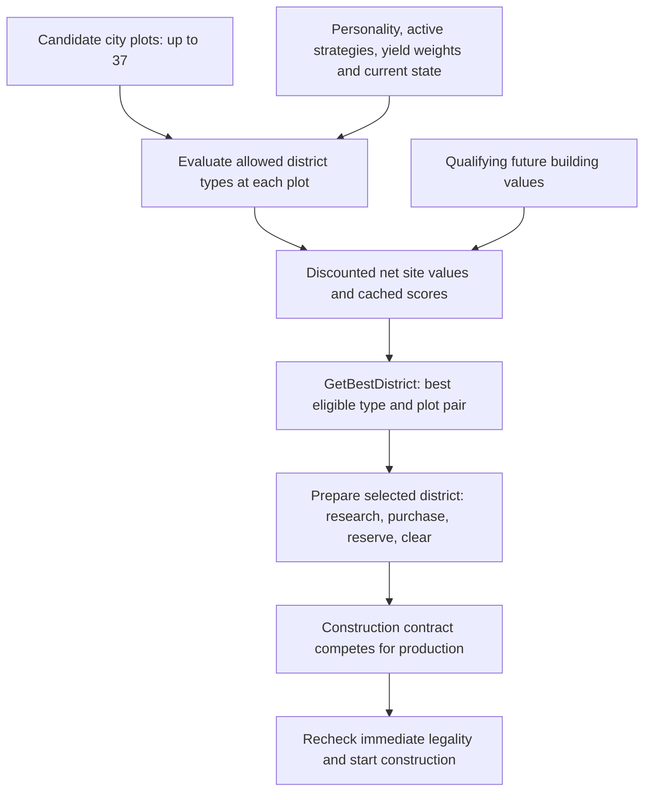

# District choice, placement scoring and custom incentives

Investigation: 3 November 2026. User questions: how does AI evaluate district sites;
how does it choose which district to build; does empire need enter that decision;
and what custom or arbitrary incentives could influence it?

> Follow-up: the [native prototype report](civ6-district-score-prototype-20261103.md)
> records later implementation and bounded runtime checks. This report's earlier
> unimplemented-extension statements describe its original investigation stage.

**In the inspected ordinary city path, district type and location are chosen
together.** The selector compares cached scores for eligible district/plot pairs.
Those scores include site economics, future building value, district preferences,
strategic yield weights and some current needs. The winner becomes a prepared
construction request, which still competes for production.

**Mod data can influence this process substantially**, especially through native
adjacency rules using ordinary or custom yield channels, and through type/yield
preferences switched by strategies. A completely arbitrary numerical formula for
each candidate plot has no established ordinary Lua callback in the inspected
interfaces. Such a formula would need a verified additional consumer, a native
extension, or a separate planner.

This was offline analysis. No game, new world, FireTuner connection, live scoring
intervention, installation, native-target mutation or tuning change occurred.
The older broad AI campaign remains paused. The request to investigate these
questions does not resume its failed placement-observer branch.

## Evidence and scope

Target: current Windows XP2 GameCore, image base `0x180000000`, SHA-256
`324c51e9ea3531758842e16c69e6cddbefbb226c5b675c3d6e60111646c2e98c`.
All native addresses below are RVAs. The installed DLL matches prepared Ghidra.
Names are reference-assisted labels; bodies, callers, loaders and PE bytes supply
the conclusions. Decompiler types remain estimates.

Evidence package:
`C:\Users\Shadow\Desktop\Codex\csc-district-placement-20261103\`.
It includes `candidate-choice-audit.md`, `data-api-audit.md`, native exports,
`placement-static-proof.json`, source snapshots, and `verification.json`.
3,111 instructions in six decisive score/weight functions were compared against
the pristine DLL. The source/API audit pins 24 files. Independent pointer/loader
checks cover preferences, district flags, reservation data and the small
YieldSensitivities callback. No new Ghidra program/database clone was needed.

REA Evidence `ev_a95d61ba66b63a70f0164a048a7e353701c4b4e874689a50d6003c7aa9b65e2c`
records the exact adjacency schema from the retained quiescent November 1 database
SHA `e1a73e2d113acae5a74f43df9a5a467847da6abc16945da3aaae718054040d60`.
This is schema corroboration, not a newly loaded November 3 mod database. Its
one-record bundle is exported; REA is closed with no pending cleanup.

The [earlier placement controls](csc-native-quarter-placement-control-evidence-20261101.md)
established a static scoring route but captured no useful Quarter placement.
The [future-economy investigation](csc-future-economy-forecast-20261103.md)
corrected a plot-handler identification and separated gameplay activation from
hypothetical AI modifier analysis. Those limits remain in force here.

## 1. The ordinary choice is a district-and-site pair

`InitializePlotAnalyzers` (`3e7350`) creates up to 37 city plot records: the usual
three rings including the center, skipping off-map plots. Each record holds a
score array indexed by DistrictDefinition. The update/evaluation jobs populate
these caches; the final selector is not itself a synchronous fresh simulation.

Admission includes revelation, ownership/assignment to this city, purchasability
of adjacent unowned land, geography, type restrictions and reservations. Internal
districts are excluded. OnePerCity prevents another site when that district already
exists elsewhere in the city. A negative district preference excludes the type.
Forecast admission is more permissive than immediate construction: prerequisites
and construction delays can be estimated before a district is currently available.

`GetBestDistrict` (`3e4a50`) loops **both plots and district types**, choosing the
largest admitted cached score. Equal scores use randomized tie-breaking. Live
reservation values constrain admission. There is no positive-score test in this
selector: its initial baseline is the invalid Q8 sentinel −9999, not zero. Later
trigger/request/queue stages are separate.

Consequently a strong Campus site can help Campus beat another district type.
The ordinary route does not first fix a district type independently of its sites.
There is also a separate `GetBestLocationFor` (`3e5550`) for callers that already
have a district type and need its best site; do not confuse the two functions.

This is a local choice over this city's admitted cache. It is not evidence of
an exhaustive future city-layout search that jointly optimizes all later districts.

## 2. What enters a district/site score

The central route is per-plot evaluation `3e2aa0` → district NetValue `52a440` →
DistrictValue `52d500`, followed by preference/cache processing and the later
building-value propagation pass (`3dfee0`). A useful decomposition is:

| Stage | Inspected inputs |
|---|---|
| Feasibility and timing | Current plot/type restrictions, missing tech/civic ETA, district build time and evaluation horizon. |
| Site benefits | Native adjacency, other district/player yield contributions, district pseudo-value, great-person-related benefits and special district effects. |
| Strategic conversion | Yield DefaultValue, actual aggregate player yield bonus, relevant pseudo-yield weights and district preference. |
| State-sensitive benefits | Housing/growth calculations, regional coverage and applicable unit/resource-enabling effects. |
| Economic costs | Maintenance, unowned-plot purchase cost, valid feature/resource clearance/harvest and lost existing improvement/resource value. |
| Land opportunity | Conditional deduction for a better alternative district's static adjacency on this same plot. |
| Future development | Qualifying positive building values propagated into missing/pillaged prerequisite district score entries. |

These are several different score stages, not terms to sum naively in yield units.
Income streams are discounted between readiness and horizon; purchase/harvest and
other fixed amounts take their own paths. Future building propagation follows
the definition/order limits established in the IZ study; it is not a complete
solution of all future economic relationships.

### Site quality includes competing use of the same land

DistrictValue computes static adjacency values for feasible alternative district
types at the proposed plot. If the chosen district's static value is below the
maximum, it can subtract the **full maximum alternative static value**, rather
than only their difference. The exception flag is DistrictDef+e0 mask `0x04`,
proved by the native loader to mean **Aqueduct**.

This opportunity-cost term is narrower than another district's full net economic
value, but broader than ignoring alternatives altogether. A new custom adjacency
can therefore affect both its recipient and competing district types at that
site. It is not guaranteed to behave like a simple additive final-score bonus.

Adjacency also enters through owned-plot and direct-static terms. Their contexts
and contribution sizes must be distinguished; a rule's raw amount is not the
complete district score. No universal doubling formula is claimed.

## 3. Does it account for what its empire needs?

**Yes, through several concrete inputs.** The max selector does not read an
empire-needs checklist itself; upstream valuation and preference systems feed it.

### Active strategy and personality

CityPlanner's district preference vector is populated through leader queries
and read during per-plot evaluation. In this path, negative excludes a type,
zero is neutral and positive multiplies the net site score by **1.5** before later
cache aggregation. Increasing a SQL Districts Value is not a proportional
increase in that multiplier. Multiplying a negative net value can make it more
negative; this is not a universal additive reward.

Shipped `Strategy_Priorities` link era/victory conditions to Districts, Yields and
PseudoYields lists. For example, the science victory declarations favor Spaceport
and add Science importance. Native VictoryStrategy activation (`536530`) starts
or ends relevant strategies; StartStrategy (`538fb0`) adds their lists to the
preference systems. Authored conditions include technological position, religion,
war/threat and eras, but each condition's exact formula or current activation
must be established separately from its descriptive name.

### A verified current-performance catch-up mechanism

There is a stronger result than merely finding strategy names:

1. Global initialization (`49c7c0`) registers **YieldSensitivities**.
2. Its callback `4a2580` resolves this player's GrandStrategic component and
   coefficient vector at +468; raw PE bytes prove the address calculation.
3. `GrandStrategic::DoTurnActivate` (`4b1540`) reads current yield output for self
   and met players. For positively configured yields, it calculates the leader
   gap and an output-dispersion measure, then writes a catch-up boost.
4. `YieldBonus` (`4b6d70`) includes that boost, and `NormalizeYields` (`52b110`)
   uses the aggregate when converting district yield benefits into score.

Shipped Expansion1_Victories.xml in XP2 configures Science/Culture sensitivities
of 10 in selected era strategies and 25 for the corresponding victory strategy.
These are a separate control from ordinary Yields percentage biases; their SQL
numbers must not be treated as interchangeable units. No effective player boost
or changed district choice was measured in a new runtime here.

Thus falling behind in a configured yield can change the relative value of
districts producing it. This is a real current-empire input, not only a fixed
leader preference.

### Local and coverage needs

HousingModifierValue (`5298e0`) reads food surplus and housing, applies the housing
growth penalty and uses projected population/food boundaries. DistrictValue calls
this for relevant district housing. Other inspected branches consider nearby
cities and existing same-type districts for regional coverage, and applicable
unit/resource-enabling effects.

These mechanisms support needs-sensitive scoring. They do not establish a
complete empire portfolio optimizer that guarantees the most urgent missing
district wins. We have not proved a general rule such as “count empire Campuses,
then build exactly enough to meet a target,” or measured every emergency strategy.

## 4. Winning the district comparison is not winning production

`CheckForDistrict` (`3e0ee0`) starts the configured district behavior tree only
when its previous district tree is no longer outstanding. Its payload includes
the type, city, location and missing research. The 35-node shipped district tree
can arrange research, purchase, reservation and Builder clearance before requesting
construction. An existing task can persist across turns; the AI does not simply
discard it and choose a wholly new district every activation.

Reservation has its own ownership/assignment and competing-value checks. The
district then reaches production through a UnitRequestContract. QueueNextBuild
(`3e8190`) arbitrates contracts and direct unit/project/default-building choices;
its body does not simply invoke GetBestDistrict and build that winner.

Execution reaches BuildDistrict (`3df220`), which rechecks immediate CanZone
before submitting the operation. Site selection, reservation, queue selection,
physical completion and useful operation are distinct outcomes.

## 5. Ways custom incentives can enter

| Form | What it can influence | Precision and limits |
|---|---|---|
| Real district benefits/costs | Net economic value through yields, housing, maintenance, costs and building unlocks. | Changes gameplay as well as AI; supported special effects differ. |
| Ordinary native adjacency rows | Location and type through weighted native spatial predicates. | Strong verified route; predefined predicates, not a general formula language. |
| Registered custom/private yield in those adjacency rows | A purpose-specific score channel whose amount/default weight can be authored. | Dynamic YieldDefinitions loop consumes it; presentation hiding does not make it AI-only or economically inert. |
| Yields and PseudoYields lists | Importance of understood benefit categories; strategy/personality scoping. | Different consumers/units. A new pseudo-yield name alone does not create a district-score consumer. |
| Districts preference | Eligibility/multiplier for a district type. | Type-wide, not an arbitrary score for one plot; aggregate sign controls the inspected path. |
| Lua Boolean strategy condition | An arbitrary accessible-state condition switching linked preferences. | Verified `(playerId, threshold) → Boolean` pattern; does not receive a candidate plot or return its numeric score. |
| Lua/property-backed gameplay effects | Current state and effects through their actual consumers. | Precise prospective site-score consumption must be proved; setting a desirability property alone is insufficient. |
| Native extension/instrumentation | In principle, a custom numerical function at a known score/cache boundary. | Outside ordinary SQL/Lua mod data; build-specific integration, cache/request consistency and behavior need implementation and validation. No such patch was made here. |
| Explicit external planner/orders | Direct type/location decisions. | A different control mechanism, rather than an incentive in native evaluation. |

### Native adjacency is the most established spatial input

`Adjacency_YieldChanges` supports integer YieldChange, TilesRequired and fields for
named district/improvement/terrain/feature, river, broad wonder/resource predicates,
one native ResourceClass, Self and prerequisite/obsolete research. Multiple rules
can be attached through District_Adjacencies. Positive rewards and negative
penalties are authored in shipped content: Seowon has Self Science +4 and −1 per
neighboring district.

An illustrative form is “add K units of our private yield per adjacent matching
customer district,” or a base Self incentive, a river bonus, a terrain/feature
bonus, or a penalty near another district. Current CSC source supplies forward
customer 10, reverse Quarter 30 and river 4 through this established route.
These current amounts are experimental inputs, not calibrated recommendations.

There is no ResourceType/TypeTag field in the standard adjacency row. Its
AdjacentResource is Boolean; **AdjacentResourceClass** is the exact SQL name and
holds one native class string. It cannot directly express an arbitrary CSC
material-tag set, future customer opportunity, Builder availability or a custom
multi-ring score. Combining several configured predicates in one row must follow
the actual evaluator semantics; do not assume arbitrary AND/OR expressions.

NormalizeYields uses the yield DefaultValue and actual aggregate player bonus;
the ordinary Yields list's 25 contributes +25%, not 25 times. Q8 rounding and an
upper aggregate bonus cap also apply. Discounting, alternative use, preferences
and later building contributions remain downstream. Raising a private cue is
not equivalent to adding that many final preference points.

### Arbitrary Lua logic can already gate a broad preference

The shipped Poland scenario uses a Lua city-count condition to gate a strategy.
Current CSC RH uses the same Call Lua Function interface to favor a Quarter type
while an assisted foundation backlog exists. A function could similarly calculate
“this empire has a credible material/customer opportunity” and enable a district
or yield preference.

The transmitted result remains a player-level Boolean. The preference can affect
other cities and all admitted sites for that type. This interface alone cannot
assign “+137 to Bakers at plot 2781 in city X.” Shipped scripted operation targets
can carry coordinates, but they are not evidence of an ordinary district-score
callback.

### Fully arbitrary per-site incentives remain a separate integration problem

No positive ordinary numerical Lua callback for each district/city/plot candidate
was found in the inspected schema, primary Lua examples or bounded API catalog.
This is a bounded search, not proof that no native extension can expose one.

The previous native investigation established why generic plot properties are
insufficient proof: DistrictValue's hypothetical context leaves the shared plot
field empty, the AI interpreter omits unsupported property requirements, and
gameplay/UI Lua previews are not shown to run inside native placement scoring.

If an extension were chosen, the verified score/cache boundary supplies a clear
integration target for `F(player, city, district, plot, currentState)`. The bonus
must enter early enough that selection, cached present value and request priority
agree; changing only a reported winner could leave the downstream contract value
inconsistent. This is an architectural possibility, not an implemented or tested
CSC feature. Marker features are another possible encoding of spatial facts, but
the project's earlier marker trial caused clearing/placement side effects; it is
not a clean arbitrary score channel.

Private yields also have no automatic AI-only scope. They can influence automatic
citizen allocation and ordinary output even without direct conversion to Gold or
Production. The current source and native-validation notes supersede older
“inert virtual human output” wording in the tuning integration document.

## Answered and still open

Answered statically: ordinary type/site joint comparison; major score stages;
strategic, catch-up and local-state inputs; supported data/strategy incentive
forms; precise limits of the inspected property and callback routes.

Still open: a complete numerical decomposition of an actual new Quarter choice,
the marginal effect of a proposed incentive on that choice, a verified ordinary
Lua per-site numeric interface, and completion/economic benefit. No new runtime
result is claimed. The old high-fan-out observer failures do not supply those
answers and were not repeated.

For CSC the immediate design distinction is **type-level motivation versus
site-level valuation**. Native best-site quality already helps determine type.
Existing spatial predicates can express useful site incentives, while Boolean
Lua strategies can express broad custom empire conditions. A fully custom
material/customer/space score needs a separately verified bridge into native
candidate values, or an explicitly separate planning layer. Choose that bridge
before treating larger weights as a solution.
