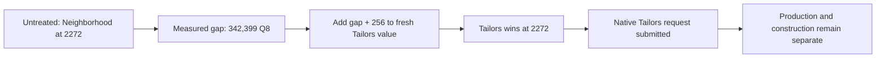

# Native Quarter placement choice after the AI reset

3 November 2026. This separately authorized test follows the
[score-delivery prototype](civ6-district-score-prototype-20261103.md). It asks
whether an explicit preferred site can change a native Quarter choice and be
followed by actual construction. Site-quality and economic-benefit claims are
outside this mechanism test.

## Clean starting rules

The earlier CSC tuning is [retired](../../integrations/csc-ai-reset-20261103.md).
Seventeen runtime/localization files and15 action entries were removed from
active source; installed reset changed only three metadata/settings files.
All other installed bytes, including gameplay and art, were preserved. The
shared controller and observational infrastructure remain; no legacy site,
subsidy or scripted-foundation policy is imported by the new driver.

This uses the unchanged existing game04 turn250 save, SHA256
`ea818368130273e02e70e31449a6f24a54e34486b8bfa402dd34b62255443e48`,
rebased onto clean current CSC rules. It is not a new-world or erased-history
comparison. Target: original AI player5, Sydney city131073, Tailors' Quarter.

## Intervention and qualification

The v2 native bridge captures all admitted Tailors sites for the selected city,
their completed cache values, the ordinary joint district/site winner and
reservation data from selector entry. It preserves the original evaluation,
seven-argument ABI and returned output pointer. It adjusts only fresh nonzero,
nonsentinel output at one declared site; it does not add repeatedly to a cache.

A candidate must have fresh positive raw and completed scores, be clear, owned,
revealed and legal in the source facts, and have no native reservation. A common
row eligibility flag alone is insufficient. The selected alternative differs
from the observed native winner. The declared adjustment is the measured score
gap plus one utility unit, bounded by1,048,576 Q8. This is an experimental
preference, not an economic valuation model or calibrated default.

No order, research grant, free purchase, queue clearing, reservation removal,
strategy trigger or district creation is issued by the experiment. The shared
controller performs finite normal intervals; native requests and construction
must provide the outcome evidence.

## Offline checks

Two owned Win64 host processes passed193 standard and191 budget assertions,
respectively, and exited0. These are overlapping suites, not384 distinct engine
scenarios. They exercise actual native interception, wildcard capture, a changed
winner in an owned numerical model, repeated fresh evaluation without compounding,
reservation capture and refusal, pointer/argument preservation and terminal
mutation-budget shutdown. Record saturation was reviewed but not exhausted.

The actual reader ran in Lua5.1 with mocked game bindings. Driver and daemon
contracts, source admission, planning and normal closure were checked with pure
and mocked cases. These checks are separate from the game observations below.
Host session/window labels do not observe a general native generation API.

## First native baseline: scoring without a new choice

The first250→251 interval loaded the clean rules successfully. Runtime snapshots
showed no old private planning yield, AI profile table, CSC AI lists, planning
adjacencies or modifiers. Legacy assistance properties, pending work and exposed
hosts were absent. Five clear owned potential sites were observed.

The native trace intercepted3,086 calls and admitted12 target invocations,
recording11 fresh Tailors outputs and12 cache entries, with zero writes, errors
or saturation. It captured **no GetBestDistrict return or present-value read**
for this scope. Therefore no treatment was armed from these scores.

The existing Sydney district tree was finishing an Aerodrome. Behavior-tree
rows7721–7755 and CityBuild row135 record its completion; physical snapshots
confirm incomplete→complete. CityBuild row136 then selects Research Lab.
The previously traced outstanding-tree gate and these observations explain why
fresh site valuation did not imply a new district choice during this interval.
Sydney also had military threats and a competing Bomber request; later production
cannot be inferred from the site scores alone.

Clear plot2493 was involved in an Outback Station improvement reservation in
the tree trace. Its attractive raw score is not permission to reuse it. The new
qualification requires the reservation snapshot at the actual district decision.

This baseline closed normally with exit0, restored preferences, retained the
hook daemon until native exit, and verified unchanged source save and clean
installed package. Its zero-choice result is retained as limited exposure,
not interpreted as rejection by the scorer.

## Revised natural-exposure window

The next baseline is bounded to five ordinary intervals and stops at the first
new district choice. Its qualification requires a sole Best return and matching
reservation capture, a distinct immediately preceding cache block and fresh
matching raw records since the previous block. It rejects mixed calculations,
later recalculation, ambiguous reservations and exhausted budgets. Candidate
legality/ownership is checked against both initial and decision-boundary facts.

The treatment starts from the same original save and is bounded to turn260.
Pre-decision physical/queue/research facts must match the baseline prefix.
Selection, request, preferred-site foundation and completed Quarter are recorded
separately. No observed choice within the baseline window means no treatment.

## A district-type switch at the same tile

The second baseline reached its first new district decision at turn252. It
captured one Best return, the matching reservation snapshot and the immediately
preceding fresh calculation. Only plot2272, coordinates52,30, was definitely
unreserved. The other reservation identifiers were not resolved as live or dead;
they were excluded rather than cleared.

The untreated winner was **Neighborhood at2272**. A different district type
provides a real competing alternative even though there is only one qualified
unreserved Tailors site. The planner was revised to distinguish this case from
a same-type site switch, which still requires two qualified sites. The archived
baseline driver was verified; its only revised functions were the offline
planner and baseline compatibility check. Native bridge inputs were unchanged.

| At the decision | Untreated | Tailors incentive |
|---|---:|---:|
| Tailors fresh output and completed cache |243,277|585,932|
| Winning type |Neighborhood|Tailors' Quarter|
| Winning plot |2272|2272|
| Winner's Q8 value |585,676|585,932|
| Tailors plot-specific present value |not captured|585,932|

The declared addition was **342,655 Q8**: the measured342,399 gap plus256.
It was applied to fresh outputs, not incremented into an existing cache. The
turn251 physical, queue and research prefix exactly matched the untreated arm.
The AI accepted a new Tailors request, contract6527, and CityBuild logged its
submission with value2288.0. The untreated tree selected Neighborhood, but the
logs do not show a submitted Sydney Neighborhood contract. The later build
step reported `Not Building`; its underlying cause was not established.

This establishes a **district-type choice change and submitted native Quarter
request at a declared tile**. It does not establish moving an already preferred
Quarter to a different tile. Nor does request value equal production priority.
Sydney was producing a Bomber and had no Tailors foundation through turn253.
The retained native-turn252 logs still list contract6527 as waiting and accepted;
the Bomber's production entry is264/280. No cancellation or expiry of this
Tailors contract was observed. The logs do not expose the numeric control-priority
comparison, so the Bomber's logged value2817 versus Tailors2288 does not by itself
explain why production chose it.

## Follow-through interruption and presentation recovery

The first treatment stalled at turn253 while attempting254 and reached the
controller's600-second limit. It was not a completed260 endpoint. Normal
cleanup nevertheless succeeded: native exit0, preferences restored, no owners,
and unchanged original save, package and frozen inputs. No construction outcome
may be inferred from that timeout.

The retained Lua log contains a NaturalWonderPopup event lock59896 and no
matching unlock. This is a different shipped popup from WonderBuiltPopup,
which the controller already handled. Source inspection shows that its own
`Close()` routine advances the popup queue or releases its presentation lock;
it submits no district order or diplomatic response.

An opt-in presentation guard now requires fresh, finite Core observer proof,
matching UI clock, the visible exact source context, and a retained popup-stack
read before calling that shipped routine. Stack membership or topness is not
an admission condition. It has an eight-acknowledgement
interval cap and refuses to replay an ambiguous acknowledgement. Sixteen Lua5.1
cases and six Python controller mocks passed. A no-adjustment250→254 control
is checking this recovery before a guarded follow-through replay. That control
is not a new scoring policy or proof of popup causality by itself.

Evidence: `Desktop/Codex/csc-native-placement-choice-20261103/`, staged in this
chat's visualization root. Original binaries and saves remain hash/path references.
