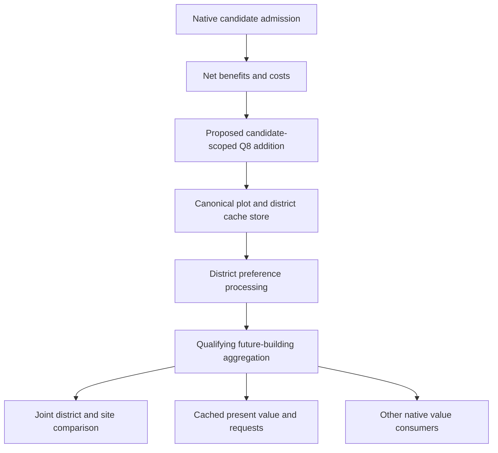

# Native district-score extension: offline feasibility and integration contract

3 November 2026. **Offline investigation complete; no extension or game prototype
was implemented or executed.** This answers where custom district/site value could
enter the inspected native path and what a practical bridge would need to preserve.

> Subsequent work on the same date implemented a bounded native prototype.
> See the [prototype and trial report](civ6-district-score-prototype-20261103.md).
> The no-implementation statements below describe this earlier static study.

## Assessment

A small native extension is a credible way to provide an arbitrary numerical
incentive for a particular player, city, district and plot. A concrete candidate
boundary exists immediately before the ordinary evaluator stores its district
net value in the shared cache. Changing that value there would be read by the
ordinary district comparison and several later value consumers. This is a
static integration finding, not observed proof of a working hook or changed choice.

The useful architecture is **copied facts or precomputed incentives → immutable
numeric policy → native score/cache integration**. Arbitrary author logic could
run beforehand, including Lua at its verified ownership boundary. Calling Lua
or Python for every native candidate is not the proposed hot path.

The existing Community Extension APIs do not already expose this control.
`DistrictTargetChooser` handles a Congress resolution target. A new compiled
integration or an experimental instrumentation host is needed for ordinary placement.

## Evidence boundary

- Current Windows x64 XP2 GameCore SHA-256:
  `324c51e9ea3531758842e16c69e6cddbefbb226c5b675c3d6e60111646c2e98c`.
  The installed DLL and Ghidra program identities matched.
- Thirteen complete Ghidra code views, three complete incoming-reference views
  and seven complete disassemblies were retained. **2,799 instructions / 11,189
  bytes** were compared byte-for-byte with the pristine installed PE.
- Eighteen existing IZ REA records were imported and the retained prerequisite
  aggregation view was inspected. This reused analysis; it did not re-run those
  functions or create a new runtime observation. The bundle was exported and
  REA ended with `open:false`, `cleanup_pending:false`.
- CE source review pinned15 files to commit
  `e59b5aa910c8a0fcab9b31973ffa477443de0e09`. The installed CE1.3 DLL has a separate
  recorded identity; correspondence with that source and current compatibility
  were not established. No installed CE or GameCore binary was loaded or changed.
- No Civ launch, FireTuner session, Frida attachment, native score mutation,
  mod deployment or prototype compilation occurred. Fixture acceptance cases
  below are proposals, not passed tests. Broader optimisation remains paused.

Evidence package: `C:/Users/Shadow/Desktop/Codex/csc-native-district-extension-20261103/`.
It includes raw code/disassembly, current program identity, PE verification,
the reused REA bundle, pinned CE source, independent cache/host/acceptance reviews
and a package manifest. These are external evidence locators; the website does
not redistribute GameCore or a native analysis database.

## 1. A specific score insertion point

The ordinary per-plot evaluator at RVA`3e2aa0` calls the district `NetValue`
wrapper at`52a440`. The following machine instructions establish the boundary:

| RVA | Observed role |
|---|---|
| `3e30b9` | Calls district NetValue at`52a440` |
| `3e30be` | Continues with the row's district-score vector |
| `3e30c3` | Dereferences the returned pointer to obtain the score |
| `3e30c5` | Stores the signed32-bit result in the district entry |
| `3e30df` and following | Positive district preference processing follows |

**The result is a pointer to output storage, not an integer score in RAX.** RCX
supplies the output pointer on entry; the function writes through it and returns
that pointer. A generic `retval.replace(integer)` implementation would change
the pointer representation rather than implement the required score change.
Static ABI reconstruction still requires a real adapter test before attachment.

The plot record is0x78 bytes. `CityPlotEvaluation.Initialize3e7030` binds its
district-score vector at+0x20 to the city buffer, records coordinates at+0x08,
city hexspace index at+0x60, and a handle built from owner/type/city fields at
+0x70..+0x77. `CityBuild` readers use records at+0x4c8 and count at+0x4d8.
These are current-build observations, not portable public object layouts.

An experimental adapter should limit itself to the verified ordinary caller
return address`3e30be`, selected original AI identities and the declared analysis
generation. Its native callback can modify the pointed score before the original
store while retaining the original pointer and native control flow. No detour
installation, relocation or trampoline correctness was tested here.

## 2. Eligibility is more than the invalid sentinel

District NetValue can return the Q8 invalid value`-2559744` (`-9999 ×256`), but
some feature-removal and resource branches return literal zero before reaching
DistrictValue. DistrictValue itself can return zero when a forecast horizon is
cut short by flood/feature-removal timing. Zero is also an ordinary possible
arithmetic result. A result-only test cannot distinguish those cases.

Consequently, **"not the sentinel" is insufficient permission to add value**.
An implementation needs a proven successful evaluation path, or a deliberately
limited initial policy that leaves ambiguous zero results untouched. Such a
policy would not support every legal zero-score candidate. Legitimate negative
scores must remain distinct from invalidity; the native selector has no universal
greater-than-zero rule. Numeric overflow and collision with the invalid sentinel
must also be handled explicitly.

Native revelation, ownership/city assignment, district admission, research,
reservation and immediate CanZone checks remain authoritative. Incentives should
rank admitted alternatives; they should not rewrite those eligibility flags.

## 3. The insertion stage defines the incentive's meaning



At the candidate boundary above, the addition is in **signed Q8 AI utility**.
It is not automatically a Production yield, an adjacency quantity or a final
production priority. A positive district preference subsequently multiplies
the relevant value by1.5. Later `CalculateDistrictValues3dfee0` adds qualifying
future-building value only to already positive district entries. An incentive
that crosses that threshold can therefore change more than its own amount.

For a qualifying positive entry in the first compact plot row, the aggregation
resets that entry to zero before adding its building sum. A pre-store addition
there can be replaced rather than carried through unchanged. Do not assume an
identical delta reaches every row's final value.

Two alternative boundaries are worth distinguishing:

| Boundary | Advantage | Different obligations/semantics |
|---|---|---|
| Caller-filtered NetValue output before canonical store | Uses the ordinary pipeline; identifies the fresh output before downstream consumers | Native per-candidate filtering; ambiguous zero/invalid handling; preference and later building gate affect the addition |
| End of CityEvaluationJob.Execute3e2a40 | One city-batch boundary can process its rows together, reducing callback fan-out | Addition follows the per-plot preference but precedes later building aggregation; row freshness and veto handling still need proof |
| End of CalculateDistrictValues3dfee0 | Addition follows that future-building aggregation | Needs a genuine fresh-base generation and idempotence contract; repeated activation or restored caches must not compound it |

Simply substituting GetBestDistrict's winning type/coordinates would leave its
cached values and other readers unchanged. It is a different, incomplete control
mechanism for this proposed score extension.

The native alternative-land deduction compares static adjacency, not every
district's full final utility. A custom addition would participate in the joint
ranking; it would not automatically become a new static-adjacency term charged
against every other district. Define whether a policy rewards one type, penalises
covering a material for all relevant types, or explicitly models that opportunity.

## 4. The cache is shared beyond the winner

Incoming-reference inspection found six direct call sites to district
`PresentValueOf3e7f40`, in four containing functions: threat/queue review,
UnitRequestContract.Update, DecodeTriggerNode.Update and
CityDistrictProductionEffect.Analyze. Unknown indirect uses remain outside this
direct-reference coverage.

The fresh additional consumer at`480540` loops districts the player could zone
and the city does not already have, obtains a best location, reads its cached
present value, arithmetic-shifts it by8 and adds the integer to its analysis
accumulator. Assembly at`48060e` proves R9 carries the returned best plot into
PresentValueOf; the decompiler's abbreviated call alone omitted that argument.
This is another route through which altered district value can influence an
evaluation beyond the immediate district selector. Its exact SQL effect
registration and eventual choice impact were not traced here.

The plot-specific PresentValueOf reads the relevant entry directly. Its
no-plot overload starts its maximum at zero; a valid negative site and a no-plot
zero return can therefore coexist. Some trigger paths convert Q8 to an integer.
Consistency means preserving the actual consumer's transformation, not insisting
that every later field equals the raw score bit-for-bit.

UnitRequestContract extra present value and request priority are separate.
The traced update can retain the larger old/current value. Removing or reducing
an incentive need not immediately retract existing requests. A greater district
value can also affect the comparison used when considering interruption of
current production. This extension cannot honestly be described as changing
only a final location choice.

## 5. Persistence and disabling need a design

`CityBuild.Write3eaac0` serializes district cached values, and
`Read3e8b30` restores those values after initializing plot analysers and marks
the evaluation state available. A modified cache can therefore be carried by
a save, even when the extension's own policy table is not saved.

Do not define generation solely by a reused pointer or game turn. Session/load
identity, city identity, fresh analysis and policy version need explicit handling.
Do not repeatedly add a delta to already modified entries. A prototype's treated
saves and outstanding requests must not be reused as an untreated reference.
Disabling a hook does not itself undo past construction or guarantee immediate
removal of cached/request influence. A release needs a qualified refresh,
serialization or saved-policy contract; no such contract was implemented here.

## 6. What the arbitrary policy could express

The bridge could carry a precomputed table or a pure function of copied features:

```text
(session, analysis epoch, player, city, district, plot) -> signed Q8 adjustment
```

Examples include nonlinear Base/Both value, a named future customer path,
additional value for a scarce industry, expected material-development delay,
a penalty for covering another chain's supply, resilience/redundancy and a
cost for displacing a much better Campus site. These are policy possibilities,
not calibrated rules or evidence that the native AI already forecasts them.

Authors could express rules in data or prepare the table in Lua at a verified
safe context boundary. A new custom SQL table/property only becomes effective
after a compiled consumer is supplied. The hot callback should read one stable,
bounded snapshot; it should not query Lua, traverse game objects asynchronously,
wait for a Python process or perform per-candidate disk/network I/O. Publishing
half a new table during one analysis pass would make ranking timing-dependent.

Direct AI scoring can avoid granting a new gameplay yield or synthetic map
feature to express the incentive. It still changes actual AI investments if
enabled. Original human identities must be excluded explicitly, including
autoplay-role complications; AI-only behaviour is a contract to verify.

## 7. How to host it

Pinned CE source shows that RegisterCallEvent requests zero Lua return values
and resumes the original trampoline. RegisterProcessor stores callbacks that
specific native callers must invoke; its existing district caller is Congress
support. Neither is the needed typed candidate-score result bridge.
[Entry bridge](https://github.com/Wild-W/CivilizationVI_CommunityExtension/blob/e59b5aa910c8a0fcab9b31973ffa477443de0e09/MemoryManipulation.cpp#L276),
[processor registry](https://github.com/Wild-W/CivilizationVI_CommunityExtension/blob/e59b5aa910c8a0fcab9b31973ffa477443de0e09/EventSystems.cpp#L8),
[Congress caller](https://github.com/Wild-W/CivilizationVI_CommunityExtension/blob/e59b5aa910c8a0fcab9b31973ffa477443de0e09/AI.cpp#L8).

| Delivery | Assessment |
|---|---|
| Frida with native CModule callbacks | Useful proposed experimental host; reuse existing research tools and filter in native code before JavaScript. It remains a process/session tool, not a shipped CSC feature. |
| New compiled CE integration | Reuses an existing GameCore carrier and Lua-registration pattern, with a new dependency/version/build/compatibility contract. Existing processor names do not make it turnkey. |
| Independent GameCore proxy | Possible separate carrier, with responsibility for loading/forwarding, hooks, state lifetime and conflicts with other GameCore carriers. Not ordinary SQL/Lua deployment. |

CE's installed frontend configuration chooses its GameCore package/DLL prefix;
this is not evidence of a generic loader for arbitrary addon DLLs. No packaging
choice or multiplayer/platform compatibility was established.

Frida documents native hot callbacks and CModule, and MinHook supplies Windows
detour machinery. Those interfaces do not validate the Civ-specific ABI or
relocatability of a chosen target. DLL initialization also needs an appropriate
loader-lock lifecycle. [Frida](https://frida.re/docs/javascript-api/#cmodule),
[MinHook](https://github.com/TsudaKageyu/minhook),
[Windows DLL guidance](https://learn.microsoft.com/en-us/windows/win32/dlls/dynamic-link-library-best-practices).

## 8. Recommended next implementation gate

Build a small, separate native test host and policy kernel before attaching to
Civ. Demonstrate unchanged output-pointer identity and exact no-op results,
signed/overflow/sentinel/zero handling, one original call, caller/player/city
scope, one application per fresh evaluation, immutable concurrent publication
and restoration. Prove out-of-scope calls avoid JavaScript; count all invocations,
admitted calls, bridge crossings and retained reports separately. A record cap
does not bound interception cost.

Then a separately bounded existing-save experiment could ask one narrow causal
question: does a declared incentive reach a fresh candidate cache, the natural
winner and the appropriate request value without changing legality or forcing
an order? Use the shared controller and preserve the actual competing choices.
No such native experiment was started by this investigation. Useful completions,
retained supply and empire benefit would remain later questions.

## Related evidence

- [District choice and incentive consumers](civ6-district-choice-placement-and-incentives-20261103.md)
- [Future-economy interpreter and current source](csc-future-economy-forecast-20261103.md)
- [Existing placement-observer closure](csc-native-quarter-placement-control-evidence-20261101.md)
- [Native production/request fields](csc-ai-native-production-analysis-20261028.md)
- [IZ architecture](civ6-industrial-zone-planning-architecture-20261101.md)
- [Current handbook extension explanation](../../civ6-ai/topics/native/native-placement-extension.md)
