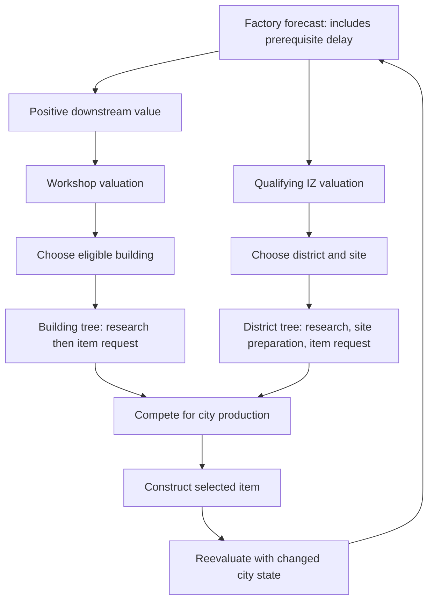

# Industrial Zone development: forecasting, requests and commitment

Investigation: 1 November 2026. Question: **Does the AI pursue Industrial Zone →
Workshop → Factory as a persistent economic plan, or choose successive actions?**

Subsequent authorized work: the [three-interval existing-save observation](civ6-industrial-zone-decision-boundary-20261101.md)
now confirms direct Factory-to-Workshop propagation and a category-selection /
production distinction at runtime. Statements below about no game and unmeasured
runtime values describe this original offline phase; the follow-up records its
own scope, failed source-read attempt, successful run, limitations and closure.

## Finding

The inspected ordinary city-development route combines **prerequisite-aware
forecasting, backward propagation of future building value, and item-level
construction commitments**. It is more capable than evaluating only immediate
benefits. We did not find a persistent three-item Factory plan in this route.

In particular, a positive Factory forecast can increase Workshop valuation and
contribute to the value of a missing Industrial Zone. The ordinary building
selector nevertheless excludes Factory while its Workshop or legal prerequisite
district is missing. The selected immediate building receives its own request;
the inspected request code does not recursively dispatch its prerequisites.
Completion changes eligibility and subsequent evaluations can choose the next
step. That is a code-backed explanation of a possible sequence, not a recorded
game in which this sequence won all competing decisions.

Authored multi-step plans also exist: the shipped district tree coordinates
research, acquisition/reservation, plot clearance and construction. The useful
distinction is between forecasting dependencies, executing a task with several
steps, and retaining a higher-level economic objective across separate tasks.

No Civ game was launched, no game or installed-mod content was changed, and no
AI weights were tuned for this investigation. Runtime frequency, actual numerical
rankings and empire benefit remain unmeasured here. The older broad AI campaign
was not resumed. Fresh-game work, if subsequently needed, uses the maintained
shared controller and native-profile hosting/restoration workflow.

## Target and evidence

All native RVAs below refer to the current Windows XP2 GameCore DLL SHA-256:

`324c51e9ea3531758842e16c69e6cddbefbb226c5b675c3d6e60111646c2e98c`

The Ghidra MCP program reports that hash and image base `0x180000000`; add that
base to an RVA to obtain its static VA. Historical linker-map names and community
layouts are discovery aids. Current loader bodies, actual SQL strings, call
relationships and assembly supply the findings below. Decompiler types and local
names are estimates. No supplied DLL, master Ghidra database or prototype was edited.

Compact raw evidence, shipped-file hashes and numbered extracts are retained at
`C:/Users/Shadow/Desktop/Codex/csc-iz-architecture-20261101/`:

- `data/`: shipped prerequisites, default event/tree bindings, boost-route review,
  nine source-file identities and extracts.
- `native/`: current decompilations, selected assembly and byte checks.
- `prior-audit/`: independently inspected prior raw exports, cache-alias proof,
  selector/queue review and source receipts.
- REA evidence identifiers and bundle details are recorded in the evidence index
  accompanying the final extraction receipt.

This package reuses the prepared analysis and existing raw exports. Old research
conclusions were checked against concrete code/data rather than adopted as the
investigation's premise. Related: [symbol provenance](csc-ai-gamecore-symbol-resource-20261029.md),
[Ghidra access](csc-ai-ghidra-mcp-20261029.md),
[older production analysis](csc-ai-native-production-analysis-20261028.md).

REA 6.8.0/Ghidra 12.1.4 retained fresh dossiers alongside the prepared Ghidra
12.2 analysis. Key parent Evidence IDs, preserved in the exported bundle:

| Current RVA | REA complete parent Evidence ID |
|---|---|
| `3dfee0` | `ev_5f7ce5ac79b51c487000e7d4c0d4761c6f192ef653dd01ea9c22659fb44987ba` |
| `55ba40` | `ev_1343a45798a4baf9748686ee9b7f0cfb08b4c1960320cdfb6225cf17fda7a746` |
| `3f9100` | `ev_baa1fc3812087d0f098177bbe889d531746798994423e6caf65218c087383086` |
| `3df040` | `ev_84c561282a476e7b6d7083e6af6e479cbe05f76ab0f91152f6639e7d36cab979` |

The tiny bounded initializer trace
`ev_80253c06b5604f6f6085bbe776343e3320cda4ec0a215d617aaa38cbac70579a`
reached its 120-node budget (144 edges, two decompilations) and retains unresolved
bindings/call-site limits. It is not a complete dependency graph and supplies no
global absence proof. Complete selected dossiers and their inspected callers are
the evidence for the scoped findings. Bundle: 18 records, 3,560,274 bytes;
`evidence-index.json` records identities and limitations. REA was closed normally
after export; no snapshot/project copy was retained for this investigation.

The installed DLL hash matches the reference. `verification.json` records
byte-for-byte checks of all 420 emitted instructions across dependency aggregation
and building selection, plus identity and artifact checks. These are static
consistency checks, not runtime replication or outcome tests.

## 1. The data defines real prerequisites

Paths in this section are under the installed game root.

| Item | Required technology | Construction prerequisites |
|---|---|---|
| Industrial Zone | Apprenticeship | Ordinary district eligibility, population and legal plot |
| Workshop | Apprenticeship | Industrial Zone |
| Factory | Industrialization | Industrial Zone and Workshop |

Primary entries: `Base/Assets/Gameplay/Data/Districts.xml:52`,
`Buildings.xml:118`, `Buildings.xml:127`, and `BuildingPrereqs` at
`Buildings.xml:201`. Gathering Storm changes costs, yields and power behavior;
the data package preserves those overrides as well. This is the ordinary building
pair, not a unique replacement or a currently modded runtime database.

The Windows prerequisite loader at `77a780` executes a join through
`BuildingPrereqs.PrereqBuilding` and writes Building `+1f8`. The reverse loader at
`77a4d0` joins through `BuildingPrereqs.Building`, selecting buildings for which
the current building is a prerequisite, and writes Building `+198`.
Thus Workshop's reverse collection includes Factory. This is a direct SQL join,
not a recursive transitive closure.

Building `+1e0` is a mutually-exclusive collection; it must not be confused with
prerequisites. The district-value aggregation's HasBuilding/lower-index exclusion test uses
that separate collection. `+218` is the resolved prerequisite district.

The raw building-definition SELECT and `7b5eb0` establish that Building `+159`
bit `0x10` is `RequiresPlacement`. Ordinary Workshop/Factory do not use the
Wonder-style placement branch. The raw query and field mapping are retained in
`native/building-query.json`; copied Linux field names alone were not sufficient.

## 2. A future Factory receives a prerequisite-aware forecast

The per-plot city evaluator at `3e2aa0` has a city-center/canonical-building branch
that calculates building values even when normal prerequisites are not yet met.
It calls the requirement inspector at `0f61c0` and checks terminal invalidity,
rather than requiring the building to be immediately constructible.

The forecast accounts for:

1. Estimated technology/civic delay.
2. Production time for a missing prerequisite district, with an additional
   ten-turn term if that district is not the current production item.
3. The desired building's own production time, with another conditional
   ten-turn term when the active queue contains a different item.
4. Research/civic and production delay for missing direct prerequisite buildings.

It passes the aggregate delay to building NetValue at `52a050`, which reaches
building Value at `52b900` and its yield/modifier/discount calculations. The exact
Factory score, regional overlap and power contribution in an actual city were
not reconstructed numerically in this pass. A positive value is a condition for
the propagation described next, not an assumed result for every city.

The inspected delay loop visits direct prerequisites; it does not establish
arbitrary recursive scheduling, exact parallel research timing or reservations
for all future steps.

## 3. Downstream value travels backward to immediate candidates

`CityBuild::CalculateDistrictValues` at `3dfee0` performs two relevant operations:

- For ordinary non-placement buildings, it adds each positive, player-mapped
  dependent-building evaluation into the current building's evaluation. For the
  shipped pair, that allows Factory value to increase Workshop value.
- It accumulates positive building evaluations into their mapped prerequisite
  district when the city lacks that district or all examples are pillaged.
  These contributions are then added to already-positive district candidates.
  The mutually-exclusive canonicalization and other gates remain significant.

Schematic arithmetic, excluding other buildings and all remaining score terms:

```text
Workshop choice value = Workshop forecast + positive Factory contribution
IZ candidate value   = native plot value + qualifying building contributions
```

For the first cache row, the inspected code resets an already-positive district
entry to zero before adding the building sum; the schematic additive plot formula
therefore applies to normal nonzero plot rows. An ordinary IZ cannot occupy the
city-center tile represented by that first row.

These are local value additions. They are not a guarantee that the Factory
dominates alternatives or that IZ obtains an otherwise-illegal/nonpositive site.
The district loop runs alongside the dependency loop; it is not safe to treat
every district contribution as the final, fully expanded building value.

The cache connection is verified: `InitializePlotAnalyzers` (`3e7350`) supplies
CityBuild's building-evaluation payload (`+4f0`, wrapper `+4e0`) to
`CityPlotEvaluation::Initialize` (`3e7030`). Entry `+28` points into that payload;
the first entry is the same vector used by `GetBestBuilding` (`3e4710`).
The per-plot evaluation writes scores there, and `DoTurnActivate` (`3e2820`)
runs dependency aggregation before checking building and district opportunities.

Propagation mutates the vector in definition iteration order. No general
topological-order guarantee, recursive fixed-point solver or universal
every-turn reset invariant was established. Negative/zero dependent values are
not added. These qualifications matter when extending this mechanism to longer
or alternative prerequisite graphs.

## 4. Selection advances through eligible steps



This shows the inspected relationships, not a prediction that all choices win.
The separate Factory-rooted construction graph suggested by the original question
was not found in this ordinary route.

`CheckForUnitOrBuilding` (`3e1580`) calls `GetBestBuilding(...,0,0)`. That selector
requires both the first missing-building result and missing-district result to
be `-1` before accepting a building candidate.

The requirement inspector (`0f61c0`) supplies the missing Workshop at result
`+4`, and a missing but normally zoneable prerequisite IZ at result `+18`.
Therefore, in this ordinary case:

| City state | Relevant ordinary selection behavior |
|---|---|
| No IZ | Factory/Workshop can have forecasts; missing district blocks their direct building selection. Their qualifying values can support an IZ candidate. |
| IZ present; Workshop absent | Factory is blocked as the next building. Workshop can compete with its downstream Factory contribution. |
| IZ and unpillaged Workshop present | Factory passes these prerequisites and competes with other eligible choices. |

This does not bypass every other eligibility check. An impossible district can
set a different terminal-invalid result, and other fields/cached-invalid values
matter. Also, multiple `BuildingPrereqs` rows behave as alternatives in the
inspected inspector: one present, unpillaged alternative clears the missing
building slots. Factory's single Workshop row avoids that ambiguity here.

Once selected, the city creates its configured one-use building behavior tree
with the selected building, city and value. `Build Unit` in shipped XML maps to
native `BuildFromCityNode`, not `BuildProductionNode`; the latter is the optional
Builder production-acceleration action in the district tree.

## 5. Commitment belongs to a requested item

The ordinary `Build City Building` tree has Decode Trigger, contract-managed
Add Goal Tech, and contract-managed Build Unit stages. It supplies the selected
building to research and construction. Its XML has no separate prerequisite-
building expansion node.

Current code narrows that observation:

- `AddGoalTechNode::Update/Execute` (`54fdf0`, `54f6b0`) identifies needed research
  and creates tech/civic research contracts. Those are real linked research
  requests, not construction requests for Workshop/IZ.
- `BuildFromCityNode::Update/Execute` (`55c550`, `55ba40`) reads the desired item,
  city and value, creates a UnitRequestContract, initializes its selected type
  and submits/manages it. The building branch uses `3f9100`.
- `UnitRequestContract::Execute` (`3f8310`) dispatches its recorded unit,
  building or district. `CityBuild::BuildBuilding` (`3df040`) checks actual
  constructibility and submits that building's build operation. Neither inspected
  body substitutes a missing prerequisite or recursively creates child jobs.

A Workshop request can carry value that originally included Factory, but the
traced request does not retain Factory as a parent objective to fulfil later.
We found item persistence, not an enduring three-step Factory job graph in this
route. This is a bounded conclusion; it does not exclude differently authored
trees, boosts, scenarios or untraced AI systems.

## 6. Competition, persistence and cancellation

`QueueNextBuild` (`3e8190`) compares eligible contracts and competing unit/project
values; successful contract execution starts the requested production. Its
fallback compares eligible buildings, units and projects. Therefore a Workshop
winning the building category does not establish that production will choose it.

Contract Update (`3fa5e0`) retains the maximum of stored and current item value
through the inspected path. This supports persistence of an item-level score;
it does not prove the original dependency remains beneficial, nor that no other
writer/cancellation can change the commitment. The same body can report failure
when its building no longer matches current production.

Both building-tree contract decorators specify Turn Limit 5. The native
`ContractManagerDecorator::Update/UpdateContract` (`559670`, `55a030`) uses an
elapsed-update threshold and cancels/releases waiting contracts in inspected
numeric states 1/3 when overdue. State 5, set by the execution path, is exempt
from that timeout branch. Thus the XML is **not** a rule that Workshop/Factory
must physically complete in five turns. Other validation/interruption failures
remain possible. Numeric contract states are preserved rather than invented enum
names; exact runtime update cadence is not measured here.

Existing current-build `UpdateWorkingContract` and threat-path exports show
separate validation, update and threat-interruption handling. This investigation
does not reduce all abandonment to a single timeout or a single strategic cause.

## 7. Other paths and experimental confounders

The 35-node `Build City District` tree is an authored multi-step workflow:
purchase/reserve a site, request research, arrange clearance with a Builder,
construct the district, and optionally accelerate construction for a qualifying
ability. This is evidence of task-level planning in the architecture.

The more elaborate `Build Trigger Building` route is bound to generic building
boost handlers. Workshop construction can support the two-Workshop Industrialization
Eureka; three Factories can relate to Class Struggle's inspiration. The exact
native dispatch of the latter was not validated here. Unlocking every technology
alone does not eliminate every potential civic-boost motive.

We checked `ChooseCityForBuildingNode::Update` (`552cc0`): it can identify a
missing district and choose a city/location, but this body does not recursively
dispatch Workshop construction. In the shipped boost tree the final build node
still requests the original trigger building; no separate missing-district or
Workshop construction node appears. This does not establish every failure or
success of that different runtime route.

Community behavior-tree/contract documentation was consulted for node discovery
and scope. Its platform names and author-reported experiments were not treated
as current Windows execution evidence. See the author's
[tree reference](https://cru121.github.io/civ6-gamecore-reference/ai-behavior-trees.html)
and [contract reference](https://cru121.github.io/civ6-gamecore-reference/ai-contracts-and-operations.html).

## Answered questions and remaining work

| Question | Status | Result |
|---|---|---|
| Are the IZ/Workshop/Factory prerequisites defined and used? | Answered statically | Shipped rows and current prerequisite/reverse loaders agree. |
| Can the AI value future buildings before their prerequisites exist? | Answered statically | Forecast includes prerequisite delay; positive downstream values propagate backward. |
| Does ordinary city construction retain a Factory-rooted three-step plan? | Bounded route answered | Inspected city/tree/request path selects an eligible next item and retains that item; no Factory-rooted construction graph found there. |
| Does the architecture support any multi-step coordination? | Answered at data/code level | District preparation workflow and linked research/construction contracts exist. |
| How can competition or interruption break progress? | Partially answered | Queue competition, waiting expiry and item validation/update paths identified; actual IZ-case occurrences unobserved. |
| Will a specific city follow the sequence and benefit? | Unresolved runtime question | No new game or causal outcome test was performed. |

The next useful runtime test is a **single decision boundary**, not a long AI
performance campaign: choose a city with a completed IZ, missing Workshop,
Industrialization available and no outstanding relevant boost objective. Capture
raw Workshop/Factory values, the dependency-adjusted Workshop value, selector
result and the corresponding item request/queue choice. Prefer a suitable existing
snapshot before generating a fresh game. Scope observation at city-level entry/
exit boundaries; avoid global yield-normalization hooks. Only after this is
interpretable would a completion boundary establish how Factory becomes the next
candidate. Use the shared controller for any fresh game, with its hosting,
finite advancement and restoration machinery.

For CSC, the immediate architectural implication is that native declared building
prerequisites already provide a future-value channel. Material preservation and
customer development in other districts are additional relationships whose
forecast/coordination must be checked separately. This report authorizes no
prerequisite changes or new tuning by inference.
