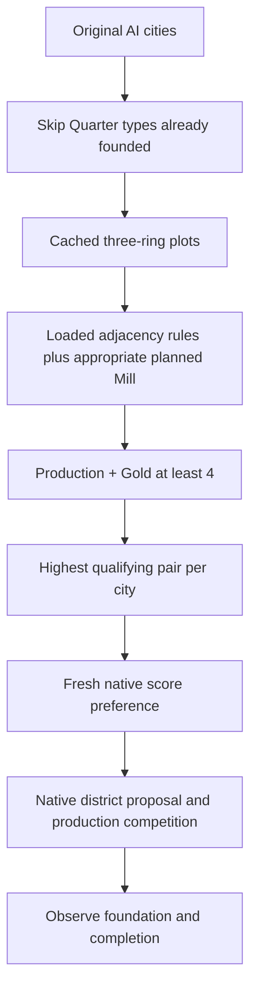

# Full-adjacency Quarter placement policy

3 November 2026. Henno requested a simple first policy for Bakers and Tailors:
scan the AI cities' three-tile radii, identify Quarter/site pairs with at least
**+4 combined Production and Gold adjacency**, and promote them through the
native district scorer. All designed adjacency sources count, including rivers
and the appropriate first Bakers Mill. This replaces the assistant's earlier
suggestion to exclude river or temporary policy effects.

## Implemented rule

The new implementation is in `project/tools/ai_site_planner/adjacency_policy/`.
It imports the shared game controller and native-lifecycle infrastructure, not
the retired CSC placement, subsidy or scripted-foundation policy. It is separate
from the broader partial investment evaluator in `ai_site_planner/evaluator.py`.

The scanner uses the **loaded bundled adjacency engine**, including its rule
inventory, eligibility, TypeTags, ownership/revelation, counting and rounding.
It evaluates the Quarter's own Production/Gold adjacency, not reciprocal yields
awarded to neighbors or later producer/customer transactions. Active policy and
integration rules apply where they actually affect that adjacency. Unexpected
stock Quarter adjacency rows stop the pilot rather than silently disappear.

Bakers' planned Water Mill adds one Production per complete pair of river edges;
a non-river Wind Mill adds one Production on Hills. Only the site-appropriate
Mill branch enters the planned score. Currently active amounts are reported
separately, including any existing empire-wide building gate. The required Mill
is named; it is not created, researched, subsidized or guaranteed to be built.
Tailors' river bonus applies to the Quarter directly. No effect is counted twice
because the public page describes it in both district and building sections.

The scanner caches each city's radius-three geography, then refreshes dynamic
scores once per inactive game turn. It excludes original humans, foreign or
unrevealed land, water/impassable/occupied sites, and land not assigned to the
city. Native plot placement potential is required. A matching material on the
placement footprint is protected from auto-harvest. Once a Quarter exists,
including an unfinished foundation, that city/type is no longer evaluated.

All qualifying pairs are retained for diagnostics. The highest total in each
city is promoted; ties use Quarter type then plot index for reproducibility.
Bakers and Tailors compete for that city's one promoted entry. There is no
additional Base/Both gate. Production and Gold each count one toward the cutoff.

## Native intervention and limits

The extension adds **1,048,576 Q8** to a successful fresh score for the exact
original-AI player/city/Quarter/plot tuple. This is an explicit strong priority
intervention, not a calibrated economic value or translation of +4 yields. It
does not ban other sites or guarantee victory over every competing proposal.
Zero, invalid sentinel, pointer mismatch and overflow retain their protections.

One immutable table contains at most128 city entries. Publication disables and
drains native invocations before replacing the table; old-version calls cannot
receive a new table's addition. Each window has a512-write/4096-record limit;
exhaustion disables the policy and fails the observation. Native callbacks use
bounded memory reads and numeric lookups, with no Lua, JavaScript or game calls.

Cache, winner and plot-specific present-value observations remain separate from
physical foundation/completion. A removed incentive does not roll back serialized
cache values or withdraw retained native requests. No reservation, production
queue or build order is replaced. The shared controller owns all game operations,
including presentation recovery and normal preference/process closure.

## Offline evidence

- 12 pure policy checks: threshold, city/type competition, human/scope rejection,
  material preservation, invalid totals and the100-turn boundary.
- Nine Lua5.1 scanner checks use the actual shared eligibility/rounding and river
  counter with mocked material/customer counts. They cover both Mill branches,
  current versus planned yield, active policies and river-pair rounding.
- 28 checks execute the real native callback kernel in an owned disposable host:
  two-city/two-type scope, pointer and seven-argument preservation, arithmetic,
  invalid results, atomic refresh/removal, version checks, cache/winner/PV
  monitors and terminal write-budget disable. These are not Civ executions.
- The installed adjacency core, processor and both Quarter SQL files matched the
  workspace source after UTF-8/newline normalization before the game.

## Test protocol and interruption

One fresh Ancient-era game: Online speed, Prince, Small Continents, six majors,
nine city states, standard resources, CSC plus official content. Seeds:
map16131103/game26131103. No RH or retired AI tuning; ordinary CSC map-generation
behavior remains part of the baseline. The authorized maximum is **turn100**.
Original humans are captured before autoplay and excluded permanently.

Henno reported that Shadow died during the first run. Accepted scans1–5 and a
turn6 autosave survived; no native score writes had occurred. There were no
surviving game or controller processes. The exact autosave was archived and
copied to a separate supported native save, SHA-256
`5331e6cc6b985e29ac23b47e0f0c49819df7656bd47b762b311df6ad549de427`.
Recovery starts at6, retains the original AI identities and pre-run mod/AutoStart
preferences, and keeps the same maximum endpoint. It is not an uninterrupted run
or a fresh matched control.

The evidence bundle is `Desktop/Codex/csc-adjacency-policy-20261103/`.
The first run's final native exit/restoration could not be observed after the
interruption. Recovery has its own source pins, native owner and closure records.

## Online100 result

The recovered game reached **turn100** and closed normally. Accepted scan files
cover turns1–100 without a missing scan boundary; this does not erase the
interrupted active interval or establish uninterrupted simulation/RNG parity.
The five original AIs produced these observations:

| Measure | Observed |
|---|---:|
| Distinct qualifying +4 pairs |8|
| Distinct promoted pairs |7|
| Native fresh-score adjustments |52|
| Native Best returns in promoted city windows |9, covering all7 promoted pairs|
| Native errors / maximum writes in one window |0 / 3|
| Foundations at previously promoted sites |7|
| Completed promoted Quarters by100 |7|
| Other foundations, all below4 in preceding scan |23|
| All observed Quarter foundations / completed |30 / 26|

**Every qualifying and promoted pair in this world was Bakers.** No Tailors
site reached4, so this game does not establish live delivery for a qualifying
Tailors policy entry. The scanner still checked eligible Tailors sites until
that city founded one; its river behavior has the separate offline checks.
Three distinct promoted sites had observations where the current adjacency was
below4 but the planned first Mill lifted the total to4.

The first example is Amsterdam, P4/city65536, plot878 (64,11). Two Specialty
materials give +2 Production, the planned Wind Mill on Hills adds +1 Production,
and the City Center gives +1 Gold. Its early current total is3 and its planned
total is4. At the first captured promoted Best return, the cached score is
1,064,573 Q8. The Quarter foundation first appears at17 and completes at68.
This long delay is a useful reminder that a preferred proposal or foundation
does not establish immediate production follow-through or first-Mill investment.

| Player | City | Quarter | Plot | First foundation observation | First complete observation | Prior planned adjacency | Previously promoted |
|---|---|---|---:|---:|---:|---:|---|
|4|Amsterdam|Bakers|878|17|68|4|Yes|
|1|Mikisiw Wacihk|Bakers|1986|38|40|4|Yes|
|4|Utrecht|Tailors|1021|48|53|0|No|
|3|Majapahit|Bakers|1754|52|54|1|No|
|1|Wihkasko Kiseyin|Bakers|2129|55|58|0|No|
|3|Palembang|Bakers|2051|56|60|3|No|
|5|Delhi|Bakers|1280|57|59|1|No|
|4|Utrecht|Bakers|1170|61|67|1|No|
|5|Mumbai|Bakers|1643|65|69|4|Yes|
|1|Paskwaw Askihk|Bakers|2573|66|75|4|Yes|
|1|Mikisiw Wacihk|Tailors|2207|68|69|2|No|
|2|Pokrovka|Bakers|2289|68|71|1|No|
|1|Wihkasko Kiseyin|Tailors|2206|69|71|1|No|
|3|Banjarmasin|Tailors|2273|71|77|0|No|
|5|Jabalpur|Bakers|1056|71|76|4|Yes|
|2|Gelonus|Bakers|2213|72|77|0|No|
|2|Myriv|Tailors|2580|72|81|1|No|
|4|Tilburg|Bakers|806|72|78|4|Yes|
|1|Pihtokahanapiwiyin|Bakers|1762|73|80|4|Yes|
|4|Amsterdam|Tailors|729|74|76|0|No|
|2|Pokrovka|Tailors|2584|77|80|1|No|
|5|Madurai|Bakers|1579|79|86|2|No|
|2|Kul Oba|Bakers|2949|82|86|1|No|
|3|Banjarmasin|Bakers|2272|82|89|1|No|
|4|Arnhem|Bakers|870|86|94|3|No|
|2|Myriv|Bakers|2507|87|94|1|No|
|3|Badung|Tailors|1237|89|Unfinished at100|0|No|
|1|Ahtahkakoop|Tailors|1914|90|Unfinished at100|1|No|
|5|Chennai|Bakers|1867|96|Unfinished at100|2|No|
|2|Pazyryk|Bakers|2805|100|Unfinished at100|1|No|

All30 cities/owners in this table were present in the preceding observation;
these are not inferred new foundations from a newly visible captured city.
The explicit preceding-scan qualifier remains: adjacency can change within an
interval. This is a descriptive treated-game result, not a matched untreated
comparison or evidence of net empire benefit.

### Performance and operational evidence

The scanner evaluated8,377 site/type pairs across1,148 city observations. Radius
geometry was built28 times across the initial launch and recovery; other reads
reused it. Completed/founded city/type exclusions reduced later work. The
in-game `os.clock` difference was0 for93 recovery samples and1 for two: this is
coarse timing, not a precise CPU benchmark or proof that a scan costs zero.
Median end-to-end readback was0.812s, maximum1.185s, including FireTuner/context
transport. That latency must not be attributed entirely to the scoring loop.
No evidence here requires permanent scan-once scores or complex dirty events.

Per-turn `scans/`, `plans/` and `native/` retain what ran and what it returned.
`native-windows.json` retains all95 finalized windows, including the empty
bootstrap window. `analysis.json` joins physical observations, prior scores,
promotion history, winner calls, policy versions, per-window counters and the
timestamped operation timeline. Event order and game-turn windows are recorded;
individual native callbacks do not have per-call wall-clock timestamps.
Controller operation intents and command journals retain reservations before
transmission and errors/no-ops. Progress and shutdown receipts distinguish the
last completed boundary from a crash, timeout or successful stop. Henno requested
15-minute human check-ins for this and future automatic games; evidence collection
remains per turn and does not wait for a human check-in.

The shared controller handled the turn97 observer warning and then continued to
100. Native game and daemon exited0; callbacks were retained until process exit,
with no explicit live detach and no diagnostic fault. All145 mod preferences /
148 installed entries and AutoStart=false matched the original pre-interruption
snapshot. Installed content and dependencies stayed unchanged, and final owner
inventory was empty. The recovery input save remains hash-pinned.

## Interpretation

Construction at a promoted site establishes policy follow-through, not that the
bonus caused a change from an untreated choice. Other sites remain selectable;
report those placements separately. The recorded adjacency for a newly observed
foundation comes from its preceding completed scan, not a reconstruction of the
exact construction tick. First-Mill construction incentives, sustained supply
and net empire benefit are later work.
