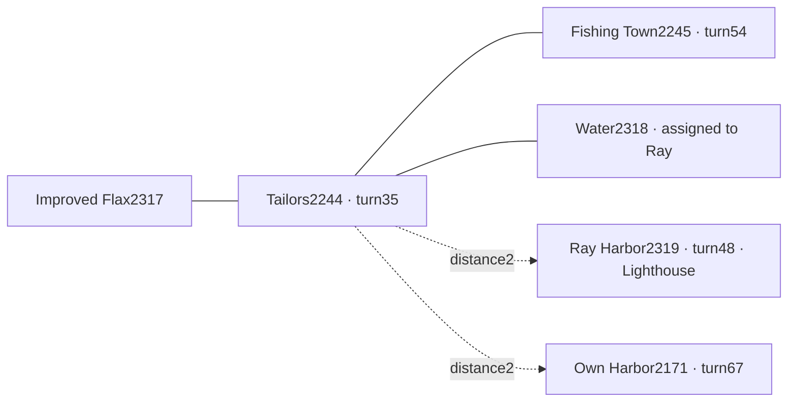

# Customer-first guidance — fresh Continents250

## Predeclared protocol

16 November2026. Small Continents, Online, Prince, **250 turns**. Map seed
**22051116**, game seed **32251116**, five stock AI majors and original observer0.
City Lights, Resourceful2 and Sukritact's Resources enabled. Main CSC AI source
19e29a42 includes reverse customer-first planning and the32-utility aggregate cap;
SQL customer/private-yield edges are the repaired gameplay-derived graph.

The accepted gameplay/art package from the preceding calibrated250 supplies
content; all current main CSC AI modules, numerical UI bridge and reviewed AI SQL
are overlaid by the established freeze tool. Unrelated workspace gameplay/art
changes are excluded so this run continues the existing test configuration.
CE SHA1be0545b94b35adaf582df2d70e827ecdb8014ccf91b59c5cc9f9b72fdc06bfc.
Upstream remains develop2986a746/mastere59b5aa9 at the pre-launch check.

Only integrated main CSC supplies AI policy. Additional Quarter/planning/
economy/native Storekeeper observers read decisions and outcomes. The shared
controller owns every game operation, with15-minute wall-clock checks and25-turn
censuses. No unlock/production fixture or external score writer is active.

Artifacts:
`C:/Users/Shadow/Desktop/Codex/csc-ai-customer-first-continents-20261116`.
Frozen source `frozen01`; output `continents250-01`; host `worker-status.json`;
task `CSC-AI-CustomerFirst-Continents-20261116`. Setup is pinned before results.

## Requested measurements

Report Bakers/Tailors foundations and completions; adjacency at placement;
Base/Spec access and improvements; mapped customers/provider districts; producer
and customer buildings; every Stage2/3/4 Service property and hidden Service
building at each census. This covers ten named Services: Storekeeper, Innkeeper,
Groundskeeper, Ride Technician, Dockmaster, Sacristan, Stage Manager, Ballet
Dancer, Musical Actor and Opera Singer (six stage/property groups). Keep native Storekeeper effect/chain-turn evidence
separate from other Services' property evidence. Include first placement order,
material losses/repair, native placement competition, purchases and empire output.

For new guidance, join aggregate/component proposal logs with existing CE
customer receipts, native choices and foundations, then inspect whether proposed
Quarter footprints remain available or are developed. Report work counters and
controller timings. Compare with the latest calibrated250 and preserved controls;
this fresh seed comparison is descriptive rather than matched causal evidence.

## Completed result

The shared controller reached **turn250**, all ten25-turn censuses verified,
and shutdown exited0 with preferences restored. All five tracked AI survived.
There are no recorded planning faults. Main CSC remained the only source of AI
policy. Subsequent coast surveys reload the saved endpoint without advancing
turns or editing the world; all three match269 structural rows and close cleanly.
[Compact results and district/economy tables](csc-ai-customer-first-continents-20261116.json).

## Quarter placement and developed chains

|Measure|Bakers|Tailors|Total|
|---|---:|---:|---:|
|AI-founded Quarters|14|7|21|
|Base adjacent at foundation|14|7|21|
|Placement rating+3 or better|14|7|21|
|Placement rating+4 or better|6|2|8|
|Both Base and Spec at foundation|2|4|6|
|Completed Quarters held at250|14|8|22|
|Working/improved Base at250|11|7|18|
|Both material classes improved at250|1|3|4|
|Completed mapped customer district at250, any stage/provider|13|5|18|
|Working Stage2 producer at250|13|7|20|
|Working Stage2 customer building at250|10|0|10|

Placement ratings use the existing planner definition including an eligible
local Mill, without hypothetical future customer districts. They are distinct
from immediate yields before that Mill is built. **88/88** observed native
Quarter-best comparisons match the published full bid. There are412 distinct
geometry-qualified Bakers candidates/117 positive offers and236/59 Tailors.
The extra endpoint Tailors was captured from observer0 at245: plot1272,
player2 city589832, pillaged and without Base. It is separate from our seven
Base-adjacent Tailors foundations. Captures/ownership churn also affect endpoint
Bakers, so compare construction events and held inventory separately.

At250, all seven AI-founded Tailors have improved Base and a working Workshop.
None has an adjacent Harbor. Bakers have13 adjacent Stage2 customer districts;
ten have a working Granary, and eight also have the working Base supplier.
Stage3 producers:12 working Bakers/4 Tailors; Stage4:10/3. Two Bakers and four
Tailors have working mapped Stage3 customer buildings; one/two respectively
have working Stage4 customer buildings.

### All Services

Positive Service-property markers at250: **Storekeeper8, Innkeeper2,
Sacristan2**. Dockmaster, Groundskeeper, Ride Technician, Stage Manager, Ballet
Dancer, Musical Actor and Opera Singer are all zero. Hidden buildings persist
through interruptions: Storekeeper9 and Sacristan3 hidden slots exist, compared
with8/2 active markers. Counts of stored slots therefore overstate live operation.
The census records property groups; zero Stage4 groups cover all their named
Services. The independent native Storekeeper audit samples every turn2–249,
with **879 active chain-turns across nine sources**, including four above100,
no gaps and no ambiguous attribution. Other Services use census property and
physical-chain evidence; they do not have this per-turn native audit.

## Customer-first guidance reaches native decisions

The new adapter publishes3302 proposals covering228 distinct customer targets;
445 proposals combine multiple supplier city/type groups. The maximum observed
addition is26 utility (three supplier groups); the32 cap is never reached.
All2950 observed CE receipt windows stage successfully.2540 show score attempts,
and **2481 show writes**;108 show a site win during that receipt window.
Repeated windows refer to the same candidates, so they are not building counts.
Fifty-nine attempted windows have no write and report reason2; the raw reason is
preserved without guessing its enum meaning.

Joining `(player,city,district,plot)` to construction events finds **21 customer/
provider foundations on previously offered targets**, including three Harbors.
For13, a positive CE write receipt occurs on the recorded native-choice turn.
The compact JSON retains every join. These establish reception and subsequent
execution at the same locations. The comparison with the preceding seed cannot
attribute those21 choices solely to the new guidance. Placement-order records
show23 customer/provider-first and15 Quarter-first physical relationships.
Eight provider-adjacent relationships appear.

## Coastal Tailors and the missing Dockmaster

Yes, materials exist near the sea: **11 of21 Tailors Base deposits** have a
geometric land-Quarter-to-sea path; nine belong to tracked AI. Another two are
lake-only. This broad proximity includes occupied footprints and Base under a
City Center; filtering ownership, usable suppliers and city range leaves fewer
practical options. Only **one of seven AI-founded Tailors is coastal**.

|Place|Concrete arrangement|Why it has not become a Dockmaster chain|
|---|---|---|
|Dumbarton, Scotland|Bamboo360 → Quarter434 → sea Harbor433; all owned, both districts currently legal|Quarter rates+1, below the+2 floor. Harbor433 has0 ordinary Gold adjacency versus+3 at506/579; the customer-first best-adjacency gate returns0 utility.|
|Selkirk, Scotland|Bamboo345 → Quarter271 → sea197/198|Quarter rates+1. Water is unowned and present district capacity is full:1/1.|
|Shaat, Nubia|Bamboo512 → Quarter513 → water586|This is a **lake**, correcting the initial broad “coastal” update. Quarter rates+1 and the water is unowned.|

Dumbarton434 appears in42 opportunity records209–250, Selkirk271 in14 records
237–250 and Shaat513 in24 records227–250; none receives a positive Quarter offer.
The policy inspection uses the actual facts/options reader and pure preference
function: Dumbarton Harbor433 is recognized with a feasible Tailors434/Base1,
but its ordinary adjacency0 versus best3 explicitly suppresses the preference.
Selkirk has no current legal Harbor targets. These are policy/eligibility gates,
not lost publications or missing material-tag support. Buying the Selkirk water
alone would not remove the+1 quality or present-capacity constraints.

### Pasargadae: good Quarter, disconnected customer

Persia builds riverside Tailors2244 on **turn35**, with Flax2317. Its Workshop
and supplier work at250, but both adjacent water footprints fail to become its
Harbor customer:

- Ray builds Harbor2319 on48, **two tiles from Tailors**, with a working
  Lighthouse by250. Adjacent water2318 belongs to Ray's plot assignment.
- Pasargadae builds City Lights Fishing Town2245 on54, occupying the other
  adjacent water tile.
- Pasargadae builds its own Harbor2171 on67, also **two tiles away**.

Native SQL contains the Harbor/Tailors private-yield edge throughout. A CL
Fishing Town is also a legitimate mapped provider, so co-location alone does
not reserve a Harbor footprint. The logs establish these choices and their
timing; they do not retain the complete historical losing Harbor matrix needed
to explain which numerical component won at48/67. The actionable gap is **joint
Harbor/Quarter footprint coordination**, including city assignment and competing
CL providers. Merely raising the Lighthouse bid cannot connect these districts.

Most other sea-near deposits have concrete obstacles: Flax876 is under Dundee's
City Center; the coast beside Bamboo942 contains a City Center, Antiquity Site
or Dyes; Nubian coastal footprints beside1905/2120/2208 are occupied by City
Centers, resources, a Hub or Encampment. Bamboo1601 belongs to a city that already
put its Tailors inland. Raw two-tile resource proximity therefore overstates the
number of presently available Dockmaster chains.

**Next useful work,2.1 with1.1/1.4:** keep coherent plans around existing Quarters,
distinguish Harbor customer access from generic provider co-location, and value
a complete Harbor-first pair when it improves the Quarter from+1 to+2. Revisit
the strict best-ordinary-adjacency gate using actual chain value and opportunity
cost; do not simply waive Quarter quality or force every Harbor beside Tailors.
No policy change or additional full game was made during this investigation.

## Purchases, retention and economy

Purchase accounting records141 payments totaling13733 Gold, with141 matching
debits and later ownership confirmations. Two payments target Quarter sites;
one later payment targets adjacent material.217 targeted checks include49
passes and130 category failures despite adequate treasury;2367/2367 native
choice totals are readable. This supports delivered accounting, while some
purchase opportunities remain blocked by native eligibility/category checks.

Four working-supplier loss events occur; the role-exhaustion counters are Base1,
working Base2 and working Spec1. Three late improvement disappearances are
recorded at222/228 (resources remain). The Base exhaustion at Bakers1934 is at128,
before player4 captures it at208; it should not be attributed to that player's
policy. Loss events and exact roles are retained in the compact JSON. One
Storekeeper source resumes after turns156–163 down; another stops after227.
Protection and repair latency remain open follow-up work.

|Endpoint250, five tracked AI|Total|Average per AI|
|---|---:|---:|
|Cities|56|11.2|
|Population|807|161.4|
|Production/turn|2949.64|589.93|
|Gross Gold/turn|6215.37|1243.07|
|Maintenance/turn|4254.00|850.80|
|Net Gold/turn|1961.37|392.27|
|Food surplus/turn|416.55|83.31|

The JSON includes all ten census trends, per-player output and ordinary district
construction/adjacency/forecast tables:427 district-object foundations in all,
including21 Quarters,49 City Centers,55 Wonders and57 City Lights districts.
There are302 non-Quarter foundations after excluding City Centers and Wonders. Gross Gold varies strongly across this seed's empires and should be
inspected alongside maintenance and net income.

### Comparison with preceding calibrated250

|Measure|Previous seed|This seed|
|---|---:|---:|
|AI-founded Quarters|23|21|
|Base-adjacent/+3+|23/23|21/21|
|Both material classes|5/23|6/21|
|Rated+4+|10/23|8/21|
|Completed Quarters held at250|22|22|
|Active Storekeeper markers|8|8|
|Active Sacristan markers|2|2|
|Dockmasters|0|0|
|Native Storekeeper chain-turns|793|879|
|Production per AI at250|509.47|589.93|
|Net Gold per AI at250|−32.29|392.27|
|Food surplus per AI at250|67.45|83.31|

[Previous result and its interrupted attempts](csc-ai-calibrated-continents-20261115.md).
These worlds have different seeds and civilisations, with the same accepted
content and optional-mod stack. Placement quality holds and customer guidance
lands, but the persistent zero Dockmasters identifies a specific spatial gap.
The economic differences are descriptive; a matched control is required to
estimate the tuning's contribution or mod balance.

## Reproduction and artifacts

Root `Desktop/Codex/csc-ai-customer-first-continents-20261116` contains frozen01,
predeclared plan, completed `continents250-01`, controller commands/journals,
`analysis.json`, saved checkpoints and exact package manifests. Lua/native
observers are passive. Main source/CE/binary identities appear above.

Coast surveys `coast250-01`, `coast250-02`, `coast250-policy-01` all reload250,
match269 structural rows, advance zero turns and close exit0/preferences restored.
`checkpoint250-alias.json` records the identical metadata alias required by the
continuation helper; save bytes do not change. Query/driver implementations are
archived per case. The reusable read-only driver/query are now
`project/tools/native_ai/late_placement/tailors_coast_survey.py` and `.lua`.
The focused policy query remains a dated diagnostic with this seed's target IDs;
it is not integrated AI policy. Broad geography needs the MAP sea/lake field;
PAIR current eligibility must not be inferred from BASE geometric paths alone.
