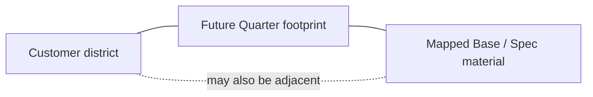

# Customer-first supply-chain placement

16 November2026, **Problem2.1**. Implemented in the main CSC AI modules; qualified
with offline Lua51/module tests. Native reception and ordinary-game outcomes are
the next measurement. No new game, native address, DLL/API or SQL definition is
introduced by this change.

## Gameplay definitions drive the reverse lookup

`CSC_AI_EconomyFacts.CustomerQuarterMap` reverses the native partner edges already
generated by `CSC_AI_Connectors.sql`. Those edges derive from gameplay customer
transactions, sales/provider tags and district replacements. Starting from a
customer district, each edge identifies a Quarter; its standard CSC district name
identifies the existing `CLASS_CSC_<KEY>_BASE` and `_SPEC` material classes.
There is no new authored customer/Quarter/resource list, including for City Lights.

The supplier reader now builds its improvement vocabulary from all loaded
`Improvement_ValidResources`, rather than filtering that vocabulary through the
currently supported Stage2 profiles. It still filters actual suppliers by the
calling Quarter's Base/Spec tags and native improvement geometry. Unrelated resource classes are rejected before
any native improvement geometry call. An arbitrary
future Quarter and modded resources therefore work without a Stage2 policy entry.

The reverse lookup reproduces48/48 links from the last loaded database. Removing
City Lights district definitions synthetically leaves16/16 vanilla partner links;
that is an offline missing-optional-definitions check, not a fresh standalone game.

## Concrete hex layouts

The live snapshot starts from the customer's current native legal targets.
For each target, it examines adjacent empty Quarter footprints and their adjacent
materials. Each prospective Quarter must fit the actor's permanent type rules,
current geography and its owning city's three-tile range. Quarter research and
population capacity can arrive later; the customer itself needs current eligibility
and a current slot. Cities can provide an adjacent Quarter across their boundary.

Both linear and triangular arrangements qualify. A resource merely within two
hexes of the customer does not qualify unless a distinct Quarter tile is adjacent
to both. This first pass uses owned, revealed footprints and visible owned
suppliers, including unimproved/locked but geometrically viable improvements.
Unowned land purchases remain a separate planning capability. Critical material
plots, occupied land and retained native district footprints are excluded;
materials already claimed by native district intent earn no speculative credit.
An existing adjacent Quarter uses the ordinary SQL incentive for that supplier
city/type, rather than receiving speculative credit for the same link again.

## Bounded policy with multiple suppliers

Only customer sites matching the **best measured ordinary adjacency** among
eligible resource-free, unclaimed owned targets can receive a future-chain bonus.
Private AI yield is excluded from that comparison; signed ordinary yields remain.
Missing/stale native adjacency suppresses speculative guidance.

Each **supplier city × Quarter type** contributes once:

- 8 native utility for at least one viable Base material.
- +2 for each of at most two extra Base materials.
- +4 for having Specialty material; **16 maximum per supplier city/type**.

Several alternate sites for the same city/type do not multiply the contribution.
Different Quarter types or different supplier cities can contribute separately.
A material such as Flax may support several compatible chains: material plots are
not consumed by the matching. The city is the owner of the prospective Quarter
footprint; suppliers can cross owned city boundaries as in the existing reader.

A small exact matcher assigns distinct adjacent Quarter footprints to the
supplier groups. With at most six adjacent hexes, its state space is at most64
masks. This avoids promising Bakers and Tailors on the same tile while allowing
several customers to share a future Quarter. Cross-customer coordination remains
greedy and respects existing leading Quarter proposals and retained intents.

**The total customer-site preference is capped at32 native utility** (8192Q8),
as agreed with Henno. This is especially relevant to Commercial Hubs, which map
to every Quarter. Logs retain each contribution and the raw sum alongside the
capped packet value. These are provisional siting bands, separate from income;
future adjacency and transactions are not added to the economic ledger.

## Delivery and diagnostics

This replaces the former16–48 customer offers derived from winning Quarter bids.
It operates even when the Quarter has no current positive bid or remains locked.
`EconomyAdapters.CustomerOffers` publishes the small additive district/site delta
through the existing CE packet/early district-score path. Ordinary site costs,
building forecasts and competition with other production remain in place.

Static graph/improvement definitions are cached for the session. Actor masks,
supplier facts and native adjacency are shared with the current player snapshot.
Legal targets are bounded to current candidates; extra adjacency reads happen
only for customer scopes with material-backed opportunities. No native pricing
or full building forecast is added by this pass. Live observations rebuild on
normal turn publication; this creates no persistent land or population reservation.

- `CSC_AI_CUSTOMER_FUTURE_BID`: customer identity, supplier count, raw and capped Q8.
- `CSC_AI_CUSTOMER_FUTURE_LINK`: supplier city/type, concrete Quarter footprint,
  Base/Spec plots, ordinary/best adjacency and individual contribution.
- `CSC_AI_CUSTOMER_FUTURE_WORK`: targets, unique Quarter checks, supply reads,
  options, unknown scopes and proposals. Existing spatial-work timing includes it.
- Existing `CSC_AI_CUSTOMER_RECEIPT` joins the exact customer district/site to CE
  reception. Native comparison, selection and district foundations remain later
  observations, available through the shared-controller diagnostics.

## Verification and next live check

Tests exercise actual main-mod fact/supplier/adapter modules, including straight
and triangular footprints, blocked/missing/mismatched/invisible suppliers,
permanent actor exclusions, protected/reserved land, current customer eligibility,
future Quarter slots, fresh cached ordinary adjacency and rejection of a better
standalone alternative. An arbitrary Quarter and modded Base/Spec resources are
used rather than a Bakers/Tailors mapping. **90 economic/Lua tests and31 selected
replay/observer/continuation checks pass.** Shared-material and city/type matching
is checked against exhaustive enumeration on40 small generated layouts.

Before declaring native follow-through, join future-bid identities to CE receipts
and the actual comparison/foundation in the next ordinary run. Record whether
the future Quarter appears on a proposed footprint, its materials survive and
the chain develops. Review work counters and controller timings in mature cities.
Keep the already-qualified+1 SQL bonus for built Quarters unchanged.
