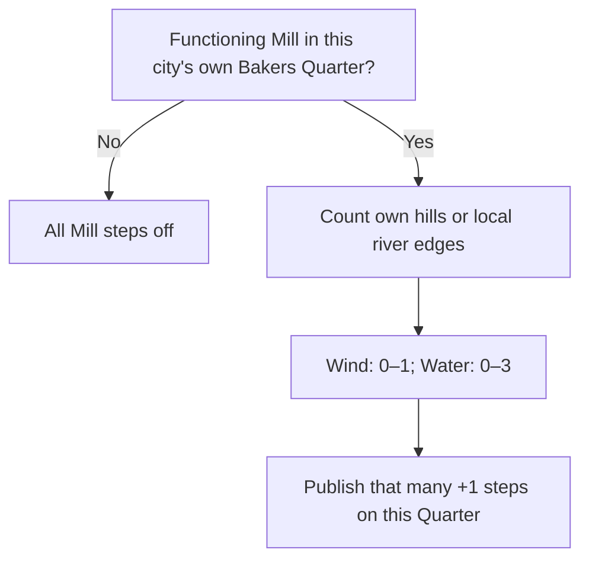

# Local Mill bonuses with bounded unit steps

4 November 2026. Source implementation following Henno's explicit design decision:
**the bonus activates only after the Mill is built in that Quarter, and applies
only to that Quarter**. This supersedes the earlier preserved remote-Mill parity
contract. It does not change the active +4 promotion/soft-deduction policy.

## What changed

The two generated Bakers Mill rules explicitly use
`COLLECTION_CITY_DISTRICTS`. The processor also corrects existing generated rows
for those exact two IDs when compiling a database containing the prior rules.
MAB supports this scope; CSC had omitted the override and inherited the generic
player-wide default. See the [read-only provenance review](csc-ai-mab-building-owner-scope-20261104.md).

| Rule | Actual calculation | Active payout modifiers |
| --- | --- | --- |
| Wind Mill | +1 Production on the Quarter's own hills tile, otherwise zero | One conditional +1 step |
| Water Mill | One Production per two river edges, truncated down | Three conditional +1 steps, maximum +3 |

`CSC_AdjacencyUnitSteps` explicitly registers these two bounded rules. The compiler
validates the supported building, district, source and coefficient contract. It
generates city-scoped building attachments and Boolean `_STEP_n` requirements.
The shared evaluator publishes each step when the actual amount reaches it.
Invalid out-of-range or fractional source counts fail before property writes;
future rule changes need a reviewed bound rather than silent clipping.

Actual-state eligibility requires local ownership, the appropriate unpillaged
building and a complete, unpillaged Quarter. Gameplay checks the native building
plot index against the receiving city's own Quarter. UI uses its supported city
district manager lifecycle methods and the validated OnePerCity/prerequisite
contract where exact building-location APIs are unavailable. Shared helpers accept
both the standard Lua numeric type and Civ's integer type.

The planned-first-Mill scanner still deliberately substitutes the appropriate
future Mill when valuing a candidate. That forecast is separate from actual-state
eligibility; it grants neither a building nor current income. Other rules retain
their original signed ten-bit representation and scope.

## Saved references and old properties

The compiler removes only the twenty old Mill numeric-bit **building attachments**.
It retains/recreates their Modifier, Argument and Requirement definitions as dormant
compatibility identifiers, including on a fresh database. They are no longer roots
of either Mill's active building graph. Four new unit-step roots replace them.
Repeated compilation is duplicate-safe and leaves unrelated attachments unchanged.

When normal synchronized gameplay reconciliation writes a Mill rule, it clears
all ten old numeric bit properties, publishes the new Boolean steps and retains
the total/actual/encoded diagnostic amounts. Stale removal also writes zero. This
is source and offline migration coverage, **not proof that a native old save has
been successfully migrated**. Native attachment persistence must still be checked.

## Verification and its limits

The focused suite clones the immutable MAB-era gameplay database into memory and
executes the actual CSC SQL compiler and shared Lua 5.1 evaluator. It covers the
active four-step graph, dormant legacy identifiers, repeat compilation, all legal
Mill counts, stale/decreasing properties, local/remote and foreign ownership,
wrong building locations, pillage/removal, gameplay/UI adapters, invalid input,
generic signed-bit preservation and planned-first-Mill evaluation.

Reproduce with `project/tools/adjacencies/test_local_mill_steps.py --database
<immutable-db> --dependencies <lupa-folder> -v`. The frozen database SHA-256 is
`f089f40e721fadc8cb58105d3d7cdf8d4c48db1a0fd9c2788274e640b0d1cd59`.
Broader regression uses the original MAB parity suite with **only** the two local
scope amendments and four-step active graph treated as intentional differences.

Final offline results all pass:

| Check | Coverage |
| --- | --- |
| Focused SQL / actual Lua 5.1 | 9 tests, independently repeated after the final UI fix |
| Frozen MAB comparison | 61 rules, 55 sources, 1,465 comparisons |
| Modifier graph inventory | 610 legacy definitions, 20 disconnected Mill definitions, 4 new unit steps; 594 active payouts |
| Policy returns | 9 mappings, 20 base/unique rules, 200 policy modifiers, 220 gameplay/UI cases |
| Edge presentation | 48 role conflicts, 48 ownership/visibility/ring cases, 384 river-edge comparisons |
| Placement sentences / scanner | 6 sentences and 9 scanner cases |
| SQL layout | All 3 changed SQL files pass |
| Handbook preparation | 2 correction-register tests pass; Quartz build and local-link/diagram verification pass |

Final receipts are retained under `Desktop/Codex/csc-local-mill-steps-20261104/`:
`offline-verification.json`, `parity-02/parity-report.json`, `scanner-report.json`
and an eight-file `source-review/` bundle. This is a source review bundle, not an
installed mod package. The receipt pins every included file. Final shared core
SHA-256 is `5f193144b308c3d01f52d992b710336cfe3d5050ccf8143f38af14d11e2a7eed`;
focused test SHA-256 is
`de4a81ce3bfa07a98c3ea2c1d66b81335d517eb3a074532faf50cba1b15f3639`.

Henno explicitly chose **offline checks only, keeping FireTuner open**. No installed
package, human application, running game or native attachment was changed. Native
yield transitions, multiple-city attachment behavior, old-save reconciliation and
the new hypothetical building vectors remain pending.

## Expected AI effect, not yet measured

The prior [component capture](csc-ai-bakers-forecast-components-20261104.md) and
[range investigation](csc-ai-adjacency-simplification-20261104.md) establish that the
hypothetical evaluator credited all ten Mill bit magnitudes, totaling 1023, while
omitting their gameplay property gates. The active source graph now has only one
or three unit amounts available through the respective building.

That bounds the encoding artifact. It does **not** teach the native evaluator to
respect omitted geometry or building conditions. It also does not prove a particular
new Q8 score, a changed winner, better placements or empire benefit. The useful next
native check is a small isolated before/after component and yield comparison via
the shared controller, with exclusive console access, before a broad game screen.
