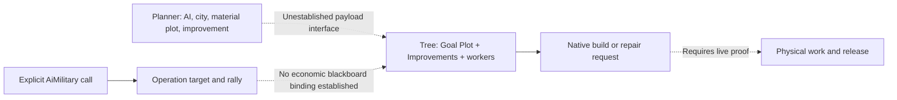

# Native material-job entry: bounded offline feasibility —30 October2026

## Decision

The native economic executor exists. A supported arbitrary **planner-to-job
payload path remains unestablished**. Park a new scripted-operation treatment
at that interface boundary rather than running a military prototype, increasing
Builder demand, replacing ordinary triggers or reconstructing the full engine.
Continue useful site planning and responsive existing guidance independently.

This is a completed bounded offline assessment of two entry routes, not proof
that arbitrary native economic submission is impossible. It does not approve
an executor, expose a general Lua blackboard writer, or show a completed job.
The separate zero-turn candidate capture was authorised after reader preflight;
its actual status is recorded separately, not inferred from this report.

## Where Build Improvement came from

Henno supplied [cru121's behavior-tree reference](https://cru121.github.io/civ6-gamecore-reference/ai-behavior-trees.html).
That was the lead. We independently inspected the installed shipped
`Base/Assets/Gameplay/Data/BehaviorTrees.xml`: node12, **Build Improvement**, is
described as taking a worker, location and improvement. Its five parameters are
Worker List, Goal Plot, Improvements, Release when done and optional Builder Plot
(lines57–58,292–296). The ordinary Build City Improvement tree binds its final
node28 to the **Needed Improvement**, **Location** and **Builder Plot** tags.
The trigger location/improvement data is produced earlier in the ordinary tree;
the parameter names alone are not an interface our Lua planner can write.

We then inspected the current Windows GameCore implementation with the prepared
GhidraMCP project. REA's previous trial supplied the separate target-setter trace;
there was no new REA cold import, Frida hook, DLL change or AI turn for this pass.
Current DLL SHA256:
`324c51e9ea3531758842e16c69e6cddbefbb226c5b675c3d6e60111646c2e98c`.
All addresses below are RVAs for that binary; mapped names are not imported
authoritative types or recovered source.

## Concrete native execution path

`BuildImprovementNode::Update`(`551a80`) reads the supplied Worker List, or falls
back to the tree/control's managed-unit list through `Control::Manager::GetMyUnits`
(`401ba0`). That fallback is not an indiscriminate scan of every empire Builder.
The path checks unit/location availability, movement-related conditions through
`Planning::CanReach`(`51c340`), desired improvement legality and district occupancy.
An existing matching pillaged improvement takes the repair path. Different
builder/goal plots have a separate adjacent-improvement path.

`BuildImprovementNode::Execute`(`551360`) checks current `Player::IsHuman()` and
returns for a human. It then prepares one of the mapped native requests:

- `Unit::Operations::BuildImprovement::MakeRequest`(`665ab0`);
- `Unit::Operations::Repair::MakeRequest`(`671e40`);
- `XP2::BuildImprovementAdjacent::MakeRequest`(`74a3e0`).

A separate route/railroad request branch also exists and is outside this job.
The request reaches an indirect Unit Operations manager dispatch. This establishes
a static action consumer, not successful request acceptance or physical work.
Do not infer success from raw ACTION_STATE values or assume the Release flag
alone proves full completion/cancellation cleanup. Runtime human flags can change
under autoplay; the stable original-human exclusion is still required.

The checked disassembly for Execute, Update, scripted Start and AssignOperation
was compared byte-for-byte with the hash-verified DLL copy. Nine relevant direct
CALL destinations were independently decoded from PE rel32 bytes, including the
three economic request helpers, human predicate and GetMyUnits/CanReach calls.
This verifies code identity and call edges; it is not a native behavior experiment.

## Two entry routes assessed

| Required element | Explicit player-owned scripted operation | Additive event-triggered tree |
|---|---|---|
| AI identity | Wrapper forwards explicit AiMilitary instance; operation uses instance-owned storage. Runtime cross-AI check still needed. | Native tree owner exists, but externally tested Lua condition/target callback tables were empty. No safe ownership inference from callback ordering. |
| Activation | StartMilitaryOperation(`4d19e0`) can instantiate an eligible configured operation; Operation::Initialize(`4ddd60`) creates the configured one-use behavior tree and assigns its operation. | Mod-authored activation was reported externally. Shared event-slot collision must be avoided; no replacement of vanilla/RH triggers. |
| Plot/type payload into economic node | **Unknown.** The target/rally setter writes operation and team coordinates. AssignOperation(`53ff30`) stores the operation ID. Neither inspected body populates the Build Improvement Goal Plot/Improvements blackboard values. | Ordinary Build City Improvement consumes a native trigger payload. No exported arbitrary Lua planner-to-trigger/payload submission was established in the inspected registry and shipped paths. Extra/PlotX/PlotY outputs do not prove a general writer. |
| Economic consumer | Build Improvement node has the real native request path above; connecting it to the operation's target/type is the missing link. | Same consumer, with existing ordinary data bindings; arbitrary selected-job injection remains the missing link. |
| Availability and cleanup | Need actual native unit ownership/availability, reservation lifetime, completion/expiry and release for an economic workflow. | Same; definition labels are insufficient. |
| Prototype gate | Not passed; park the interface and do not test combat recruitment merely to obtain movement. | Not passed; do not displace normal event handlers to manufacture activation. |

No general writer was found within this bounded inspection. That is an unknown
interface, not an assertion of engine-wide impossibility. Static DefaultData for
one fixed plot would not itself demonstrate a reusable dynamic planner interface.

## Further reasons not to probe these calls blindly

The [REA result](csc-ai-rea-trial-20261030.md) verified a conditional temporary
visibility-count/AI-knowledge refresh before the target setter's invalid-ID gate.
This pass additionally shows `StartScriptedOperation`(`4d1c90`) can call
`EvaluateNewOps`(`4ceb70`) and global `WaitForJobs`(`4a16e0`) after an initial
start failure, then attempt start again. Invalid names/IDs are not established
no-effect introspection calls.

Current installed RH source is also instructive:

- `RH_EarlyAggression.lua:1098` sets `RH_EA_FORCE_ASSAULT_ENABLED=false`;
  lines2145–2152 report C++ crashes in StartScriptedOperationWithTargetAndRally
  across sessions. Auto-attach is false at950.
- `RH_AttackWatchdog.lua:47` disables operation escalation. The guarded code at
  635–678 demonstrates explicit player `GetAi_Military()` and target/rally inputs,
  not a reliable working economic route.

Those crash reports are **RH author statements in source**, not a crash locally
reproduced by CSC or proof that every scripted-operation form is unsafe. Their
practical value is to avoid treating API availability and pcall as native safety
evidence. Workshop files were read only and their hashes are retained.

## Reader preflight and next useful native evidence

The parallel bounded reader audit inventoried54 native call names against the
Lua registry and shipped same-context UI. It found no definite mandatory binding
or signature repair. Both Members iterators and the four-argument plot adjacency
preview have shipped UI precedents. Some Plot UI calls are omitted/miscategorised
by the static registry; shipped UI usage prevents an absence conclusion. Optional
GetNumSpecialtyDistricts remains unknown and guarded. Conditional loaded CSC rule
dispatch, AI-city cache exposure and actual getter/control values still need the
one zero-turn capture; fixtures cannot establish those facts.

Do not hold that capture behind further job-route reconstruction. Once captured,
use actual comparable sites to advance the planner through existing working
guidance and the guarded acquisition/foundation backend. A new native executor
can be revisited when a concrete payload interface is found; it is not a dependency
for all supply-chain progress. No new tuning amount or forced order is justified
by this offline packet.

## Evidence

H/native-goal-feasibility-20261030 contains `reader-preflight.md/json`,
`current-build-static.json`, `create-once.json` and `feasibility-audit.json`.
H is this thread's visualization workspace. The audit retains exact shipped/RH
source hashes and checked native bytes. It is not an independent runtime test.
The existing [roadmap (historical)](https://github.com/hennogous/Henno-Mods/blob/819b67c/project/docs/integrations/csc-ai-roadmap.md) and
[community route review](csc-ai-community-native-job-routes-20261030.md) retain
the broader context and external/local evidence boundaries.
