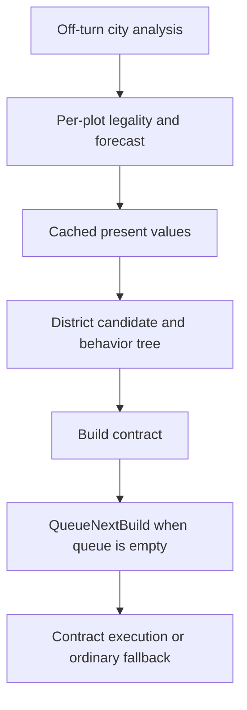

# Native production and preference analysis — 28 October 2026

## Result and scope

The complementary toolchain is operational. We can decompile the installed Windows GameCore, inspect assembly and cross-references, and use the earlier Frida probe for targeted runtime observation. This is reconstructed machine-code logic, not recovered Firaxis source, original symbols or a complete AI specification.

The strongest new finding is that the traced **Buildings and Districts preference handlers consume `AiFavoredItems.Favored`, not `Value`**. Their downstream effects depend on the sign of accumulated preferences, not the magnitude written in the SQL Value column. The queue investigation also identifies cached evaluations, contract-mediated district construction and a contract update path that retains the higher score. These provide concrete reasons to stop interpreting every numeric SQL preference as a proportional priority control.

This turn performed static analysis only: no game launch, hooks, gameplay changes, RH edits, deployment or automation. Prior runtime observations remain separately scoped in [the first instrumentation report](csc-ai-native-instrumentation-probe-20261028.md). That probe confirmed entrypoint calls; instrumentation neutrality remains unproven.

## Reproducible workbench

- Local output root: `C:/Users/Shadow/Desktop/Codex/csc-native-ai-analysis-20261028` (called A below).
- Portable Ghidra 12.2 and Temurin JDK 25.0.5+8; archives verified against official release hashes. Source URLs and checksums are in `A/tools/setup-source-receipt.json`.
- Current Windows XP2 DLL SHA256: `324c51e9ea3531758842e16c69e6cddbefbb226c5b675c3d6e60111646c2e98c`; Steam build15296837, preferred image base `0x180000000`. Local copy and source receipt: `A/binary/`.
- GameCore reference mapping pinned at `7ddecbafa37b8d4598831f61ebc73538fd9fd987`, in `A/reference/civ6-gamecore-reference`.
- Maintained [launcher, exporter and instructions](../../../tools/native_ai/README.md). Ghidra project, generated C/assembly and binaries stay outside the repository.
- Successful initial import/analysis and exports include all 67 mapped direct CityBuild functions. `A/tooling-analysis-status.json` records each subsequent export batch. Two callbacks without recovered native function starts were skipped, not assigned invented boundaries. Missing PDB/DWARF and one automatic-analysis null-address warning are disclosed there.

Mappings provide names, not authoritative prototypes. Only unique/unique-reordered/resolved names were applied; old-build sizes and Linux layouts/signatures were not imported. Four PresentValueOf overloads had misleading shared reference signatures, corrected by callers and assembly. The Windows contract vtable was verified directly from PE bytes. All addresses below are RVAs for this exact DLL; never reuse blindly after a game update.

## Preference controls: the numeric Value trap

The complete static chain is:

1. Global AI initialization registers Buildings and Districts query handlers (`495170`, `4969c0`).
2. Both handlers install callback `4a2450`. All four inspected query factories select columns in the order row ID, Item, **Favored**, Value, and further metadata.
3. `GetQueryVal<bool>` (`525970`) reads column index 2. The callback adds +1 for Favored=true or −1 for false, reversing the contribution when removed.
4. CityPlanner initialization (`4b4250`) supplies the resulting arrays to building and district selection.
5. The district plot evaluator (`3e2aa0`) rejects a negative district preference in this path, leaves zero ordinary, and multiplies a positive preference's net value by **1.5**.
6. `GetBestBuilding` (`3e4710`) applies **0.5** for a negative preference and **2.0** for a positive preference. Zero has no preference multiplier. Other conditions and multipliers remain separate.

These constants were verified in DLL bytes, not guessed from decompiler labels. Accumulation permits opposing active preferences to cancel. Multiple positives can affect the sign against negatives, but do not increase these multipliers beyond the positive branch.

Consequently, changing Value=300 to Value=900 while leaving the same active Districts entry Favored=true does not strengthen this preference path. RH's large Buildings/Districts Value numbers are not proportional multipliers here either. This conclusion does **not** apply to every AiLists system: Yields, PseudoYields, Specializations and other handlers require their own consumer traces.

This is a plausible explanation for why adding more positive building preferences sometimes produced no response: an already-positive sign would keep the same multiplier. We have not reconstructed the exact active preference accumulator for every city/turn of V7, so this is not a retrospective causal proof of its identical results.

Evidence: `favored-parser-exports/`, `favored-callback-exports/`, `favored-query-exports/`, `parser-exports/GlobalAiInitialize_Inferred_49c7c0.txt`, `citybuild-exports/CityBuild_GetBestBuilding_3e4710.txt`, and `evaluation-exports/CityEvaluationJob_Execute_FirstCallee_3e2aa0.txt` beneath A.

## From valuation to queue

`DoOffTurn` (`3e2590`) submits City Analysis. `CityEvaluationJob::Execute` (`3e2a40`) calls the per-plot evaluator at `3e2aa0`. That evaluator includes legality, research/civic delay and production time before calling district NetValue (`52a440`). `CalculateDistrictValues` (`3dfee0`) supplements cached district values with related building values; its name does not mean it contains the whole scoring algorithm.

`CheckForDistrict` (`3e0ee0`) gets a candidate and location, prepares the analysis/requirements and creates a configured behavior tree. Shipped BehaviorTrees.xml passes district, city and desired location to Build Unit, with separate BuildPriority and PresentValue/UnitValue parameters. BuildPriority is therefore not automatically equivalent to numeric valuation or a direct city queue position.

### QueueNextBuild — `3e8190`

- Returns for human-controlled owners and an already occupied queue.
- Scans managed contracts in numeric state 3, validates and updates them, and selects the highest signed score at contract offset `+158` (hex). Equal scores retain the earlier candidate.
- The selected contract's final gate compares it to best unit value minus `0x100` (1.0 in the observed fixed-point representation) and best project value. There is **no best-building comparison at this gate**.
- It attempts the chosen contract's Execute. The ordinary fallback compares buildings, units and projects; district construction enters through the contract route.

Assembly for the final gate: VA `1803e86d2`–`1803e8717`. The later fallback building comparison begins at `1803e874d`. This is not a universal claim that contracts always beat buildings: eligibility, validation, updates and execution must first succeed.

### Contract persistence — Update `3fa5e0`, Execute `3f8310`

The inspected UnitRequestContract update branches for buildings, units and districts assign:

`stored value = max(previous stored value, current PresentValueOf lookup)`

Execute passes this retained score into BuildUnit/BuildBuilding/BuildDistrict. Lowering a current forecast therefore cannot lower an existing contract through **this update path**. Other writers, replacement and cancellation have not all been traced; this is not a permanent lifetime invariant.

The actual Windows UnitRequestContract vtable at RVA `9fa5e0` maps Execute at slot `38`, Update at `68`, Validate at `98` and LogContract at `a8`. An independent review checked these DLL bytes and the queue branches; see `A/independent-review.md` and `independent-control-checks.json`.

### Reconsideration and queue interruption

`ReconsiderDistrictConstruction` (`3e9630`) marks matching district contracts with numeric state 6 and releases handles. It does not recalculate district values or simply move a district to the front of production. Enum names remain unconfirmed.

`UpdateWorkingContract` (`3ea990`) distinguishes failed validation (state 6, pop front, release), failed update (usually state 4, release without pop), and a valid continuing contract. Do not collapse these into one cancellation rule.

`UpdateBuildQueueForThreat` (`3ea150`) consumes `AI_CURRENT_TASK_BIAS`. With a current item, its comparison threshold in score units is:

`oldValue + max(oldValue, currentTaskBias)`

The shipped default is 80. Crucially, final cancellation in the inspected path additionally requires the threat/damage-or-attack gates. This does not establish a generic every-turn queue-switch cost. Changing the global parameter to accelerate Quarter completion would be premature.

## Time preference and clearance economics

`AI_DISCOUNT_RATE` is a genuine consumed parameter, with shipped default 2.0. Global initialization converts it to fixed point and adjusts it inversely for game speed; `GetPlayerDiscount` (`4b38f0`) feeds the plot evaluation path. DiscountFixedAmount (`528140`) and DiscountIncomeStream (`528310`) are exported. Their exact piecewise arithmetic is not fully catalogued; do not substitute an assumed exponential formula.

District NetValue (`52a440`) includes, under distinct legality/visibility gates, discounted tile purchase cost, feature/resource harvest credits, subtraction of existing improvement/resource value, district value and time horizon. Therefore the native engine does compare immediate clearance value with some lost long-term value. This does not prove it knows CSC's complete downstream supply-chain cost.

District Value (`52d500`) has also been exported and calls normalization and income-discount helpers. Its detailed adjacency, modifier and building contributions still need focused tracing. We have not yet produced a complete harvest-versus-improve formula or a verified hook for preserving a specific CSC material.

PresentValueOf overloads are mostly cached lookups: building `3e7e50`, district `3e7f40`, improvement `3e8000`, unit `3e8150`. District lookup selects a matching plot value or the best eligible cached plot value. A DB input loading immediately does not imply immediate cache refresh, contract change or queue replacement.

## What RH changes, and what it does not establish

The subscribed RH5.097 sources use Buildings/Districts preferences, city events, specialization settings and other AI inputs. They modify some specialization defense flags and bind alternative city events. No AI_CURRENT_TASK_BIAS or AI_DISCOUNT_RATE override was found in the inspected RH or shipped DLC SQL/XML. That is a source search result, not a claim about every possible runtime mod combination.

Relevant shipped references are GlobalParameters.xml (defaults), Leaders.xml (default specializations and city events), BehaviorTrees.xml (contract parameter bindings), and schema 01_GameplaySchema.sql (AiBuildSpecializations and AiFavoredItems). RH files remained read-only. Its Value=900-style rows must now be interpreted through the actual handler for each System, rather than treated as universal priorities.

## Implications and next probe

1. Catalogue controls by their native consumer. Mark Buildings/Districts Value magnitude as unused in this traced route, while retaining the meaningful Favored signal.
2. Observe the full district chain: cached candidate score, preference sign, contract creation and retained score, queue occupancy, selection and completion. Tracing only CalculateDistrictValues misses important stages.
3. For delayed effects, distinguish reevaluation, existing commitments, queue interruption and actual build time. More waiting alone does not isolate them.
4. Use a loaded-save versus loaded-save control before interpreting detailed Frida traces; the earlier fresh-versus-load comparison did not prove neutrality.
5. A narrowly scoped future experiment should compare an ordinary new district contract with an already accepted one, logging score changes and queue decisions without forcing production. Test Favored false/neutral/positive separately from numeric Value magnitude. No new game is launched by this report.

These findings justify better probes and removal of incorrect assumptions. They do not yet establish a new beneficial CSC tuning package or authorize changing RH's global policy.

The companion [control catalog](csc-ai-native-production-controls-20261028.json) records addresses, evidence level and unresolved scope for reuse. Raw reconstructed code stays in the local analysis package; this repository contains the methodology, findings and extraction tools.
