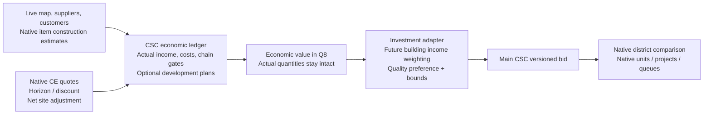

# Native valuation mechanics and competitive Quarter bids

Main CSC now retains native site-cost accounting and native evaluation timing,
then builds its Quarter bid from the central economic ledger. A separate
investment weighting and spatial calibration make good sites competitive while
bounding weak-site bids. The ledger's actual transaction quantities remain
unchanged. This implements Henno's15 November request under **1.4/1.6/1.8**, with
the shared supplier guard from **2.2**.

**Closed fresh Online50 comparison:** eight Quarters against four with the
previous policy on the same starting world. Six Bakers and two Tailors; all
eight have Base, seven rate+3 or more and three rate+4 or more at foundation.
All eight native Quarter wins match the published bid/version/write. Recorded
material-resource losses and planning/native faults are zero. Both sessions
save and close with exit0 and preferences restored.

These are short-run placement results. They do not measure mature Services.
The earlier comparator has four Bakers, all+3+, three+4+, one Base+Spec, and
five exact native Quarter wins. The new run has one Base+Spec foundation too.
The additional+2 Tailors at Pella is founded at a modest94.7utility; the+2 floor
continues to permit investment where native competition is weak.

## The model and the investment adapter

The existing bounded optional plan search was already implemented before this
work. The preceding audit overstated mandatory later-building losses as a bug;
[AI-C190 is corrected](../../civ6-ai/findings.md#ai-c190). The search now ranks
optional customer omissions by the same final placement objective as the other
plans. Building/job marginal values continue to use the economic objective.

### Native mechanisms reused

- **Actual evaluation context.** CE reads GlobalAI's ordinary horizon and
  discount, which include game-speed scaling. Online reads50turns/1024Q8=4.0.
  Native quote bounds now support horizons through300. The fixed50/4 fallback
  is explicit on older CE; the new site/context APIs are adopted together.
- **Native site accounting.** The generic quote returns district `NetValue`
  minus intrinsic district `Value`, before future-building aggregation. This
  preserves native land purchase, harvest, intact-improvement and resource-copy
  accounting. The former full worked-terrain debit is absent in this mode.
  A frontier's native invoice is counted once; the UI invoice still supplies
  affordability and buyer-eligibility facts.
- **Native construction estimates.** The UI bridge reads the same
  `BuildQueue:GetTurnsLeft(type)` used by stock CitySupport/ProductionPanel,
  including item modifiers/progress. Cost/current Production remains the fallback.
  Unlocks, prerequisites and each city's shared queue still constrain readiness.
- **Native normalization and discounting.** Real yield and amenity streams
  continue through the CE quote helpers. No extra DefaultValue/strategic-yield
  conversion or universal capital-cost debit is introduced.

An owned, empty, featureless/resource-free/unimproved footprint has a zero native
site residual by the traced NetValue branches. The facts layer uses that proven
fast path; other sites and frontier invoices call the native evaluator. Quotes
and successful scalar prices are cached only for one player/publication.
Existing/pillaged Quarter footprints remain available to repair/building/supply
consumers without being mistaken for new land acquisition.

### Mapping building benefits to an investment bid

The adapter uses native BuildingValue's **1+2d** investment-weight shape on
positive ordinary income from missing producer buildings. Here CSC's modeled
transactions supply effective building income. This is an explicit adapter
mapping: the native modifier interpreter itself does not automatically amplify
all CSC transactions. It is not a change to gameplay yields.

Actual per-turn amounts and `valueQ8` remain economic records; `bidValueQ8` and
`forecastAdjustmentQ8` expose the investment weighting. Existing buildings,
upkeep, site costs, immediate adjacency, amenities and percentage Services do
not receive this future-income multiplier. Population and Stage4 transactions
retain their producer attribution. Hidden availability markers contribute no
economic prerequisite depth, preventing fictional Water/Wind differences.

The first economic predecessor follows loaded definitions and unique
replacements; cycles/depth are bounded. Unknown timing, unavailable suppliers
and unbuilt customer districts still produce no forecast transaction. Optional
investments can be deferred. The central model still prices one actual Mill.

### Initial Stage2 Service value

Storekeeper has a gated10% growth record after its producer, adjacent completed
customer/buyer, Base supplier and civic can all operate. Its utility proxy is
10% of current positive Food surplus, priced as Food. Starvation has zero
positive-growth opportunity; unavailable inputs remain explicitly unpriced.

Dockmaster uses the loaded20% amount and only observed eligible sail-era naval
production in the recipient city, through Renaissance. Its use window is at
most10turns. It is never valued as permanent+20% to every project in that city.
One recipient benefit is counted once, and an already-active Service is not
added again. GPP, trade, future specialist staffing and Stage3/4 Service premiums
remain uncovered channels.

## Calibration against the control districts

The [three-map audit](csc-ai-district-value-audit-20261115.md) supplies ordinary
investment reference values near600/1,200/2,100utility, anchored at Online
turns38/113/200. The reference interpolates smoothly. Its clock and utility
scale with the native horizon; live qualification here is Online, and CE's
existing4096 score ceiling continues to bound every bid.

At a600reference and ordinary construction delay:

| Prospective adjacency | Spatial preference | Whole-bid quality cap |
| --- | ---: | ---: |
|+2|48|300|
|+3|240|690|
|+4|600|1,050|
|+5|960|1,410|
|+6 or more|1,320|1,770|

Both material classes retain+64utility; extra Base/Spec deposits retain bounded
+24/+16 preferences. Compatible customer layouts retain their bounded separate
preference. Future customers provide neither actual adjacency nor transaction
income. Base and minimum+2 remain mandatory, and preferences cannot resurrect
negative economics after material protection.

Spatial preference is adjusted for actual construction delay using the native
present value of a unit Production stream relative to a one-fifth-horizon
construction delay, capped at1.25. Near-horizon completion earns little location
preference. Whole-bid caps interpolate by quality; a generic later amenity cannot
turn a+2 site into a top-tier district bid. These are CSC policy weights fitted
to the control ranges, separate from the engine's own rules.

The captured real-map turn25 quotes illustrate the change, at reference
readiness before any optional layout preference:

| Site | Rating | Economic utility | Previous total | Calibrated total |
| --- | ---: | ---: | ---: | ---: |
|Bakers1061, player1|2|22.6|134.6|134.6|
|Bakers2457, player3|2|18.7|130.7|130.7|
|Bakers985, player1|4|49.3|401.3|713.3|
|Bakers1383, player4|4|50.3|338.3|650.3|

The early native+2 medians are554.3 for Campus,624.1 for Theater and631.9 for
Commercial Hub. The regression fixture checks both sides of that comparison.
These are real-map price examples; normal ownership, legal-site, protected
material, slot and purchase-buyer gates still apply to publication/construction.

The qualified turn50 scan reports+2 quotes163–165,+3 quotes474–497 and+4 quotes
997–1,061, including live timing/reference scaling. Their economic values are
30–127; early later-building depth additions remain zero because those benefits
do not yet fit the horizon.

### Mature-game check without another long run

The new-seed turn200 checkpoint loads under frozen05 with **98/98 structural
rows equal**. No game turn advances. The diagnostic inspects544 geometric
candidates, finds56 positive quotes and retains eight detailed ledgers. It
takes1.56seconds including controller transport. Native cost and both economic/
bid component sums reconcile, and exit0/restoration pass.

| Real-map candidates at200 | Economic utility | Future-income weighting | Final bid |
| --- | ---: | ---: | ---: |
|Two+2 Bakers sites, no customer footprint|2,391–2,541|274–321|1,050 each|
|Two+3 Bakers scopes|1,155–1,162|265–268|2,415 each|
|Two+4 physical Bakers/Tailors sites, three city scopes|47–356|217–283|3,020–3,264|
|One+5 Bakers site|253|227|4,096|

The two weak sites have substantial raw later amenity value. Their ledgers
retain that value while the placement-quality cap keeps them below ordinary
late+2 district medians of1,920–2,616. The+4 sites sit above that medium range.
The+5 bid reaches CE's existing4096 ceiling. This checks mature price bands;
the fresh50 run separately verifies native consumption and foundations.

## Safeguards and diagnostics

New Quarter proposals now honour the same cross-quarter protected-material map
already used by customer planning. A larger spatial preference cannot offset
that guard. Native ordinary-district supplier penalties, Builder protection,
capacity admission and all existing execution adapters remain active.

`CSC_AI_SPATIAL_BID` records economic value, forecast adjustment, native site
cost, horizon/discount, comparison reference, quality cap and cap adjustment,
the spatial/material/layout terms, protection and final bid. Cap adjustment
reconciles the components to the published total. `CSC_AI_SPATIAL_WORK` counts
native site quotes, empty-site fast paths and unavailable inputs. Native
comparisons, requests and foundations retain their separate existing journals.

The read-only qualification scan took1.06seconds at25 and1.11seconds at50,
including controller transport, while inspecting80/142 geometric candidates
and retaining six/seven detailed ledgers. This is a bounded diagnostic timing;
the ordinary planner retains per-publication caches and existing bounded plan
enumeration. Native C++ introduces no hooks or Lua calls from AI workers.

## Validation and delivery

- **79 economic/fact/adapter tests pass**, including native-context units, actual
  versus bid income, optional plans, Service gates, one-time invoices, supplier
  protection and strong/weak benchmark order.38 observer/integration/continuation checks pass.
- CE's supported MSVC Release build passes;243 native district checks, four
  Runtime hook-group checks and instruction-call delivery/restoration pass.
- Initial3turn request with full observers is rejected after initialization by
  their endpoint restriction; shutdown exits0/restores. The runner now rejects
  unsupported endpoints before launch. An initial carrier filename/hash mismatch
  was rejected before launching. Neither failure was a native crash.
- Online25 native API qualification and the calibrated Online50 run are both
  complete and restored. No forced districts, unlocks, suppliers or queues were
  used. Main CSC is the only AI policy; additional code is read-only observation.
- The first mature diagnostic omitted the census's expected-turn input; its
  assertion rejected the read, and it closed/restored exit0. The corrected
  mature200-02 passes with zero advanced turns and matching structure. The
  maintained replay now uses persistent provenance guards and archives scripts.

CE branch: `codex/native-quarter-valuation`, commit`2d200ef`, based on tested`dbfb93b`.
No upstream PR. WildW refs were checked before live tests and remained
develop`2986a746b396eb93aad14f9afffb043a09c2c489`,
master`e59b5aa910c8a0fcab9b31973ffa477443de0e09`.
The current custom APIs still require the experimental CE build.

CE DLL SHA`1be0545b94b35adaf582df2d70e827ecdb8014ccf91b59c5cc9f9b72fdc06bfc`;
XP2 SHA`092abfbb2176f8df04b5212f819dc269dd83aea866ff05aaf489904a1ff7c41f`.
Named RVAs, allocator ABI, fingerprints, bounds and nil-on-unavailable behaviour
are documented beside `native/native_site_pricing.inl` and CE's native README.

Artifacts: `Desktop/Codex/csc-ai-native-valuation-20261115/`: supported build,
native-selftest, frozen03/04 packages, fresh25-01 and fresh50-01. Frozen05 adds
comment corrections and non-Online reference scaling; Online calculation is
unchanged from the50turn qualification. A final regression fix makes reference/
readiness cache publication atomic on unavailable unit-price input; successful
quote behaviour remains unchanged. The maintained Markdown and skill
contain reusable findings; large logs/saves stay in the evidence directories.

[Compact results, prices and native foundation receipts](csc-ai-native-valuation-20261115.json).
