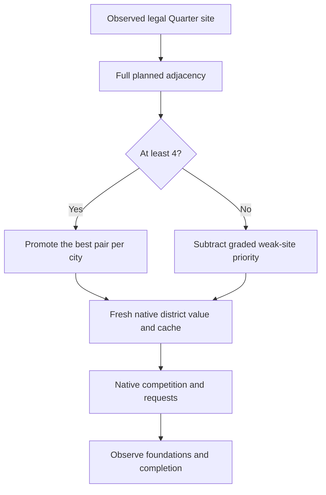

# Soft penalties for weak Quarter placements

Started 3 November 2026; recovered test completed 4 November 2026. Follow-up to the [positive-only adjacency pilot](csc-ai-adjacency-policy-20261103.md).
Henno requested a first extension that discourages poor Quarter placements and a
fresh test game. The prior pilot's23 below-4 foundations remain valid observations;
they were not evidence of a penalty failure because that policy only added bonuses.

**Result:** the signed extension successfully lowered weak-site scores. The
Online100 game founded ten promoted Quarters and four below-4 Quarters, versus
23 below-4 foundations in the earlier positive-only run. This is an encouraging
descriptive comparison, not a matched causal test. Two escapes involved requests
admitted before scanner coverage; two stayed positive after the subtraction and
won after downstream native valuation. All four are traced below.

## What we can change

The native AI scores city/district/plot pairs. The existing fingerprinted hook
can subtract from a fresh Quarter value as well as add to it. The ordinary
`GetBestDistrict` selector compares signed cached values against a reservation
threshold and its current maximum, starting at-2559744 Q8. It has no universal
positive-value gate: a negative value can still win. Thus a subtraction makes
the site less competitive without an unconditional exclusion.

There are downstream effects. Positive district preferences multiply the value
by1.5 after the hook. Future-building aggregation only applies to strictly
positive district values; crossing zero also removes that forecast uplift.
Plot-specific present value reads the altered cache. Existing requests retain
the maximum of old and refreshed values, so this version starts a fresh game;
it does not claim to retract an existing commitment.

Static evidence: exact XP2 SHA256
`324c51e9ea3531758842e16c69e6cddbefbb226c5b675c3d6e60111646c2e98c`.
Existing Ghidra program and installed DLL identities were rechecked; a fresh
decompilation of`0x1803e4a50`matches the retained signed comparison. Raw sources:
`Desktop/Codex/csc-district-placement-20261103/native/1803e4a50.c`lines28,53–54;
`baseline-0x1803dfee0.c`lines131–135;`baseline-0x1803e2aa0.c`lines282–299;
`1803e7f40.c`lines30,34. Retained request evidence:
`Desktop/Codex/csc-native-ai-analysis-20261028/contract-exports/UnitRequestContract_Update_3fa5e0.txt`lines27–35.
See also [the native extension investigation](civ6-district-score-extension-20261103.md)
and handbook findings AI-N006,AI-N009,AI-N053–058.

## First policy

Use the same actual loaded adjacency rules, radius-three candidate scope,
planned first Bakers Mill, dynamic per-turn refresh and original-human exclusion
as v1. Stop scanning each city/Quarter type once its foundation exists.

| Pair's planned Production+Gold | Adjustment before downstream native processing |
| --- | --- |
| Highest eligible score at least4 in a city | Existing+1048576 Q8 promotion |
| Other score at least4 | Neutral |
|3 |−65536 Q8 |
|2 |−131072 Q8 |
|1 |−196608 Q8 |
|0 or lower |−262144 Q8 |

Fractional scores use`-min(262144,ceil((4-total)*65536))`. Production and Gold
still count equally. These amounts express priority, not economic utility or
a calibrated yield-to-native-price conversion. Native base values of promoted
sites in the prior run ranged7369–67374 Q8; the first subtraction is deliberately
large enough to have a measurable effect rather than being lost in rounding.
Material-footprint protection still excludes a pair from promotion; this version
does not add a separate material-destruction penalty to an otherwise>=4 pair.

Native zero and values at/below the no-result sentinel stay unchanged. A negative
adjustment cannot lower a score beyond-1048576 Q8; an already lower native score
is left alone. That keeps a newly penalized value above the selector's sentinel
even after the observed1.5 multiplier. Overflow/pointer/row/caller guards remain.
The policy does not edit placement legality, reservations, requests or orders.
All scanner exclusions and the ordinary native comparison still apply.

## Carrier and offline checks

The v2 implementation is`project/tools/ai_site_planner/adjacency_policy/`.
Multiple exact player/city/district/plot entries can now share a city. Cache
observations cover all scoped entries; winner monitoring runs once per city
invocation and includes other district types. Immutable publication still
disables and drains native callbacks. Capacity4096 pairs,4096 writes and16384
records per window; exhaustion disables and fails the run. Native callbacks
perform bounded memory/number operations, without Lua, JavaScript or game calls.
Retain the worker and callbacks until the held native process exits.

Checks before launch:19 policy/validation tests;40 real-kernel checks in an owned
disposable native host, including signed penalties, same-city multi-pair scope,
full4096-entry publication, cache coverage, floor protections, atomic refresh
and terminal write-budget disable;9 existing Lua5.1 adjacency scanner checks;
153 shared-controller Python checks. Replaying100 saved scans produces8289
weak-pair observations with a maximum133 entries in a window, within capacity.
These checks do not establish actual game effect.

## Fresh-game protocol and result

One fresh Online-speed Ancient/Prince/Small Continents game, six majors/nine
city states, standard resources, CSC+official content, maximum turn100. Use the
same map16131103/game26131103 seeds as the prior pilot to reduce avoidable setup
differences. The prior pilot was interrupted/recovered and is not a matched
untreated control. Preserve code/content/dependency pins, original identities,
every scan/plan/native window, timestamps, native logs, stop and restoration.
The shared controller owns hosting, finite autoplay, popup handling and closure.
High-level check-ins every15 minutes; meaningful failure/completion promptly.

### Controller interruption and recovery

The first run reached80. At75 a troop-warning conversation exposed conflicting
control flags: Core reported active observer autoplay, but the UI player object
still reported human. The original guard skipped once, then its next scheduled
retry successfully closed the conversation and play resumed. The attempted
repair handoff arrived later at80 and exposed a missing probe-adapter `capture`
method. This was a controller exception, not a native hook fault or crash.

The driver froze the extension, preserved the partial80→81 operation, restored
all145 mod-ID/148 installed-entry preferences and AutoStart=false, and closed the
game and native worker normally. Both native exit and ownership absence were
verified. No source was edited while that worker ran. The initial status estimate
that all nine Quarters at80 were promoted was corrected by the detailed audit:
The Hague's Bakers site was an exception, traced below.

The shared controller now records stale UI human flags while using its fresh
Core authority, with independent UI clock/local-player, session and participant
checks intact. Warning, already-declared-war and whitelisted first-meet guards
share that correction. The probe adapter now supports read-only phase captures
for both active and inactive handoffs. Validation after repair:161 controller
tests,35 existing Lua5.1 fixtures and20 policy/recovery checks. Tests include
actual Core human-control refusal and stale-UI acceptance in all three guards.
These checks alone do not constitute a new native handoff or popup occurrence.

On4 November the supported native load used the preserved turn80 autosave,
SHA256`6569b8b97489c558212e361772f126ae8c04c054983e83ce88409d8716a65a7c`.
All captured city/district/queue/candidate/rule/player facts matched the original
turn80 scan exactly, ignoring collection order and performance statistics.
Installed content, dependency manifests and original preferences also matched.
This is explicitly narrower than full-world, RNG, native-cache or fractional-turn
parity. The duplicate original80 scan remains a reference; analysis uses the
recovery80 scan once and preserves the original partial native window separately.

The recovered run reached100 and closed normally, with native/daemon exit0,
zero native errors, exact preference restoration, unchanged installed content
and no remaining game/worker owner. No further game was started. There was no
new eligible warning or active handoff requiring native validation in the
recovered segment; the corresponding repair remains offline-tested.

### Online100 result

Accepted scans cover1–100 without a missing boundary, using the explicit recovery
reconciliation above. This is not an uninterrupted simulation. Completed-window
totals include two empty startup windows and99 accepted AI intervals.

| Observation | Result |
| --- | ---: |
| Weak-site deductions in completed windows |13,881|
| Good-site additions in completed windows |75|
| Native errors |0|
| Promoted pairs / native Best pairs / foundations |10 /10 /10|
| Promoted completions by100 |9|
| Below-4 foundations / completions |4 /3|
| All Quarter foundations / completions |14 /12|
| Promoted Tailors foundations and completions |2 /2|

The interrupted original80→81 window separately contains245 changes
(244 deductions, one addition),496 records and zero native errors. Its Delhi
proposal was observed again in the recovered interval; it is not counted twice
in completed-window totals. Recorded choices, queues and physical observations
remain separate evidence stages. No grants, forced construction, queue clearing
or reservation/request replacement was used.

| City / original AI | Quarter / plot | Prior-scan adjacency | First foundation | Complete by |
| --- | --- | ---: | ---: | ---: |
| Amsterdam /4 | Bakers /878 |4|17|64|
| Mikisiw Wacihk /1 | Bakers /1986 |4|39|41|
| Hyderabad /5 | Bakers /1425 |4|52|56|
| Amsterdam /4 | Tailors /951 |4|53|55|
| Ahtahkakoop /1 | Bakers /2573 |4|55|62|
| Mistawasis /1 | Tailors /2278 |4|62|65|
| Mumbai /5 | Bakers /1724 |4|69|74|
| Utrecht /4 | Bakers /797 |4|71|79|
| The Hague /4 | Bakers /1170 |1|76|80|
| Delhi /5 | Bakers /1429 |3|87|88|
| Jabalpur /5 | Bakers /982 |4|89|95|
| Majapahit /3 | Bakers /1829 |1|90|91|
| Pihtokahanapiwiyin /1 | Bakers /1546 |4|95|unfinished100|
| Pokrovka /2 | Bakers /2212 |0|98|unfinished100|

Scores are from the preceding completed scan, not the exact foundation tick.
Bakers scores include the conditional first Mill, not guaranteed immediate
income. Twelve founded Quarters were Bakers and two were Tailors.

The policy refreshed14,222 site/type evaluations across1,239 city observations,
building radius-three geography42 times across launch/recovery. Maximum table
size272, native changes272/window and records547/window stayed within budgets.
Median scan transport/readback was0.807s, maximum1.250s, including FireTuner
transport and context work. Native `os.clock` samples were mostly zero with a
maximum1; these are coarse samples, not a precise CPU benchmark or zero-cost proof.

| Descriptive comparison | Positive only | Positive plus penalties |
| --- | ---: | ---: |
| Promoted foundations |7|10|
| Below-4 foundations |23|4|
| All foundations |30|14|
| Completed Quarters by100 |26|12|

Both worlds used the declared same seeds/setup, but each was interrupted and
recovered, decisions diverged and no matched untreated arm was run. Fewer weak
foundations do not by themselves establish caused improvement or net empire
benefit. Material/producer follow-through, strategic usefulness and displaced
investments remain separate questions.

### Why one weak site still reached construction

The Hague, original AI4/city131073, Bakers plot1170, had only+1 planned adjacency
in scan75. It was not a scanner candidate in scan74, but the native AI already
returned it as Best during74→75 with cached value1027783 Q8 and submitted
contract933 at 4014 native units. Thus its first native proposal preceded its
first penalty-table entry.

The next window **did apply the penalty**:62312−196608=−134296 Q8. Both the final
cache and plot-specific present value were observed at−134296. Nevertheless,
the native production log selected the already admitted contract933 at75;
the foundation first appeared in scan76 and completed in scan80. Its completion
log still carried the retained4014-unit request value.

This supports a coverage/admission-timing and retained-request explanation.
It does not show that a newly penalized negative site won a fresh comparison.
The exact reason for the scanner's earlier exclusion—ownership, visibility,
city assignment, placement potential or an intra-turn change—was not recorded.
Simply increasing the subtraction after admission would not address the observed
retained request. The next improvement should cover native proposal candidates
before admission, or separately review how to refresh existing request values.
Neither change is silently included in this first version.

Exact trace: `weak-site-the-hague.json`, original `native-windows.json` window75/76,
scans74/75/76/80 and `logs-closed/AI_CityBuild.csv`contract933, in the evidence bundle.

### The other three escapes

**Pokrovka, AI2/Bakers2212, was another coverage/admission case.** Native Best
returned1371672 Q8 and contract1270 was submitted at92, before the plot appeared
in the scanner at93. Later deductions produced−83114 Q8, and the plot-specific
value was−5823 when the retained request was selected at97. Foundation98 was
still unfinished at100. As in The Hague, the earlier exclusion's exact cause
was not captured; simply increasing a later subtraction does not retract the
already admitted request.

**Delhi and Majapahit demonstrate a second limitation: a fixed early deduction
can leave a positive score that later becomes much larger.**

| Case / native window | Fresh value | Deduction | Hook result | Final cache / Best |
| --- | ---: | ---: | ---: | ---: |
| Delhi Bakers1429 /81 |66,743|65,536|1,207|1,358,358|
| Majapahit Bakers1829 /87 |228,808|196,608|32,200|1,623,830|

The deductions applied correctly, but both values remained positive and eligible
for the later building forecasts. Their observed final cached values won the
native comparison. Delhi contract1042 admitted at80, selected86 and completed87
in the native log (physical foundation87/completion88). Majapahit contract1139
admitted86, selected89 and completed90 in the native log (physical90/91). Static
consumer code and runtime boundary values support downstream uplift as the
mechanism; this probe does not itemize every forecast or preference contribution.

Three penalized pair returns won Best in completed windows, all with positive
final scores; the third was an unbuilt Tailors proposal at Mikisiw Wacihk.
No negative Best return was observed. That bounded observation does not override
the static finding that signed negative values can win under other conditions.

Complete traces for all four founded exceptions, candidate-score histories,
native records and source-log hashes are in `weak-sites.json`. The first version
therefore establishes a working soft deduction and exposes two specific next
targets: admit policy coverage before native requests, and consider adjusting
the **final aggregated site value** so downstream forecasts cannot overwhelm
an early penalty. Refreshing retained request values would be a separate hook
with its own evidence and lifecycle contract. No larger weight or extra test
game was silently substituted for those decisions.

Evidence destination:`C:/Users/Shadow/Desktop/Codex/csc-placement-penalties-20261103/`.
