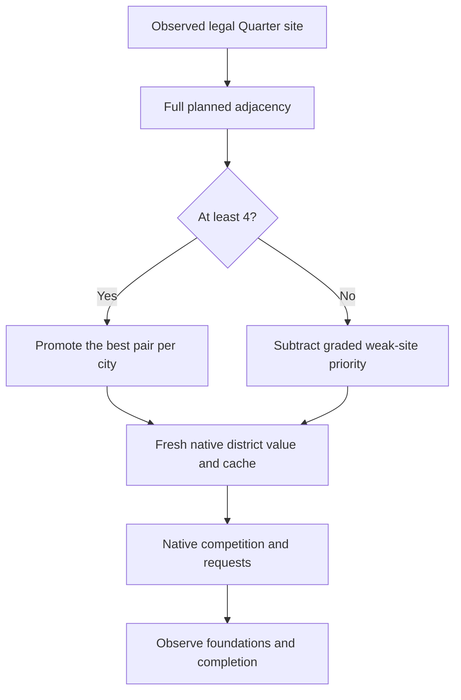

# Soft penalties for weak Quarter placements

3 November2026. Follow-up to the [positive-only adjacency pilot](csc-ai-adjacency-policy-20261103.md).
Henno requested a first extension that discourages poor Quarter placements and a
fresh test game. The prior pilot's23 below-4 foundations remain valid observations;
they were not evidence of a penalty failure because that policy only added bonuses.

## What we can change

The native AI scores city/district/plot pairs. The existing fingerprinted hook
can subtract from a fresh Quarter value as well as add to it. The ordinary
`GetBestDistrict` selector compares signed cached values against a reservation
threshold and its current maximum, starting at-2559744 Q8. It has no universal
positive-value gate: a negative value can still win. Thus a subtraction makes
the site less competitive without an unconditional exclusion.

There are downstream effects. Positive district preferences multiply the value
by1.5 after the hook. Future-building aggregation only applies to strictly
positive district values; crossing zero also removes that forecast uplift.
Plot-specific present value reads the altered cache. Existing requests retain
the maximum of old and refreshed values, so this version starts a fresh game;
it does not claim to retract an existing commitment.

Static evidence: exact XP2 SHA256
`324c51e9ea3531758842e16c69e6cddbefbb226c5b675c3d6e60111646c2e98c`.
Existing Ghidra program and installed DLL identities were rechecked; a fresh
decompilation of`0x1803e4a50`matches the retained signed comparison. Raw sources:
`Desktop/Codex/csc-district-placement-20261103/native/1803e4a50.c`lines28,53–54;
`baseline-0x1803dfee0.c`lines131–135;`baseline-0x1803e2aa0.c`lines282–299;
`1803e7f40.c`lines30,34. Retained request evidence:
`Desktop/Codex/csc-native-ai-analysis-20261028/contract-exports/UnitRequestContract_Update_3fa5e0.txt`lines27–35.
See also [the native extension investigation](civ6-district-score-extension-20261103.md)
and handbook findings AI-N006,AI-N009,AI-N053–058.

## First policy

Use the same actual loaded adjacency rules, radius-three candidate scope,
planned first Bakers Mill, dynamic per-turn refresh and original-human exclusion
as v1. Stop scanning each city/Quarter type once its foundation exists.

| Pair's planned Production+Gold | Adjustment before downstream native processing |
| --- | --- |
| Highest eligible score at least4 in a city | Existing+1048576 Q8 promotion |
| Other score at least4 | Neutral |
|3 |−65536 Q8 |
|2 |−131072 Q8 |
|1 |−196608 Q8 |
|0 or lower |−262144 Q8 |

Fractional scores use`-min(262144,ceil((4-total)*65536))`. Production and Gold
still count equally. These amounts express priority, not economic utility or
a calibrated yield-to-native-price conversion. Native base values of promoted
sites in the prior run ranged7369–67374 Q8; the first subtraction is deliberately
large enough to have a measurable effect rather than being lost in rounding.
Material-footprint protection still excludes a pair from promotion; this version
does not add a separate material-destruction penalty to an otherwise>=4 pair.

Native zero and values at/below the no-result sentinel stay unchanged. A negative
adjustment cannot lower a score beyond-1048576 Q8; an already lower native score
is left alone. That keeps a newly penalized value above the selector's sentinel
even after the observed1.5 multiplier. Overflow/pointer/row/caller guards remain.
The policy does not edit placement legality, reservations, requests or orders.
All scanner exclusions and the ordinary native comparison still apply.

## Carrier and offline checks

The v2 implementation is`project/tools/ai_site_planner/adjacency_policy/`.
Multiple exact player/city/district/plot entries can now share a city. Cache
observations cover all scoped entries; winner monitoring runs once per city
invocation and includes other district types. Immutable publication still
disables and drains native callbacks. Capacity4096 pairs,4096 writes and16384
records per window; exhaustion disables and fails the run. Native callbacks
perform bounded memory/number operations, without Lua, JavaScript or game calls.
Retain the worker and callbacks until the held native process exits.

Checks before launch:19 policy/validation tests;40 real-kernel checks in an owned
disposable native host, including signed penalties, same-city multi-pair scope,
full4096-entry publication, cache coverage, floor protections, atomic refresh
and terminal write-budget disable;9 existing Lua5.1 adjacency scanner checks;
153 shared-controller Python checks. Replaying100 saved scans produces8289
weak-pair observations with a maximum133 entries in a window, within capacity.
These checks do not establish actual game effect.

## Fresh-game protocol and result

One fresh Online-speed Ancient/Prince/Small Continents game, six majors/nine
city states, standard resources, CSC+official content, maximum turn100. Use the
same map16131103/game26131103 seeds as the prior pilot to reduce avoidable setup
differences. The prior pilot was interrupted/recovered and is not a matched
untreated control. Preserve code/content/dependency pins, original identities,
every scan/plan/native window, timestamps, native logs, stop and restoration.
The shared controller owns hosting, finite autoplay, popup handling and closure.
High-level check-ins every15 minutes; meaningful failure/completion promptly.

**Status:** offline checks passed; fresh game not yet launched. Results will be
reconciled here after the bounded test. No caused choice change or empire benefit
is claimed from a plan or a native score write.

Evidence destination:`C:/Users/Shadow/Desktop/Codex/csc-placement-penalties-20261103/`.
