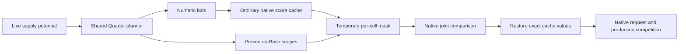

# Typed Quarter-site declines

Active1.7. [AI-C164](../../civ6-ai/findings.md#ai-c164) establishes the need:
all11 known-no-Base Bakers pairs consumed their finite deductions, yet a weak
Quarter still won. Increasing a penalty until that example passes does not
express a stable rule about unusable supply potential.

## Integrated rule

Main CSC's shared Bakers/Tailors forecaster now marks a weak candidate for
optional decline only when all mapped Base types are visible, resource
definitions exist, every adjacent tile is explored, and none contains a
revealed owned **or unowned** mapped Base. This means no credible current
adjacent opportunity, not impossibility forever. Any potential supplier stays
eligible even with a locked or unknown improvement path. No-host or below4
adjacency alone does not request a decline.

Potential is cached only within one player/profile publication: six neighbors
per site and one resource-definition pass. No second world scan is added.
The publisher derives scopes from the retained, capacity-bounded bid packet.
Complete Begin/Allow/Commit replacement withdraws them when live facts improve.
Missing optional CE support retains the existing numeric guidance. Capacity
omissions are logged; they cannot imply complete coverage.



Main comments, validation, prior-version receipts and tests accompany the
three changed Lua modules. Eight focused decline-policy tests cover both
Quarter profiles, unknown/hidden/missing data, unowned potential, dynamic
withdrawal, optional fallback, ABI10 refusal, capacity and staging rejection.
The focused Lua/driver suite passes65 tests, including the eight decline-policy
tests. Native checks are separate below.

## Generic CE facility

The CE fork adds `CE_AIDistrictDeclineStage(player, city, district, plot)` to the
existing versioned transaction, plus capability and exact-key receipt reads.
It follows `SupplierRowMask`'s existing hook/lifecycle, but masks only the
specified district column. It changes neither other district cells nor
reservation handles, retained trees, purchase contracts or production queues.
No new native address, MinHook call or Lua/native score handshake is added.

The scope owns an RAII list of borrowed i32 cells. Only during the ordinary
joint selector, eligible owned/frontier cells in the guarded score range are
temporarily masked; all original values restore before normal cache/Best
observation. Reserved cells are covered because they can exceed reservation
priority. Nested masks cannot restore a parent. Retirement still restores the
bytes, without crediting counters in a replacement publication. Allocation
failure happens before writes and disables this capability; insufficient
journal capacity changes no cell in the batch.

`considered` means consulted, `masked` means temporary application and
`restored` means restoration in that generation. Ineligible/missing/protected
cells can be considered without a mask or rejection; `rejected` is the
pointer/write-layout guard. `originalQ8` requires `masked>0`. Ready alone is
not an enabled publication. Main logging reads64 exact prior keys at most;
every native key remains explicitly queryable. Stale versions report staged0.

The fork source, API documentation and166 native checks are committed at
`e4f3228` on `codex/ce-purchase-ownership-ack`; no PR was created. The tests also
pass four shared hook-group failure paths and instruction-call restoration.
WildW develop was rechecked before live testing and remains2986a746.

## Native boundary correction

Ghidra reference SHA324c51e9, text-matched hotfix092abfbb, GetBestDistrict
RVA3e4a50 uses:

```text
reservationPriority < cell && currentBest <= cell
```

The initial best is−2,559,744 Q8. A reserved row with a lower priority can
therefore admit a cell **equal** to that floor. The corrected transient value
is named `DeclinedScore = InvalidScore - 1` (−2,559,745). Original at-floor
cells also need masking; below-floor and explicitly protected extreme values
remain unchanged. Synthetic checks implement both native predicates, exercise
equal/above-floor targets with all alternatives below floor, and verify no
winner plus exact restoration. This is admission control, not a persistent
invalidity or an economic valuation.

Primary decompilation is archived in
`Desktop/Codex/csc-ai-problems-1-2-20261110/deferral-native-reference-01`.
The independent Astra review caught allocation-failure and journal-capacity
edges; the final native suite passes166 checks. Its limits remain synthetic
ABI/lifetime coverage, not a substitute for a real comparison.

## Live evidence so far

All replays use source200
`e333251ec7318fb6b170678a956c28e02e2f9b01c4c4753c99e84b1a112fe19a`, the
same declared balanced radius4 knowledge fixture, and main CSC policy.

- `deferral-nicopolis-full-01` is prototype evidence using CE8909dcc9. It
  selected district31/472 at306,049 Q8 and submitted Hippodrome contract4333
  at203. It predates the reserved-floor correction and is not the final arm.
- `deferral-nicopolis-full-02` uses corrected CE build03, SHA256
  `a849eff803d68f7dc4061421c98812ae466b50f0d96a790f884f0f7bcf60eafb`.
  It again selects district31/472 at306,049 and completes200→204 with normal
  verified closure. Runtime `GameInfo.Districts[31]` confirms **Hippodrome**;
  earlier conversational references to Preserve were incorrect.
- `deferral-nicopolis-control-01` uses the same corrected DLL and main policy,
  omitting only P1/Nicopolis/Bakers decline scopes before publication. Other
  score entries, declines and guidance remain. It selects Bakers36/472 at
  347,924 and submits contract4333 for Bakers at1359 utility units. The full
  arm submits the same numbered contract for Hippodrome at1195.

The [sealed matched audit](csc-ai-quarter-decline-20261112-audit.json) verifies
all642 package files per arm. The sole file difference is the scoped publisher
ablation. Source, CE binary, numeric offers, physical facts and entire36×38
post-selector matrix—including flags and reservation IDs—are exactly equal.
Full has11 temporary target masks to−2,559,745; control has none. The restored
matrix equality also verifies no other district column was changed. Native
selector journals, final traces and actual requests agree. The expected extra
control-only Bakers present-value read follows its selection.

Astra independently reproduces the audit: **levels1–3 are demonstrated for
the deferral half**, not whole1.7. This is a changed native choice/request from
dynamic main CSC, rather than a score-counter claim.

The remaining evidence is a credible new Base opportunity, dynamic scope
withdrawal and a fresh Quarter choice/request in continued treatment. Existing
farmed Flax471 can supply a minimal diagnostic territorial-change fixture;
first inspect legal free Quarter397/398, customer geometry, population,
capacity and the retained Hippodrome plan/queue. Any ownership transfer must
preserve resource/improvement/terrain and carry **no native-acquisition claim**.
Do not cancel the retained plan or add production. Let ordinary planning resume;
completion is not a new acceptance gate. **1.7 remains open.**

## Bounded reconsideration continuation

`nicopolis_replay.py --deferral-opportunity` repeats the full arm from the
same turn200 source. At204 it requires the established Hippodrome472 choice,
then inspects the actual main planner, legal free footprints397/398, current
queue, population and available district-capacity getters. It permits one
declared transfer of existing farmed Flax471 from player11 to Nicopolis.
Resource, improvement, terrain, river edges, queue, population and Treasury
must remain unchanged. This is diagnostic opportunity creation, not buying.

The same exclusive shared-controller owner continues ordinary turns, checking
finite boundaries214–254. It neither cancels the retained Hippodrome plan nor
orders a Quarter, grants production or forces a replanning event. Read-only
receipts remain restricted to the three supplier-adjacent candidate pairs.

Success requires a fresh native selection and unique Bakers request at a
previously declined site that the main supplier reader now connects to471.
The exact consumed publication must show the owner/city/material facts and
retired decline; the native Best record must come from a complete checked
trace prefix. An unrelated Bakers choice or an incomplete reader prefix
cannot qualify. Astra reviewed these checks before launch. The focused
driver/fixture suite passes29 tests; the JavaScript observer syntax check
passes. No continuation outcome is claimed here yet.
