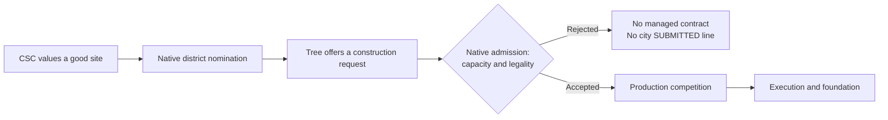

# Why six good Quarter nominations did not become construction requests

**Result:** four city/Quarter cases reproduce a native population-capacity
rejection before production competition. Three use the original footprint;
Charleston chooses another footprint in replay. The two later Australian
nominations do not repeat. Original records and a no-turn inspection confirm
Canberra capacity blocking at turn 200; Sydney has room by then, but its original
site's positive bid has already been withdrawn. Its exact original rejection
and the reason for that withdrawal remain unobserved. No gameplay tuning or
CE DLL changed during this investigation.

## Question and evidence boundary

Follow up the eight unbuilt city/Quarter nominations in the
[completed placement run](csc-ai-quality-placement-250-20261113.md#retrospective-follow-through-audit-no-new-game-required).
Constantinople's waiting request and Geelong's ownership change were already
separated. The remaining six have positive native district choices but no
corresponding `SUBMITTED` line in `AI_CityBuild.csv`.

The question is whether they lost production competition or failed an earlier
admission check. Preserve the distinction between a published value, district
nomination, attempted request submission, city acceptance, queue execution and
foundation. Missing CSV submission is not proof that the request node never
attempted submission.

## Archived observations

The original six cases have 32 positive native Best records. Their successful
Purchase Plot nodes say `Not Buying anything`; the observed trees reach the
generic Build Unit node, which reports `Not Building` and fails on the next
update. Their original player/city identities survive through turn 250.

| Original player / city | Quarter | Native nomination turns | Supporting capacity evidence from original records |
|---|---|---:|---|
| 1 / Antioch (Byzantium), city 196610 | Bakers | 62–143 | Four population-limited districts completed by 113; population 12 at 125. |
| 4 / Canberra, city 65536 | Bakers | 97–110 | Holy Site, Campus and Theater completed by 96; population 9 at 100. |
| 4 / Canberra, city 65536 | Tailors | 178–180 | Water Entertainment completes 162, filling the fourth counted slot; population 12 at 175. |
| 4 / Sydney, city 131073 | Bakers | 136–176 | Four counted districts completed by 129, fifth by 151; population 10 at 125 and 15 at 175. |
| 4 / Hobart, city 262147 | Bakers | 56 | Campus completes 55; population 1 at 50 and 5 at 75. |
| 5 / Charleston, city 131073 | Bakers | 122–130 | Government Plaza and Campus completed by 99; population 6 at 125. |

These are census intervals and completed-district histories, not exact-day
observations of the failing native predicate. In-progress foundations also
consume capacity, so completed districts are only a lower bound. The replay
measurements below distinguish that explanation from other legality or
defensive-only gates where the nomination repeats.

## Native admission path, verified on the current binary

Current Windows Steam XP2 SHA256:
`092abfbb2176f8df04b5212f819dc269dd83aea866ff05aaf489904a1ff7c41f`.
Reference SHA256:
`324c51e9ea3531758842e16c69e6cddbefbb226c5b675c3d6e60111646c2e98c`.
REA decompiles the current binary directly; nine relevant full function bodies
also match the annotated reference byte for byte. No historical prototype is
assumed to be a verified Windows ABI merely because the names match.

1. BuildFromCityNode.Update (`55c550`) checks the requested item and unlocks.
   Its Execute (`55ba40`) can create a district UnitRequestContract and call
   Manager.SubmitContract (`403c70`). It manages the tree's contract only when
   the native request reaches accepted state 3.
2. CityBuild.ReceiveContract (`3e9500`) calls the contract's Validate vtable slot
   `+0x98` **before** appending it to the city and logging it. A failed validation
   returns false before the CSV can say `SUBMITTED`.
3. UnitRequestContract.Validate (`3fa8e0`) checks required city, defensive-only
   conditions, execution state and ETA. Its district path calls CanZone
   (`0f97b0`) for the specific footprint. For a request not already done, an
   invalid-site byte at requirements `+0x01` or nonzero required-population int
   at `+0x20` rejects admission. The CanZone return alone is not the full test.
4. CanZone computes population-limited capacity with GetNumDistricts
   (`11eb20`, flags `1,0,1,0,0`) and GetNumAllowedDistricts (`11eae0`). The count
   includes unfinished population-limited districts; the allowed count uses
   current population and the city's extra district allowance. Existing
   foundations and repairs have separate early handling.
5. BuildFromCityNode.Log (`55c1e0`) prints `Not Building` when its managed
   contract lookup returns null. This does not name the rejected condition or
   prove that no request object was ever created.

The native request value is signed Q8 utility, 256 units per whole point; it is
not Gold. Raising that value does not remove a legality or capacity restriction.
The game's later production comparison remains a distinct decision.

## Diagnostic replay protocol

Three short windows use the original run's hash-verified saves and exact archived
CSC/CE packages: 50–64, 100–130 and 150–180. Main CSC policy remains the only
tuning publisher. No bid, world fact, unlock, queue order or treasury is injected.
The shared controller owns launch, console, finite autoplay, saves and cleanup.

The optional `district_admission_watch` is diagnostic-only. Five observational
Frida hooks record ReceiveContract, Validate, nested CanZone and the two capacity
queries for original major-AI Quarter requests. They check the full original DLL
identity and loaded entry fingerprints, distinguish other contract classes by
their Validate vtable slot, and retain paired request/city identities. They call
no game function and replace no argument or return. Observation is bounded to
10,000 records and stops on faults; a fault invalidates this measurement without
turning off the main CSC policy. Hooks remain resident until the exact held
native process exits, with recording frozen before returning to the menu.

Controller window labels bound the callback times; the native CSV supplies exact
turns for a uniquely joined request. A replay can diverge after loading, so its
observed rejection is corroboration of a native mechanism and scoped case, not
an assertion that every unrecorded original instruction repeated identically.

## Evidence locations

`Desktop/Codex/csc-ai-district-admission-20261113/` contains:

- `offline-six-cases.json`: original nominations, native log line references and
  population censuses, with native CSV hashes.
- `binary-qualification.json`: current/reference function-body identities.
- `rea-admission-current.json`: five retained REA records, including current
  logger, ReceiveContract, Validate and CanZone decompilation.
- Replay folders: exact inputs, loaded modules, native logs, bounded admission
  records and controller closure/restoration receipts.

`six-case-audit.json` verifies the three closed replay measurements and the
separate no-turn inspection. Its initial all-six-native-cases assertion failed
because the two later nominations did not repeat. The original audit script is
preserved as `audit_six_cases_initial.py`; the corrected audit retains those two
absences explicitly instead of relabelling them as successful captures.

## Captured request rejections

| City / Quarter | Native replay turn | Population | Used / allowed slots | Contract / result |
|---|---:|---:|---:|---|
| Hobart Bakers, plot 1345 |56 |3 |1 / 1 |721: capacity rejection |
| Antioch Bakers, plot 912 |62 |2 |1 / 1 |832: capacity rejection |
| Canberra Bakers, plot 1196 |106, 110, 112 |9 |3 / 3 |1792, 1897, 1950: capacity rejection |
| Charleston Bakers, plot 2101 |124 |6 |2 / 2 |2259: capacity rejection |

Each row has a same-required-city ReceiveContract → Validate → CanZone join,
invalid-site byte 0, a nonzero population-block field, native used count at least
allowed count, and false results from all three functions. These are actual
failed admissions, not bids losing a production auction. Native required-city
checks on other cities are excluded from the diagnosis.

Hobart, Antioch and Canberra match original nominated coordinates exactly.
Charleston's replay uses 2101 rather than original 2398. Its original turn-125
population 6 and Government Plaza/Campus also support a full allocation, but
do not make this an exact-original-footprint reproduction. A Charleston attempt
on replay turn 122 rejects before CanZone; that earlier gate was not observed.
Do not assign every original or replay attempt to the captured capacity branch.

The raw population-block payloads are 6, 6, 12 and 9 respectively. They are not
the next population thresholds: for example, a normal city's second slot opens
at population 4, not 6. Read allowed capacity or the native UI's failure reason
instead of treating this raw field as a growth forecast.

An existing Berlin Quarter repair, contract 625, passes admission through this
observer and later enters production. It subsequently cancels, so it is an
accepted-work control, not proof of completed repair. The second replay also
records ongoing/completed Baltimore work; done-state validation can pass despite
an invalid-site flag, as the native state-7 exception predicts.

## The two later nominations did not repeat

The 150–180 replay is clean but does not reproduce either player-4 Quarter
nomination. It instead nominates Water Entertainment, Neighborhood and Encampment.
At 179 Canberra's Neighborhood tree is waiting and Sydney's Encampment tree is
running. Those occupied district trees explain why no fresh Quarter nomination
appears late in this replay; they do not explain the earlier scoring divergence
or capture the original failed request at 176/178.

The original 175 census has Canberra population 12 with four counted completed
districts, and Sydney population 15 with five. That supports historical capacity
blocking. A separate inspection loads the original 200 save and uses the same
capacity and CanProduce queries as the shipped ProductionPanel, advancing no
turns:

| Original saved state, turn 200 | Population | Used / allowed | Native Quarter production check |
|---|---:|---:|---|
| Antioch Bakers |12 |4 / 4 |False; needs population 13+ |
| Canberra Bakers |11 |4 / 4 |False; needs population 13+ |
| Canberra Tailors |11 |4 / 4 |False; needs population 13+ |
| Sydney Bakers |17 |5 / 6 |True |
| Hobart Bakers |12 |3 / 4 |True |
| Charleston Bakers |11 |3 / 4 |True |

Thus Canberra remains demonstrably capacity-blocked. **Sydney has an open slot
by 200.** It must not be presented as continuously capacity-blocked or as an
exact captured original rejection. CanProduce here concerns the district type,
not the legality/value of one particular footprint. These UI results are native
legality checks, not observed AI request or production comparisons.

## What happened to the original sites afterward?

| Original site | Later evidence in the original run |
|---|---|
| Hobart 1345 |A Theater plan on the same coordinates is selected on 62 and completes on 70. |
| Antioch 912 |A Dam plan on the same coordinates is selected on 80 and completes on 83. |
| Antioch 838 |An Industrial Zone plan on the same coordinates is selected on 100 and completes on 104. |
| Antioch alternatives 766 / 836 |Positive Quarter writes remain through packet 249. A Commercial Hub offer for 766 is accepted but never records execution/completion. |
| Canberra Bakers 1196 / Tailors 1124 |Both keep positive Quarter writes through packet 249. No accepted other-district plan on these footprints was found. |
| Sydney 1423 |Positive through packet 176; explicit managed negative default on 177–238. An Encampment plan on the same coordinates is selected on 238 and completes on 242. |
| Charleston 2398 |Positive through 132, negative 133–146, positive 147–172, negative 173–249. The negative periods are actual policy withdrawal, not missing trace rows. |

The site-occupation evidence joins exact tree reservation coordinates to selected
and completed construction contracts. All-district foundation events were not
instrumented, so this is not a fresh physical plot census. Native write packet
versions are usually drained on the following observed turn. Missing writes
alone are not used to infer that a site was occupied.

For Sydney and Charleston, negative defaults do not identify the reason for
withdrawal. Quality, economic value and other eligibility inputs remain possible;
no specific cause is claimed from the write records alone. Sydney's free slot
at 200 therefore does not mean CSC was still offering that original site.

## Interpretation and next scope

The 15 nominated city/Quarter combinations were not 15 verified immediately
constructible investments. The native legality layer is working, and a larger
bid cannot remove its population restriction. Some later opportunities were
used by other district plans; some Quarter offers persisted or were withdrawn.

Under **1.6**, distinguish desirable future sites from bids actionable at the
current population/district allocation. Preserve future potential and existing
construction/repair, but expose current admission readiness and reconsideration
when capacity changes. This investigation diagnoses that boundary; it does not
implement a new capacity filter or demonstrate improved follow-through.
The exact original Sydney and Canberra-Tailors rejection calls, and Sydney's
withdrawal cause, remain bounded unknowns. Do not raise every bid to compensate.

All three replay sessions and the zero-turn inspection exit 0 and restore
preferences/packages. The replay journals contain 51, 188 and 242 consecutively
sequenced records, with complete Receive/Validate pairs, no unresolved handles,
no observation faults and no dropped-budget stop. The first two have scoped
positive admission/validation controls. An independent agent reproduces the
joins, source-site qualifications, negative reproduction and saved-state results.
No game or test worker remains active. Diagnostic source is committed separately
from unchanged main CSC policy and CE; no upstream PR is created.
