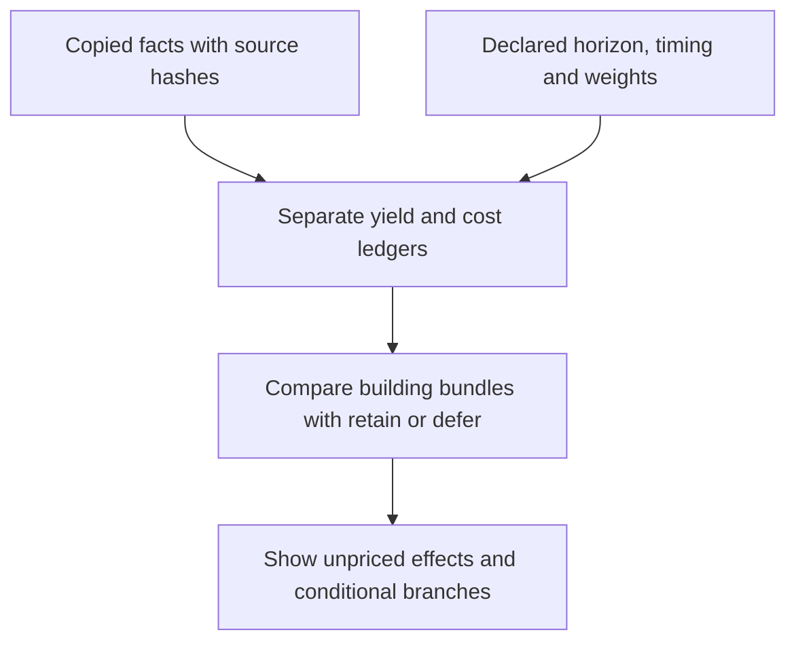

# First offline Tailors site review

3 November 2026. First implementation of the fresh site planner.

**44 captured Tailors cases: six new-site alternatives in one city and 38 existing Quarters.** 41 support a partial numerical review; three unfinished Quarters need remaining-production information. No game, native hook, installed mod or gameplay rule was changed.

The first mechanics profile is Tailors only. The engine supports explainable investment bundles; Bakers and the other Quarters need separately checked profiles. It imports no retired planner or tuning policy.

## What the numbers mean

These are **partial scenario values**, not actual profit, native Q8 utility or calibrated empire value. Default: 80 future turns, Production1 / Gold0.5 / Culture1. Captured district quotes are used where present; unquoted building costs use current nominal costs. The CSC Gold companion is assumed enabled. Construction is serial at constant captured city production, with no additional queue delay. Future unlock availability is an explicit assumption.

Existing Quarter benefits are subtracted before scoring upgrades. Retain/defer has value0. Population, materials and customers remain fixed in this first forecast. Positive and negative missing terms mean this is neither an upper nor lower bound. No review value can be sent to the native bridge.

## Six new sites: a genuine tie on observed current relationships

All six belong to captured AI3/city131073 at turn110. None has owned matching Base or Specialty supply or an existing matching customer. Dyes beside2114/2116/2189 belong to another player; they are not credited. Plot2338 has one river edge, below the two-edge Production step. All six cover a Farm; lost worked yields and alternative land use remain unpriced.

| Plot | Base / Specialty | River edges | Distinct future customer footprints | Best reviewed bundle | Partial value |
|---|---|---:|---|---|---:|
| 2114 | 0 / 0 | 0 | 3 Harbor, 0 land | Quarter | -82.50 |
| 2116 | 0 / 0 | 0 | 0 Harbor, 2 land | Quarter | -82.50 |
| 2189 | 0 / 0 | 0 | 1 Harbor, 2 land | Quarter | -82.50 |
| 2264 | 0 / 0 | 0 | 1 Harbor, 2 land | Quarter | -82.50 |
| 2338 | 0 / 0 | 1 | 1 Harbor, 1 land | Quarter | -82.50 |
| 2411 | 0 / 0 | 0 | 5 Harbor, 0 land | Quarter | -82.50 |

Retain/defer beats starting all six under the quantified present-relationship scenario. That is not a verdict that these cities should never build a Quarter. Exports, Services, future customers and alternative uses need their own estimates. Different district types on the same future plot are alternatives, not multiple guaranteed customers. Native plot potential is not immediate city permission.

## Existing Quarters: best local upgrade under the default assumptions

Each row compares building bundles with retaining that same observed Quarter. Rows are sorted by identity, **not ranked across different cities or historical worlds**. Only additional buildings appear in the bundle. Fashion House requires Workshop, not Tailor. A zero value means retain; missing repair quotes remain unscored.

| Capture | Player / city | Plot | Best additional bundle | Partial incremental value |
|---|---|---:|---|---:|
| candidate150 | 1 / 262147 | 2311 | Workshop, Tailor, Fashion House | 74.35 |
| candidate150 | 1 / 393221 | 2165 | Fashion House | 83.00 |
| candidate150 | 1 / 524295 | 2392 | Retain | 0.00 |
| candidate150 | 2 / 131073 | 1541 | Retain | 0.00 |
| candidate150 | 2 / 458758 | 1472 | Retain | 0.00 |
| candidate150 | 2 / 720906 | 800 | Retain | 0.00 |
| candidate150 | 3 / 65536 | 2562 | Retain | 0.00 |
| candidate150 | 3 / 196610 | 3084 | Quote/readiness needed | Unpriced |
| candidate150 | 3 / 327684 | 2045 | Retain | 0.00 |
| candidate150 | 3 / 393221 | 2114 | Retain | 0.00 |
| candidate150 | 3 / 458758 | 3232 | Retain | 0.00 |
| candidate150 | 4 / 65536 | 1346 | Retain | 0.00 |
| candidate150 | 4 / 327684 | 1650 | Retain | 0.00 |
| candidate150 | 4 / 655369 | 1636 | Retain | 0.00 |
| candidate150 | 5 / 65536 | 1683 | Retain | 0.00 |
| candidate150 | 5 / 327684 | 1603 | Retain | 0.00 |
| candidate150 | 5 / 393221 | 1229 | Retain | 0.00 |
| candidate150 | 5 / 786442 | 1017 | Retain | 0.00 |
| reference150 | 1 / 131073 | 2156 | Retain | 0.00 |
| reference150 | 1 / 196610 | 2752 | Fashion House | 424.50 |
| reference150 | 1 / 327684 | 2008 | Retain | 0.00 |
| reference150 | 1 / 458758 | 2165 | Retain | 0.00 |
| reference150 | 1 / 524295 | 2244 | Retain | 0.00 |
| reference150 | 1 / 589832 | 2683 | Retain | 0.00 |
| reference150 | 2 / 131073 | 1541 | Retain | 0.00 |
| reference150 | 2 / 262147 | 1028 | Retain | 0.00 |
| reference150 | 2 / 393221 | 1472 | Retain | 0.00 |
| reference150 | 3 / 65536 | 2562 | Retain | 0.00 |
| reference150 | 4 / 65536 | 1346 | Retain | 0.00 |
| reference150 | 4 / 131073 | 1349 | Tailor | 149.38 |
| reference150 | 4 / 196610 | 1789 | Retain | 0.00 |
| reference150 | 4 / 589832 | 1636 | Retain | 0.00 |
| reference150 | 4 / 786443 | 238 | Quote/readiness needed | Unpriced |
| reference150 | 5 / 65536 | 1683 | Workshop, Tailor, Fashion House | 603.80 |
| reference150 | 5 / 131073 | 1975 | Retain | 0.00 |
| reference150 | 5 / 262147 | 2195 | Fashion House | 146.00 |
| reference150 | 5 / 393221 | 1155 | Retain | 0.00 |
| reference150 | 5 / 720906 | 1088 | Quote/readiness needed | Unpriced |

## Sensitivity: the assumptions can change the preferred investment

These are different evaluations of the same copied facts. They are not simulated or observed AI outcomes. Culture emphasis changes its weight from1 to2. The cost multiplier affects unquoted building costs; a captured district quote stays fixed.

| Case | 40 turns | 80 turns | 120 turns | Culture emphasis,80 | 1.5x unquoted costs,80 |
|---|---|---|---|---|---|
| Kerma | Retain (0.0) | Fashion House (83.0) | Fashion House (263.0) | Fashion House (305.0) | Retain (0.0) |
| Qaraqorum | Retain (0.0) | Retain (0.0) | Retain (0.0) | Retain (0.0) | Retain (0.0) |
| Kyoto | Retain (0.0) | Workshop, Tailor, Fashion House (603.8) | Workshop, Tailor, Fashion House (1247.3) | Workshop, Tailor, Fashion House (1139.9) | Workshop, Tailor, Fashion House (283.0) |

## A priced conditional customer branch

At actual new-site2189, the capture records Harbor plot potential at2188. This branch **assumes** Harbor/Lighthouse completion at relative turn20, ordinary customer Gold3/turn, maintenance1/turn and total customer investment120/200/320 Production. Those are review estimates, not captured quotes, commitments, available capacity or confirmed unlocks. The branch pays its customer cost and maintenance once and adds its declared ordinary yields alongside the CSC relationships. Even when this partial value becomes positive, the site still lacks the owned Base path required by our planning ambition; that unresolved goal is shown separately.

| Horizon | Customer cost assumption | Best bundle | Partial value | Choice versus defer |
|---:|---:|---|---:|---|
| 80 | 120 | Quarter, Workshop | -48.50 | retain_or_defer |
| 80 | 200 | Quarter, Workshop | -128.50 | retain_or_defer |
| 80 | 320 | Quarter, Workshop | -248.50 | retain_or_defer |
| 120 | 120 | Quarter, Workshop | 91.50 | review_only_missing_base_path |
| 120 | 200 | Quarter, Workshop | 11.50 | review_only_missing_base_path |
| 120 | 320 | Quarter, Workshop | -108.50 | retain_or_defer |

Future materials have a separate conditional work-cost/completion input. They require an owned mapped footprint and explicit conflict assessment; illegal or resource-covering customer promises are rejected. Unspecified future work gets no free improvement or Service credit.

## Mechanics and unresolved value

- Ordinary customer transactions remain separate from material-gated Services. Base+customers can beat Both without useful customers; there is no Both-or-+4 admission rule.
- Working supply is independent of whether a citizen works the material tile. Producer supply benefits can apply while the extra tile income is unworked or unknown; the latter is not counted as realised income.
- Market and Temple are separate sales even in one city. Stage4 rounds each customer city’s population before adding branches. Current SQL uses Stage3 engine coefficient0.105; this profile does not substitute the design display0.1 or claim exact displayed-yield reproduction.
- Service paths are shown, but their strategic value is unpriced by default. Specialist allocation, trade demand, amenities, growth feedback, policies, competing military/economic work and native-score overlap are also unpriced. The review cannot establish overall empire benefit.
- Historical captures include earlier treatments. These are current-mechanics re-evaluations of copied facts, not clean current-rules games or causal comparisons. Source worlds and player/city identities stay separate.
- The Sydney native mechanism capture lacks a resource-type catalogue, customer buildings and river-edge counts. It is not silently joined to a different world to manufacture a site-quality result.

## Implementation and verification

`project/tools/ai_site_planner/` contains the independent evaluator, fact extractor, copied fixtures and report generator. Focused tests cover ordinary sales without Base, distinct customer branches, per-customer rounding, unworked supply, industry intensity, future investment costs/timing, footprint conflicts, retaining sunk benefits, missing repair/production data and all44 captured cases.

The tool produces JSON, this Markdown and an [interactive comparison](https://hennogous.github.io/Henno-Mods/ai/static/site-planner-review.html). The HTML selects among27 evaluations computed by the same Python model; it does not implement a second scoring engine.

The next review should decide which missing effects or assumptions can change a choice, then extend the mechanics coverage and collect the specific missing facts. Native utility conversion and deployment remain the next roadmap phase.

## Source records

- `shadow`: SHA-256 `570d35d7828689ef0cbd0326d940f2da9efee00dfeb74030b2737dba1a634377`; locator `C:\Users\Shadow\Desktop\Codex\csc-native-shadow-planner-20261030\run-02\shadow-initial.json`.
- `census`: SHA-256 `f884197a6828bcec62dd319925934171d5f5e8e94a23cd171889d57bf708dfee`; locator `C:\Users\Shadow\Desktop\Codex\csc-native-shadow-planner-20261030\run-02\initial-census.json`.
- `candidate150`: SHA-256 `e7f51b697191b1bc42c5deb8eb4622659903702d3b78611192ba98bc2b44ccb3`; locator `C:\Users\Shadow\Desktop\Codex\csc-paired-selective-chain-screen-20261101\candidate\run-01\continue-live45\compact\turn-150.json`.
- `reference150`: SHA-256 `eabe002785f878d0862a5c6f78780914851bae8472be92704954b5a41eb5e066`; locator `C:\Users\Shadow\Desktop\Codex\csc-paired-selective-chain-screen-20261101\reference\run-02\recovery-45-v2\finish-145\resume-150\compact\turn-150.json`.

Current mechanics source snapshots (LF-normalized UTF-8 SHA-256):

- `Civ Supply Chains/Data/CSC_Q_TAILORS.sql`: `88f827e5e48700d36c1cf638c46de61c759d4ccbec364976b0718d8922a313a1`.
- `Civ Supply Chains/Data/CSC_Q_TAILORS_GOLD.sql`: `12a3715af262606d358e8a4ed31d796635457563ff6f3699db2a7d5aac9c6f03`.
- `Civ Supply Chains/Lua_UI/CustomerPopulationReturns/CSC_CustomerPopulationReturns.lua`: `b196d4f94f0ff4e6740ee881f4276166d8974de4c328c66401a0abc16042cef7`.
- `Civ Supply Chains/Lua_UI/Adjacencies/CSC_AdjacencyCore.lua`: `813acb3de6750922ada38f1baa898833f2ca5e04d34014c62e6926c5b93e9f2b`.
- `Civ Supply Chains/Lua_UI/Adjacencies/CSC_AdjacencyGameplay.lua`: `c93b6e4b3683b0ab7f9c06be4b3b5ee4da7dd893d3c209073a8d9bf1ed71fb15`.

[Planner topic](../../civ6-ai/topics/csc/site-planner.md) · [Current roadmap](../../civ6-ai/roadmap.md)
