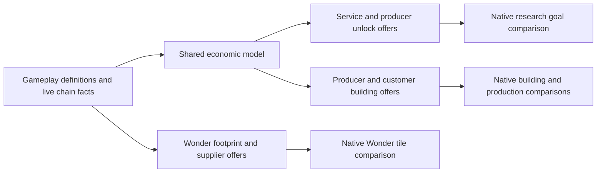

# CSC research and later-stage investment guidance

Problems 6.1, 7.1–7.2, 8.1, 9.1, 10.1–10.2, 11.1–11.2 and 12.1 are in scope for Bakers and Tailors. The strategy decisions in 6.2, 9.2 and 12.2 are deferred. The candidate reuses the native research, building and Wonder-site comparisons in CE. Gameplay SQL and the CE DLL are unchanged for this slice.

| Decision | Candidate policy | Evidence |
| --- | --- | --- |
| 6.1, 9.1, 12.1 Service unlock | Offer the one remaining topic when the producer, customer and authored material requirements are already met. Pool distinct chains and combine Housing at the receiving city before pricing it. | Ordinary Fractal verified Feudalism and Storekeeper. The matched Kish replay verified Divine Right and Sacristan. The matched Québec replay verified Opera and Ballet and Stage Manager. |
| 7.1, 7.2 Stage 3 producer | From population 7, price the unlock against the expected exchange. From population 10, bid for the eligible building against other orders. Price working venues and the modeled local returns. | Offline tests cover the population gates, live eligibility and queued orders. The native Guilds comparison and completion are verified in Pangaea. Native Bakery construction is verified in a matched replay. |
| 8.1, 11.1 Customer building | Price an eligible mapped adjacent customer building for its operating producers, including unique replacements. Group links that share one customer order and round their population return together. | Tests cover shared recipients, population rounding and replacements. On ordinary Fractal, Urumqi's Market and Qaraqorum's Zoo both received their exact bids, completed and paid both sides of the exchange. |
| 10.1, 10.2 Stage 4 producer | Use the same population gates and require feasible Base and Specialty supply. Supplier readiness constrains material returns. Each distinct missing new improvement carries a share of a Builder's cost. | Offline tests cover missing or late supply, the charge cost, and repair. A treatment Café completed sooner. Humanism reached the civic comparison and completed at the same time in both arms. |
| 11.2 Wonder site | Use the existing native Wonder-site bid on adjacent owned tiles with viable Base and Specialty. Give more weight as each class becomes operational and preserve material protection. | Hagmatana's Broadway row received the bonus in three matched pairs. The controlled payment pair completed and paid the exact exchange. The unrestricted pairs recorded cancellations when a rival finished first. |

Astra recommended pricing each physical queue order once through the existing ledger. The controlled replays follow bids through native competition, selection and realised effects. The full games track Problem 3 supplier timing for both material classes. Astra independently audited all ten representative decision results and the three matched benchmark pairs before closure.

## Fractal checkpoint from turn 150 to 165

Both arms reloaded the same verified ordinary save and used Steam GameCore build 26595377, the same CE package and identical gameplay content. The treatment differed in five existing CSC Lua files. The control retained the preceding CSC guidance for Problems 1–5. Both arms reached turn 165 and restored the local mod settings.

The treatment published 40 Stage 3 producer offers and 50 Stage 4 producer offers across the replay, with no later customer or research offers. Native queue receipts include Bakery and Café comparisons. Angkor Wat's Café score rose from 98,551 to 114,935 Q8 in one queue comparison. Both arms chose a Trader at turn 154. At turn 157 the treatment chose the Café, while the control chose a Theater Square project. The control first logged a Café production preference at turn 161. The treatment Café was complete at turn 165 on Bakers plot 2869 with working Flax and Berries. Its adjacent customer was the Stage 2 Granary, so this case qualifies producer construction while the later customer exchanges still need their own cases.

At Angkor Thom, the Bakery's queue comparison rose from 222,474 to 238,858 Q8. The Bakery appeared in the turn-153 production choice log and completed with 107.6 Production against an 80 cost on turn 154. Both arms built it. The treatment moved the Café ahead of the project while leaving the earlier Trader and this Bakery outcome intact.

| Working producers at turn 165 | Previous guidance | Combined candidate |
| --- | ---: | ---: |
| Stage 2 | 12 | 13 |
| Stage 3 | 7 | 7 |
| Stage 4 | 2 | 3 |

The 64-utility ceiling applied to 87 of 90 producer offers. Later replays retain the raw prices and per-building native receipts to assess calibration. Raw evidence is under `Desktop/Codex/csc-ai-stage6-12-20261121/fractal-150-165-v2`.

## Fractal checkpoint from turn 100 to 115

The treatment published 13 Stage 4 producer research offers for player 5's Humanism. The native civic comparison recorded five uses. The applied amounts ranged from 12,998 to 14,335 Q8. The stock goal stayed ahead at each comparison. In the last recorded comparison, Humanism was the immediate research step toward the higher-scoring goal. Both arms owned Humanism by the turn-113 observation. This is a representative research bid that reached the selector and deferred to ordinary priorities.

The same replay published 52 later building offers and recorded 22 exact building receipts. The passive Service observer read 33 gameplay effect attachments with no catalogue omissions. It verified one operating Storekeeper link for each of the 14 sampled turns in both arms. Raw evidence is under `Desktop/Codex/csc-ai-stage6-12-20261121/fractal-100-115`.

Astra identified Québec's ready Stage Manager as the clearest Service-unlock replay. The city starts with a working Fashion House, adjacent Amphitheater, Flax and Silver and still needs Opera and Ballet. A separate turn-200 Fractal checkpoint has a live Café at Bakers plot 1503 and an adjacent Entertainment Complex at 1576 missing a mapped customer building. These are the next targeted replay cases.

## Québec's Stage Manager from turn 250 to 265

The original turn-250 world already had the working Fashion House at 545, Flax at 544, Silver at 620 and the adjacent Amphitheater at 471. Québec's player lacked Opera and Ballet. Both arms preserved those facts and let the AI research normally.

The treatment published 14 Opera and Ballet offers worth 12,373 Q8 for this ready chain. The native civic receipt identified this topic in five publication windows. Several other civic goals stayed ahead. In the turn-263 receipt, Opera and Ballet was the stock and adjusted goal and the immediate step. Both arms owned the civic and activated the Stage Manager effect on the same Amphitheater at turn 264. The native Service watcher observed all 14 interior turns. This establishes delivery and actual operation for 12.1, with equal timing in the two arms.

Raw evidence is under `Desktop/Codex/csc-ai-stage6-12-20261121/quebec-250-265`.

## Missing customers from turn 200 to 215

The ordinary replay kept the Café at plot 1503 and Entertainment Complex at 1576 intact. Neither arm built the mapped Zoo, and the treatment offered no bid on that venue. A controlled replay can supply its Arena prerequisite and verify the Zoo's immediate eligibility before judging delivery.

The same treatment found a different opportunity for player 5's Market. It published 12 customer offers worth 16,384 Q8 each against a raw estimate of 26,940 Q8. Native receipts show both queue and ordinary nominations applied to that Market. The Market remained out of production during the sample, so the controlled Market replay exercises selection and the realised exchange separately.

The CSC publisher averaged 2.046 seconds per turn in control and 2.097 seconds in treatment over 15 complete measurements. Maximums were 2.502 and 2.330 seconds respectively. This short replay measures the whole publisher during each world’s play. The ordinary campaign will measure longer-run overhead. Raw evidence is under `Desktop/Codex/csc-ai-stage6-12-20261121/entertainment-200-215`.

## Early research and the controlled Market rebuild

In the turn-50 trial both arms received the same missing Water Mill at Bakers plot 2497. The preparation verified two working Base suppliers, its adjacent Granary and unowned Feudalism and Guilds. The treatment sent and reached the native comparisons for both topics. Feudalism completed and Storekeeper activated at another intact Quarter for the same player on turn 71 in both arms. Both prepared suppliers had stopped working by the turn-72 census. The Guilds receipt on turn 71 identifies it as the immediate step toward a longer goal. The replay ended before it recorded the completed civic.

In the Market fixture, removing the Stage 3 customer at plot 913 removed both observed population payments. The treatment's exact offer reached both building selectors in player 5's city, and neither arm rebuilt this Market by turn 215. The same treatment offered a Market in Mahendraparvata, where CE applied the bid in the production selector and the queue finished the Market on turn 205. The control also built that Market. The ordinary campaign now logs positive population-payment quantities for both sides of each assembled Stage 3 and 4 exchange.

Raw evidence is under `Desktop/Codex/csc-ai-stage6-12-20261121/storekeeper-50-72` and `market-200-215-v2`.

The normal guided Pangaea arm closed the earlier Guilds timing gap. Player 5 published 16 Stage 3 producer bids for Guilds (civic index 19) from turns 74 through 89. The turn-78 receipt captured the bid while the immediate step was still a different civic. The turn-83 receipt applied 12,109 Q8 and recorded Guilds as the immediate step while the longer goal remained civic 24. The watcher first observed Guilds owned at turn 91. These events all precede the verified turn-200 save. The matched early replay and the normal-game completion together qualify 7.1, with the longer native goal preserved.

## Legal Zoo and Wonder qualification

Adding only the missing Arena on both copies made the Zoo eligible at the Entertainment Complex beside the Café. The treatment then made 15 offers for that exact Zoo. Three receipts show a queue write, and two show a write in the ordinary nomination selector. Both cities still pursued other work through turn 215. This verifies delivery for 11.1 while leaving construction and payment open. Keep the current 64-utility cap while observing more opportunities.

The same archived map had no admissible Bolshoi footprint beside a Tailors layout with both material classes in the Wonder scout. That case ended before any placement score comparison. The ordinary runs will record Wonder placement and exchange quantities and provide new candidate worlds for a matched placement case. Raw evidence is under `Desktop/Codex/csc-ai-stage6-12-20261121/zoo-200-215` and `wonder-200-220`.

The first two Sacristan trials lacked a valid starting opportunity. The first city's adjacent plots did not admit a Holy Site. The second archive already had Divine Right for the player with a supplied Tailors and Temple. Both setups ended before editing a copy.

REA and Ghidra also established a narrow experimental reset for this case. On Steam XP2 `4de40abf`, the Lua `SetCivic` entry at RVA `6f12f0` forwards the Boolean to the native setter at `284870`. Clearing the ownership flag returns before the completion broadcast. The `SetCulturalProgress` thunk at `6f13a0` uses the numeric Q8 argument converter at `6f0450` and the progress writer at `284bb0`. A diagnostic can clear both fields on copies of the same archived world, then create the missing Tailor so its attachment was never active under the old civic state. The actual AI must choose and complete the civic again. This setup has no role in ordinary play or shipping guidance.

The current ownership routine evidence is `ev_73c6c355b1d543b036c45af5fea9bc5d1ea20ecafe3bb06e3900a8c5a56ecbc9`. The progress writer clamps to the topic's cost. It records positive progress deltas in the accumulated culture counters, while a decrease only changes the topic's progress. The fixture resets the two observed topic fields and leaves the prior game history in place.

The live turn-100 control verified the split Lua surface. `PlotInfo` reported Divine Right as owned with stored progress zero before preparation. The Gameplay script confirmed both setters, cleared ownership and prepared the producer. `PlotInfo` then reported the civic unowned with progress zero. The Gameplay context had no progress getter. The readbacks establish the starting civic state for this copy. The AI then plays toward the unlock under ordinary research rules.

Both turn-100 copies reached turn 125 with the Tailor and Temple operating. The treatment published 25 Divine Right quotes for one chain. All seven measured civic receipts were for another player and topic. Divine Right stayed unowned in both copies and the prepared Sacristan remained inactive. The next fixture starts from the earlier turn-50 save, advances both copies to 70 and uses a naturally unowned Divine Right. It checks the current civic and stored progress across both copies, adds the same missing local buildings and toggles only the prepared player's Divine Right Service credit. Astra reviewed the boundary. Raw reset evidence is under `Desktop/Codex/csc-ai-stage6-12-20261121/sacristan-reset-100-125-v2`.

The turn-70 preparation worked in both copies. Player 5 already had Divine Right as the immediate step with 120.2578125 Culture invested. The adapter computed a 9,231 Q8 credit for one ready chain on turn 71. The treatment published that credit and neither arm recorded a comparison for the topic. The civic completed on turn 72 in both arms, and the native watcher saw the same Sacristan link on 23 shared clocks from turn 72 through 99. The turn-100 census recorded an operating Tailor, Temple and Flax plus 26 units paid on each side of the Tailor–Temple exchange. The initial research choice predates turn 70, so the next preparation moves to turn 55, after the Tailors completes and before the civic is selected. The fixture requires a pending research choice before editing and records the physical plots alongside their native district IDs. Raw evidence is under `Desktop/Codex/csc-ai-stage6-12-20261121/sacristan-natural-50-100`.

## Kish's Sacristan before the civic choice

Both copies of the turn-50 Fractal checkpoint played into the same turn-55 world, with all 48 structural rows matching. Divine Right had zero invested Culture and another civic was in progress. The one intended policy difference was player 5's Divine Right Service credit. Both copies received the same missing Workshop, Tailor and Temple beside the existing Flax supplier. The setup recorded Tailors plot 2038 as native district 524295 and Temple plot 1965 as native district 393221 in recipient city 65536. The Service was inactive before play.

The treatment published 15 credits from turns 56 to 70. The control calculated the same kind of credit and withheld it from the packet. Native receipts applied 2,804, 3,954 and 6,267 Q8 at the turn-62, 63 and 66 observations, each tied to the preceding publication version. In the last receipt, the engine retained civic 24 as its longer goal and recorded Divine Right (20) as the immediate step. Both copies completed Divine Right on turn 71. The exact source and customer activated Sacristan on turn 71 and operated on nine shared sampled turns through 81. At turn 82 both source cities recorded their Sacristan effect marker. The matched result establishes native comparison, selected step, completed civic and the same realised Service in both arms. Raw evidence is under `Desktop/Codex/csc-ai-stage6-12-20261121/sacristan-natural-pre55-50-82`.

## Preselected full-game pairs

Each pair uses a fresh Small Online game through turn 250 on the shared controller, with the same map and game seed, gameplay and UI mods, and pinned Firaxis GameCore and CE build. The control retains CSC gameplay with guidance and private customer adjacency disabled. The treatment runs the integrated CSC policy. Both use stock AI. Seeds are fixed before qualification begins.

| Map | Map seed | Game seed |
| --- | ---: | ---: |
| Continents | 793412556 | 1390346751 |
| Fractal | 28111119 | 38111119 |
| Pangaea | 27061117 | 37061117 |

Report placement, suppliers, producer and customer completions, Wonders, working exchanges, active Service turns, unlock timing, missed opportunities, competing work and guidance processing time for each pair. Count Service duration from active native effects on specific recipients.

Campaign artifacts and the frozen package are under `Desktop/Codex/csc-ai-stage6-12-20261121/campaign`.

Shadow lost the first Pangaea stock process at turn 100. The restart reached turn 50 and the controller stopped when that path produced the old native checkpoint name. Both attempts are archived. Intermediate checkpoint names now include a per-run suffix, so a retry can start the same ordinary world while preserving saves from the previous attempt.

The guided Pangaea arm started normally and saved turn 200. A hidden `FIRST_MEET_NEAR_INITIATOR` invitation to observer 0 blocked its turn-205 autoplay window. The native log and the live session agreed on sender 5 and recipient 0. The original session closed cleanly. Reloading the exact save matched all 249 structural rows and reproduced the block as `FIRST_MEET_NO_MANS`. The controller now checks the three shipped initial invitation variants, requiring the latest NONE/INITIAL/Processing Immediately record, exact live participants and active autoplay. The second replay applied the shipped `CHOICE_EXIT` at turn 205 and continued past the stall. Keep the original prefix and the successful recovery raw logs, and use the save boundary when joining Service clocks and timing.

## Continents through turn 250

Both games matched the opening map, roster, start plots and units and reached the endpoint. The stock arm kept CSC gameplay and withheld the publisher and private customer placement bonuses. Both arms sampled 200 shared Service turns. The UI watcher omits a number of controller handoff turns, so the table reports active links only on shared clocks.

| Turn-250 count | Bakers stock | Bakers combined | Tailors stock | Tailors combined |
| --- | ---: | ---: | ---: | ---: |
| Quarter foundations through turn 250 | 13 | 15 | 14 | 3 |
| Completed Quarters | 13 | 14 | 13 | 3 |
| Working Base supplier links / adjacent links | 2 / 3 | 15 / 17 | 1 / 1 | 3 / 3 |
| Working Specialty supplier links / adjacent links | 0 / 0 | 3 / 4 | 0 / 0 | 0 / 0 |
| Stage 2 / 3 / 4 completed producers | 11 / 8 / 5 | 13 / 11 / 4 | 9 / 8 / 6 | 3 / 1 / 1 |
| Stage 2 / 3 / 4 working producers | 11 / 8 / 5 | 13 / 11 / 3 | 9 / 8 / 6 | 3 / 1 / 1 |
| Stage 2 / 3 / 4 completed customer hosts | 4 / 0 / 0 | 12 / 8 / 1 | 0 / 1 / 2 | 0 / 2 / 3 |
| Stage 2 / 3 / 4 working customer hosts | 4 / 0 / 0 | 12 / 7 / 1 | 0 / 1 / 2 | 0 / 2 / 3 |
| Stage 2 physical exchange pairs | 3 | 12 | 0 | 0 |
| Quarters with a working Stage 2 pair and working Base | 1 | 10 | 0 | 0 |
| Stage 3 / 4 exchanges with positive quantities on both sides | 0 / 0 | 5 / 0 | 0 / 0 | 1 / 1 |
| Active Stage 2 / 3 / 4 Service link-turns | 54 / 0 / 0 | 801 / 154 / 0 | 0 / 0 / 0 | 0 / 47 / 0 |

The combined arm observed 11 distinct Storekeeper, six Innkeeper and one Sacristan links. A Tailors Fashion House at 2692 paid an adjacent Amphitheater at 2693 in both directions at the endpoint. Both arms had zero mapped Wonder customer links. The combined arm published 590 later building offers and logged 234 exact receipt rows. This seed produced no later producer or Service research offers and no Wonder offers. The combined publisher's wall time averaged 1.195 seconds and reached a maximum of 2.887 seconds across 250 publications. The separately timed managed native scoring averaged 14.13 milliseconds and reached 27.97 milliseconds.

The 590 offers cover 16 distinct player/city/building keys. Fourteen reached a native comparison and thirteen received a write. Both Stage 4 producer targets received comparisons. The two interior keys without writes were Market offers. Player 2's turn-202 offer was compared without a write and player 5's turn-232 offer expired without a recorded comparison. A Bakery offer on turn 250 had no subsequent production window.

The first Bakers foundation moved from turn 71 to 21. The first Tailors foundation moved from turn 60 to 129. Foundation counts are original AI placement events, so they also include work that was still under construction or had disappeared from the original AIs' holdings by turn 250.

## Fractal through turn 250

Both arms reached turn 250 from the verified common opening. The Service watcher provided 199 shared clocks.

| Turn-250 count | Bakers stock | Bakers combined | Tailors stock | Tailors combined |
| --- | ---: | ---: | ---: | ---: |
| Quarter foundations through turn 250 | 16 | 14 | 13 | 5 |
| Completed Quarters | 13 | 13 | 9 | 5 |
| Working Base supplier links / adjacent links | 0 / 2 | 12 / 15 | 2 / 2 | 5 / 6 |
| Working Specialty supplier links / adjacent links | 0 / 1 | 2 / 4 | 0 / 1 | 2 / 2 |
| Stage 2 / 3 / 4 completed producers | 12 / 9 / 5 | 13 / 10 / 8 | 8 / 8 / 4 | 5 / 3 / 4 |
| Stage 2 / 3 / 4 working producers | 11 / 8 / 5 | 13 / 10 / 8 | 7 / 7 / 4 | 3 / 3 / 3 |
| Stage 2 / 3 / 4 completed customer hosts | 5 / 2 / 0 | 9 / 5 / 1 | 0 / 1 / 0 | 0 / 2 / 2 |
| Stage 2 / 3 / 4 working customer hosts | 5 / 2 / 0 | 9 / 5 / 1 | 0 / 1 / 0 | 0 / 2 / 2 |
| Stage 2 physical exchange pairs | 3 | 9 | 0 | 0 |
| Quarters with a working Stage 2 pair and working Base | 0 | 6 | 0 | 0 |
| Stage 3 / 4 exchanges with positive quantities on both sides | 2 / 0 | 4 / 1 | 1 / 0 | 2 / 1 |
| Active Stage 2 / 3 / 4 Service link-turns | 0 / 0 / 0 | 573 / 80 / 0 | 0 / 0 / 0 | 0 / 193 / 0 |

The combined arm observed seven distinct Storekeeper, four Innkeeper and two Sacristan links. None of the four completed ordinary games had a mapped Wonder customer link. On Fractal the treatment published 919 later building offers and logged 340 exact receipt rows. All 27 distinct player/city/building keys received a write at least once. The publisher averaged 1.325 seconds and peaked at 2.410 seconds across 250 publications. The separate native managed-cell timing averaged 15.74 milliseconds and peaked at 28.83 milliseconds.

First foundations moved from turn 29 to 17 for Bakers and from 38 to 28 for Tailors. Stage 2 supplied Quarter counts join working producers and customers to an operating Base supplier. They count each Quarter once even if it has several working pairs. Stage 3 and 4 positive payments come from actual game properties for both recipients.

- **6.1, Feudalism.** Player 3 received eight offers from turn 62 through 69. The native turn-68 receipt records Feudalism as the immediate research step toward the longer goal. Player 3 first owned Feudalism at the turn-71 observation, when Storekeeper also operated from the offered Bakers source `655367`.
- **8.1, Market.** Player 4's Urumqi (city `262147`) published a Market offer on turn 203. The next receipt records the exact queue write at 16,384 Q8. The native chooser nominated it on turn 203, and the queue reached 117.6 of 60 production on turn 205. The turn-225 and turn-250 censuses record the Bakery at 1823 and Market at 1748 paying 26 units on each side. The turn-200 census precedes the exchange.
- **11.1, Zoo.** Qaraqorum (player 4, city `65536`) went from no Zoo exchange to a native Zoo submission on turn 209. The exact receipt records a queue write and the ordinary nomination receipt records a write. Production reached 245 of 180 on turn 213. The turn-250 census records the Café at 2189 and Zoo at 2115 paying four units each.
- **11.2, Wonders.** Repeated publications produced 924 offers and zero exact native matches. The CE counter records an exact match before checking the score sign or applying the cap, so the next check is candidate admission. Astra traced two natural orders. Angkor Thom built Broadway two tiles from its Tailors, with both plots touching the Quarter and its Theater already occupied. Qaraqorum had both materials earlier and later pursued Sydney Opera House. The nearest Harbor was three tiles from the Quarter, beyond the range for one site to touch both. Scout the turn-200 checkpoint for an admissible footprint before evaluating the premium.

On the benchmark GameCore `4de40abf`, the Wonder loop in RVA `3e2360` first calls `CanHaveWonder` at `25bab0` and requires a nonnegative combined delay estimate. Only then does the call at `3e3a5a` pass the exact coordinates to Building NetValue at `52a030`. The return at `3e3a5f` feeds the plot's building-score entry. The UI legality result is useful for scouting. The earlier-packet CE receipt establishes actual native comparison and score application. Current disassembly and decompilation evidence is `ev_1b56ac155dd8ebc6783ba10f4fd53759c847380afbc858a5776b9e62edb151ee` and `ev_6dede9f8c29725b7dd51f67e0f8c94ac78fe47941baedf3ded743ec3ad0fb77b`.

Evidence is under `Desktop/Codex/csc-ai-stage6-12-20261121/campaign/fractal-combined` in the native receipts, `AI_CityBuild.csv`, `City_BuildQueue.csv`, `full-census-{200,225,250}.json` and `observed-services.json`.

### Supplier timing across the first two pairs

Among buyers with legal Base work still needed when a supplier first became actionable, working Base at buyer completion plus ten turns went from 2 of 3 to 3 of 8 on Continents and from 0 of 3 to 5 of 10 on Fractal. All eight on-time treatment cases were Bakers. Tailors reached zero of three across the two treatment arms in that cohort, with more Tailors already supplied when first actionable. For Specialty, the comparable work-needed cohort contained two treatment Bakers on Fractal and one made the deadline. World divergence changes which buyers and plots get into this cohort.

The supplier survey detected three outages in each of the four arms. The stock arms recorded no recovery by turn 250. The treatment recovered two Continents Tailors Base links in 7 and 22 turns and one Fractal Tailors Specialty link in 3 turns. Three treatment outages were still unresolved in those surveys at turn 250. These are working supplier links while the buyer remains eligible, independent of whether the Service is active.

## Pangaea stock Broadway observation

Hagmatana, player 3 city `262147`, submitted native Broadway contract `2944` on turn 144, chose it for production on turn 150, and completed it on turn 169. The Wonder at 1354 borders its Tailors at 1428, which the city completed on turn 59. The turn-200 and turn-225 censuses show the Fashion House and Broadway each receiving two units. At turn 250 the Fashion House was pillaged and that exchange was absent. The positive turn-250 Tailors payment in the same game belonged to an Amphitheater at 3004 serving a different Tailors at 2929.

The native `DISTRICT_WONDER` placeholder at 1354 already reported `IsComplete` at foundation on turn 150. The production queue first paid 86.2 of 810 on turn 151 and reached 814.5 on turn 169, when contract 2944 completed. The Wonder-building inventory and the later payment observations establish the completed venue.

The stock Hagmatana link identifies a native-legal physical layout and a witnessed selection and production window. The placement guidance requires viable Base and Specialty because it targets a supportable chain. The stock city had no surveyed legal supplier of either class at that Quarter, and the actual Wonder transaction can pay once the two buildings operate. The paired 11.2 replay still needs a CSC bid at the upstream site comparison.

Astra reviewed the fallback. A replay must reach the same world before the turn-144 contract and confirm two distinct legal supplier plots while Broadway's footprint remains available. The diagnostic runner can now follow ordinary play from an archived checkpoint to an exact earlier preparation turn. It verifies matched structure there before applying any controlled setup. Prefer a naturally viable candidate in a guided archive first. Reusing Hagmatana's stock save would need an explicit stock-derived diagnostic with its original package identity verified and the same supply and publisher setup in both arms.

The turn-150 guided Pangaea survey checked all three unbuilt mapped Wonders and found zero legal layouts beside a Tailors plot with both viable supplier classes. The next matched replay uses stock-derived Hagmatana with the original gameplay state followed to turn 142, then adds the same supplier and producer setup on both copies. Exact raw survey evidence is under `Desktop/Codex/csc-ai-stage6-12-20261121/wonder-pangaea-150-survey`.

The first Hagmatana load uncovered a diagnostic loader bug. Stock archive verification replaced the saved structural census with a file manifest. After separating those values, the recorded readback showed 49 of 58 structural rows from the original turn-start census. Nine neighbor observations elsewhere on the map were absent on loading the later inactive save. The intact city, building and Quarter records include Hagmatana's target Quarter. The matched diagnostic retains the full comparison, requires the target Quarter and world structure to agree with the original census, and compares all structural rows between the two reloaded copies and again just before adding suppliers. The exact save and package checks still apply. The first attempt closed at the load gate and archived no live Wonder test. Raw evidence is under `Desktop/Codex/csc-ai-stage6-12-20261121/wonder-hagmatana-142-176/off`.

The repaired source gate matched 45 of 45 projected rows and reached turn 142. The reloaded game had neither Mass Media nor a Theater Square beside plot 1354. The original native contracts built the Theater Square in Hagmatana by turn 121. In the reload, player 3 built one in Tushpa by turn 131. The current binary's Wonder placement predicate at RVA `25bab0` compares both owner and city for the required neighboring district, then matches its district type or an accepted replacement. REA retained the predicate as `ev_942393213a20c0a2054c0d9fb573395b5e91087c76db3ff045a8f890124e1a5e`. The matched replay now identifies an engine-legal Theater footprint in Hagmatana and supplies the same missing prerequisites on both copies. The native UI must accept the actual Wonder site before play continues. The failed read-only preparation is under `Desktop/Codex/csc-ai-stage6-12-20261121/wonder-hagmatana-142-176-v3/off`.

The next fixture established the Theater on plot 1279. The Quarter had four owned land plots without districts besides the Wonder plot. No untouched pair met the supplier rules. The controlled preparation kept the city, Quarter, Theater and intended Wonder footprint, and used owned plots 1429 and 1503 for legally placed Flax and Silver improvements. The dormant Gameplay publisher's local tag cache is normally initialized during its first publication. The dry policy check had read it before initialization, so it saw zero supply despite the two placements. The fixture now initializes the loaded definitions before reading supply. Subsequent normal publication still uses the stock publisher's real startup path. Both aborted copies restored preferences and left the source saves unchanged. Raw setup attempts are under `wonder-hagmatana-142-176-v4/off` and `wonder-hagmatana-142-176-v5/off`.

The initialized reader saw one working supplier of each class and calculated a 6,144 Q8 Broadway offer on the exact plot. The native UI accepted the Wonder placement. A follow-up isolated the UI failure to a producer readback that calls a Gameplay-only method. The replay now uses Gameplay for producer and civic checks and PlotInfo for native site legality. The stock run also lacked the normal turn-one publisher's original-AI seat properties. Restoring the archived seats let the real publisher commit version 1, calculating the control's exact Broadway quote and withholding it from the packet. The prepared control copy closed before advancing beyond turn 142. Raw evidence is under `wonder-hagmatana-142-176-v7/off`. The next replay qualifies the score write and follows construction and payment.

### Matched turn-142 placement credit and the Wonder race

The pair matched all 49 loaded structural rows across copies and all 67 rows at preparation. The native UI verified the same legal plot 1354 beside a working Tailors and two suppliers. Both copies had a functioning Fashion House and zero Broadway payments before play. The treatment recorded 17 exact native increases across packet versions 1–17 at turn-143 through turn-159 observations. The first row increased from 196,733 to 202,877 Q8, and each increase was 6,144 Q8. The control had zero placement increases. Hagmatana's native Wonder contract was submitted on turn 151 at 902 utility with the bid and 878 without it. Both chose the contract on turn 158. Both cancelled it after Preah Vihear completed its competing Broadway on turn 163, with zero Hagmatana payment at the turn-176 endpoint. The independent native submit and queue records show how an applied placement credit can survive into the Wonder offer while the world race remains decisive. The raw score and contract records are under `wonder-hagmatana-142-176-v8`.

### Earlier turn-125 Broadway opportunity

The earlier preparation matched all 60 structural rows across copies, and the intended Broadway site and two suppliers passed the same legality checks. This pair kept ordinary rival production. Hagmatana submitted the contract on turn 146 at 635 control / 659 guided, selected it on turn 150, and the exact plot 1354 acquired the Wonder placeholder on turn 151 in both copies. The guided arm recorded 26 exact native score increases through the turn-151 receipt. Preah Vihear chose Broadway on 155 and won on 161. The Hagmatana contract was cancelled in both copies, and the turn-180 endpoint observed zero exchange payment. Both copies closed and restored settings. Evidence is under `wonder-hagmatana-125-180`.

### Broadway completion and payment with the recurring rival held

The payment pair used the turn-125 setup and held Preah Vihear's player's Mass Media in both disposable copies from turns 125 to 168. The hold verified the intended city and read back the civic state. The native logs recorded no Broadway order for that player. Other contenders could still compete. Both copies matched all 49 loaded rows and all 60 preparation rows, used the same legal Theater, suppliers and Fashion House, and started with zero Broadway payment. The replay left Hagmatana's selection and production to the game AI. Only the exact placement bid differed between copies.

| Exact Hagmatana result | Control | Guided |
| --- | ---: | ---: |
| Positive native writes to Broadway plot 1354 | 0 | 26 |
| Turn-146 contract value | 660 | 684 |
| Native contract selected | 150 | 150 |
| Exact plot foundation first observed | 151 | 151 |
| Completed by native production | 168 | 168 |
| First completed building and both payments observed | 169 | 169 |
| Fashion House Production / Broadway Culture on turns 169–180 | +2 / +2 | +2 / +2 |

The first treatment receipt on turn 126 raised the exact plot from 190,017 to 196,161 Q8. Every applied credit was 6,144 Q8. Both native queues reached 827.6 of 810 production on turn 168. On turn 169, both recorded completed Broadway at 1354 and the functioning Fashion House at 1428. The observed payments matched the authored quantities for twelve consecutive observations through turn 180. Both replays closed and restored settings. This qualifies the full decision boundary for 11.2 in a controlled layout. The two unrestricted pairs retain the evidence of how the same placement credit fares against a faster rival. Raw data is under `wonder-hagmatana-payment-isolation-125-180`.

## Pangaea through turn 250

The stock arm reached turn 250 from its ordinary start. The guided arm used its original observations up to the exact turn-200 save and its matched-state continuation through turn 250. The successful continuation closed the hidden first-meet invitation at turn 205 and restored the original mod preferences at the end. The comparison uses 199 shared Service clocks. The original abandoned play after the save and the first blocked recovery contribute zero observations.

| Turn-250 count | Bakers stock | Bakers combined | Tailors stock | Tailors combined |
| --- | ---: | ---: | ---: | ---: |
| Quarter foundations through turn 250 | 13 | 18 | 15 | 4 |
| Completed Quarters | 13 | 17 | 15 | 4 |
| Working Base supplier links / adjacent links | 0 / 1 | 15 / 20 | 1 / 1 | 5 / 5 |
| Working Specialty supplier links / adjacent links | 3 / 3 | 4 / 4 | 1 / 1 | 1 / 1 |
| Stage 2 / 3 / 4 completed producers | 12 / 12 / 10 | 17 / 16 / 10 | 15 / 11 / 9 | 4 / 4 / 3 |
| Stage 2 / 3 / 4 working producers | 10 / 10 / 9 | 16 / 15 / 10 | 14 / 10 / 7 | 4 / 4 / 3 |
| Stage 2 / 3 / 4 completed customer hosts | 7 / 3 / 1 | 10 / 7 / 2 | 0 / 2 / 3 | 0 / 3 / 1 |
| Stage 2 / 3 / 4 working customer hosts | 7 / 1 / 1 | 10 / 7 / 1 | 0 / 1 / 3 | 0 / 3 / 1 |
| Stage 2 physical exchange pairs | 5 | 9 | 0 | 0 |
| Quarters with a working Stage 2 pair and working Base | 0 | 6 | 0 | 0 |
| Stage 3 / 4 exchanges with positive quantities on both sides | 1 / 1 | 8 / 0 | 1 / 1 | 3 / 1 |
| Completed mapped Wonder customer hosts | 0 | 0 | 1 | 0 |
| Active Stage 2 / 3 / 4 Service link-turns | 0 / 0 / 0 | 679 / 353 / 0 | 0 / 0 / 0 | 0 / 132 / 0 |

The first Bakers foundation was turn 23 stock and turn 25 guided. The first Tailors foundation moved from 55 to 23. In guided play, 11 Storekeeper, ten Innkeeper and two Sacristan links operated. The three longest Storekeeper links were active on 138, 117 and 106 shared sampled turns. The two Sacristans each operated on 66 shared sampled turns. The native Guilds research trace completed on turn 91.

Pangaea had 452 later building offers across 19 distinct city/building keys. Native receipts recorded writes on 15 keys. The 1,137 Wonder site offers produced zero exact native matches in the measured packets. The only ordinary completed Wonder customer across all six games was stock Hagmatana's Broadway. Its later pillage interrupted the production-side exchange. The guided publisher averaged 1.223 seconds, with a peak of 2.766 seconds. Native managed-cell work averaged 15.56 milliseconds and peaked at 29.14 milliseconds.

The original guided raw measurements are in `campaign/pangaea-combined` and the successful suffix is in `campaign/pangaea-combined-turn200-resume-v2`. Reproduce the three-pair audit with `later_stage_results.py <campaign> --continuation Pangaea <successful-suffix>`. Resume evidence verifies the saved state before continuing normal play. Reload resets transient native caches and can change subsequent choices.

## Combined benchmark results

| Three-map total | Bakers stock | Bakers combined | Tailors stock | Tailors combined |
| --- | ---: | ---: | ---: | ---: |
| Quarter foundations | 42 | 47 | 42 | 12 |
| Completed Quarters | 39 | 44 | 37 | 12 |
| Working Base links / adjacent links | 2 / 6 | 42 / 52 | 4 / 4 | 13 / 14 |
| Working Specialty links / adjacent links | 3 / 4 | 9 / 12 | 1 / 2 | 3 / 3 |
| Stage 2 / 3 / 4 completed producers | 35 / 29 / 20 | 43 / 37 / 22 | 32 / 27 / 19 | 12 / 8 / 8 |
| Stage 2 / 3 / 4 working producers | 32 / 26 / 19 | 42 / 36 / 21 | 30 / 25 / 17 | 10 / 8 / 7 |
| Stage 2 / 3 / 4 completed customer hosts | 16 / 5 / 1 | 31 / 20 / 4 | 0 / 4 / 5 | 0 / 7 / 6 |
| Stage 2 / 3 / 4 working customer hosts | 16 / 3 / 1 | 31 / 19 / 3 | 0 / 3 / 5 | 0 / 7 / 6 |
| Stage 2 physical exchange pairs | 11 | 30 | 0 | 0 |
| Quarters with a working Stage 2 pair and working Base | 1 | 22 | 0 | 0 |
| Stage 3 / 4 exchanges with positive quantities on both sides | 3 / 1 | 17 / 1 | 2 / 1 | 6 / 3 |
| Completed mapped Wonder customer hosts | 0 | 0 | 1 | 0 |
| Stage 2 / 3 / 4 distinct active Service links | 1 / 0 / 0 | 29 / 20 / 0 | 0 / 0 / 0 | 0 / 5 / 0 |
| Stage 2 / 3 / 4 active Service link-turns | 54 / 0 / 0 | 2,053 / 587 / 0 | 0 / 0 / 0 | 0 / 372 / 0 |

Across the 598 shared observation clocks the guided AI delivered 54 distinct Service links and 3,012 link-turns, against one link and 54 link-turns for stock. Eight Storekeeper links and one Sacristan link were active at 100 or more shared turn observations. The publisher averaged 1.248 seconds over 750 measured turns and peaked at 2.887 seconds. The separately measured native managed-cell work averaged 15.14 milliseconds and peaked at 29.14 milliseconds.

The guided AI built 20 fewer Quarters while increasing working Base links from 6 to 55. The gains are concentrated in Bakers. Tailors fell from 37 to 12 completed Quarters and added five Sacristans. The absence of Dockmaster or Stage 4 Services in normal games remains visible. The earlier Québec matched replay independently verifies actual Stage Manager activation after its civic unlock.

### What limits Tailors beyond coastal sites

Join `QUARTER`, `MATERIAL`, `PRODUCER` and `CUSTOMER` by Quarter plot in each
turn-250 census. Use the recovered Pangaea endpoint for the guided arm. Count
each completed Quarter once per map. A working producer requires an intact
Quarter, and a working customer requires a completed host and
operating building. These endpoint counts complement the whole-game Service
clocks.

| Tailors at turn 250 | Stock | Guided |
| --- | ---: | ---: |
| Completed Quarter | 37 | 12 |
| At least one adjacent Base deposit | 4 | 12 |
| At least one working Base supplier | 4 | 11 |
| Adjacent mapped Stage 3 district | 3 | 5 |
| Working Tailor and adjacent working Temple or Market | 2 | 4 |
| Both material classes working | 0 | 3 |
| Both material classes working and an operating Fashion House | 0 | 2 |
| Both material classes working and a working mapped Stage 4 customer | 0 | 0 |

All seven adjacent mapped Stage 3 hosts in guided play contained a working
Temple or Market at the endpoint. The other seven Tailors had no adjacent
mapped Stage 3 district. Five Sacristan links operated during the runs for
372 shared link-turns. The six working Stage 4 customer hosts and the three
Tailors with both suppliers were on different Quarter sites. The earlier
Québec replay demonstrates that a fully assembled Stage Manager can instead
wait on the civic.

The quality filter selects fewer Tailors and increases the number with usable
Base supply. Earlier [Perth evidence](csc-ai-perth-followthrough-20261117.md)
also shows one competitive site losing at district selection despite exact
bid delivery. For inland Tailors, the benchmark points to viable Base sites
that can share space with a Holy Site or Commercial Hub, and to the overlap
of Specialty and Theater footprints for Stage 4. Native candidate and score
comparisons would distinguish scarce legal footprints from low district bids.

#### Inland customer placement during the game

Follow the seven guided Tailors with no mapped Stage 3 customer district at
turn 250 back to their foundations. Intersect the Quarter's six recorded
neighbours with the Holy Site and Commercial Hub families in the loaded
customer mapping. Reconstruct the positive `CSC_CUSTOMER_WATCH_GROUP` sets
from the change log, requiring exactly one player publication clock and the
same owner. Join native `net` and `cache` records by player, city, district,
plot and packet version. Use the original Pangaea segment through turn 199
and the recovered segment from turn 200. A publication clock establishes a
currently legal owned footprint. A native score establishes evaluation, and
the separate physical foundation records establish construction.

| Guided Quarter | Foundation | Legal adjacent Stage 3 windows, distinct turns | Observed outcome |
| --- | ---: | ---: | --- |
| Continents Sparda, plot 1101 | 236 | 14, turns 237–250 | Holy Site sites on 1174 and 1175 entered evaluation. Both remained open at the endpoint. |
| Fractal Qaraqorum, 2265 | 36 | 5, turns 48–52 | The +3 Quarter had Cotton and Dyes. The only observed Holy Site candidate on 2338 received bids, then became a Rural Community on turn 73. |
| Fractal Kookeqota, 2634 | 209 | 23, turns 212–250 | One candidate, 2709, became an Aerodrome on turn 217. The neighbouring city still had a legal customer candidate late in the run. |
| Fractal Alexandria Troas, 1134 | 28 | 90, turns 53–183 | Native site lookups returned linked locations. The Theater Square took 1060 on turn 114, and the Industrial Zone took 1208 on turn 147. |
| Pangaea Mahendraparvata, 1528 | 77 | 22, turns 84–143 | An Aqueduct took 1602 on turn 118 and a Wonder took 1601 on turn 133. |
| Pangaea Sparda, 1729 | 23 | 56, turns 24–149 | Two neighbouring cities built their Holy Sites elsewhere. A Wonder, Dam and Canal later occupied observed linked candidates. |
| Pangaea Meroë, 603 | 139 | 0 observed | Two adjacent Flax plots and two earlier district foundations constrained the ring. |

Six of seven had a currently legal adjacent customer site and a positive
economic offer. Each of those six has a native score observation on a linked
cell. Five eventually lost at least one of those footprints to another
construction. The ranges above give the first and last observations, with
gaps between them. They describe opportunities, including cases that lacked
a customer production selection in the observed window.

Pangaea Sparda exposes a same-comparison loss. Packet 50 raised the linked
Holy Site's early value at 1656 by 11,663 Q8. Its final cached score was
183,337 Q8 (716.2 utility). The same native generation selected the
nonadjacent 1654 at 210,125 Q8 (820.8 utility). The city submitted Holy Site
contract 669 at turn 50 and founded 1654 on 56. The city later used 1656 for a
Canal, showing the opportunity cost of preserving a site. In the seven
working Stage 3 links present at the three endpoints, six customer districts
were physically founded first. The one Quarter-first link was Angkor Thom's
Commercial Hub, founded on turn 92 beside its turn-80 Tailors.

The current customer-first path gives a bounded preference to an exact
material-backed prospective layout when it matches the customer's best
ordinary adjacency. The Quarter-first path can promote a matching footprint
in the forecast scheduler via the preceding packet. Each subsequent quote
uses current owned legal options and current economic value. Those mechanisms
help when either piece is ready and a strong alternative stays available.
For Quarters with a separate essential customer, the common missing input is
the remaining value of a specific connection across both placements. The
proposed next slice is a gameplay-derived link plan that carries its best few
footprints forward across both foundation orders, revalidates them, and prices
using the last competitive site for other construction. District and production
competition still decide whether to complete the connection. A matched replay
should contain a close connected choice, a clearly stronger competing site and
a lost or occupied footprint before retesting whole games.

#### Anchored connection prototype

The prototype runs inside CSC's normal placement adapter when its test switch
is enabled. It uses one completed working district as the anchor. For a
Quarter anchor, it reads current native-legal customer footprints and the
loaded venue mappings. For a customer anchor, it starts from positive normal
Quarter bids and checks current native admission. The same path accepts
Markets, Temples, Zoos, Ferris Wheels and Leugi's Conservatory when their
loaded definitions match. Stage 4 needs viable supply of both material
classes. The existing quotes still make the bids to complete the link.

Each player checks up to two groups per placement order and prices at most
two distinct sites per group. The twin ledger quotes estimate ordinary
transaction value with and without a venue, using the current readiness of
materials, producer, district and buildings. An exclusive competing build
pays half the estimated value lost compared with the backup, capped at 64
native utility. Equally valuable backups yield zero cost. Three or more
known sites, unavailable quotes and disappearing candidates leave a group
without a deduction. Across groups sharing a plot, take the largest loss and
exempt productive alternatives. Only the most recent selected identities are
remembered. Prices, validity and costs are recalculated each publication.

The prototype uses CE's existing early district residual and managed Quarter
score. An early deduction is clamped to keep the estimated native cell positive
for building aggregation. An unmodified Quarter basis is used if its fresh
forecast goes missing later, so a carried bid cannot accumulate yesterday's
deductions. The native private yield and gameplay SQL stay at the benchmark
settings. The prototype compares local ordinary transaction value and the
normal bids handle wider economic and Service effects.

The matched Pangaea replay used the archived turn-100 save and identical Dev
CE `6244570`, gameplay files and optional mods in each arm. Both source
censuses matched all 94 archived structural rows, and both completed turn
115 and restored preferences. The prototype produced 28 positive
Quarter-first plan observations across four distinct anchors. From 60 sampled
post-commit receipts, the native engine wrote 38 deductions. Both arms ended
with the same 11 physical Quarter sites and 15 customer-host links. Turns
101–115 averaged 1.351 seconds for the control and 1.410 for the prototype,
with maxima of 1.749 and 1.829 seconds. This example measures delivery and
cost in a short replay with an equal physical link outcome.

The natural Continents turn-150 replay matched 142 structural rows in both
arms. Two promising customer-first city scopes were already full for district
slots. The prototype priced no qualifying connection by turn 155. Both arms
ended with the same 11 Quarter sites and 19 customer-host links. Turns 151–155
averaged 1.576 seconds for the control and 1.608 for the prototype, with
maxima of 1.697 and 1.791 seconds.

The controlled Continents capacity replay adds two population to player 4's
city 196610 in each copy of the same turn-150 save, opening one district slot.
The game controller verifies a working Commercial Hub on 2506 and ten legal
Tailors sites including the linked 2581. On turns 151 and 152, the prototype
values that Stage 3 connection at 7,570 and 7,604 Q8. The four sampled
competing district cells on 2581 each receive the 3,785 then 3,802 Q8
deduction. The Tailors keeps its ordinary bid. Both arms close and restore
preferences, and the planned tile remains open at both turn-153 endpoints.
This is live customer-first delivery with a controlled capacity change and
an equal physical outcome.

Raw Dev CE and replay evidence is under
`Desktop/Codex/csc-ai-anchored-links-20261122`. The three output folders are
`pangaea-100-115`, `continents-150-155` and `continents-capacity-150-153`.
The staged candidate changes only the five declared Lua policy files.
The ordinary CSC package still starts with the prototype switch off.

#### Qualification for completed district pairs

The matched-save gate follows a native selector change through foundation
and district completion in each placement order. The control runs the
ordinary CSC guidance with the private adjacency yield enabled. The treatment
uses the same Dev CE and gameplay packages. A stronger ordinary choice and a
blocked footprint with a viable backup also need live evidence.

The follow-up tests a gap in the prototype's score. The customer forecast
currently compares alternative sites against a reference. A profitable
linked reference needs a credit in district-type competition even when
there are no other sites. The candidate shifts the reference and each freshly
priced alternative by the same amount. For customer-first Quarter bids the
complete forecast already counts the exchange. The candidate can recover
some of it where the generic site-quality ceiling removed part of the
forecast. The native journal is the gate for both changes. The prototype
otherwise retains the cost of consuming a stronger planned footprint and
rechecks availability under current capacity and material protection. Among
competing footprints, two are priced per visited anchor. An unpriced third
site can still be an adequate backup, so loss pricing waits for stronger
evidence. A still-legal plan keeps its preferred plot across visits and gives
new or redirected sites one priority quote. Standing plans alternate with
rotating alternatives so backup sites can be repriced under a full budget.
For two plots of the same city and district, an observed disadvantage in the
backup's native or complete Quarter score reduces how much of the lost link
it can replace. If those comparison scores are unavailable or belong to
different city/type scopes, the planner keeps the backup's full quoted value.
This preserves the site's identity for a later recheck while bounding the
deduction by the actual local connection value.
The customer-first plan retains its exact Quarter footprint after it wins a
native site comparison. Another city's intent or a competing Quarter type
can invalidate that site. Wonder offers also skip those reconciled plans.

The new turn-25 Fractal source reproduces the Holy Site at 2349. In the
control, it completes on turn 35, and on turn 40 the player founds a Rural
Community on the adjacent Tailors target 2424. At publication the city still
has both of its district slots in use. The earlier packet supplies a positive
Tailors forecast to the native comparison. The anchored planner had required
current UI build admission before pricing. The new planner retains a positively
valued, owned site at known-full capacity if the plot passes the native type check.
This lets it value loss of the site while waiting for growth. The final
request still needs live admission. Capacity-waiting sites have a separate
trace and are excluded from the currently legal opportunity denominator.
Ghidra's reference body and the active Steam core `4de40abf` have the same
three-argument Lua binding at RVA `1c380`. The active registration points
to that body and it dispatches indirectly through slot `+0x58`. Its active
Cities accessor at `363170` reads the singleton at `b8e238`; constructor
`362d60` installs a table whose slot points to the plot-rules method at
`362a40`. Use that read for map potential and the separate controller query
for current city admission. REA dossier `ev_1bd8da8261266198edbe68d44be82bb3121a0b420976d08286ccfd4d9d9bd25b`
traces that method to the checked plot helper at `25a340`. Raw current-binary
evidence is in `Desktop/Codex/csc-ai-anchored-links-20261122/plot-predicate-rea-evidence.json`.
[Reference predicate evidence](csc-native-future-customer-legality-20261101.md)

Both turn-25 copies matched all 24 source structure rows and closed at turn
65 with zero observer faults or dropped records. The frozen treatment in that
pair still required immediate admission. Both chose the Rural Community on
2424 and completed it on turn 41. On turn 42 the treatment then priced 2348
beside the same Holy Site as its remaining Tailors footprint. The turn-43
native cache received the entire +2,607 Q8, from 40,589 to 43,196. The native
best was still a Rural Community at 2350 with 106,145 Q8.

The capacity-aware replay also matched all 24 source rows and closed cleanly
at turn 65. From turn 36 through 40 it carried both Tailors options by the
Holy Site while the city was full. The two sites offered the same local
connection value of 3,476 Q8. The planner retained its earlier preference
2348 even as the complete Quarter bid for 2424 was much stronger. The
turn-40 native cache contained 101,982 Q8 for 2424 and 44,521 for 2348. The
Rural Community won 2424 at 107,075 Q8 and completed on turn 41. The planner
then continued on 2348, which became actionable on turn 42 and received the
same +2,607 Q8 in the next comparison. The city still had no completed
Tailors–Holy Site pair at turn 65. When two sites for the same Quarter in the
same city have viable links, the revised shortlist uses the complete fresh
bid to pick between them. An older preferred site can break a full-score tie.

The Pangaea reload took a different path at the expected backup-site case.
The turn-150 structure gate matched all 174 rows. The later control built an
Industrial Zone on 2982 on turn 192 and completed it on turn 194. Both
Entertainment Complex candidate plots (2755 and 2756) were still open when
the Industrial Zone took the city's last current specialty slot. The control
then founded a Campus on 2756 on turn 197 and completed it on 201. The treatment
left 2756 vacant through 210. Earlier, packet 17 charged the Rural Community
on 2756 exactly 11,279 Q8 for consuming the Stage 4 footprint beside Bakers
2757. The native early cell had the same base of 432,829 in both arms.
The native best changed from Rural Community 2756 in the control to a Rural
Community on 2905 in the treatment. Quarter-first planning now also retains
verified full-capacity plots for future evaluation. It keeps them out of the
ordinary customer bid list and gives currently admitted alternatives priority. Waiting plots are traced
separately from currently legal opportunities in both placement orders.

Both Pangaea arms closed at turn 210 from the same 174-row checkpoint.
They completed the same eight new physical pairs, all Bakers: four with
the Quarter first and four with the customer first. The treatment captured
two ordinary backup redirects. On turn 156, the Stage 4 plan beside Bakers
2399 preferred Entertainment Complex plot 2324 and priced backup 2400 at
the same value. The Commercial Hub took 2324 that turn, forming the Stage 3
pair. At the planner's turn-169 visit, plot 2400 became the legal Stage 4
target. Beside Bakers 1498, a Commercial Hub took preferred Entertainment
Complex plot 1571 on turn 163. The plan returned to legal backup 1572 on
turn 194, once the city could build the customer. Packet 45 wrote the
combined +25,526 Q8 offer for 1572, taking the exact native cell from
425,654 to 451,180 before aggregation. Both backup plots stayed clear of
new district foundations through the replay. The physical and native
observers finished with zero faults or drops. Raw data is in
`Desktop/Codex/csc-ai-anchored-links-20261122/pangaea-150-210-connection-backup`.

Over turns 151–209, publisher time averaged 1.79 s in the control and
1.92 s in the treatment. The peaks were 2.90 s and 9.02 s. The treatment's
two slow rounds were concentrated in player 1's placement pass. It issued
35 footprint deductions across two customer-first plans, then dropped to
20 on turn 153 as the plan beside the Commercial Hub on 1828 fell out.
Player 1's measured pass fell from 7.38 s to 0.25 s. The earlier adapter
asked the native site evaluator about every competing type that fit the
terrain, including foreign uniques and existing one-per-city types. The
next revision reuses the shared, per-publication district type mask to skip
these calls and skips plots whose entire loss budget was spent on the
completion bid. The regression checks preserve the deduction for an
available competing type. Replaying from the same Pangaea checkpoint on
the newer planner cut the turn-151–153 peak from 9.02 s to 5.94 s. Player
1's turn-152 pass fell from 7.38 s to 4.23 s, with nine deductions on
plot 1902 in place of fifteen. The slot and backup handling also differs
between the two frozen revisions. The focused timing replay will separate
native quote costs from the surrounding Lua work.

The timing replay from the same save confirmed the source. Player 1's
turn-152 anchored planning took 9.1 ms, and the extra site quotes inside
the footprint deduction took 3.93 s of its 4.55 s placement pass. The
longest individual quote took 0.44 s. On turn 153 the same quote path took
18 ms. The inexpensive path in the Dev CE feature branch stages the
ordinary delta and the extra opportunity cost separately. It reads the
real net score during the engine's existing calculation and applies the
cost only to its positive remainder, keeping at least 1 Q8 for building
aggregation. Invalid cells and the existing signed residual retain their
previous behaviour. The pinned existing Dev CE build still uses the
native-quote fallback.

The fast replay loaded the same 174 structural rows and ran on the local
Dev CE feature build `cc37c87`. Its Lua publisher averaged 2.24 s with a
2.48 s peak on turns 151–153, against 4.84 s and 6.36 s for the profiled
fallback. On turn 152 player 1's footprint deductions took 1.0 ms and
issued zero exploratory site quotes. The same nine costs were proposed
on 1902 and all four sampled receipts recorded a guarded native write.
The game closed cleanly and the launcher restored the original Dev CE
DLL and verified its hash. This is a short, targeted comparison.

A second customer-first case comes from Opango on Continents. At population
8 with two of three slots used, Bakers and Tailors both bid for plot 1305 at
+3 adjacency. Bakers won by 737 Q8 (2.88 utility) over Tailors, submitted
contract 1588 on turn 99 and completed on turn 104. The site borders a
completed Theater Square on 1231 with a Marae and a working Flax Farm on
1304. It has no Tailors Specialty, so the candidate must earn credit from
eligible adjacency without assuming a Stage 4 exchange. The competing
Bakers has two Base materials and remains a substantial alternative.
Tailors plot 1230 also touches the Theater. Its native complete score was
130,525 Q8 against 267,533 Q8 on 1305, so equivalent relationship geometry
alone cannot establish it as a competitive substitute.
The turn-100 save already follows contract submission. The matched test
starts from the earlier turn-50 save, runs both arms with identical staged
bytes and the flag off, verifies the turn-96 census, then turns the planner
on in the treatment before the native request window. The same replay
watches the Quarter-first comparison in player 4's city 196610. In the
archived game, Bakers 800 completed on turn 87 and had legal Entertainment
Complex options on 799 and 948. The turn-103 selector picked Theater Square
653 about 20 utility ahead of 799. The Theater Square was founded on 105
and completed on 110. Observe both cities through turn 113.

The first Continents replay found a packaging mismatch. The earlier save's
district bridge lacked `NominationQueueAvailable`, which the staged
publisher calls even with anchored connections off. Civ reached turn 113
and closed cleanly, but the publisher repeatedly failed and the arm was
discarded. The runner now stages all eight registered AI scripts from the
same revision and checks the publisher log before play and at each
five-turn boundary. The corrected matched comparison uses the same save.

Both corrected Continents arms matched all 27 source rows and all 108
pre-switch rows. Only the connection flag changed at turn 96. The
reloaded world gave Opango a different choice from the historical one.
In the turn-103 observation, the Industrial Zone on 1305 won at 302,532
Q8 in the control and 300,545 in the treatment. Tailors was 248,249
in both. Both copies submitted the Industrial Zone on turn 102 and
placed its foundation on 109. This is a clearer ordinary-choice control.

The Quarter-first change came from Whanganui. Its Bakers at 1609 already
existed at the switch. The linked Commercial Hub on 1683 had the same
early base of 187,393 Q8 in each arm. In packet 55, ordinary guidance
added 23,640 Q8 in both worlds. The last-slot plan added 9,900 more to the
treatment. Its native cache read 297,904 Q8 after aggregation, against
288,004 in the control. The treatment selected the Hub in that native
comparison, submitted it on turn 104, founded it on 105 and completed the
pair on 111. The control submitted the same plot on 106, founded it on
107 and was still building at turn 113. The physical census after the
switch found one new completed pair in the treatment and zero in the
control. Both observers closed with zero faults or drops. This shows
earlier selection and completion for a Quarter-first case. The
customer-first case remains in qualification.

The matched Stirling replay isolated a customer-first choice at turn 129.
Both copies had a Holy Site on 2618 and a Theater Square on 2693. The
guidance recovered 16,384 Q8 of the mapped link from the Quarter's
site-quality cap. Tailors 2692 rose from 416,180 to 432,564, overtaking
the Rural Community on 2621 at 430,923 in the same generation. The
native journal recorded the Tailors as best and passed its value to
the production valuation reader. The city had all six population slots
filled and issued no Tailors construction request. Both copies chose
Colosseum production on turn 130 and finished the replay with one
new Quarter-first pair apiece. The follow-up begins from the same
turn-100 save and opens one slot in both copies at turn 127, then
compares their capacity, legal footprint, native choice and production.

In the one-slot replay both copies reached six of seven district slots
at population 19, and all 101 prepared rows matched. The target Tailors
again received the same 16,384 Q8 deduction recovery. The effective
Tailors score of 432,564 stayed 3,681 Q8 below the Rural Community at
436,245. The mapped Holy Site link was independently priced at 38,405
Q8, and the site-quality adjustment had clipped more than this amount.
Both arms completed Colosseum on turn 133. Neither issued a Tailors
order through turn 140.

The next version restores more of this already forecast value for
sites with at least +3 adjacency. Its recovery limit can rise from 64
utility to the existing minimum siting premium of 8% of the ordinary
district reference, bounded at 128 utility. The quote for the existing
link and the value removed by the site-quality cap still limit the
recovery. The separate last-slot and footprint-loss budgets keep their
earlier scale. This revision is being tested in the same prepared save.

Both calibrated Stirling arms matched all 101 prepared rows and reached
turn 140 with complete native and physical histories. The turn-128
treatment packet recovered 27,753 Q8 on Tailors 2692. In the same
turn-129 native generation, the control read 416,180 for Tailors and
chose Rural Community 2621 at 436,245. The treatment read 443,933 and
chose Tailors. It submitted contract 2535 on turn 128, founded the
Quarter on turn 129 and completed it on turn 130. The physical observer
verified the pair with Holy Site 2618 and the pair with Theater Square
2693. Both customers were already complete before the experiment.
The existing Colosseum still completed on turn 133. The control had
no Tailors there by turn 140. The single extra slot was identical in
both worlds. This completes the matched customer-first check.

##### Ordinary campaign and counting rules

The full-game campaign starts both arms from ordinary new games, with
the private yield enabled and Dev CE `6244570` in both. The frozen CSC
packages differ only in whether the anchored planner is enabled. Keep
the short timing result with `cc37c87` separate from the campaign's
timing on the public Dev CE revision.

In the conversion count, alternate tiles for the same anchor, builder
city and district type are one opportunity. It converts when the same
player builds a matching district on an offered tile and both members
complete. The physical-pair count also records completed pairs outside
the observed opportunity set and counts a captured pair once. Footprint
loss counts individual offered tiles taken by a different build. A city
can lose one tile and still complete the pair on another. Report named
Wonder pairs and City Lights goods-provider or sales-only links separately
from ordinary district transactions.

For material retention, report working suppliers at turn 250 alongside
the subset that stayed working after their first observed improvement.
An interruption can come from pillage, ownership change or loss of the
improvement. The tagged-resource disappearance count records the
physical loss of the deposit. The historical audit matched the working
supplier history to all 21 endpoint supplier links in both the Continents
and Fractal checks.

Both Continents arms reached turn 250 with verified observation and closure.
They began with matching AI seats, map signatures, starts, units and all 48
private-yield rows.

| Continents measure from the first campaign | Control | Guided |
| --- | ---: | ---: |
| Converted ordinary partner opportunities | 7 / 45 (15.6%) | 12 / 55 (21.8%) |
| Completed physical ordinary pairs | 7 | 12 |
| Bakers Quarter-first pairs | 6 | 8 |
| Bakers customer-first pairs | 1 | 2 |
| Tailors Quarter-first pairs | 0 | 0 |
| Tailors customer-first pairs | 0 | 2 |
| Offered footprints taken by a different district | 26 | 20 |
| Working Quarter–material links at turn 250 | 15 | 15 |
| Links continuously working after first observation | 12 | 10 |
| Mean publisher time per turn | 1.195 s | 1.102 s |
| Maximum publisher time per turn | 2.950 s | 2.225 s |

The two guided Tailors pairs share Quarter 2452, which completed on turn 210
beside two Theater Squares. The guided arm completed seven Commercial Hub,
three Entertainment Complex and two Theater Square pairs. The control
completed five Commercial Hub and two Entertainment Complex pairs. Neither
arm logged an offered named Wonder site or a completed named Wonder pair.
Goods-provider-only pairs fell from 13 to 9 and sales-only pairs stayed at 3.

Across the 199 turns observed in both games, operating Storekeeper links
rose from 11 to 12 and Innkeeper links from 5 to 7. Storekeepers provided
584 and 798 active link-turns respectively, and Innkeepers provided 155
and 310. Total Service time rose from 739 to 1,108 active link-turns
(+50%). Each active producer–customer link contributes one per observed
turn. All operating Services in these two games were Bakers Stage 2 or 3.

Two Bakers Base deposits disappeared in the guided arm. The observer saw
Cattle 2644 disappear on turn 165 and Wheat 2651 on turn 222, both on tiles
without a district that turn. The first recorded foundation at 2644 was a
Wonder on turn 243. The logs establish the deposits' disappearance and its
timing. Raw comparisons are in
`Desktop/Codex/csc-ai-anchored-links-20261122/campaign-strong-relief-1522abc1`.

##### Tailors follow-through on Continents

| Original AI Tailors placement | Control | Guided |
| --- | ---: | ---: |
| Distinct city–plot options that cleared the observer's adjacency screen | 266 | 261 |
| Distinct city–plot options with a positive bid | 36 | 27 |
| Cities with a positive bid on an owned site and a free slot at publication | 11 | 11 |
| City publications with such an offer | 325 | 511 |
| Those publications with an exact positive native score write | 323 | 509 |
| Publications with a write but no joint native district comparison recorded | 251 | 390 |
| Publications with a write where a higher-scoring district won | 72 | 118 |
| Those publications with an exact positive `GetBestDistrict` site result | 0 | 1 |
| Completed Tailors | 0 | 1 |

The adjacency screen uses the geometric upper bound before later checks for
Base supply, material protection, purchase eligibility and economics. The
publication comparison joins player, city, district, plot, version and exact
positive value. The native journal never reported saturation in either arm.
Slots describe the city when CSC published the bid and can change before use.
For each logged joint comparison, compare the returned district's cached score
with the highest exact Tailors write in the same city publication. In the
guided arm the median winning margin was 823 native utility. Only one of the
118 losses had a margin of 64 utility or less. Tsikhe won 49 of these repeated
city comparisons and the first Rural Community type won 25. Both come from
City Lights in this mod stack. The vacancies and gaps are publication counts,
so a long-running city plan can contribute more than once.

Quito's plot 2452 had positive bids from turn 83 in both games. The guided
arm's exact native best-site receipts for this plot matched 17 publications
with a full city. On publication 203 the city had used three of five slots,
and the engine returned plot 2452 at 940,800 Q8. Quito submitted contract
5207 on turn 203, founded the Tailors on 209 and completed it on 210. The
control remained at three of three slots late in the game. Its earlier
openings coincided with Campus and Theater Square construction.

Quito's working Bamboo supplier was pillaged on turn 210 and restored on
224. The Textile Workshop completed on 228. There was no adjacent Harbor
for Dockmaster or adjacent Holy Site and Temple for Sacristan, although
player 1 already owned Naval Tradition and Divine Right by turn 86. Both
adjacent Theater Squares had Amphitheaters and could be Stage 4 customers.
The Quarter had no adjacent Specialty source or Fashion House, and the
player reached Opera and Ballet on turn 243. These were two completed
district pairs with no operating Tailors Service.

The planner logs its top two positive sites per city and Quarter type.
Across this sample, only plots 1934 and 1935 in one city earned the
Base-plus-Specialty premium in either arm. Their logged prospective links
were to City Lights Rural Communities. Neither plot appeared in the
customer-first ordinary partner opportunities on the same publication as
its two-material bid. Quito showed the complementary constraint, with
Stage 4 customers present and no Specialty source. An earlier planning
pass can track the overlap of both materials and a specific competitive
Stage 4 customer footprint before either district exists. The current
log samples leading bids, so estimating how many such layouts the map
offered requires counting them before site ranking.

##### Fractal recovery

The first Fractal control stopped with turn 159 as its last reported turn
and turn 150 as its last verified save. The game controller restored the
original mod and autoplay preferences in a menu-only session and preserved
the partial attempt as `fractal-control-interrupted-159`. The qualification
run restarts the control from turn 1 using the same pinned seeds and mods.

Henno stopped that restarted run with turn 247 as its last reported turn
to strengthen the treatment before repeating the comparison. The game
controller restored the starting preferences. The completed Continents
result above remains evidence for the original candidate.

##### Proactive high-quality Quarter layouts

The revised candidate recognises a site with two viable Base deposits or
distinct Base and Specialty deposits and a specific customer. Existing
customers qualify through their loaded adjacent transactions. A planned
district must have a mapped buyer at a stage those suppliers can support
and match its city's best ordinary adjacency. Stage 4 needs Specialty.
Goods-provider and sales-only links keep their ordinary value. A competing
native reservation on a deposit removes it from the extra layout credit.

This spatial preference adds 12% of the ordinary district reference at +2,
rising to 20% at +3 and capped at 256 native utility. Apply the premium after
the ordinary forecast cap so the latter still limits speculative building
income. The usual minimum quality, positive economics and material guards
still apply. The exact planned customer can receive 16 utility within the
existing 32-utility customer-side cap when it is a legal target and has
capacity. After the Quarter is founded its chosen footprint can seed the
existing partner planner. Live facts revalidate both directions on each
publication. Saved one-turn continuity uses the underlying Quarter score.
The controlled campaign enables this policy with the anchored treatment
and keeps the private adjacency loaded in both arms.

The endpoint analysis follows the extra-credit layouts that were offered
before either district started. It joins the exact Quarter cell and value
through publication, score write and best-site return. It checks foundations
and completion independently. Group these counts by Quarter and two-Base
or Base-plus-Specialty supply. A layout includes a particular customer plot
and stage, so several logged layouts can lead to one physical Quarter.

The same report records what beats delivered placement bids. Join each
positive Quarter write or positively adjusted customer cache cell to the
joint district choice in the same native generation, with the cell observed
before the choice. Compare the strongest observed site for each district
type and retain the winning type, plot and score margin. For district
requests that later fail or are cancelled, read the production queue during
the request window. These rows show which items received production while
the request was pending. The controller already records both sources.

The archived Continents treatment verifies the join. In one early case,
Tbilisi's Bakers value of 24,502 Q8 lost to a Rural Community at 29,143 Q8.
In a separate request, Tbilisi submitted Bakers contract 213 on turn 16
and it failed on 19. The city recorded two turns of Settler production
during that request window.

##### Revised Continents result

The revised campaign pins CSC `e2fd989b` and Dev CE `6244570`. On
Continents both arms reached turn 250, verified the same opening world and
AI seats, and loaded the same 48 private-yield adjacency rows.

| Continents measure | Control | Revised treatment |
| --- | ---: | ---: |
| Converted ordinary partner opportunities | 7 / 45 (15.6%) | 10 / 62 (16.1%) |
| Completed physical ordinary pairs | 7 | 10 |
| Bakers Quarter-first / customer-first | 6 / 1 | 6 / 1 |
| Tailors Quarter-first / customer-first | 0 / 0 | 1 / 2 |
| Offered footprints taken by a different district | 26 | 21 |
| Working Quarter–material links at turn 250 | 15 | 21 |
| Links continuously working after first observation | 12 | 18 |
| Mean publisher time | 1.171 s | 1.227 s |
| Maximum publisher time | 2.843 s | 2.528 s |

The two completed Tailors both had working Flax at turn 250. Batumi's at
3087 completed on turn 206 beside an existing Commercial Hub and Market.
That customer was later pillaged. The same city founded a Harbor on the
former Hub tile 3161 on turn 241 and completed it on 244. The Lighthouse
was working on turn 245 and Dockmaster operated on the four measured turns
246–249. Tskhinvali completed its Tailors at 3009 on turn 217 beside an
existing Theater Square and ended with a working Fashion House exchange.
The Commercial Hub and later Harbor were distinct built customers. The
endpoint retained the Harbor and Theater pairs.

Batumi's only recorded legal Harbor candidate on turn 239 was plot 3161.
It was adjacent to the completed Tailors. The joint selector returned it
at 868,951 Q8 in publication 240. The foundation reading measured +1 Gold
and +1 private CSC placement yield. This case follows native selection
with the private yield present and shows how a new customer footprint can
become useful after the Quarter already exists.

Across 199 common Service observations, distinct Storekeepers rose from
11 to 12 and Innkeepers fell from 5 to 4. The treatment added one Dockmaster.
Together they supplied 889 active link-turns, compared with 739 in control.
Both arms logged zero named Wonder opportunities and completed pairs.

The planner identified 18 layouts before either member had a foundation.
Seventeen received an exact positive native score write. Three layout
variants across two possible Quarter tiles in Quito reached the native
best-site return, with its district slots occupied at publication. Neither
of those Quarter tiles was founded. The new pre-foundation layout path
therefore produced zero completed pairs on this seed. Six strengthened
Bakers sites with an existing customer were founded on their proposed tiles.

Quito's last boosted prospective Bakers bid was on turn 167, when it had
used both slots. Plot 2529 fell below the adjacency threshold on turn 168.
Population opened a third slot on turn 183. Quito selected a Theater Square
on the proposed Commercial Hub footprint 2527 in publication 197 and
founded it on 198. The slot opened 16 turns after the last strengthened bid.

The loss audit joins 44 higher-scoring winners to strengthened prospective
Quarter bids. Rural Communities accounted for 36 of those comparisons.
One high-quality Tailors layout on plot 1935 is a direct example. The CSC
cell was 86,502 Q8, and the Campus won that same plot at 162,326 Q8 before
foundation on turn 57. Full score and queue reports sit in the two
`audited-connection-result.json` files under
`Desktop/Codex/csc-ai-anchored-links-20261122/campaign-strong-layout-e2fd989b`.

The matched Fractal replay from turn 100 to 120 on Dev CE `6244570` verified
all 106 retained source rows in each arm. The treatment published 20
quarter-first and 12 customer-first credit offers. The footprint deductions
returned 100 native eligible reads and 82 writes. Across the four scouted
cities, all 37 recorded native best district/site choices and the one request
had the same district and plot in both arms. Both endpoint censuses held 13
Quarters and 16 customer host rows with identical placement and completion.
At the turn-112 journal drain, both arms returned Entertainment Complex
2187 at 1,443.24 utility in city 65536 (player 4). The eligible linked plot
2115 scored 1,283.62. Preserve this stronger ordinary choice as a control
when testing any increase in the linked-site weight.
In player 3's city 65536, the turn-101 Commercial Hub quote on plot 2424
received +12,223 Q8 for the adjacent Bakers and −9,380 Q8 for consuming the
only viable Tailors footprint next to a Holy Site. The native cell read the
combined +2,843 Q8. The Bakers could still connect to a comparably valued
Hub on 2498. On turn 105 the Tailors credit reached the native best result
on 2424, which was already the best site in the control. The other eligible
Tailors footprint lagged by 770.4 utility.
This shifted testing to earlier saves with a recorded decision to build a
district, including a Fractal city where the control chose a Campus only 25.7
utility above a Bakers-adjacent Commercial Hub in the archived game.

The matched turn-50 to 72 Pella replay reproduced that choice in both
arms. The packet published on turn 55 added 8,890 Q8 to the linked Hub on
1654. CE read 100,574 Q8 in the early cell and cached 121,776 Q8 after native
aggregation. Campus 1730 won with 128,367 Q8, then appeared in the production
log on turn 56 and completed on turn 60. The city had one free specialty
slot at population 10. The anchored planner issued no additional offer for
that Hub. The next candidate uses the same projected gameplay adjacency as
the empire forecast so an eligible Quarter's foundation-driven benefit is
available to the local plan as well as mapped building transactions. It
also budgets a bounded preference for the completion when investing in a
different district would consume the last current slot. Backups outside
that city reduce the value at stake, and an unknown backup defers this extra
preference. Any preference actually written leaves only the balance for a
competing footprint deduction. The game still controls construction.

The rerun published an additional 2,833 Q8 for Hub 1654. The native early
cell increased by that exact amount to 103,407 Q8, and the cached Hub rose
to 124,609 Q8. Campus 1730 retained its 128,367 Q8 and still won by 14.68
utility. The physical observer recorded its foundation on turn 56 and
completion on turn 60. Both observers closed with zero faults and drops.

The next iteration recognizes a Partner or Quarter foundation when there
is a credible completion estimate. The local forecast delays the actual
building exchange to district and building readiness. A Stage 4 prospect
with just Base can still earn an immediate adjacency quote where the loaded
rules pay it. The Stage 4 exchange itself requires both material classes.

##### The three Tailors Wonder customers

Use the exact building identities from `CSC_QuarterWonderSales`. Bolshoi
Theatre and Broadway require a flat land tile beside a Theater Square.
Sydney Opera House requires coast beside land and a Harbor, with lakes
excluded. The current GameCore predicate requires the adjacent district
to belong to the Wonder's city, including accepted unique replacements.
The UI bridge asks that predicate on the exact city, building and plot.
The experimental planner drops sites the predicate rejects from its
bounded positive offers. CE still checks the actual native candidate,
score, unlock timing and the world race. The existing protected-material
gate and calibrated positive offer apply for Quarter-first Wonders.

A completed named Wonder also enters the customer-first Quarter planner
through the Stage 4 transaction facts. A generic Wonder placeholder never
establishes a customer. The matched campaign reports exact Wonder links and
opportunity conversion alongside ordinary districts, including whether the
Quarter or Wonder foundation came first. The earlier Hagmatana controlled
trial proves the native Broadway write and the completed building's exchange.
That trial retained the same winning plot, and ordinary play can still lose
the Wonder to another city. [Hagmatana matched evidence](#matched-turn-142-placement-credit-and-the-wonder-race).

The ordinary campaign uses the following seeds, selected before the campaign
starts. Each map is played in both arms on Online speed through turn 250, with
the same mods and original AI roster checks. The game controller retains
legal opportunities at publication, native choices, first foundations and
completions, competing use of footprints, supplier retention and guidance
wall time. Group legal backup plots for the same anchor, city and required
district into one missing-district opportunity. Report those conversions
alongside plot-level conversions and physical pairs by placement order and
Quarter type. Count unconverted footprints occupied by a conflicting
foundation, including after a change of owner or buying city. Across all
three pairs, the candidate must complete more physical pairs and improve
conversion overall and in at least two worlds.

| Map | Map seed | Game seed |
| --- | ---: | ---: |
| Continents | 1457395586 | 276090738 |
| Fractal | 1836181160 | 641259670 |
| Pangaea | 1094008659 | 1112702560 |

### First observed unlocks, producer completions and Services

Each cell shows stock → guided. Civic turns are the first ownership observation among all AI players in that game. Producer turns are the first time a corresponding order reached its cost in `City_BuildQueue.csv`, in stage order. This measures completed production orders. The endpoint tables count actual buildings, including purchases. On Pangaea the production log uses the original prefix before turn 200 and the verified replay from turn 200. Service turns use the shared observation clocks.

| Map | Feudalism / Guilds / Divine Right / Humanism / Opera and Ballet | Bakers producers (2 / 3 / 4) | Tailors producers (2 / 3 / 4) | Storekeeper / Innkeeper / Sacristan |
| --- | --- | --- | --- | --- |
| Continents | 68 / 73 / 82 / 106 / — → 62 / 71 / 66 / 91 / — | 101 / 111 / 121 → 85 / 107 / 128 | 115 / 122 / 136 → 131 / 140 / 139 | 183 / — / — → 98 / 189 / 164 |
| Fractal | 56 / 62 / 69 / 81 / 224 → 61 / 66 / 77 / 97 / 224 | 116 / 136 / 128 → 55 / 121 / 138 | 104 / 129 / 160 → 119 / 123 / 151 | — / — / — → 71 / 199 / 124 |
| Pangaea | 61 / 66 / 77 / 92 / 212 → 62 / 66 / 79 / 93 / 226 | 72 / 91 / 125 → 69 / 97 / 135 | 119 / 121 / 149 → 89 / 105 / 153 | — / — / — → 78 / 127 / 168 |

The first Mill finished earlier on all three guided maps. First civic and later producer timings varied, while more matched suppliers and customers converted into working Services. Different players can set the first time for each column. The exact city replays identify changes in competing work: Angkor Wat started a Café ahead of a Theater Square project after both arms built the Trader, and player 5 kept its higher-ranked civic goals during the Humanism comparison.

### Later building bids that reached the engine

Count each player, city and building once per role. Count an offer only in a committed packet and match its native receipt by packet version and exact key. Cells show **published / compared / applied**. Pangaea uses the original log before the verified turn-200 checkpoint and the recovered log from turn 200. The endpoint building counts separately measure construction and purchases.

| Guided game | Stage 3 producers | Stage 4 producers | Stage 3–4 customer buildings |
| --- | ---: | ---: | ---: |
| Continents | 10 / 9 / 9 | 2 / 2 / 2 | 4 / 3 / 2 |
| Fractal | 16 / 16 / 16 | 7 / 7 / 7 | 4 / 4 / 4 |
| Pangaea | 10 / 10 / 10 | 3 / 3 / 3 | 6 / 2 / 2 |
| **Total** | **36 / 35 / 35** | **12 / 12 / 12** | **14 / 9 / 8** |

Five eligible customer keys had no recorded native comparison. One more was compared without a write. Customer delivery missed six keys, the largest remaining gap among these building roles. The replays above identify cases where an applied bid also lost to other work and cases where the queue completed the investment and paid both sides.

### Problem 3 timing after all three pairs

| Working by buyer completion plus ten turns, among cases needing legal Base work | Continents | Fractal | Pangaea | Total |
| --- | ---: | ---: | ---: | ---: |
| Stock Bakers | 1 / 2 | 0 / 3 | 0 / 1 | 1 / 6 |
| Guided Bakers | 3 / 7 | 5 / 8 | 8 / 9 | 16 / 24 |
| Stock Tailors | 1 / 1 | 0 / 0 | 1 / 3 | 2 / 4 |
| Guided Tailors | 0 / 1 | 0 / 2 | 0 / 1 | 0 / 4 |

Separately, 20 guided Base cases already had working supply when first actionable, compared with three stock cases. Specialty had two comparable guided work-needed cases and one reached the deadline. The guided runs observed 13 eligible supplier outages and seven recoveries, versus six outages and zero recoveries in stock. Four Pangaea recoveries took 3, 21, 12 and 12 turns. Tailors readiness and the time needed to improve or restore a supplier remain practical gaps.
