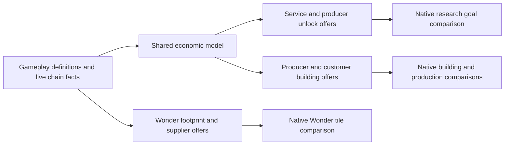

# CSC research and later-stage investment guidance

Problems 6.1, 7.1–7.2, 8.1, 9.1, 10.1–10.2, 11.1–11.2 and 12.1 are in scope for Bakers and Tailors. The strategy decisions in 6.2, 9.2 and 12.2 are deferred. The candidate reuses the native research, building and Wonder-site comparisons in CE. Gameplay SQL and the CE DLL are unchanged for this slice.

| Decision | Candidate policy | Evidence |
| --- | --- | --- |
| 6.1, 9.1, 12.1 Service unlock | Offer the one remaining topic when the producer, customer and authored material requirements are already met. Pool distinct chains and combine Housing at the receiving city before pricing it. | Offline tests cover gates, pooling and existing bids. Québec verified a Stage Manager bid, civic comparison and active effect. Earlier-stage cases remain open. |
| 7.1, 7.2 Stage 3 producer | From population 7, price the unlock against the expected exchange. From population 10, bid for the eligible building against other orders. Price working venues and the modeled local returns. | Offline tests cover the population gates, live eligibility and queued orders. Native Bakery construction verified. Unlock follow-through is open. |
| 8.1, 11.1 Customer building | Price an eligible mapped adjacent customer building for its operating producers, including unique replacements. Group links that share one customer order and round their population return together. | Tests cover shared recipients, population rounding and replacements. The native selectors applied targeted Market and Zoo bids. A different offered Market completed in ordinary production. |
| 10.1, 10.2 Stage 4 producer | Use the same population gates and require feasible Base and Specialty supply. Supplier readiness constrains material returns. Each distinct missing new improvement carries a share of a Builder's cost. | Offline tests cover missing or late supply, the charge cost, and repair. A treatment Café completed sooner. Humanism reached the civic comparison and completed at the same time in both arms. |
| 11.2 Wonder site | Use the existing native Wonder-site bid on adjacent owned tiles with viable Base and Specialty. Give more weight as each class becomes operational and preserve material protection. | Offline tests cover material admission and plot scoping. Live comparison, placement and exchange are open. |

Astra recommended pricing the effect of one physical queue order at a time through the existing ledger. The controlled replays will check how the applied bid competes with other research and production, then follow selection through to construction or a realised Service. The full games will keep Problem 3 supplier timing visible for both material classes.

## Fractal checkpoint from turn 150 to 165

Both arms reloaded the same verified ordinary save and used Steam GameCore build 26595377, the same CE package and identical gameplay content. The treatment differed in five existing CSC Lua files. The control retained the preceding CSC guidance for Problems 1–5. Both arms reached turn 165 and restored the local mod settings.

The treatment published 40 Stage 3 producer offers and 50 Stage 4 producer offers across the replay, with no later customer or research offers. Native queue receipts include Bakery and Café comparisons. Angkor Wat's Café score rose from 98,551 to 114,935 Q8 in one queue comparison. Both arms chose a Trader at turn 154. At turn 157 the treatment chose the Café, while the control chose a Theater Square project. The control first logged a Café production preference at turn 161. The treatment Café was complete at turn 165 on Bakers plot 2869 with working Flax and Berries. Its adjacent customer was the Stage 2 Granary, so this case qualifies producer construction while the later customer exchanges still need their own cases.

At Angkor Thom, the Bakery's queue comparison rose from 222,474 to 238,858 Q8. The Bakery appeared in the turn-153 production choice log and completed with 107.6 Production against an 80 cost on turn 154. Both arms built it. The treatment moved the Café ahead of the project while leaving the earlier Trader and this Bakery outcome intact.

| Working producers at turn 165 | Previous guidance | Combined candidate |
| --- | ---: | ---: |
| Stage 2 | 12 | 13 |
| Stage 3 | 7 | 7 |
| Stage 4 | 2 | 3 |

The 64-utility ceiling applied to 87 of 90 producer offers. Later replays retain the raw prices and per-building native receipts to assess calibration. Raw evidence is under `Desktop/Codex/csc-ai-stage6-12-20261121/fractal-150-165-v2`.

## Fractal checkpoint from turn 100 to 115

The treatment published 13 Stage 4 producer research offers for player 5's Humanism. The native civic comparison recorded five uses. The applied amounts ranged from 12,998 to 14,335 Q8. The stock goal stayed ahead at each comparison. In the last recorded comparison, Humanism was the immediate research step toward the higher-scoring goal. Both arms owned Humanism by the turn-113 observation. This is a representative research bid that reached the selector and deferred to ordinary priorities.

The same replay published 52 later building offers and recorded 22 exact building receipts. The passive Service observer read 33 gameplay effect attachments with no catalogue omissions. It verified one operating Storekeeper link for each of the 14 sampled turns in both arms. Raw evidence is under `Desktop/Codex/csc-ai-stage6-12-20261121/fractal-100-115`.

Astra identified Québec's ready Stage Manager as the clearest Service-unlock replay. The city starts with a working Fashion House, adjacent Amphitheater, Flax and Silver and still needs Opera and Ballet. A separate turn-200 Fractal checkpoint has a live Café at Bakers plot 1503 and an adjacent Entertainment Complex at 1576 missing a mapped customer building. These are the next targeted replay cases.

## Québec's Stage Manager from turn 250 to 265

The original turn-250 world already had the working Fashion House at 545, Flax at 544, Silver at 620 and the adjacent Amphitheater at 471. Québec's player lacked Opera and Ballet. Both arms preserved those facts and let the AI research normally.

The treatment published 14 Opera and Ballet offers worth 12,373 Q8 for this ready chain. The native civic receipt identified this topic in five publication windows. Several other civic goals stayed ahead. In the turn-263 receipt, Opera and Ballet was the stock and adjusted goal and the immediate step. Both arms owned the civic and activated the Stage Manager effect on the same Amphitheater at turn 264. The native Service watcher observed all 14 interior turns. This establishes delivery and actual operation for 12.1, with equal timing in the two arms.

Raw evidence is under `Desktop/Codex/csc-ai-stage6-12-20261121/quebec-250-265`.

## Missing customers from turn 200 to 215

The ordinary replay kept the Café at plot 1503 and Entertainment Complex at 1576 intact. Neither arm built the mapped Zoo, and the treatment offered no bid on that venue. A controlled replay can supply its Arena prerequisite and verify the Zoo's immediate eligibility before judging delivery.

The same treatment found a different opportunity for player 5's Market. It published 12 customer offers worth 16,384 Q8 each against a raw estimate of 26,940 Q8. Native receipts show both queue and ordinary nominations applied to that Market. The Market remained out of production during the sample, so the controlled Market replay exercises selection and the realised exchange separately.

The CSC publisher averaged 2.046 seconds per turn in control and 2.097 seconds in treatment over 15 complete measurements. Maximums were 2.502 and 2.330 seconds respectively. This short replay measures the whole publisher during each world’s play. The ordinary campaign will measure longer-run overhead. Raw evidence is under `Desktop/Codex/csc-ai-stage6-12-20261121/entertainment-200-215`.

## Early research and the controlled Market rebuild

In the turn-50 trial both arms received the same missing Water Mill at Bakers plot 2497. The preparation verified two working Base suppliers, its adjacent Granary and unowned Feudalism and Guilds. The treatment sent and reached the native comparisons for both topics. Feudalism completed and Storekeeper activated at another intact Quarter for the same player on turn 71 in both arms. Both prepared suppliers had stopped working by the turn-72 census. The Guilds receipt on turn 71 identifies it as the immediate step toward a longer goal. The replay ended before it recorded the completed civic.

In the Market fixture, removing the Stage 3 customer at plot 913 removed both observed population payments. The treatment's exact offer reached both building selectors in player 5's city, and neither arm rebuilt this Market by turn 215. The same treatment offered a Market in Mahendraparvata, where CE applied the bid in the production selector and the queue finished the Market on turn 205. The control also built that Market. The ordinary campaign now logs positive population-payment quantities for both sides of each assembled Stage 3 and 4 exchange.

Raw evidence is under `Desktop/Codex/csc-ai-stage6-12-20261121/storekeeper-50-72` and `market-200-215-v2`.

## Legal Zoo and Wonder qualification

Adding only the missing Arena on both copies made the Zoo eligible at the Entertainment Complex beside the Café. The treatment then made 15 offers for that exact Zoo. Three receipts show a queue write, and two show a write in the ordinary nomination selector. Both cities still pursued other work through turn 215. This verifies delivery for 11.1 while leaving construction and payment open. Keep the current 64-utility cap while observing more opportunities.

The same archived map had no admissible Bolshoi footprint beside a Tailors layout with both material classes in the Wonder scout. That case ended before any placement score comparison. The ordinary runs will record Wonder placement and exchange quantities and provide new candidate worlds for a matched placement case. Raw evidence is under `Desktop/Codex/csc-ai-stage6-12-20261121/zoo-200-215` and `wonder-200-220`.

The Sacristan trials lacked a valid starting opportunity. The first city's adjacent plots did not admit a Holy Site. The second archive already had Divine Right for the player with a supplied Tailors and Temple. Both setups ended before editing a copy. Keep 9.1 open and look for unowned topics in the ordinary samples.

## Preselected full-game pairs

Each pair uses a fresh Small Online game through turn 250 on the shared controller, with the same map and game seed, gameplay and UI mods, and pinned Firaxis GameCore and CE build. The control retains CSC gameplay with guidance and private customer adjacency disabled. The treatment runs the integrated CSC policy. Both use stock AI. Seeds are fixed before qualification begins.

| Map | Map seed | Game seed |
| --- | ---: | ---: |
| Continents | 793412556 | 1390346751 |
| Fractal | 28111119 | 38111119 |
| Pangaea | 27061117 | 37061117 |

Report placement, suppliers, producer and customer completions, Wonders, working exchanges, active Service turns, unlock timing, missed opportunities, competing work and guidance processing time for each pair. Count Service duration from active native effects on specific recipients.

Campaign artifacts and the frozen package are under `Desktop/Codex/csc-ai-stage6-12-20261121/campaign`.

## Continents through turn 250

Both games matched the opening map, roster, start plots and units and reached the endpoint. The stock arm kept CSC gameplay and withheld the publisher and private customer placement bonuses. Both arms sampled 200 shared Service turns. The UI watcher omits a number of controller handoff turns, so the table reports active links only on shared clocks.

| Turn-250 count | Bakers stock | Bakers combined | Tailors stock | Tailors combined |
| --- | ---: | ---: | ---: | ---: |
| Completed Quarters | 13 | 14 | 13 | 3 |
| Working Base supplier links | 2 | 15 | 1 | 3 |
| Working Specialty supplier links | 0 | 3 | 0 | 0 |
| Stage 2 / 3 / 4 working producers | 11 / 8 / 5 | 13 / 11 / 3 | 9 / 8 / 6 | 3 / 1 / 1 |
| Stage 2 / 3 / 4 working customer hosts | 4 / 0 / 0 | 12 / 7 / 1 | 0 / 1 / 2 | 0 / 2 / 3 |
| Stage 2 physical exchange pairs | 3 | 12 | 0 | 0 |
| Stage 3 / 4 exchanges with positive quantities on both sides | 0 / 0 | 5 / 0 | 0 / 0 | 1 / 1 |
| Active Stage 2 / 3 / 4 Service link-turns | 54 / 0 / 0 | 801 / 154 / 0 | 0 / 0 / 0 | 0 / 47 / 0 |

The combined arm observed 11 distinct Storekeeper, six Innkeeper and one Sacristan links. A Tailors Fashion House at 2692 paid an adjacent Amphitheater at 2693 in both directions at the endpoint. Both arms had zero mapped Wonder customer links. The combined arm published 590 later building offers and logged 234 exact receipt rows. This seed produced no later producer or Service research offers and no Wonder offers. The combined publisher's wall time averaged 1.195 seconds and reached a maximum of 2.887 seconds across 250 publications. The separately timed managed native scoring averaged 14.13 milliseconds and reached 27.97 milliseconds.
